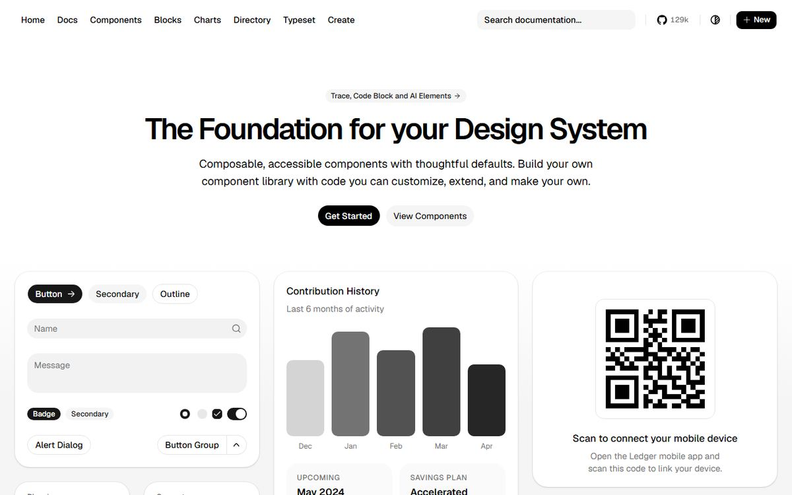
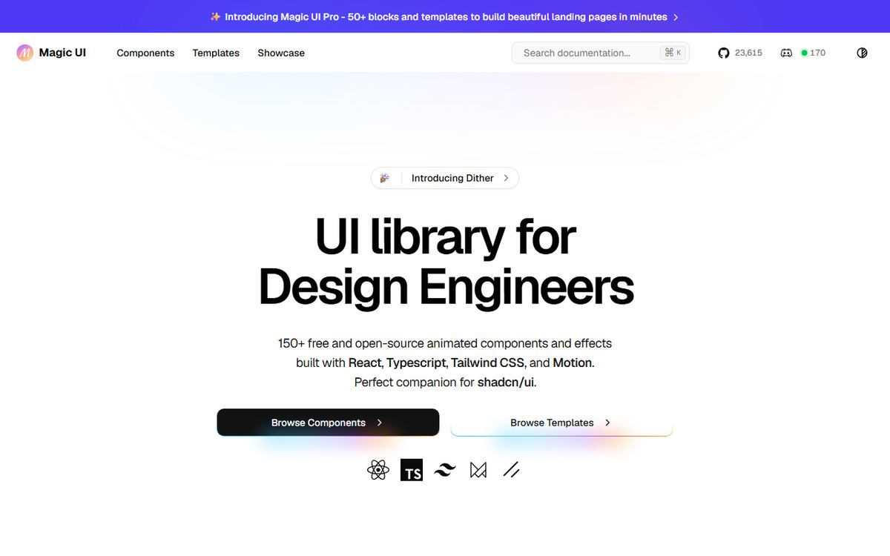
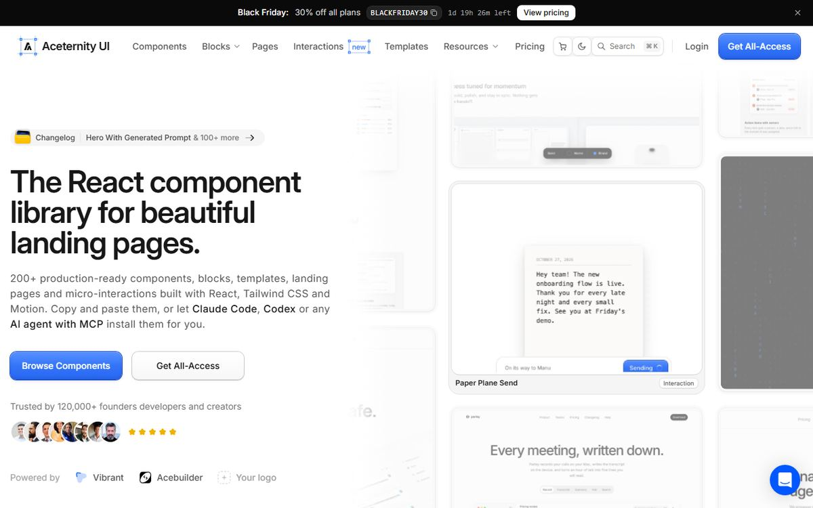
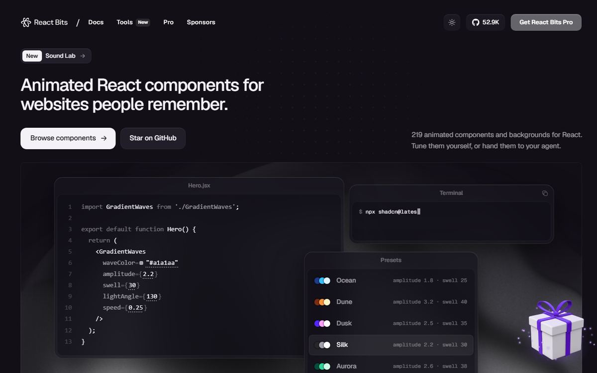
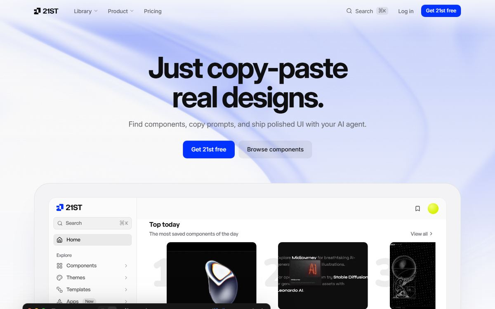
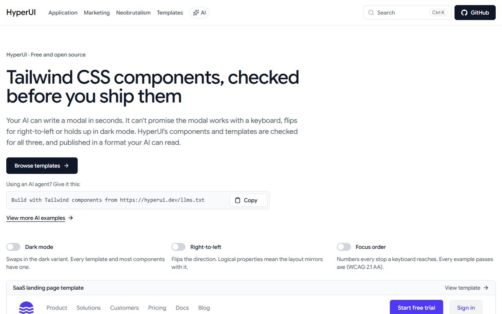
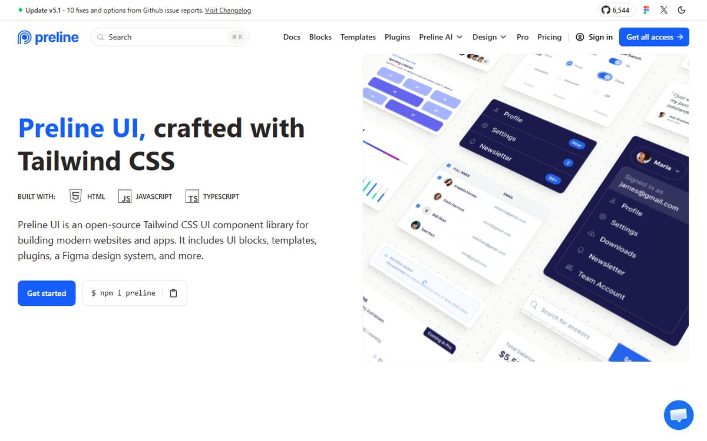
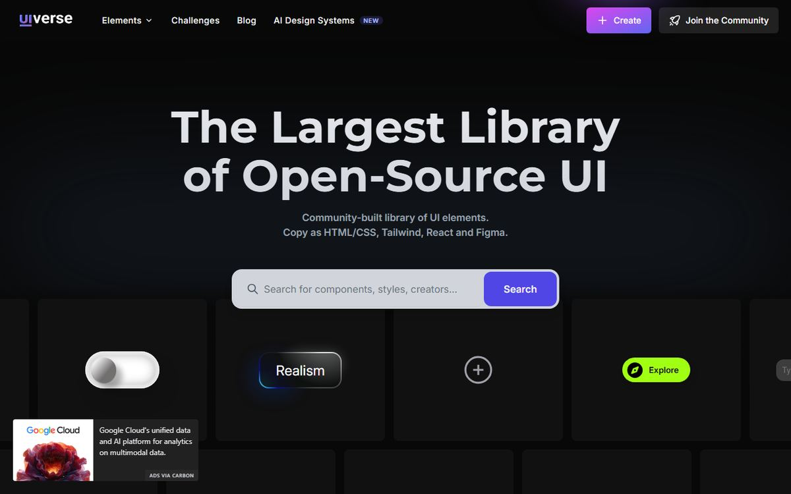

You know the feeling. The backend works, the API returns clean JSON, and then you open a blank file to build the landing page. Two hours later you are still nudging a button's border radius.

Copy-paste UI libraries exist to end that loop. Instead of installing a heavy package and fighting its defaults, you grab the component code, drop it into your project, and edit it like any other file. It is your code from the first minute.

This guide covers 27 free copy-paste UI libraries for developers. Most lean on Tailwind CSS or plain CSS, many are open source, and a few are built mainly for animation. I have grouped them by what they are actually good at, added a comparison table, included real screenshots of the main homepages, and finished with tips for picking one without regretting it three weeks later.

## What Is a Copy-Paste UI Library?

A copy-paste UI library is a collection of ready-made interface components (buttons, navbars, pricing tables, hero sections, animated cards) that you copy straight into your codebase instead of installing as a locked dependency. You get the source code, so you can change markup, styling and behavior without overriding a package's internals.

The approach became popular with shadcn/ui, which pairs a command line tool with component source files that land inside your own repository. Many newer libraries on this list borrow the same idea.

## Why Developers Prefer Copy-Paste Components

There are good reasons this pattern keeps growing:

* **You own the code.** No waiting for a maintainer to fix a bug or expose a prop.
* **Smaller bundles.** You ship only the components you actually use.
* **Easier theming.** Colors, spacing and typography live in your own CSS or Tailwind config.
* **Better for AI-assisted coding.** Local component files are easy for coding agents and editors to read, extend and refactor. If you are exploring that workflow, our guide to [AI coding agents explained](https://f9xr.org/dev9b/p/ai-coding-agents-explained/) is a good companion read.
* **Fewer breaking upgrades.** There is no major version bump that rewrites your UI overnight.

The trade-off is real too. You are responsible for updates, accessibility checks and consistency. We will come back to that in the tips section.

## What We Learned Using Them on Real Projects

We have rebuilt several F9XR landing pages and internal dashboards with this model, and it held up best when we treated pasted components as a starting point rather than a finished product. On one dashboard rebuild we started from shadcn/ui primitives, kept a single `components/ui` folder, and moved every color and radius into CSS variables before the second screen. That one decision meant a later brand refresh took an afternoon instead of a week.

The failures were predictable too. A hero section copied from an animation-heavy library looked great on a fast laptop and stuttered on a mid-range phone until we capped the effect and respected `prefers-reduced-motion`. Pasted forms also shipped without proper labels until we ran a keyboard pass. The lesson is simple: the copy is free, the review is not.

## Quick Comparison of the Most Popular Picks

| Library | Open source | Stack focus | Best for |
|---|---|---|---|
| [shadcn/ui](https://ui.shadcn.com) | Yes | React, Tailwind CSS | Production app foundations |
| [Magic UI](https://magicui.design) | Yes | React, Tailwind CSS, motion | Animated landing pages |
| [Aceternity UI](https://ui.aceternity.com) | Listed as free | React, Tailwind CSS, motion | Eye-catching hero sections |
| [React Bits](https://www.reactbits.dev) | Check site | React, CSS or Tailwind variants | Creative animated effects |
| [21st.dev](https://21st.dev) | Yes | React, Tailwind CSS | Browsing community components |
| [HyperUI](https://www.hyperui.dev) | Yes | HTML, Tailwind CSS | Framework-free marketing blocks |
| [Preline](https://preline.co) | Yes | Tailwind CSS | Admin dashboards and forms |
| [Uiverse](https://uiverse.io) | Community driven | HTML, CSS, Tailwind | Buttons, loaders, toggles |
| [Origin UI](https://originui.com) | Yes | React, Tailwind CSS | Polished form and input components |
| [KokonutUI](https://kokonutui.com) | Yes | React, Tailwind CSS | Modern shadcn-style add-ons |
| [Bundui](https://bundui.io) | Yes | React, Tailwind CSS | Dashboard and admin blocks |
| [HextaUI](https://hextaui.com) | Yes | React, Tailwind CSS | Extending shadcn/ui |
| [Hover.dev](https://www.hover.dev) | Partly paid | React, Tailwind CSS, motion | Interactive UI details |

Licensing and pricing change, so always confirm on each site before using components in client or commercial work.

## Screenshots of the Main Copy-Paste UI Libraries

A component library is only as good as the design language it gives you. These homepage screenshots were captured in November 2026 and show what the most popular options actually look like before you install anything.










Screenshots are shown for illustration and comparison only. All product names, logos and trademarks belong to their respective owners.

## The Main Libraries, Explained

### shadcn/ui: The Reference Point

[shadcn/ui](https://ui.shadcn.com) is not a traditional component package. You run its command line tool, pick a component, and the source file is added to your project. It builds on Tailwind CSS and accessible [Radix UI](https://www.radix-ui.com) primitives, which is why so many other libraries on this list are described as "shadcn compatible." The [shadcn/ui documentation](https://ui.shadcn.com/docs) covers the CLI setup in detail.
```bash
npx shadcn@latest init
npx shadcn@latest add button
```

If you only learn one library from this article, make it this one. The rest of the ecosystem keeps orbiting around it.

### Magic UI: Animation Without the Headache

[Magic UI](https://magicui.design) focuses on animated components such as marquees, text effects, bento grids and shiny buttons. It is a strong choice when you want a product landing page to feel alive without writing keyframes by hand.

### Aceternity UI: Bold Hero Sections

[Aceternity UI](https://ui.aceternity.com) is known for dramatic visual blocks like spotlight effects, animated backgrounds and 3D style cards. Use it sparingly. One standout section beats five competing ones.

### React Bits: Creative Effects for React

[React Bits](https://www.reactbits.dev) offers animated backgrounds, text animations and interactive elements. It is great when you want personality in a portfolio or a startup homepage.

### 21st.dev: A Community Marketplace

[21st.dev](https://21st.dev) works more like a discovery hub. Designers and developers publish components, and you browse, preview and copy what fits. It is a handy place to search when you know the component you need but not the library that has it.

### HyperUI: Plain HTML and Tailwind CSS

[HyperUI](https://www.hyperui.dev) gives you free Tailwind CSS blocks you can paste into any HTML file. No React needed. That makes it useful for static sites, server rendered templates and quick prototypes.

### Preline: Interactive Tailwind Components

[Preline](https://preline.co) covers a wide range of Tailwind based components, including forms, tables, navigation and dashboards. Interactive pieces rely on a small JavaScript layer, so read its setup notes before dropping components into a framework project.

### Uiverse: Tiny Elements With Big Personality

[Uiverse](https://uiverse.io) is a community gallery of single elements: loaders, switches, cards, checkboxes and buttons. You can usually grab the HTML and CSS directly. It is perfect when you need one clever component, not a full design system.

### Origin UI, HextaUI, Bundui and KokonutUI: The shadcn Extension Family

[Origin UI](https://originui.com), [HextaUI](https://hextaui.com), [Bundui](https://bundui.io) and [KokonutUI](https://kokonutui.com) follow the shadcn style approach with extra components, blocks and templates. They are a quick way to fill gaps such as advanced inputs, dashboards and pricing sections. Because projects in this space move fast, check each site for its current status and install instructions.

### Hover.dev: Interactive Details

[Hover.dev](https://www.hover.dev) is known for animated, interactive components. A few of its components are paid, so read the licensing notes before you build a product around one.

### Chakra Framer: For Chakra UI Projects

[Chakra Framer](https://chakraframer.com) is aimed at teams already using Chakra UI. If your project is built on Chakra, this saves you from translating Tailwind examples by hand.

### Tailus HTML: Tailwind Blocks for Plain HTML

[Tailus HTML](https://html.tailus.io) provides Tailwind based blocks written in plain HTML. Like HyperUI, it suits static sites and projects without a JavaScript framework.

## More Libraries Worth Bookmarking

Each of these is on the community list of free copy-paste resources. Open a few, scan the component categories and see which design language matches your project.

* [UI Layouts](https://www.ui-layouts.com) (open source)
* [Eldora UI](https://www.eldoraui.site) (open source)
* [Cuicui](https://cuicui.day) (open source)
* [Indie Starter UI](https://ui.indie-starter.dev) (open source)
* [Fancy Components](https://www.fancycomponents.dev) (open source)
* [Ground UI](https://ground.bossadizenith.me) (open source)
* [React Components](https://reactcomponents.com) (open source)
* [Just D](https://getjustd.com) (open source)
* [Flash UI](https://flashui.site)
* [LN Dev UI](https://ui.lndev.me)
* [Ever UI](https://www.ever-ui.com)
* [Atomix UI](https://atomix-ui.vercel.app)

Some of these are younger projects. Treat them as inspiration and a source of ideas first, and check activity on their repositories before betting a long running product on them.

## How to Choose the Right Library

Ask these questions in order:

1. **What is your stack?** React with Tailwind opens almost every door. Plain HTML narrows you to HyperUI, Tailus HTML and Uiverse style sources.
2. **How much animation do you really need?** Magic UI, Aceternity UI and React Bits shine here. For dashboards and internal tools, calmer libraries like Preline or the shadcn family are easier to maintain.
3. **Is it open source?** Open source gives you license clarity and a repository you can inspect.
4. **Does the style match your brand?** Mixing three visual languages makes a site look stitched together. If you need a starting point, our roundup of [UI and UX design inspiration resources](https://f9xr.org/dev9b/p/best-ui-ux-design-inspiration-resources/) shows how to study real sites without copying them.
5. **Is it still maintained?** Look at recent commits, open issues and release notes.

## Practical Tips Before You Paste

* **Check the Tailwind version.** Some snippets assume a specific setup, and the [Tailwind CSS documentation](https://tailwindcss.com/docs) is the fastest way to confirm the syntax. A version mismatch is the most common reason a pasted component looks broken.
* **Install only the dependencies you need.** Animated components often rely on a motion library such as [Motion for React](https://motion.dev). Add it once and reuse it.
* **Respect reduced motion.** Wrap heavy animations in a `prefers-reduced-motion` check so users who need calm interfaces are not punished by your parallax hero.
* **Test accessibility.** Tab through every interactive component, check focus rings and confirm color contrast. Copying code does not copy accessibility guarantees. The [WCAG overview from the W3C](https://www.w3.org/WAI/standards-guidelines/wcag/) is the reference to keep open.
* **Measure performance.** Run Lighthouse after adding animated sections. Heavy effects can hurt Core Web Vitals, which affects SEO.
* **Normalize your design tokens.** Move colors, radii and spacing into variables or your Tailwind config so pasted components inherit one consistent look. If an AI agent writes code for you, our explainer on [design system files for AI agents](https://f9xr.org/dev9b/p/what-is-getdesign-md-ai-agents-design-system/) shows how to make those tokens stick.
* **Pair components with one icon set.** A mixed bag of icon styles is the fastest way to make a polished component look amateur. Our comparison of [Lucide vs Font Awesome](https://f9xr.org/dev9b/p/lucide-vs-font-awesome/) covers choosing an icon library that fits your stack.
* **Keep a components folder with notes.** Write down where each component came from and its license. Future you will say thank you.
* **Avoid the template look.** Generic gradients and identical card grids give your site away. Our walkthrough on [how to de-AI-slop your website design](https://f9xr.org/dev9b/p/how-to-de-ai-slop-website-design/) shows how to fix that.

## Common Mistakes to Avoid

* Pasting an entire landing page template and changing only the logo.
* Stacking five animated effects in one viewport. If you are adding a 3D or WebGL centerpiece, our [Three.js landing page guide](https://f9xr.org/dev9b/p/setup-threejs-models-landing-page/) explains how to keep it from becoming a performance problem.
* Ignoring licenses on paid or partly paid components.
* Mixing component libraries that fight over global CSS.
* Forgetting to compress images and lazy load media inside fancy hero sections.

## Frequently Asked Questions

### What is the best free copy-paste UI library for React?

shadcn/ui is the most widely adopted starting point for React projects because it gives you accessible, editable components built on Tailwind CSS. Magic UI and React Bits are strong additions when you want animation, and 21st.dev helps you discover community components.

### Are copy-paste UI libraries really free?

Most libraries on this list are free to use, and many are open source. A few, such as Hover.dev, include some paid components. Always read the license and pricing page before using code in client or commercial projects.

### Can I use these libraries without React?

Yes. HyperUI and Tailus HTML provide Tailwind CSS components in plain HTML, and Uiverse offers HTML and CSS snippets. These work well for static sites and server rendered pages.

### What is the difference between a copy-paste library and a component library like Material UI?

A traditional component library is installed as a dependency, and you customize it through its API and theme. A copy-paste library adds the component source files to your own project, so you edit the code directly and control updates yourself.

### Do copy-paste components hurt SEO or performance?

They can if you overuse heavy animations or large background effects. Keep semantic HTML, optimize images, respect reduced motion preferences and test with Lighthouse to protect Core Web Vitals.

### Do I need Tailwind CSS to use these libraries?

Most modern copy-paste libraries are built with Tailwind CSS, but not all. Some offer plain CSS or HTML versions. Check each library's installation page to see what it expects.

## Key Takeaways

* Copy-paste UI libraries give you component source code you fully own and can edit.
* shadcn/ui is the best foundation for React, and many other libraries extend or follow its approach.
* Magic UI, Aceternity UI and React Bits are ideal for animation heavy landing pages.
* HyperUI, Tailus HTML and Uiverse work well when you want plain HTML and CSS.
* Confirm the license, Tailwind version and maintenance status before you paste anything.
* Protect accessibility and performance by testing keyboard navigation, contrast and Lighthouse scores.

## Conclusion

The best library is the one that disappears into your project. Start with a solid base like shadcn/ui, add one animation focused library for personality, and keep a short list of utility sources such as HyperUI and Uiverse for those odd one off components. Build a small component library of your own from what you collect, and your next landing page will take an afternoon instead of a week.

Know a library that should be on this list? Share it in the comments and we will keep updating this guide. If you want to help improve this article or suggest another resource, read the [Contributor Guide](https://f9xr.org/dev9b/contribute/) and the [Editorial Policy](https://f9xr.org/dev9b/editorial-policy/) that govern everything we publish. This article was drafted with AI assistance and reviewed by the F9XR Team before publishing.
