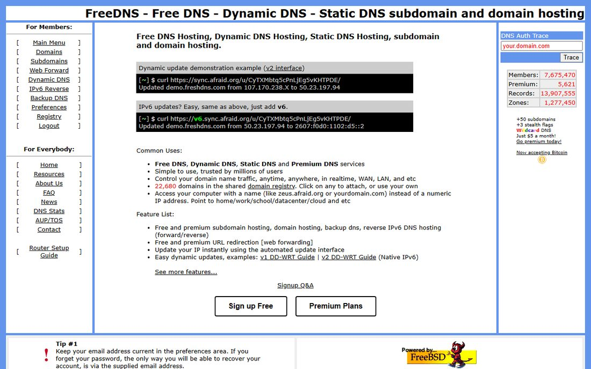
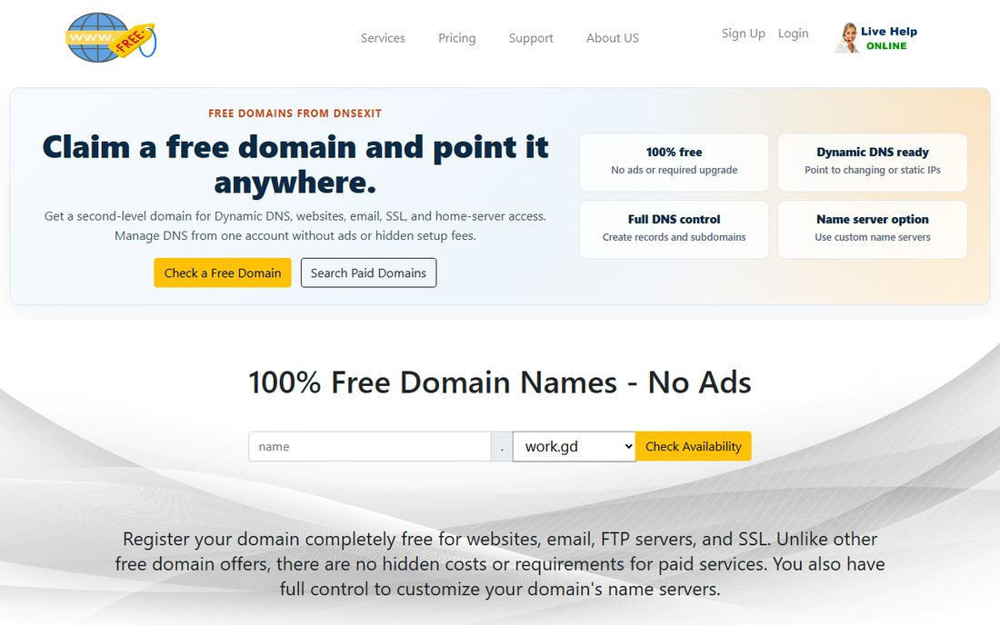
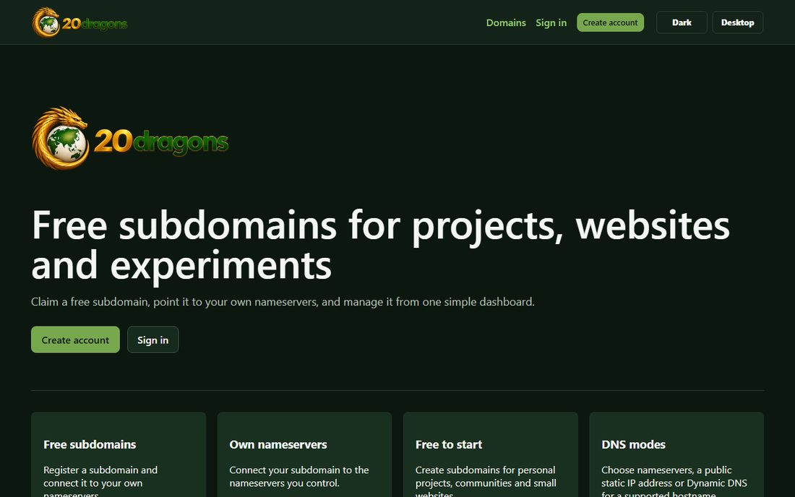
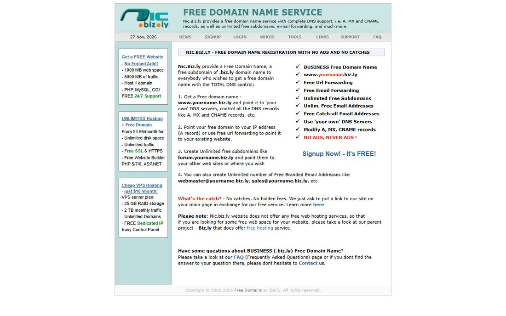
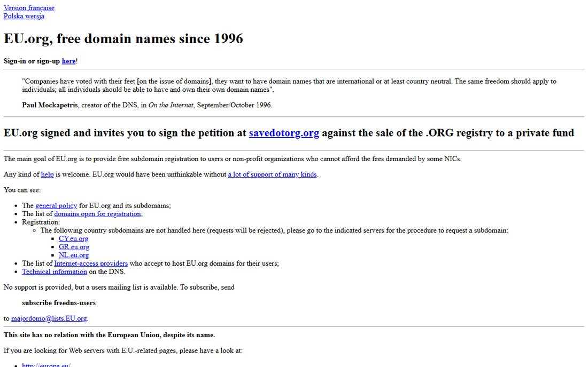
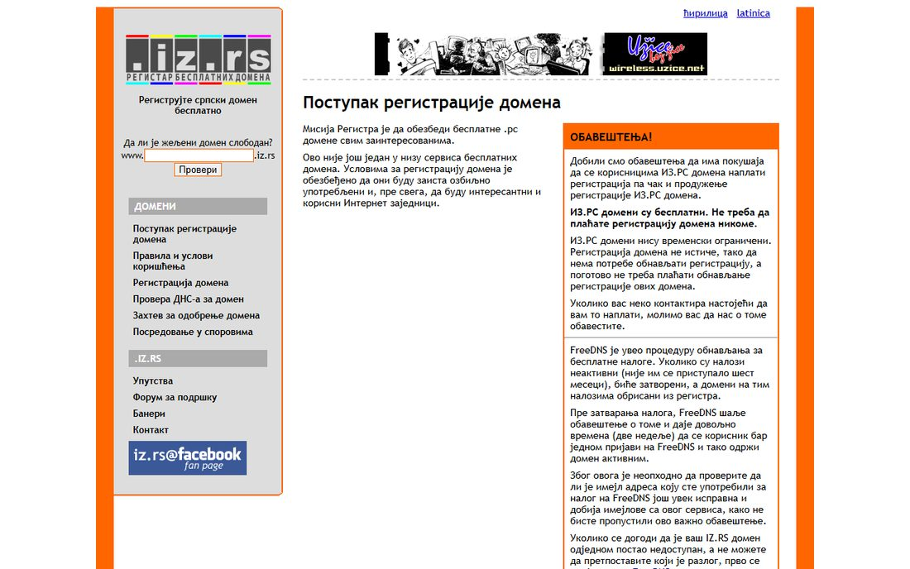

You have an idea, a handful of early customers, and a bank balance that makes every subscription feel like a big decision. A domain name costs very little next to most business expenses, yet when you are bootstrapping, even a small yearly fee can feel like something to delay.

So the question comes up on almost every founder forum: can you launch a real business site on a free domain?

The honest answer is yes, with conditions. Free domains and subdomains have existed for decades. Some services are run by respected volunteers, some by commercial DNS companies, and some by hobbyists who may vanish next year. Picking the right one, and knowing when to graduate to a domain you own, is the difference between a smart launch and a painful rebuild.

This guide covers eight providers for free domains for your small startup, explains how free domains actually work, lays out the SEO and trust risks, and gives you a setup plan you can finish in an afternoon. Every provider was checked against its own official page on November 26, 2026, and the screenshots were captured on November 27, 2026. Where we could not verify something, we say so.

> **TIP** — Quick answer
>
> The best free options for a startup with no budget are FreeDNS (afraid.org) for flexible subdomains and dynamic DNS, FreeDomain.one for free names with full DNS control and free SSL, EU.org for a long-running free subdomain registry, and 20dragons for subdomains with your own nameservers. Treat all of them as a launchpad, not a permanent home for your brand.
>

## Free Domain vs Free Subdomain: What You Actually Get

Before you compare providers, you need one distinction that most listicles skip.

A **domain** is the name you register through a registrar, such as `yourbrand.com`. You pay yearly, and you own the registration for as long as you renew it.

A **subdomain** is a name that lives under someone else's domain, such as `yourbrand.provider.org`. The provider owns the root, and you control only your piece of it.

Free services fall into three models:

1. **Shared root subdomains.** You pick a name under a root the provider already owns. FreeDNS, nic.biz.ly, FreeDomain.one, and 20dragons work this way.
2. **Registry style subdomains.** A volunteer registry delegates a subdomain to your own nameservers. EU.org and IZ.RS follow this model.
3. **Instant DNS records.** A tool creates a hostname that points at an IP address and nothing else. ipq.co is the example here.

For a startup, the model matters more than the brand name. It decides whether you can set up business email, whether you can switch hosts, and whether you can ever take the name with you when you outgrow it.

## How We Evaluated Each Provider

We looked at the same questions for every service:

- **DNS control:** Can you set A, CNAME, MX, and TXT records, or use your own nameservers?
- **Email support:** Can you receive mail on the domain, or only forward it?
- **Rules and approval:** Does the provider require real content, a backlink, or a specific country?
- **Longevity:** How long has it operated, and what happens if you stop logging in?
- **Business fit:** Is the name something a customer would trust?

## Quick Comparison Table

| Provider | Type | What you get | Key catch |
| --- | --- | --- | --- |
| FreeDNS (afraid.org) | Shared subdomains plus DNS hosting | Free subdomains on a large shared registry, dynamic DNS, web forwarding | Premium plan needed for extras such as wildcard DNS |
| FreeDomain.one | Shared root names | Free names, custom nameservers, free SSL, free email plan | Names sit under shared roots like publicvm.com |
| 20dragons | Shared subdomains | Free subdomains, own nameservers, static IP or dynamic DNS modes | Available roots are listed after sign up |
| nic.biz.ly | Subdomain of biz.ly | Full DNS support, free email forwarding, unlimited sub-subdomains | Link back to their site required |
| EU.org | Volunteer registry | Free subdomain delegated to your nameservers | No support, strict policy, slow reviews reported |
| IZ.RS | Serbian free registry | Free `.iz.rs` name with your own DNS | Serbia link and active content required |
| ipq.co | Instant DNS record | A record to an IP address | Not suited for business use |
| serverthuis.com | Unverified | Dutch language subdomain check page | We could not verify the terms |

## The Providers, Reviewed

### 1. FreeDNS (freedns.afraid.org)

[FreeDNS](https://freedns.afraid.org/) is one of the most established services of its kind. At the time of writing, the homepage shows roughly 7.6 million members, over 13.9 million DNS records, and more than 22,000 domains in its shared registry that you can attach a subdomain to. You can also host DNS for a domain you own at no cost.

You get static DNS, dynamic DNS, web forwarding, and IPv6 reverse DNS. A premium plan at five dollars a month adds more subdomains and wildcard DNS.

*Screenshot: the FreeDNS homepage lists 7.6 million members and 22,680 shared domains, captured November 27, 2026.*

**Best for:** Startups that want flexibility, a track record, and the ability to move their DNS to a real domain later without changing providers.

**Watch out for:** Shared registry domains vary in reputation. Choose a clean looking root, and keep your account email current, because it is the only recovery route.

### 2. FreeDomain.one

[FreeDomain.one](https://freedomain.one/) is run by a company that describes itself as an ICANN accredited registrar serving customers since 1998. It offers free names under shared roots such as publicvm.com, jo3.org, run.place, 2bd.net, linkpc.net, and work.gd. You can use custom nameservers, point the name at a static or changing IP, and get wildcard SSL certificates valid for 90 days with renewal scripts. There is also a business email plan that starts free.

*Screenshot: FreeDomain.one advertises free names, full DNS control and no ads, captured November 27, 2026.*

**Best for:** Founders who need a working website, SSL, and email under one account without paying upfront.

**Watch out for:** The shared roots are not brand friendly, and the site's wider business model includes paid hosting and domains, so read each upsell carefully before clicking.

### 3. 20dragons

[20dragons](https://www.20dragons.com/) offers free subdomains for projects, websites, and experiments. You register a name, then choose how it resolves: your own nameservers, a public static IP address, or dynamic DNS for supported hostnames. Everything is managed from one dashboard, and documentation is available on its docs site.

*Screenshot: 20dragons pitches free subdomains with your own nameservers, captured November 27, 2026.*

**Best for:** Testing a landing page or a minimum viable product while keeping DNS under your control.

**Watch out for:** It is a newer looking service with little public history, so keep a backup plan and do not build a customer facing brand on it.

### 4. nic.biz.ly

[Nic.Biz.ly](https://nic.biz.ly/) offers a free subdomain such as `yourname.biz.ly` with A, MX, and CNAME records, URL forwarding, unlimited sub-subdomains, and free branded email addresses like `sales@yourname.biz.ly`. The service has been running since 2002 and says it never injects ads.

The catch is stated openly: they ask you to place a link to their site on your main page. The directory at getfreedomain.name also reports stricter quality expectations for this namespace, so read the current rules before applying.

*Screenshot: nic.biz.ly explains its free domain service and the required link back, captured November 27, 2026.*

**Best for:** A small local business that wants branded email addresses at no cost and does not mind the backlink.

**Watch out for:** The `.biz.ly` suffix is unusual, and customers may hesitate to type it.

### 5. EU.org

[EU.org](https://nic.eu.org/) has offered free subdomain registration since 1996. Despite the name, it has no relation to the European Union. Its stated goal is to help individuals and non-profits who cannot afford the fees demanded by some registries. You delegate the name to your own nameservers, so you need a DNS host first, and FreeDNS or Cloudflare can fill that role.

No support is provided apart from a user mailing list, and users in public forums report that new requests can take a long time. We could not confirm current turnaround times.

*Screenshot: EU.org still runs the same plain page it has used for years, captured November 27, 2026.*

**Best for:** Non-profits, community projects, and founders who value longevity over convenience.

**Watch out for:** Read the general policy first, because it is aimed at individuals and non-profits, and a commercial startup should confirm that its use is acceptable.

### 6. IZ.RS

[IZ.RS](https://www.iz.rs/postupak_registracije) gives you a free `yourname.iz.rs` name, managed through a FreeDNS account. Its own registration page states that the domains are free, that they do not expire, and that anyone asking you to pay is not the registry.

The rules are strict. Your site needs real, original content within 24 hours or the domain can be deleted without warning. You must request approval after 15 days and no later than 30 days, and your FreeDNS account must be accessed at least once every six months. A third party directory also notes that the service expects an affiliation with Serbia.

*Screenshot: IZ.RS publishes its approval rules and account activity requirements in Serbian, captured November 27, 2026.*

**Best for:** Serbian or regional businesses that want a country coded name.

**Watch out for:** The approval process can remove a domain if your site does not meet the conditions.

### 7. ipq.co

[ipq.co](https://www.ipq.co/) creates a DNS record for an IP address instantly. You enter an IP and a name, and you receive `name.ipq.co` or a name under `fdns.uk`. According to the getfreedomain.name directory, once assigned you cannot change the IP or remove the entry.

**Best for:** Quick technical tests only.

**Watch out for:** Skip it for anything customer facing. Fixed IP only, no email, no flexibility.

### 8. serverthuis.com

The link you supplied points to a Dutch language page for checking a subdomain (`subdomeincontroleren`). The site blocks automated access, and we could not independently verify its terms, supported records, or longevity. Until you have confirmed the rules yourself, treat it as unverified and do not rely on it for a business.

## Extra Options From the getfreedomain.name Directory

The [getfreedomain.name](https://www.getfreedomain.name) list also tracks other namespaces, including `.is-a.dev`, `.js.org`, `.zone.id`, `.us.kg`, and `.nom.za`. Several of these are developer focused or country specific. If you build software, our guide to [14 free subdomain providers for developers](https://f9xr.org/dev9b/p/free-subdomains-for-developers-list/) covers them in detail, including is-a.dev, JS.ORG, DNSHE, Zone.ID, and the free `.pp.ua` zone.

## Which Free Domain Fits Your Small Startup?

Use this decision shortcut:

| Your situation | Best fit |
| --- | --- |
| You need free DNS hosting now and a domain later | FreeDNS |
| You want SSL and email in one account | FreeDomain.one |
| You are testing a landing page this week | 20dragons or FreeDNS |
| You want branded email addresses on a free name | nic.biz.ly |
| You run a non-profit or community project | EU.org |
| You serve a Serbian audience | IZ.RS |
| You need a quick server test | ipq.co |

If you are running a home server or a small internal tool, pair the free name with a dynamic DNS updater. The [noip.at DynDNS setup guide](https://f9xr.org/dev9b/p/noipat-dyndns-what-is-it-setup-guide/) walks through the client side, and the [Hurricane Electric free DNS guide](https://f9xr.org/dev9b/p/hurricane-electric-free-dns-setup-guide/) shows how to host the zone itself.

## The Real Business Risks of Free Domains

This is the section most free domain lists leave out, and it is the one that protects your revenue.

**You do not own the root.** The provider can change rules, suspend your subdomain, or close the service. Your customers, backlinks, and email history all live on a name you cannot take with you.

**Search trust is weaker.** A free subdomain can be indexed and can rank, but a shared root with a mixed reputation can drag on trust. Google evaluates site quality, expertise, and trust signals, and a name you own is easier to build those on. Our [Hugo SEO checklist](https://f9xr.org/dev9b/p/hugo-seo-guide/) covers the on-page signals you control, and the [anycast DNS explainer](https://f9xr.org/dev9b/p/anycast-dns-what-is-it-setup-guide/) helps when you later move to a faster DNS setup.

**Email deliverability suffers.** Free roots are abused by spammers, and mail from them is more likely to hit spam folders. If email drives your sales, do not use a free subdomain for it. A paid domain with routing, such as the setup in our [Cloudflare Email Routing guide](https://f9xr.org/dev9b/p/cloudflare-email-routing-custom-addresses/), is safer.

**Public Suffix List status.** Domains listed on the [Public Suffix List](https://publicsuffix.org/) get isolated cookies and better browser security. Unlisted shared roots can have limits, which is why some services cannot offer custom nameservers.

**Customers judge the address.** A name like `yourshop.work.gd` looks temporary. For a local business, that can cost trust at the moment someone decides whether to call you.

**AI search visibility.** Tools such as ChatGPT, Gemini, Perplexity, and Claude tend to cite sources they can identify as stable, authoritative entities. A throwaway address makes entity consistency harder, and a weak address is one more reason for an assistant to pick a competitor it can verify.

> **WARNING** — Do not take payments on a borrowed name
>
> If you collect card details, run ads, or send invoices, buy the domain first. A free subdomain is fine for validating demand, not for handling money.
>

## Step by Step: Launch on a Free Domain the Smart Way

1. **Start with a free DNS host.** Create a FreeDNS account, or use another free DNS service, so you control records from day one.
2. **Pick a name you can keep.** Choose the name you would want on a paid domain later, so your brand does not change when you upgrade.
3. **Add the records.** Use an A record for an IP address or a CNAME for a hosting platform, then add an MX record only if the provider supports email on that name.
4. **Enable HTTPS.** Use a free certificate, such as Let's Encrypt or the SSL option from your provider, and confirm the padlock appears.
5. **Connect analytics and Search Console.** Verify the site early so you collect data you can migrate later.
6. **Document everything.** Keep a copy of every DNS record, so you can rebuild in minutes.

## When to Stop Using a Free Domain

Upgrade when any of these becomes true:

- You take payments or collect customer data.
- You send marketing or transactional email.
- You print the address on packaging, vehicles, or cards.
- You run paid ads or want a Google Business Profile with a trusted website link.
- You have your first steady revenue, even a small amount.

When that day comes, buy the domain, redirect the old address with a 301, and update your listings. Our guide to [pointing a Cloudflare domain at GitHub Pages](https://f9xr.org/dev9b/p/github-pages-custom-domain-cloudflare/) covers the DNS side of the move, and the [Blogger custom domain walkthrough](https://f9xr.org/dev9b/p/blogger-custom-domain-cloudflare-setup/) covers the same steps for a blog.

## Frequently Asked Questions

### Can I get a free domain name for my business?

Yes, in two forms. Services such as FreeDNS, FreeDomain.one, and 20dragons give you a free name under a shared root. A few registries, such as EU.org, delegate a subdomain to your nameservers. You will not own the root domain.

### What is the best free domain provider for a startup?

For most startups, FreeDNS is the safest starting point because it has operated for years and lets you host DNS for a paid domain later. FreeDomain.one is a strong choice if you want free SSL and an email plan with it.

### Is a free domain bad for SEO?

Not automatically. Search engines can index free subdomains. The risk is that you do not control the root, shared roots can carry a mixed reputation, and moving later requires careful redirects. Use free domains to validate an idea, then move.

### Can I use a free domain for business email?

Some providers offer email forwarding or a starter plan, but deliverability is often weaker on shared roots. For sales or support email, a paid domain is safer.

### Do free domains expire?

It depends. IZ.RS says its domains do not expire but requires regular account activity. Other services use yearly terms or close inactive accounts, so set reminders and log in regularly.

### Are free domains safe and legal to use?

They are legal to use for legitimate purposes. Safety depends on the provider and on your own habits. Keep records, avoid abusive content, and read each service's acceptable use policy.

## Key Takeaways

- Free domains solve a cost problem for the first months, not a branding problem for the long term.
- Know the model: a shared root subdomain, a registry delegation, or an instant DNS record.
- FreeDNS and FreeDomain.one are the most practical picks for startups that need real DNS control.
- Read the rules before you apply, because several services require real content, a backlink, or a regional link.
- Never run customer email or payments on a free subdomain.
- Document your DNS records and plan the upgrade before your first paying customer arrives.

## Conclusion

A free domain is a fair way to test an idea, ship a landing page, and prove demand without spending money you do not have. Choose a provider with a clear track record, keep your DNS under your control, and treat the address as temporary from day one.

The moment your business earns its first steady revenue, move to a domain you own. If you want to share your own setup notes with other founders, read the [Contributor Guide](https://f9xr.org/dev9b/contribute/) and the [Editorial Policy](https://f9xr.org/dev9b/editorial-policy/) that governs everything we publish.

---

*Provider details were checked against official pages on November 26, 2026, and screenshots were captured on November 27, 2026. Services change often, so confirm current terms before you register.*

*This guide was drafted with the assistance of an AI coding assistant, then reviewed by the F9XR Review Board before publishing.*
