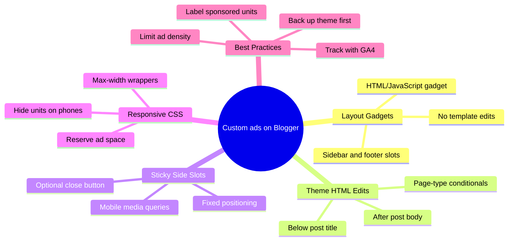

If you run a developer blog on Blogger and want full control over your ad placements, you do not have to wait for AdSense approval or stick to its auto-inserted units. Custom ads let you drop in your own banners, affiliate creatives, direct-sold HTML, or third-party network scripts exactly where they perform best, and you can add custom ads to Blogger without AdSense using nothing more than Layout gadgets and a few theme HTML edits.

This guide walks through the practical methods developers actually use: Layout gadgets for quick wins, theme HTML edits for precise placement, conditional tags so ads only appear on posts, and a few responsive CSS tricks. Everything stays under your control and works with most modern Blogger themes.

<!--more-->



## Why Custom Ads Make Sense for Developers

AdSense is convenient, but it is not always available or ideal. Some blogs get rejected, some niches underperform, and many developers simply prefer selling their own inventory or testing higher-paying networks. Custom HTML and JavaScript ads give you:

- Exact placement (header, after first paragraph, sticky side rails, footer)
- Freedom to use any ad network or direct advertiser code
- Ability to A/B test sizes and formats without platform restrictions
- Better matching with your design system and dark/light themes

Blogger still supports the classic HTML/JavaScript gadget and full theme editing, so the technical barrier stays low. Google documents this directly in its guide to [showing ads from other services on Blogger](https://support.google.com/blogger/answer/1269077) — the platform is a publisher surface, not a walled garden.



<!--
Markdown tree fallback (for readers without Mermaid rendering):

Custom ads on Blogger
  - Layout Gadgets
    - HTML/JavaScript gadget
    - Sidebar and footer slots
    - No template edits
  - Theme HTML Edits
    - Below post title
    - After post body
    - Page-type conditionals
  - Sticky Side Slots
    - Fixed positioning
    - Mobile media queries
    - Optional close button
  - Responsive CSS
    - Max-width wrappers
    - Hide units on phones
    - Reserve ad space
  - Best Practices
    - Back up theme first
    - Label sponsored units
    - Limit ad density
    - Track with GA4
-->

## Method 1: Add Ads via Layout Gadgets (Fastest)

This is the cleanest starting point and requires zero template surgery.

1. Open your Blogger dashboard and select the blog.
2. Go to **Layout**.
3. Find the section where you want the ad (sidebar, footer, header area, or below the posts gadget).
4. Click **Add a Gadget**.
5. Choose **HTML/JavaScript**.
6. Leave the title blank if you do not want a visible heading, or name it something neutral like "Sponsored".
7. Paste your full ad code (banner image link, network script, or affiliate unit) into the content box.
8. Click **Save**, then **Save arrangement** at the bottom of the Layout page.

Common high-performing spots:

| Placement          | Recommended Size     | Notes                              |
|--------------------|----------------------|------------------------------------|
| Sidebar top        | 300×250 or 300×600  | Always above the fold on desktop   |
| Below post title   | 336×280 or responsive| High visibility on single posts    |
| After content      | 728×90 or responsive | Good for longer articles           |
| Footer             | Leaderboard          | Low intrusion, still earns         |

> [!TIP]
> Test every placement on both desktop and mobile. Many themes stack gadgets differently on smaller screens, and a sidebar slot that leads on desktop can end up below the third paragraph on a phone.

## Method 2: Insert Ads Directly in the Theme HTML

When you need the ad inside the post body or in a location the Layout screen does not expose, edit the theme.

1. Go to **Theme**, click the three-dot menu next to your current theme, then **Edit HTML**.
2. Always back up the theme first (**Download theme**).
3. Use Ctrl+F (or Cmd+F) to locate the relevant section.

> [!WARNING]
> Blogger has no robust undo for HTML mistakes. Download a copy of the theme before your first edit, and keep it next to the notes describing what you changed. When a theme update wipes your custom code, that backup is the difference between a five-minute restore and an afternoon of rework.

### Below the Post Title

Search for the post title markup (often contains `post-title` or `entry-title`). Immediately after the closing title tag, add:

```html
<b:if cond='data:blog.pageType == "item"'>
  <div class="custom-ad-unit" style="margin: 20px 0; text-align: center;">
    <!-- Your ad code here -->
  </div>
</b:if>
```

### Inside or After the Post Body

Find `<data:post.body/>` or the `post-body` / `entry-content` div. Place your code before or after it, wrapped in the same conditional so it only appears on individual posts:

```html
<b:if cond='data:blog.pageType == "item"'>
  <div class="mid-post-ad" style="margin: 25px auto; max-width: 100%;">
    <!-- Your ad code here -->
  </div>
</b:if>
```

### Sticky Side Ads (Advanced but Effective)

For left and right sticky units that stay visible while scrolling, add the HTML near the end of the body (before `</body>`) and pair it with CSS in the theme's `<b:skin>` or additional CSS section.

Example structure:

```html
<b:if cond='data:blog.pageType == "item"'>
  <div class="fixed-left-ad">
    <!-- Left ad code -->
  </div>
  <div class="fixed-right-ad">
    <!-- Right ad code -->
  </div>
</b:if>
```

Then add CSS that positions them fixed, hides them under a certain viewport width, and includes a close button if desired. The mechanics of `position: fixed` and its stacking quirks are covered in MDN's [CSS position documentation](https://developer.mozilla.org/en-US/docs/Web/CSS/position) if you want the full picture. Always test thoroughly; sticky ads can hurt mobile experience if not gated properly.

## Making Custom Ads Responsive and Theme-Friendly

Hard-coded fixed sizes break on mobile. Prefer responsive units from your ad network when available. If you control the creative, wrap it:

```html
<div class="ad-wrapper" style="width: 100%; max-width: 336px; margin: 0 auto;">
  <!-- ad code -->
</div>
```

Add a simple media query in your theme CSS so large side ads disappear on narrow screens:

```css
@media (max-width: 1100px) {
  .fixed-left-ad,
  .fixed-right-ad {
    display: none !important;
  }
}
```

> [!NOTE]
> Label ads clearly with a small "Advertisement" or "Sponsored" text above the unit. This builds trust and satisfies most ad network policies.

Ads that match your design system read as part of the page instead of an overlay. The same discipline that keeps a site from drifting into generic template territory applies here — our guide to [de-AI-slop website design](/p/how-to-de-ai-slop-website-design/) covers keeping that visual coherence across a whole layout.

## Practical Tips from Real Developer Blogs

- **Back up the theme before every edit.** Blogger does not have a robust undo for HTML mistakes.
- **Use conditional tags** (`data:blog.pageType == "item"`) so homepage and archive pages stay clean.
- **Limit the number of units.** Three well-placed ads usually outperform six cluttered ones.
- **Track performance.** If you already run Google Analytics 4, create custom events or use UTM parameters on direct ad links — our guide to [changing domains and streams in GA4](/p/change-domain-ga4-multiple-data-streams-guide/) shows how to structure that measurement so ad clicks stay separable from organic traffic.
- **Use `rel="sponsored"`** on the anchor tags of direct-sold banners. It is what Google asks publishers to disclose, and it keeps manual actions off your account.
- **Keep an `ads.txt` file** if your third-party network requires it. Blogger lets you enable a custom ads.txt under Settings → Monetization; the [ads.txt specification](https://iabtechlab.com/ads.txt/) explains the line format.
- **Test with an ad blocker disabled** and on multiple browsers. Some networks serve different creatives based on user agent.
- **Plan the custom domain early.** If you outgrow the `blogspot.com` subdomain, the DNS-record workflow is the same CNAME dance covered in our guide to [creating a Cloudflare subdomain for GitHub Pages](/p/how-to-create-cloudflare-subdomain-github-pages/) — point the records at your host, wait for propagation, done.
- **Raise the value of the inventory itself.** Better rankings make every slot worth more; if you also publish on a static site, our [Hugo SEO checklist](/p/hugo-seo-guide/) is a verified starting point for the technical side.

## Common Issues and Quick Fixes

**Ad does not appear**
Clear browser cache, wait a few minutes for Blogger's CDN, and confirm the gadget is not hidden by CSS. Check the browser console for JavaScript errors from the ad script. In practice, a stalled script from the network is the usual culprit, not the gadget itself.

**Layout shifts**
Reserve space with a `min-height` on the ad container or use the network's responsive unit that reports its size early. Shifting content under a reader's cursor is the fastest way to lose trust — and it shows up as a Core Web Vitals penalty.

**Mobile overflow**
Force `max-width: 100%` and `overflow: hidden` on the ad wrapper. A single wide iframe is enough to create a horizontal scrollbar on a 360px phone.

**Theme update wipes custom code**
Document every change in a private note or a Git repo of your theme XML so you can re-apply after updates. Diffing the old and new theme files tells you exactly what the update touched.

## FAQ: adding custom ads to Blogger without AdSense

### Can I add custom ads on a free Blogspot subdomain?

Yes. Both Layout gadgets and theme HTML edits work on free `*.blogspot.com` blogs. Some premium ad networks prefer a custom domain, but the technical setup is identical.

### Do custom ads violate Blogger terms of service?

No, as long as the ads are legal, non-malicious, and do not impersonate Google or Blogger UI elements. Direct HTML/JavaScript gadgets are an officially supported feature.

### How do I show an ad only on post pages and not the homepage?

Wrap the code with `<b:if cond='data:blog.pageType == "item"'>` ... `</b:if>`. This is the standard Blogger conditional for single-post pages.

### What is the best ad size for Blogger sidebars?

300x250 (medium rectangle) and 300x600 (half-page) remain the most reliable. Responsive units are safer for mixed device traffic.

### Can I use the same method for affiliate banners and network scripts?

Yes. Any valid HTML or JavaScript snippet works inside an HTML/JavaScript gadget or theme insertion point.

### Should I still set up ads.txt for custom ads?

If your ad network or direct buyers require it, yes. Enable the custom ads.txt option under Blogger Settings, Monetization, and paste the required lines.

## Key Takeaways

- Layout HTML/JavaScript gadgets are the fastest and safest way to start.
- Theme HTML edits give precise control inside posts and headers.
- Always wrap custom ads in Blogger conditional tags for page-type targeting, and keep responsive containers plus media queries so mobile stays clean.
- Limit density, label units honestly, and back up the theme before every change.
- Custom ads free you from AdSense approval delays and let you test higher-value inventory on your own schedule.

## Conclusion

Adding custom ads to Blogger is Layout gadgets for the quick wins and theme HTML edits for everything else, held together with page-type conditionals and a bit of responsive CSS. Start with one or two gadget placements, move to theme edits only when you need a position the Layout screen cannot reach, and keep every change recorded so a theme update never surprises you.

Treat ad slots as design decisions rather than afterthoughts — the same principle teams like F9XR apply when they plan layout, analytics, and monetization together instead of bolting them on at the end.

Want to write something like this for Dev9b? The [Contributor Guide](/contribute/) explains how to submit an article, and everything we publish is reviewed against the standards in our [Editorial Policy](/editorial-policy/).

---

*This guide was researched and drafted with the assistance of an AI coding assistant, then reviewed by the F9XR Review Board before publishing. Blogger's interface changes occasionally — Google's [Blogger Help Center](https://support.google.com/blogger) is the authoritative reference for Layout and Theme options.*
