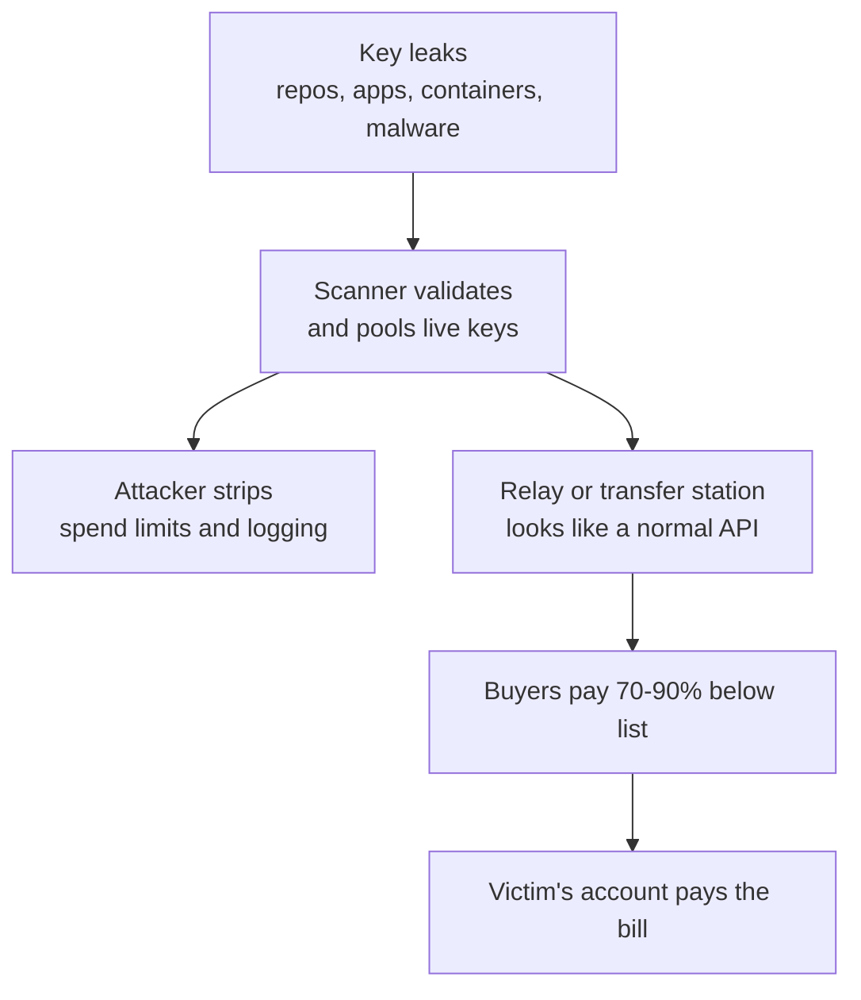

The AI token black market turns a leaked key into inventory. You check your cloud dashboard on a Monday and the bill for your AI project is 40 times higher than last week. Nobody shipped anything big. No traffic spike. Just a steady burn of tokens you never used.

That scenario shows up in incident reports often enough now that security teams treat it as routine. Through 2026, researchers and AI labs documented a working underground economy around one asset: **AI API keys**. Criminals steal them, wrap them in cheap resellers, and sell access to anyone who wants frontier models at a discount. The account owner pays.

This guide walks through the pipeline, the evidence, and the controls that actually reduce your risk. It also covers the buyer's side, because a cheap endpoint can cost you more than money.

<!--more-->

## What the AI token black market actually sells

A token is the unit of text a large language model reads and writes. Providers bill per token, and access is gated by an API key, a long secret string that behaves like a password with a credit card attached.

Demand for cheap frontier access is real. So is the supply chain that formed around it. Three tiers get mixed together in most conversations, so keep them apart:

| Tier | What it is | Legal status | Main risk to you |
|---|---|---|---|
| Legitimate gateway | An open-source router a team runs with its own paid keys | Legal | Misconfiguration |
| Gray-market relay | Resellers pooling accounts, trial credits or discounted capacity against provider terms | Often violates terms of service | Swapped models, data exposure |
| Black market | Resale of stolen keys, hijacked accounts and fraudulent proxies | Illegal | Account bans, legal exposure, malware |

The vocabulary around this space is a mess. Here is the short version.

- **LLMjacking:** using stolen credentials to run model workloads on someone else's account.
- **Token jacking:** Unit 42's term for hijacking stolen AI access tokens and routing them to gray-market resellers.
- **Transfer stations:** reseller platforms, common in the Chinese-language ecosystem, that proxy requests to official APIs at rock-bottom prices.
- **Shadow APIs:** third-party services that claim to offer an official model and may serve something else.
- **Distillation:** training a cheaper model on a stronger model's outputs, one reason some actors want bulk tokens.

## How a stolen key becomes a resale service

The pipeline reported by Cybernews, VentureBeat, Anthropic's September 2026 threat intelligence report and independent researchers looks much the same each time.



### Step 1: Harvest the keys

Anthropic's report puts customer mistakes at the top of the list. Keys end up in GitHub repositories, mobile app bundles, Docker images, websites and chatbot front ends.

Other documented sources:

- **Supply chain attacks.** CloudSEK traced a package compromise that started in March 2026 and exposed cloud keys, repository tokens, SSH keys, Kubernetes secrets and AI provider keys across thousands of downstream projects. Cybernews links npm campaigns such as Shai-Hulud and Miasma to the same pool of stolen credentials.
- **Infostealer malware.** One 2026 incident began with an employee at a major platform company opening an infected file. Attackers harvested workspace credentials and reached the API keys behind them.
- **Prompt injection against LLM gateways.** Anthropic describes attackers tricking LiteLLM deployments into leaking the production credentials sitting behind them.
- **Compromised evaluation sandboxes.** The same report covers keys from more than 30 AI companies stolen through one compromised sandbox.
- **Exposed self-hosted model servers.** Misconfigured local servers open to the internet have also been hit.

### Step 2: Validate and pool

Scanners crawl public code hosting, test each key, and move the live ones into pools. The window is short. A key pushed to a public repo can be found and tested in minutes.

### Step 3: Wrap the keys in a relay

Raw keys are awkward to sell. Operators build a relay that looks like a normal API instead. A buyer gets an endpoint and a key of their own. Requests get proxied through stolen credentials behind it.

Researchers who studied this stack point to open-source gateways like one-api and new-api as the plumbing. Those tools are neutral and widely used by teams for quotas. The line gets crossed when the channels behind them hold stolen, leaked or trial-farmed keys.

Attackers also cover their tracks. Cybernews described them creating new keys on the compromised account, removing billing limits, and switching off usage alerts and logging.

### Step 4: Sell the access

Sales run through Telegram channels, Discord servers, marketplaces and polished storefronts. VentureBeat described Telegram vendors offering 24/7 support and money-back guarantees, with one seller advertising several Claude models at once. Reported discounts sit between 70 and 93 percent below list.

Google threat intelligence, cited in the same reporting, shows more buyers and more sellers advertising AI accounts through 2026, with average prices per account more than doubling.

## Why the prices look impossible

The seller usually did not pay for the compute. A few models explain the pricing:

1. **Stolen keys.** Cost to the seller is close to zero. The victim's card gets charged.
2. **Trial farming.** Mass-created free-tier accounts, with the credits pooled.
3. **Model substitution.** A premium model in the listing, a cheaper one behind the endpoint.
4. **Data harvesting.** Access sold at a loss because your prompts, source code and customer data are the product.

That fourth one matters if you paste private code into a mystery proxy. You just handed it to an unknown third party.

## The evidence so far

| Finding | Source | Why it matters |
|---|---|---|
| 45.83% of tested shadow API endpoints failed model fingerprint verification; another 12.50% showed major identity deviations | CISPA Helmholtz Center, "Real Money, Fake Models" (March 2026) | A cheap endpoint often does not serve the model it names |
| At least 187 academic papers had used shadow APIs | Same audit | Some published results may rest on a substituted model |
| About 30 AI companies hit in roughly four days using victims' keys | Anthropic threat report (September 10, 2026) | Key theft is fast and automated |
| A hacktivist campaign ran for a month on stolen API keys | Anthropic threat report | Stolen keys fund attacks, not only free chatbots |
| Credential theft aimed at AI services reportedly grew 376% from Q4 2025 to Q1 2026 | Industry write-up citing underground tracking | Treat as directional, and verify against primary sources |
| Dark-web listings for some model keys reportedly start near $15 | Secondary industry reporting | Low prices are the lure, not a sign of legitimacy |

Two of those are primary sources: the CISPA paper and Anthropic's report. Some pricing and growth figures come from secondary write-ups. Use them as context, not as hard numbers in your own documentation.

## Who loses money, and who loses data

**Developers and startups** feel it first. A key without a spending limit can generate a serious bill within hours, and small teams have no finance department to absorb the shock.

**Companies and their customers** get hit twice. Attackers use stolen keys as attack compute, and legitimate users lose quota when it runs dry. Because the traffic looks like normal usage, detection is hard.

**Buyers of cheap access** are not safe either. You may get a weaker model, leaked prompts, an account ban when the key is revoked, or malware. Anthropic's report describes fraudulent resellers that proxied traffic to a different model while harvesting credentials from the customers who signed up. The buyer's own keys became inventory.

**Researchers** get bad data. The CISPA audit found accuracy on a medical benchmark dropped sharply for one shadow endpoint compared with the official model. If your evaluation ran through a swapped model, your results do not reproduce.

## A practical API key security checklist

You do not need an enterprise team to cut most of this risk. Start with these.

### 1. Never hardcode keys

Keep secrets out of source files. Use environment variables or a secrets manager.

```bash
# .env (never commit this file)
OPENAI_API_KEY=your-key-here

# .gitignore
.env
.env.*
```

```python
import os

api_key = os.environ.get("OPENAI_API_KEY")
if not api_key:
    raise RuntimeError("Missing API key. Set it in your environment.")
```

### 2. Scan before you commit

Add a secret scanner to your pre-commit hook and your CI pipeline.

```bash
gitleaks detect --source . --verbose
```

Deleting a key from the latest commit does not remove it from history. **Rotate it.**

### 3. Set spending limits and alerts

Most providers let you set monthly budgets and usage alerts. Turn them on and send alerts to a channel people read. Attackers try to disable these, so alert on changes to billing limits and key creation too.

### 4. Use scoped, short-lived keys

Create separate keys per project and per environment. Restrict each one to the models and endpoints it needs. Rotate on a schedule, and immediately after any staff change or suspected exposure.

### 5. Keep keys out of client code

Never ship a provider key in a mobile bundle, browser JavaScript or a public Docker image. Route requests through your own backend, which holds the key and enforces per-user rate limits.

### 6. Harden your LLM gateway

If you run LiteLLM or a similar proxy, do not expose it to the open internet without authentication. Patch it, restrict admin routes, and treat prompt injection as a real path to credential leakage. Give the gateway only the key access it needs.

### 7. Watch your dependencies

Pin versions, use lockfiles, review new packages and run dependency audits. Supply chain compromises are a major source of stolen environment variables. Our [gh-secure setup walkthrough](/p/what-is-gh-secure-setup-guide/) shows how to switch on secret scanning and push protection for a public repo in about two minutes.

### 8. Monitor usage like a production system

Look for unfamiliar models, odd hours, new regions, sudden token spikes and requests that do not match your app's patterns. Billing anomaly detection is often the first signal.

### 9. Buy through official channels

Anthropic's guidance is to buy AI access only from the provider directly, or through approved cloud marketplaces and verified partners.

## How to spot a risky AI reseller

Run this table against any third-party gateway before you trust it.

| Red flag | Why it matters |
|---|---|
| Price is 70 to 90 percent below list | Someone else is covering the difference |
| No company, no terms, no privacy policy | You cannot know what happens to your prompts |
| Payment only in crypto or chat apps | Hard to dispute, common in scams |
| "Unlimited" frontier model access | Capacity is oversold or pooled |
| Asks for your own provider key to "cut costs" | Your key may be harvested and resold |
| Model behavior differs from the official API | Possible model substitution |
| Closed-source client you must install | Malware or key exfiltration risk |

If you have to evaluate an endpoint for research, do not trust the model name. Compare responses against the official API on a fixed prompt set, check token counts and latency, and run benchmark tasks with a known official score. The CISPA paper describes fingerprinting methods worth reading before you build your own.

## If your key is already stolen

1. **Revoke the key** in your provider dashboard.
2. **Check usage logs** for the time window, models and IP ranges involved.
3. **Look for new keys** and changed billing or logging settings. Attackers often create their own.
4. **Find the leak.** Search repos, CI logs, container images, app bundles and recent dependency changes.
5. **Rotate other secrets** that lived in the same place, including cloud keys and tokens.
6. **Contact provider support** about disputed charges and share your timeline.
7. **Add the controls above** so it does not happen twice.

## The legal gray zone

Reselling your own legitimately purchased capacity in line with a provider's terms can be fine. Buying from a service that sells stolen keys is a different matter, and it can expose you to account termination and legal risk. Even gray-market pooling often breaks provider terms.

This article gives general information. For legal advice, read the terms of service for anything you use and talk to a lawyer before you build a business on a reseller.

## Where this goes next

Expect more automation. Agents that read repos, call tools and spend money raise the stakes because the credentials they hold are powerful. Security teams are already arguing that AI keys and agent integrations belong in the same inventory as production credentials, with rotation, scoping and monitoring.

If you build with coding agents, [how AI coding agents work](/p/ai-coding-agents-explained/) explains the permission model, and [OpenCode MCP servers](/p/opencode-mcp-servers/) covers the tool surface they reach. Our [codebase auditor skill](/p/how-to-install-update-f9xr-codebase-auditor-skill/) helps you catch exposed secrets earlier. And if cost is what pushed you toward a shady reseller, start with a [legitimate free vibe coding setup](/p/omniroute-setup-free-vibecoding/) instead.

## Where the numbers come from

- Cybernews, "Token theft now is an industry" (August 6, 2026)
- VentureBeat, reporting on Anthropic's September 2026 threat intelligence report and underground account pricing
- CISPA Helmholtz Center for Information Security, ["Real Money, Fake Models: Deceptive Model Claims in Shadow APIs"](https://arxiv.org/abs/2603.01919) (March 2026)
- Business Standard, ["Hackers target AI supply chains as stolen tokens fuel new cyber threat"](https://www.business-standard.com/amp/technology/artificial-intelligence/hackers-target-ai-supply-chains-as-stolen-tokens-fuel-new-cyber-threat-126081201976_1.html) (August 2026)
- GitHub Docs, [secret scanning](https://docs.github.com/en/code-security/secret-scanning)

## Key Takeaways

- The AI token black market resells stolen or abused API keys, hijacked accounts and fraudulent proxies at deep discounts.
- Most stolen keys leak from customers' own environments: public repos, app bundles, containers and compromised dependencies.
- Resale usually runs through relays or transfer stations that proxy to official APIs after attackers remove spending limits and logging.
- Cheap endpoints are risky for buyers too. A CISPA audit found that 45.83% of tested shadow API endpoints failed fingerprint checks.
- If a price looks too good, assume someone else is paying for it.

## Frequently asked questions

### What is the black market for AI tokens?

An underground ecosystem where stolen API keys, hijacked accounts and fraudulent proxies are sold at steep discounts. Buyers get cheap model access while the legitimate account owner gets the bill.

### How does the AI token black market work?

Attackers steal keys from exposed repositories, apps, containers, malware or supply chain attacks. They validate and pool the keys, wrap them in a relay that looks like a normal API, then sell access through Telegram, Discord or storefronts far below official rates.

### Why are stolen AI API keys so valuable?

A key grants access to paid model quota that can be spent immediately and resold. Since the seller did not pay for the compute, they can undercut official prices and still profit. Keys for advanced models are in the highest demand.

### What are transfer stations in the AI token market?

Reseller platforms that proxy requests to official AI APIs, often with stolen or pooled credentials, while advertising very low prices. The term is common in coverage of the Chinese-language reseller ecosystem.

### How do stolen AI keys usually leak?

Anthropic's September 2026 report points to customer mistakes first: keys exposed in GitHub repos, mobile app files, Docker containers, websites and chatbots. Malware, supply chain attacks and prompt injection against LLM gateways are also documented.

### How do I protect my AI API keys?

Store keys in environment variables or a secrets manager, scan repos before you commit, set spending limits and alerts, use scoped and rotating keys, keep keys out of client code, secure your LLM gateways, and watch usage for anomalies.

## Conclusion

The economics are simple. Stolen compute is free for the seller and expensive for the victim, and a relay makes it easy to resell. Your defense is boring work: short-lived scoped keys, secret scanning, spending limits and a habit of watching usage.

For a design that removes provider keys from your app entirely, our guide to [building a SaaS app with Puter.js](/p/puter-js-build-saas-app-guide/) walks through a keyless, user-pays setup.

If you want to write up what you find, our [contributor guide](/contribute/) explains how to submit. Every post here, including this one, is checked against the standards in our [editorial policy](/editorial-policy/).
