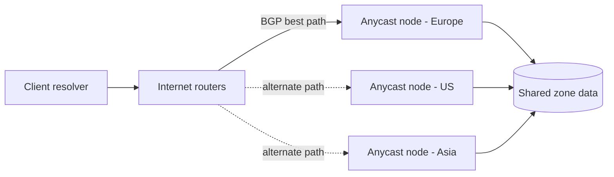
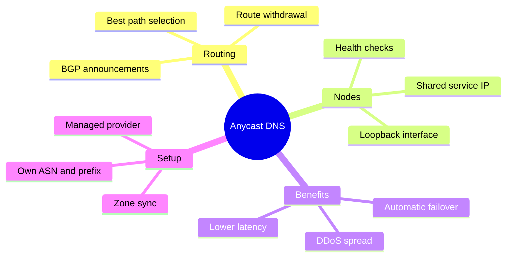

Most developers first meet DNS as a simple lookup: query a nameserver, get an IP address back. That mental model works fine until latency, outages, or traffic spikes start to matter. At that point the conversation usually turns to Anycast.

Anycast DNS is the technique that lets the same IP address live in many places at once. Internet routing automatically sends each query to a nearby healthy node. The client still sees one address. Behind the scenes, a whole network of servers shares the load and the risk.

This guide explains what Anycast DNS actually is, why it matters for real applications, and the practical paths you can take to use it: from one-click managed services to running your own nodes with BGP. If your DNS experience so far is closer to [dynamic DNS for a changing home IP](/p/noipat-dyndns-what-is-it-setup-guide/), this is the next layer down the stack.

<!--more-->

## What Is Anycast DNS?

In normal unicast networking, every IP address points to one specific machine. A DNS query travels across the internet until it reaches that single destination.

Anycast flips the model. Multiple servers in different cities or data centers all announce the same IP address, or more precisely the same IP prefix. When a resolver sends a packet to that address, the Border Gateway Protocol (BGP) and the routers in between choose the best path according to their routing tables. In practice that is usually the topologically closest or lowest-latency location currently advertising the address. It is not guaranteed to be the lowest-latency node, because BGP is a routing protocol, not a latency probe.

From the client's point of view nothing changes. The nameserver IP stays the same. The network simply delivers the query to whichever instance is currently preferred.

Because DNS queries are small and mostly stateless, Anycast fits them especially well. The same idea powers the big public resolvers such as 1.1.1.1 and 8.8.8.8, and the authoritative networks of Cloudflare, Route 53, NS1, and many others.

### Unicast vs Anycast at a Glance

| Aspect               | Unicast                             | Anycast                               |
|----------------------|-------------------------------------|---------------------------------------|
| IP to server mapping | One IP to one server                | One IP to many servers                |
| Routing decision     | Fixed destination                   | Network chooses the best available node |
| Latency              | Depends on distance to a single site | Usually lower for global users       |
| Failover             | Manual or TTL dependent             | Automatic via route withdrawal        |
| DDoS surface         | Concentrated on one location        | Spread across many locations          |

## How Anycast DNS Works Under the Hood

1. Each Anycast node is configured with the shared service IP, often on a loopback or dummy interface.
2. A BGP daemon such as BIRD or FRRouting, or a cloud provider's control plane, announces the prefix that contains that IP to upstream providers.
3. The announcements propagate through the global routing system. Other networks learn multiple paths to the same prefix.
4. When a client or recursive resolver sends a query to the Anycast IP, intermediate routers pick one of the available paths based on policy, AS-path length, and local preference.
5. The chosen node answers the query. If that node later fails or is taken offline, it withdraws its BGP announcement and traffic shifts to the remaining nodes.

That last step is the part that changes how you operate DNS. There is no DNS record to update and no TTL to wait for. The routing layer does the failover, typically within seconds to a few tens of seconds depending on convergence.



No change is required on the client side. No special DNS record type is needed. The magic lives entirely in the routing layer.



## What Anycast DNS Actually Fixes

Anycast is not a feature you enable in a zone file. It is a network property, and the benefits show up at the level of user experience and operations.

- **Lower query latency** — Users in Asia hit an Asian point of presence, users in Europe hit a European one. The first hop of every page load gets faster.
- **Higher availability** — A single data-center outage no longer takes the entire DNS service offline.
- **Built-in load distribution** — Traffic is naturally spread across locations.
- **DDoS resilience** — Attack traffic is absorbed by many ingress points instead of overwhelming one server, although a large enough volumetric attack can still saturate individual uplinks.
- **Transparent to applications** — Your code still talks to the same IP or the same set of nameserver hostnames.

These advantages are why almost every serious public DNS provider and CDN uses Anycast for authoritative and recursive infrastructure.

## How to Set Up Anycast DNS

There are two realistic paths for most teams.

### Option 1: Use a Managed Anycast DNS Provider

This is the fastest and lowest-risk way, and it is the right default for most projects.

Popular choices include Cloudflare DNS, whose free tier already runs on a large Anycast network, Amazon Route 53, and IBM NS1 Connect. Many teams first encounter Cloudflare while connecting a site to GitHub Pages, as covered in this [Cloudflare subdomain setup for GitHub Pages](/p/how-to-create-cloudflare-subdomain-github-pages/) and the [custom domain workflow for GitHub Pages](/p/github-pages-custom-domain-cloudflare/).

Typical steps:

1. Create an account with the provider and add your domain, or create a new zone.
2. Copy the authoritative nameserver hostnames the provider gives you, such as `ns1.cloudflare.com` and `ns2.cloudflare.com` or the equivalent.
3. At your domain registrar, replace the existing NS records with the new ones.
4. Wait for the old NS TTLs to expire. This usually takes a few hours, and up to 48 hours in stubborn cases.
5. Add your A, AAAA, CNAME, MX, TXT, and other records through the provider's dashboard or API.

Because the provider already operates Anycast nodes worldwide, your domain immediately benefits from low-latency global resolution and automatic failover. You never touch BGP yourself.

Many providers also offer secondary DNS, DNSSEC, health-checked records, and geo-steering if you need more advanced traffic management later.

### Option 2: Run Your Own Anycast DNS Network

This path is for teams that need full control, have or can obtain their own IP space, and are comfortable operating BGP.

High-level requirements:

- An Autonomous System Number (ASN).
- A globally routable prefix, commonly an IPv4 /24 and an IPv6 /48. Shorter IPv4 prefixes are often filtered by upstreams.
- At least two geographically diverse locations with independent upstream connectivity.
- Servers that can run a DNS daemon and a BGP daemon.
- A health-check mechanism that withdraws the route when the local DNS service is unhealthy.

A common software stack is Knot DNS, PowerDNS, BIND 9, or NSD for serving zones, BIRD or FRRouting for BGP, and a small monitoring script or orchestrator that ties health to route announcements.

Rough deployment outline:

1. Obtain the ASN and prefix from a Regional Internet Registry or a sponsoring provider.
2. Deploy identical DNS configurations on each node. Put the Anycast IP on a loopback or dummy interface so it stays up independently of physical NICs.
3. Configure the BGP daemon to announce the prefix only when the local health check passes.
4. Set up zone synchronization with AXFR or IXFR protected by TSIG, or a configuration-management pipeline that pushes the same zone files everywhere.
5. Announce the prefix from every healthy location.
6. Point your domain's NS records at hostnames whose A and AAAA records are the Anycast addresses. If those names live inside your own zone, publish glue records at the registrar.
7. Test from multiple continents with `dig`, public looking glasses, and probes such as RIPE Atlas.

Self-hosting gives maximum control and can be cost-effective at scale, but it also means you own routing policy, monitoring, DDoS response, and round-the-clock operations.

## A Field Note from Our Own Deployments

In our own DNS work we treat Anycast as a routing feature, not a DNS feature. The zone file stays the same. What changes is where the packets land.

The mistakes that caused the most pain were rarely in the zone data. They were in health checks and route policy. A node that still answers locally but has lost its upstream transit looks healthy to a naive process check. A node that withdraws a route too eagerly can cause flapping, which is worse than staying up with elevated latency.

Two habits paid off. First, health checks query the actual authoritative service over the Anycast address and compare the answer to a known-good value. Second, we watch reachability from outside the network. A local `dig` success proves very little about what a resolver in another country sees.

## Practical Tips and Gotchas

- Start with a managed provider unless you already have an ASN and multi-location infrastructure. If you are still choosing a home for a small project, our [free subdomains for developers list](/p/free-subdomains-for-developers-list/) is a gentler starting point.
- Keep TTLs reasonable. Very low TTLs increase query load; very high TTLs slow down recovery after a record change.
- Always run health checks that actually exercise the DNS service, not just "is the process running."
- Monitor from outside your own network. Local success does not guarantee global reachability.
- Document your BGP communities and filtering policy. Accidental route leaks are painful and can affect networks far beyond yours.
- For dual-stack deployments announce both IPv4 and IPv6 prefixes and test both.
- If you use multiple DNS providers for redundancy, make sure zone data stays in sync and understand how resolvers choose among the NS set.

A quick sanity check from your workstation looks like this:

```bash
dig +short NS example.com
dig example.com A
dig @198.51.100.10 example.com A
```

The last command queries a specific nameserver directly. Run it against each node you expect to be live.

## Key Takeaways

- Anycast DNS lets multiple servers share one IP address. BGP routes each query to a nearby healthy node.
- The main gains are lower latency, automatic failover, and better resistance to localized outages and DDoS.
- For most developers the practical route is a managed Anycast DNS provider such as Cloudflare, Route 53, or NS1.
- Running your own Anycast network is possible but requires an ASN, suitable IP space, multi-location servers, BGP, and solid health checking.
- DNS is an excellent fit for Anycast because queries are small and mostly stateless.

## Conclusion

Anycast DNS is one of those ideas that sounds exotic until you see how little application code it touches. The zone stays the same, the client stays the same, and the routing layer quietly sends each query to a node that is close and alive. Managed providers make that available in an afternoon. Self-hosting makes it a network engineering project, with all the control and responsibility that implies.

If something in this guide is wrong or outdated, use the [Contributor Guide](/contribute/) to send a fix. Our [Editorial Policy](/editorial-policy/) explains how Dev9b reviews and updates articles. This post was drafted with AI assistance and checked against the Cloudflare Learning Center, Microsoft Learn, the anycast.guide material, and RFC 1546.

## Frequently Asked Questions

### What is the difference between Anycast and Unicast DNS?

Unicast maps one IP to one server. Anycast maps one IP to many servers; the network chooses which instance receives each query, usually the closest healthy one.

### Do I need my own ASN to use Anycast DNS?

No. Managed providers already operate Anycast networks. You only need an ASN if you plan to announce your own prefixes from your own servers.

### Is Cloudflare DNS Anycast?

Yes. Cloudflare's authoritative DNS runs on a large global Anycast network, and the free plan already benefits from it. See the [Cloudflare explanation of Anycast DNS](https://www.cloudflare.com/learning/dns/what-is-anycast-dns/) for the provider's own overview.

### How fast does failover happen with Anycast?

When a node withdraws its BGP route, traffic usually shifts within seconds to a few tens of seconds, depending on routing convergence. That is typically much faster than waiting for DNS TTLs to expire. The [Microsoft Learn Anycast DNS overview](https://learn.microsoft.com/en-us/windows-server/networking/dns/deploy/anycast) walks through the mechanics.

### Can I mix Anycast DNS with traditional unicast nameservers?

Yes. Many domains list both Anycast and unicast nameservers. Resolvers will try the available ones according to their own algorithms.

### Does Anycast work with IPv6?

Yes. The same principles apply. Operators commonly announce both an IPv4 /24 and an IPv6 /48 or longer prefix for dual-stack service. If you plan to run your own nodes, the [anycast.guide DNS Anycast guide](https://anycast.guide/guides/dns-anycast/) covers the operational details, and [RFC 1546](https://www.rfc-editor.org/rfc/rfc1546) is the original conceptual document for anycasting.
