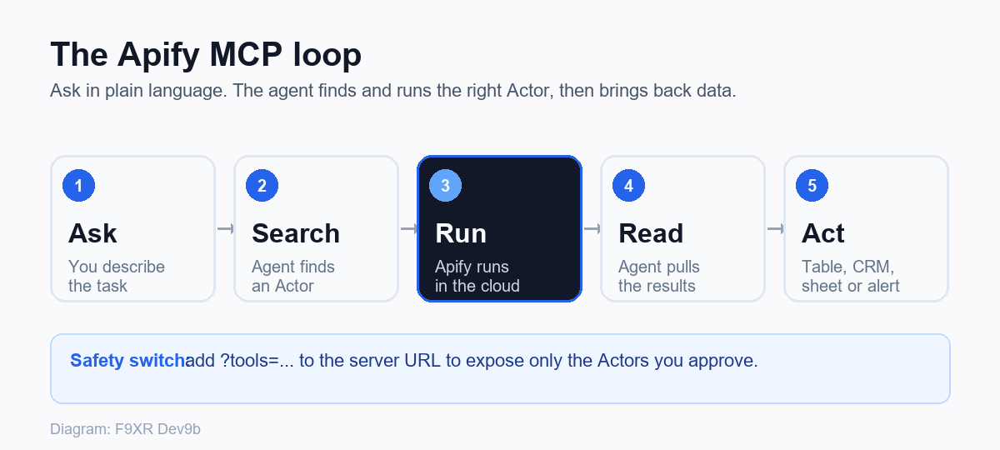

## Apify MCP Explained: Automate Data Tasks With AI Agents

Here's a scenario most business owners will recognize. You want to know what your competitors charge, what customers say about them on Google Maps, or which companies in your city are hiring. So you open a dozen tabs, copy and paste into a spreadsheet, and lose an afternoon.

Now picture typing that request to your AI assistant and getting back a clean table twenty minutes later. That's the idea behind the **Apify MCP server**. It connects AI tools such as Claude, Cursor and VS Code to Apify's library of ready-made web automation tools, so your assistant can go and fetch real data instead of guessing.

This guide explains what Apify MCP is in plain English, how to set it up, where it fits in a real workflow, and what to watch out for before you let an AI agent loose on the web. 

<!--more-->

> **Quick answer:** Apify MCP is a server, hosted at [mcp.apify.com](https://mcp.apify.com), that lets AI applications and agents use the Apify platform through the [Model Context Protocol](https://modelcontextprotocol.io/docs/getting-started/intro) (MCP). It allows an AI assistant to find and run Apify Actors (ready-made scrapers and automations), read the results, and look up Apify documentation, all from inside tools like Claude Desktop, Cursor or VS Code.

## First, a Few Terms Made Simple

Before the setup, let's clear up the jargon. These four terms come up constantly.

| Term | Plain English meaning |
|---|---|
| **MCP (Model Context Protocol)** | An open standard that lets AI apps connect to outside tools and data in a consistent way. Think of it as a universal plug between an AI assistant and other software. |
| **Apify** | A cloud platform for web scraping, data extraction and browser automation. |
| **Actor** | A packaged scraper or automation job on Apify, with a defined input and output. You give it a task, it runs in the cloud, and you get results. |
| **Apify Store** | The marketplace where Apify and the community publish Actors for sites and workflows such as Google Maps, Instagram, Amazon and Google Search. |

So Apify MCP is simply the bridge. Your AI assistant is the brain, Apify Actors are the hands, and MCP is how they talk.

## What Is Apify MCP?

The Apify MCP server lets AI agents discover and run Actors from the Apify Store, access stored results, and even search Apify's own documentation. According to [Apify's MCP documentation](https://docs.apify.com/mcp), it is meant for AI applications, agents, IDEs and command line tools that need to work with the Apify platform.

There are two ways to connect:

1. **Hosted (recommended for most people).** You point your AI client at `https://mcp.apify.com`. Your browser opens, you sign in to Apify, and you approve the connection. This uses Streamable HTTP with OAuth, so you don't paste your API token into a config file.
2. **Local.** You run the server on your own machine using the `@apify/actors-mcp-server` package. This is handy for development and testing, and it needs your Apify API token.

One thing to note if you read older tutorials: Apify announced that the older Server-Sent Events (SSE) transport would be removed on April 1, 2026, in favor of Streamable HTTP. If an old guide uses SSE, update your client configuration.

## Why Should Business Owners Care?

You don't need to be a developer to see the value. Here's what changes in practice.

- **Your AI stops guessing.** Instead of answering from old training data, the assistant can pull fresh information from the web.
- **You skip the manual work.** Research, lead lists and price checks that used to take hours become a request.
- **You use proven tools.** Actors in the Apify Store are already built. There are tens of thousands of them across social media, e-commerce, lead generation and AI data.
- **You can start free.** [Apify's pricing page](https://apify.com/pricing) lists a free plan with $5 of monthly usage credit and no card needed to begin. Unused credits do not roll over.

## How Apify MCP Works



The flow is simple: 

1. You ask your AI assistant for something, such as "Find recent reviews for dental clinics near me."
2. The assistant uses the Apify MCP server to search for a suitable Actor.
3. It reads the Actor's details, then calls the Actor with the right inputs.
4. Apify runs the job in the cloud.
5. The results come back to your assistant, which summarizes them, builds a table, or passes them on to your next step.

### What tools does the server expose?

By default, the hosted server loads the Actor discovery and documentation tools, the `apify/rag-web-browser` Actor (for browsing and extracting web data), the `apify/web-fetch` Actor, and a `report-problem` tool. Here are a few of the tools documented by Apify:

| Tool | What it does |
|---|---|
| `search-actors` | Finds Actors in the Apify Store |
| `fetch-actor-details` | Shows what an Actor does and what input it needs |
| `call-actor` | Runs an Actor and returns its results |
| `get-actor-run` | Checks details of a specific run |
| `search-apify-docs` and `fetch-apify-docs` | Look up Apify documentation |
| Schedule tools (for example `update-schedule`) | Manage recurring runs |

You can limit what your AI can touch by adding a `tools` parameter to the server URL. For example, `https://mcp.apify.com?tools=apify/instagram-scraper,apify/google-search-scraper` exposes only those two Actors. That's a smart move for safety and for keeping costs predictable.

## How to Set Up Apify MCP (Step by Step)

### Step 1: Create a free Apify account

Sign up on [Apify](https://apify.com/). The free plan is enough for testing. Keep your API token private if you plan to use token-based setups.

### Step 2: Choose your AI client

Apify's docs cover popular options including Claude Desktop, Cursor, VS Code, and coding agents such as Claude Code and Codex. If you're using Claude or Cursor for the first time, check out our guides on [top MCP servers every marketer should use](/p/top-mcp-servers-every-marketer-should-use/) and [best Claude connectors for marketers](/p/best-claude-connectors-for-marketers-2026/) to see how this fits with other tools.

### Step 3: Connect the server

**Claude Desktop:** Add a custom connector and use `https://mcp.apify.com` as the server URL. Your browser opens so you can sign in to Apify and approve access. Apify also notes you can search for "Apify" in the connector directory. For more details, see [Apify's Claude Desktop integration guide](https://docs.apify.com/integrations/claude-desktop).

**Cursor or other clients with a config file:** Add this to your MCP configuration:

```json
{
  "mcpServers": {
    "apify": {
      "url": "https://mcp.apify.com"
    }
  }
}
```

**Using a token instead of OAuth (Bearer token):**

```json
{
  "mcpServers": {
    "apify": {
      "url": "https://mcp.apify.com",
      "headers": {
        "Authorization": "Bearer <APIFY_TOKEN>"
      }
    }
  }
}
```

**Apify CLI shortcut:** Run `apify mcp install cursor`. Supported clients listed in the docs are `claude-code`, `cursor`, `vscode`, `vscode-insiders`, `codex`, `kiro` and `antigravity`.

**Local server:** If your client does not support remote MCP servers, run it locally:

```json
{
  "mcpServers": {
    "actors-mcp-server": {
      "command": "npx",
      "args": ["-y", "@apify/actors-mcp-server"],
      "env": {
        "APIFY_TOKEN": "YOUR_APIFY_TOKEN"
      }
    }
  }
}
```

### Step 4: Run a small test

Start with a low limit so you can check the output and the cost. For example:

> "Use Apify to search Google for the top 10 results for 'emergency plumber [your city]' and list the business names and websites in a table."

### Step 5: Save what works

Once a request gives you useful output, note the Actor and the inputs. Repeat it, schedule it, or send the results to a spreadsheet or automation tool.

> [!TIP]
> If you are building with a coding agent such as Claude Code, Cursor, GitHub Copilot or Codex, Apify's docs suggest installing the Apify plugin, which sets up the MCP server together with Agent Skills in one step.

## Practical Ways to Use Apify MCP in Your Business

| Use case | Example request to your AI | Who benefits |
|---|---|---|
| **Competitor price checks** | "Compare prices for these 5 products across competitor sites." | Online stores |
| **Local review monitoring** | "Pull new Google Maps reviews for my three branches and flag complaints." | Local businesses |
| **Lead research** | "Find companies in my niche in this city and list their websites." | Agencies, B2B startups |
| **Content research** | "Search the web for what is ranking for this topic and summarize the gaps." | Marketers, bloggers |
| **Social listening** | "Collect recent public posts mentioning my brand." | Brands, startups |
| **Website data collection** | "Fetch this page and extract the product specs into a table." | Ecommerce teams |

### A simple three step workflow to copy

1. **Collect:** Your AI uses Apify MCP to gather data from the web.
2. **Analyze:** The AI summarizes, scores or flags what matters. For a look at how agents fit into broader marketing work, check out [AI agents that automate your marketing workflow](/p/ai-agents-automate-business-marketing-workflow/).
3. **Act:** You send the output to a spreadsheet, CRM, email draft or your team chat using your existing automation tool.

Apify's own platform also supports integrations with tools such as Zapier, Make and n8n, so you can pass results onward without writing code. If you're just getting started with automation, our guide on [social media automation with Pabbly Connect](/p/pabbly-connect-social-media-automation-guide/) can help you wire things up.

## Costs: What to Expect

Apify uses a layered model. You have a plan with monthly credits, you spend credits on compute, and many Store Actors add their own fees per result, per event or as a monthly rental. The MCP server excludes rental Actors, because that subscription model does not suit on-demand runs through MCP.

Practical cost tips:

- Read each Actor's **Pricing** tab before a big run.
- Set small limits during testing.
- Use the `tools` parameter to restrict which Actors your AI can call.
- Check your usage in Apify Console after the first few runs.

Apify also supports agentic payments, which let agents pay for Actor runs without an Apify account in some setups. Per Apify's docs, per request payments such as Skyfire work only with pay-per-event Actors. This is more of an advanced option, so most small businesses should stick with a normal account.

## Risks and Good Habits

Giving an AI agent web access is powerful, so treat it like a new team member who needs clear boundaries. If you're concerned about bots hitting your own site, it's worth reading [how to block AI crawlers on your site](/p/block-ai-crawlers-on-your-site/).

| Risk | What to do |
|---|---|
| **Leaked API token** | Prefer OAuth. If you use a token, keep it out of public repos and shared files. |
| **Surprise bills** | Start on the free plan, use low limits, and restrict the tool list. |
| **Legal and privacy issues** | Scrape only public data you have a right to use. Respect site terms and privacy laws such as GDPR where they apply. Avoid collecting personal data you do not need. |
| **Bad or outdated data** | Spot check results before making decisions. Scrapers can break when websites change. |
| **Untrusted web content** | Web pages can contain text that tries to steer an AI. Review outputs and do not give your agent permission to take irreversible actions without a human check. |

This is general guidance and not legal advice. If you plan to collect data at scale, talk to a qualified professional.

## How F9XR Team Can Help You

Most owners don't struggle with the idea. They struggle with the wiring. This is where F9XR Team comes in:

- **AI automation workflows:** mapping your repeatable tasks and setting up safe, low cost automations around tools like MCP servers
- **Website development and redesign:** fast, clear websites that give your data something useful to feed
- **Local SEO:** using review, listing and competitor data to improve your visibility in your city
- **AI search visibility:** making your content easy for Google, Gemini, ChatGPT, Claude and Perplexity to understand and cite
- **Digital presence audits:** a clean-up of your site, profiles and tracking so your automation results lead to action

If you want a second opinion before you connect anything to your business, we're happy to help.

## Key Takeaways

- Apify MCP is a bridge that lets AI assistants run Apify Actors and read their results through the Model Context Protocol.
- The easiest route is the hosted server at `mcp.apify.com` with OAuth sign in.
- Actors are ready-made scrapers and automations, so you don't have to build them yourself.
- Start with the free plan, small limits and a narrow list of allowed tools.
- Good first projects include competitor price checks, local review monitoring, lead research and content research.
- Always check pricing on each Actor, protect your API token, and respect privacy and site terms.
- Treat AI output as a draft. Verify before you act on it.

## Frequently Asked Questions

## Conclusion

Apify MCP won't run your business for you, and it shouldn't. What it does well is remove the boring middle of research work: the copying, the tab juggling and the spreadsheet cleanup. Start small with one useful question, keep your permissions narrow, check the output, and expand only when it earns its place.

If you'd like help turning that first experiment into a reliable workflow, F9XR Team supports businesses with website development, website redesign, local SEO and complete digital presence solutions, so the data you collect actually turns into customers.

*Sources: [Apify MCP documentation](https://docs.apify.com/mcp), [Apify pricing](https://apify.com/pricing), [Apify Claude Desktop integration](https://docs.apify.com/integrations/claude-desktop), and [Model Context Protocol](https://modelcontextprotocol.io/docs/getting-started/intro). Confirm current details on Apify's site before relying on them, since features and pricing change.*

To learn more about how we work, check out our [Contributor Guide](/contribute/) and [Editorial Policy](/editorial-policy/).

## Key Takeaways

- **Bridge, not replacement:** Apify MCP connects AI assistants to real web data through Apify Actors.
- **Easy start:** Use the hosted server at `mcp.apify.com` with OAuth to skip token setup.
- **Start small and safe:** Limit tools with `?tools=...`, test with low limits, and watch costs.
- **Verify everything:** Treat scraped data as a draft, and respect site terms and privacy laws.
- **Focus on action:** Connect results to a spreadsheet, CRM or automation tool so they drive real work.

## Conclusion

Apify MCP won't run your business for you, but it can take the repetitive research off your plate. Start with one concrete question, lock down permissions, check the output, and only scale up when it proves useful.

If you need help wiring it into your existing stack, the F9XR Team can build a safe, focused workflow for your goals.
