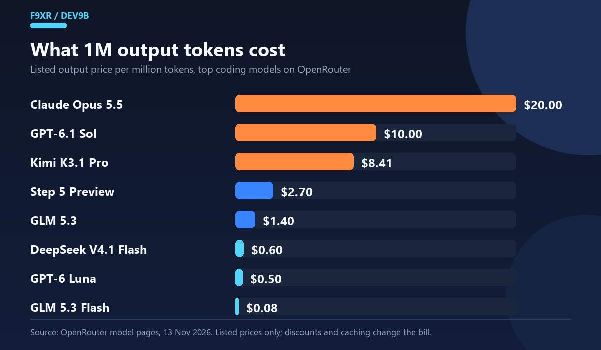
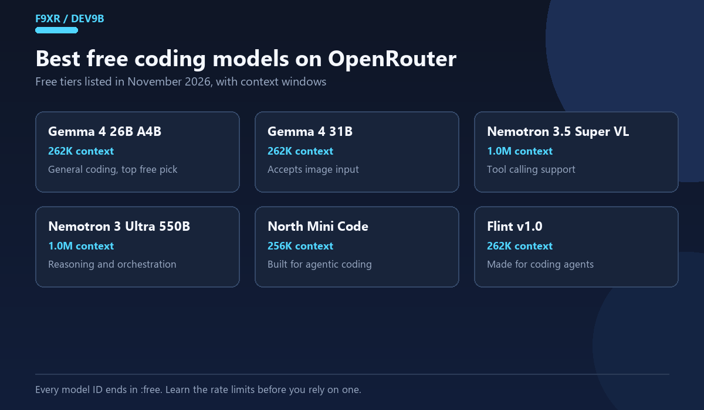
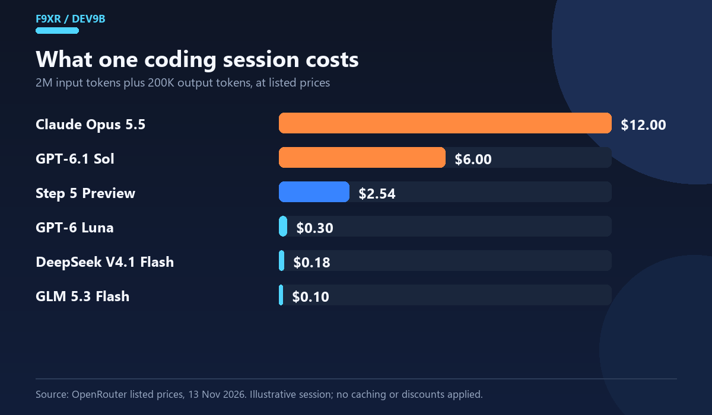
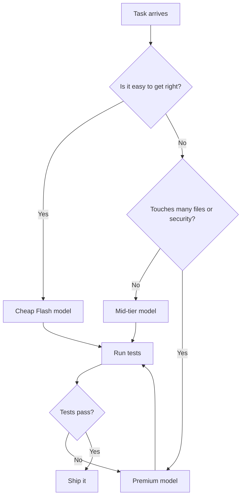

Finding the best coding models on OpenRouter is harder than it should be. The site now lists hundreds of models behind one API key, and a good share of them arrived this month. A model name tells you very little about whether it can edit a real repository without setting your budget on fire.

The useful signal is usage. OpenRouter publishes a programming collection that counts the tokens developers actually route through each model, and that number is difficult to fake. It will not tell you which model writes the best code, but it does show which ones people keep paying for.

This guide covers the best coding models on OpenRouter in November 2026, with listed prices, context sizes, free options, working API code and a test method you can run against your own repository. Prices move weekly, so treat every number here as a dated reference.

<!--more-->

## What Usage Rankings Can and Cannot Tell You

[OpenRouter's programming rankings](https://openrouter.ai/collections/programming) order models by token volume over a recent window. That is a real signal, and it has limits worth knowing before you read anything into the order.

- **Cheap models collect more tokens.** A model at four cents per million input tokens can be used ten times as often as a premium one for the same budget.
- **Agent loops distort the count.** One autonomous session can push millions of tokens through a model, so heavy tool use inflates a model's position.
- **Listed prices are not final prices.** Provider differences, discounts and prompt caching change what you actually pay.
- **The page moves.** The snapshot below was taken on November 13, 2026, and it will look different within a month.

I treat the collection as a shortlist rather than a verdict. OpenRouter coding models rise and fall on this list for reasons that have as much to do with price as with quality. The prices and context sizes below come from the model pages on that date. The notes on fit are my read of those numbers plus how coding agents actually spend tokens. I have not run a private benchmark across every model, and any list that claims a clean quality ranking across labs deserves suspicion.

## Quick Picks: Best Coding Models on OpenRouter

| If you want... | Look at | Why |
|---|---|---|
| The most popular option | DeepSeek V4.1 Flash | Tops the programming collection by token volume, at very low listed prices |
| The lowest cost | GLM 5.3 Flash | About $0.04 input and $0.08 output per million tokens |
| A premium model for hard problems | Claude Opus 5.5 | Priced high, still widely used for coding, 1M token context |
| A large context on a budget | Hy4 or GPT-6 Luna | Both list a 1.05M context at modest prices |
| Zero cost while learning | A `:free` model such as Gemma 4 26B A4B | No card needed, but tight rate limits |
| Middle ground for agent work | Step 5 Preview or GPT-6.1 Sol | Between the budget and premium tiers |

None of these answers fit every project. The trade-offs are below.

## Top Coding Models on OpenRouter, Ranked by Usage

Here is the top ten from [OpenRouter's model list](https://openrouter.ai/models) on November 13, 2026.

| Rank | Model | Provider | Context | Input per 1M | Output per 1M |
|---|---|---|---|---|---|
| 1 | DeepSeek V4.1 Flash (1017 snapshot) | DeepSeek | 1.05M | $0.038 | $0.50 |
| 2 | Hy4 | Tencent | 1.05M | $0.417 | $1.251 |
| 3 | DeepSeek V4.1 Flash | DeepSeek | 1.05M | $0.04 | $0.60 |
| 4 | GLM 5.3 Flash | Z.ai | 1.05M | $0.0399 | $0.0784 |
| 5 | GPT-6 Luna | OpenAI | 1.05M | $0.10 | $0.50 |
| 6 | Claude Opus 5.5 | Anthropic | 1M | $4 | $20 |
| 7 | Step 5 Preview | StepFun | 1M | $1 | $2.70 |
| 8 | Kimi K3.1 Pro | Moonshot AI | 1.05M | $0.2375 | $8.411 |
| 9 | GPT-6.1 Sol | OpenAI | 1.05M | $2 | $10 |
| 10 | GLM 5.3 | Z.ai | 1.05M | $0.0699 | $1.40 |

Hy4 carried a 50 percent discount on the day I checked, so its standard price may be higher. Confirm on the model page before you build a budget around it.

Two things stand out. Cheap Flash models own the top of the list. A context window around 1.05M tokens has also become ordinary, which means context size alone no longer separates one model from another.



*Listed output prices per 1M tokens on 13 November 2026. The spread between GLM 5.3 Flash and Claude Opus 5.5 is roughly 255 times.*

## The Models Worth Knowing

### DeepSeek V4.1 Flash

DeepSeek holds the first and third spots because OpenRouter lists a dated snapshot next to the main version. Both sit near four cents per million input tokens, with output between 50 and 60 cents, and both offer a 1.05M context.

This is the sensible default for high volume work: refactors, test generation, review passes and agent loops where the token count climbs fast. If you are new to OpenRouter and want one model to start with, begin here and compare it against a premium model on your hardest tasks.

Pin the main version rather than the dated snapshot unless you have a reason to freeze behavior. Snapshots get retired, and a hardcoded ID that disappears will break a pipeline at the worst possible moment.

### Hy4 (Tencent)

Hy4 ranks second by token volume with a 1.05M context and mid-range pricing. It is a reasonable pick for long context jobs such as reading a full module or a large diff in one pass. Because the discount was active when I checked, rerun your cost estimate if the promotion ends.

### GLM 5.3 Flash (Z.ai)

The cheapest model in the table, with output under ten cents per million tokens. That price shape rewards bulk, low-risk work: docstrings, boilerplate, file classification and first pass reviews. The larger GLM 5.3 also makes the top ten at a higher output price, so you can step up without changing providers.

### GPT-6 Luna (OpenAI)

A low-priced OpenAI model with a 1.05M context. It makes sense if your team already trusts OpenAI tooling and behavior but wants a cheaper tier for everyday edits. You are paying a small premium over the Flash models for familiarity and provider consistency.

### Claude Opus 5.5 (Anthropic)

The premium entry, at $4 input and $20 output per million tokens with a 1M context. It is far more expensive than everything above it, yet it still ranks sixth by usage. Developers reach for it on work where a wrong answer costs more than the tokens.

Architecture decisions, security-sensitive changes, large multi-file edits and debugging that has already defeated two cheaper models are the obvious cases. A common pattern is to let a cheap model produce the first draft, then bring in Opus to review or repair what failed.

### Step 5 Preview (StepFun)

Priced at $1 input and $2.70 output with a 1M context, this sits between the budget and premium tiers. It works as a middle gear for agent tasks that need more care than a Flash model but do not justify Opus pricing. The word Preview in the name is a warning: behavior can change, and the model can disappear. Keep a fallback configured.

### Kimi K3.1 Pro (Moonshot AI)

The price shape here is unusual. Input is cheap at $0.2375 per million tokens, while output is $8.411. That matters for coding. If your workload reads a lot of code and writes little, such as review or analysis, the cheap input side helps. If it generates long files or long explanations, the output price will dominate the bill.

### GPT-6.1 Sol (OpenAI)

A clear step up from Luna at $2 input and $10 output. Test it when the cheaper OpenAI tier struggles on your tasks but Opus feels like overkill. On a 2 million input token session with 200,000 output tokens, the difference between Sol and Opus is roughly $6, which is real money at scale.

## Best Free Coding Models on OpenRouter

OpenRouter marks free variants with a `:free` suffix. One tracker listed 14 free models on November 12, 2026. These are the ones most relevant to coding.

| Model ID | Context | Notes |
|---|---|---|
| `google/gemma-4-26b-a4b-it:free` | 262K | Named as a top free coding pick by one tracker |
| `google/gemma-4-31b-it:free` | 262K | Accepts image input, useful for UI screenshots |
| `nvidia/nemotron-3.5-super-vl:free` | 1.0M | Large context, tool support |
| `nvidia/nemotron-3-ultra-550b-a55b:free` | 1.0M | Suited to reasoning and orchestration |
| `cohere/north-mini-code:free` | 256K | Built for agentic coding, supports tool calls |
| `recursive/flint-v1.0:free` | 262K | Built for coding agents, strong results reported by its maker |
| `openrouter/free` | 200K | Router that picks a free model for you |



*The free tier in November 2026. All IDs end in `:free`, and rate limits apply.*

> [!WARNING] Check the data policy before you paste private code
> Some free models train on your prompts. Others retain them for a set period. Read the policy on the model page before sending client work, proprietary code or anything covered by an NDA.

If you are hunting for the best free OpenRouter models for coding, start with the two Gemma IDs and `cohere/north-mini-code:free`. Free models are fine for learning, side projects and low-stakes scripts. They are less fine as the only path in a production agent. Rate limits are tight, most free endpoints have a single provider, and a 429 error leaves you with no same-model fallback. One tracker reports 20 requests per minute and daily caps that range from about 50 requests under $10 in lifetime credits to around 1,000 above that. Another lists a 200 per day cap. Read [OpenRouter's documentation](https://openrouter.ai/docs) for the current numbers.

Two more things to keep in mind. Maker-reported benchmarks are not comparable across labs because each one uses its own settings. And free endpoints get retired, so an agent config pointing at an old ID will fail without warning. Check the live catalog before each run.

For a full walkthrough of wiring free models into an editor agent, see our guide to [using Cline with free OpenRouter models](/p/use-cline-free-openrouter-models/). The free model tracker at [CostGoat](https://costgoat.com/pricing/openrouter-free-models) is a useful cross-check, and [TeamDay's free coding model roundup](https://www.teamday.ai/blog/best-free-openrouter-models-coding-2026) covers a few endpoints that did not make my table.

## What a Coding Session Really Costs

Per-million prices are hard to feel. Here is an illustrative session. An agent reads **2 million input tokens** of code and context and writes **200,000 output tokens** of edits. The math uses listed prices and ignores caching and discounts.

| Model | Input cost | Output cost | Total |
|---|---|---|---|
| GLM 5.3 Flash | $0.08 | $0.02 | about $0.10 |
| DeepSeek V4.1 Flash (1017) | $0.08 | $0.10 | about $0.18 |
| GPT-6 Luna | $0.20 | $0.10 | about $0.30 |
| Step 5 Preview | $2.00 | $0.54 | about $2.54 |
| GPT-6.1 Sol | $4.00 | $2.00 | about $6.00 |
| Claude Opus 5.5 | $8.00 | $4.00 | about $12.00 |

The cheapest and most expensive options differ by roughly a factor of one hundred for identical token volume. That gap is why routing by task beats picking one model for everything.



*Same session volume, listed prices, no caching. The gap between the cheapest and priciest model is roughly one hundred times.*



In practice the split looks like this:

1. **Cheap model first** for drafts, boilerplate, tests and file summaries.
2. **Mid-tier model** for feature work that needs more care.
3. **Premium model** for tricky bugs, design reviews and final checks.
4. **Free model** for experiments, learning and throwaway scripts.

## Calling a Coding Model Through the OpenRouter API

OpenRouter exposes an OpenAI compatible endpoint, so most SDKs work after you change the base URL and key. Here is a minimal Python example.

```python
import os
from openai import OpenAI

client = OpenAI(
    base_url="https://openrouter.ai/api/v1",
    api_key=os.environ["OPENROUTER_API_KEY"],
)

response = client.chat.completions.create(
    model="google/gemma-4-26b-a4b-it:free",
    messages=[
        {"role": "system", "content": "You are a careful senior engineer."},
        {"role": "user", "content": "Write a Python function that validates an IPv4 address, with tests."},
    ],
)

print(response.choices[0].message.content)
```

The same call from Node.js:

```javascript
import OpenAI from "openai";

const client = new OpenAI({
  baseURL: "https://openrouter.ai/api/v1",
  apiKey: process.env.OPENROUTER_API_KEY,
});

const result = await client.chat.completions.create({
  model: "google/gemma-4-26b-a4b-it:free",
  messages: [
    { role: "user", content: "Explain this stack trace and suggest a fix." },
  ],
});

console.log(result.choices[0].message.content);
```

To use a paid model, copy its exact ID from its page on OpenRouter. IDs follow a `provider/model-name` pattern, but I have not listed paid IDs here because they change with each release and a wrong guess only returns an error.

### Add a fallback

OpenRouter accepts an ordered list of models in the request body and tries the next one when a model is rate limited or unavailable. The Python SDK passes that through `extra_body`. Check the [API reference](https://openrouter.ai/docs) for the exact field, because request options evolve.

```python
response = client.chat.completions.create(
    model="google/gemma-4-26b-a4b-it:free",
    extra_body={"models": ["google/gemma-4-31b-it:free"]},
    messages=[{"role": "user", "content": "Summarize this diff."}],
)
```

### Basic API hygiene

- Store the key in an environment variable, never in a repository.
- Set a spending limit in your OpenRouter account while you experiment.
- Log the model that handled each request so you can compare cost and quality later.

> [!TIP] Set the cap before the first agent run
> A runaway loop on a premium model can burn through a month of budget in an afternoon. A hard limit costs nothing and saves the argument with your finance team.

## How to Test a Model on Your Own Repository

A leaderboard gives you candidates. Your code gives you the answer. This is the loop I use when a new model looks promising.

1. **Pick five real tasks** from your backlog: one bug fix, one refactor, one new feature, one test-writing job, one code review.
2. **Run each task on two or three models** with the same prompt and the same context. Keep the diffs.
3. **Score the results** on whether the code compiles, whether tests pass, how many corrections you needed and how long it took.
4. **Compare cost per accepted result**, not cost per token. A cheap model that needs four retries can cost more in time than a pricier one that gets it right.
5. **Repeat monthly.** The lineup changes fast enough that last quarter's winner may no longer be the best value.

Write the results down. A short table with model, task, retries and total cost will settle arguments that benchmarks cannot.

## What to Check Beyond Price

| Factor | Why it matters |
|---|---|
| Tool calling support | Agents need it to edit files and run commands |
| Context window | Large repos need room, but a bigger window does not guarantee better answers |
| Output limit | Long generations can be cut off on some models |
| Latency | Slow models hurt interactive editing |
| Data policy | Matters for private or client code |
| Provider uptime | Single-provider models fail with no backup |

## Choosing the Tool Around the Model

The model is half of the setup. The tool decides how well it edits files, runs tests and recovers from errors.

If you work in a terminal, our walkthrough on [setting up OpenCode](/p/how-to-setup-opencode-tui/) shows how to point an agent at OpenRouter models. For the editor question, [OpenCode vs Cursor](/p/opencode-vs-cursor/) compares the two interfaces on cost and control. If you are still deciding whether agents are worth the setup, [AI coding agents explained](/p/ai-coding-agents-explained/) covers how they plan, call tools and fail. And if you want another route to near-zero cost, the [OmniRoute setup for free vibe coding](/p/omniroute-setup-free-vibecoding/) is worth a look.

## Mistakes That Cost You Money

- **Choosing by rank alone.** The top model may simply be the cheapest, not the best fit for your stack.
- **Ignoring output price.** Agents write a lot, and output tokens usually cost several times more than input.
- **Hardcoding a preview or snapshot ID.** It can disappear with little warning.
- **Sending sensitive code to free endpoints** without checking the training policy.
- **Using one model for everything.** Routing by task almost always lowers the bill.
- **Treating maker benchmarks as a ranking.** Use them as hints, then test on your own repo.
- **Skipping spending caps.** One bad loop on a premium model gets expensive fast.

## Frequently Asked Questions

### What is the best coding model on OpenRouter?

There is no single best model for every task. By usage, DeepSeek V4.1 Flash leads OpenRouter's programming collection in November 2026. For harder problems, many developers choose a premium model such as Claude Opus 5.5, and for zero cost experiments a free model works.

### What is the most used coding model on OpenRouter?

DeepSeek V4.1 Flash, including its dated snapshot, holds the top spots in OpenRouter's programming collection by token volume as of November 2026. Token volume reflects popularity and low cost, not necessarily the highest code quality.

### What is the cheapest good coding model on OpenRouter?

GLM 5.3 Flash lists the lowest prices among the top ten at around $0.04 input and $0.08 output per million tokens. DeepSeek V4.1 Flash is also very cheap. Test both on your own tasks before committing.

### Are there free coding models on OpenRouter?

Yes. OpenRouter marks free models with a `:free` suffix, and one tracker listed 14 of them in November 2026, including Gemma 4 and NVIDIA Nemotron variants. Free models have rate limits, often a single provider and varying data policies.

### How many requests can I make to free OpenRouter models?

Sources agree on a limit of 20 requests per minute. Daily caps depend on your account credits and differ between trackers, from about 50 to 1,000 per day. Check OpenRouter's documentation for current limits.

### How do I use OpenRouter with the OpenAI SDK?

Set the base URL to `https://openrouter.ai/api/v1`, use your OpenRouter API key, and put the OpenRouter model ID in the `model` field. Everything else works like a normal OpenAI compatible request.

## Key Takeaways

- **DeepSeek V4.1 Flash** leads OpenRouter's programming collection by token usage, with very low listed prices and a 1.05M context.
- **GLM 5.3 Flash** is the cheapest of the top ten, while **Claude Opus 5.5** is the premium pick at $4 input and $20 output per million tokens.
- A **1M token context** is close to standard now, so price, tool support and reliability matter more than window size.
- **Usage rankings show popularity, not quality.** Test candidates on your own code before you commit.
- The same coding session can cost about **ten cents or about twelve dollars**, depending on the model.
- **Route by task:** cheap models for drafts, mid-tier for features, premium for the hard parts.
- **Verify model IDs** before each run, because previews, snapshots and free endpoints get retired.

## Conclusion

The best coding models on OpenRouter in November 2026 are not the ones with the longest names or the biggest context windows. They are the ones that pass your tests at a price you can live with. Start with DeepSeek V4.1 Flash or GLM 5.3 Flash for volume, keep one premium model for the tasks that keep failing, and run the five-task test before you route real work through anything new.

If you want to share your own model comparison, read our [contributor guide](/contribute/) first. Our [editorial policy](/editorial-policy/) explains how we check prices, dates and claims before publishing. This article was drafted with AI assistance and reviewed by the F9XR Team against the OpenRouter pages linked above.
