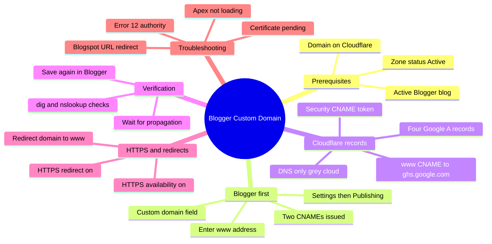

Your Blogger blog works fine on `something.blogspot.com`. You publish three posts, someone finds one, shares the link, and the URL looks like a rough draft. Then you want `yourdomain.com` on a business card, in a podcast description, or on a GitHub profile.

A Blogger custom domain is free, and the actual work is six DNS records plus one toggle in Blogger's settings. The part that eats your weekend is this: Blogger hands you two CNAME values, one of them unique to your blog and your Google account, and if something is off it answers with a message that reads like a shrug. "We have not been able to verify your authority to this domain." That is the famous **Error 12**.

This guide is the entire process on Cloudflare's free plan: which records to create, which ones must stay on the grey cloud, how to prove the DNS actually propagated, and how to fix the failure modes people genuinely hit. If you have already pointed other things at Cloudflare, our [GitHub Pages custom domain walkthrough](/p/github-pages-custom-domain-cloudflare/) covers the shared fundamentals in more depth.

<!--more-->

## The Setup at a Glance

The whole flow fits in one picture, and it is worth memorising because every failure in this guide is a step done in the wrong order.



## What Blogger Needs From Your DNS

Blogger does not use a single A record or a single CNAME. It wants a small, fixed set, and every one of them is documented in Google's own [custom domain help article](https://support.google.com/blogger/answer/1233387).

| Type | Name | Target | Purpose |
|---|---|---|---|
| CNAME | `www` | `ghs.google.com` | The blog itself |
| CNAME | unique token, e.g. `abc123xyz` | `gv-xxxxx.dv.googlehosted.com` | Ownership verification |
| A | `@` | `216.239.32.21` | Naked domain |
| A | `@` | `216.239.34.21` | Naked domain |
| A | `@` | `216.239.36.21` | Naked domain |
| A | `@` | `216.239.38.21` | Naked domain |

Two details in that table cause most of the pain.

**The security CNAME is unique.** Google generates it for your specific blog and Google Account, which is why you cannot copy it from a tutorial and why it changes if you delete and re-add the domain in Blogger. It is the record people forget.

**The four A records are only for the naked domain.** They make `yourdomain.com` resolve so it can redirect to `www.yourdomain.com`. They are not required if you only ever use the www address, and adding them by mistake is a common source of conflicts.

## Before You Start

* An active Blogger blog you can open in the **Settings** menu.
* A domain you already own, with nameservers pointing at Cloudflare. If the zone is not **Active** yet, wait for the nameserver change to settle first.
* A free Cloudflare account. The free plan covers all of this; nothing below needs a paid plan.
* `dig` or `nslookup` available locally. On Windows PowerShell, `Resolve-DnsName` does the same job.

> [!NOTE]
> If the domain still uses your registrar's default nameservers, add it to Cloudflare first, then change the nameservers at the registrar. Cloudflare emails you when the zone goes active. Everything in this guide assumes DNS answers from Cloudflare.

## Step 1: Add the Domain in Blogger First

This part is not optional, and the order matters.

1. Sign in to [Blogger](https://www.blogger.com) and pick your blog from the top-left switcher.
2. Open **Settings**, then the **Publishing** section.
3. Click **Custom domain**.
4. Enter the www form of your address, for example `www.yourdomain.com`.
5. Click **Save**.

Blogger will reject it, and the rejection is what you want. The error panel shows the two CNAME values you need:

```
We have not been able to verify your authority to this domain.
On your domain registrar's website, locate your Domain Name System (DNS)
settings and enter the following two CNAMEs:
(Name: www, Destination: ghs.google.com) and
(Name: ihv6dsqzqncm, Destination: gv-b75e6hh5zu7kdr.dv.googlehosted.com)
```

Those strings are from a real support thread, and they show the shape to expect: a random name on the left, a `gv-` prefixed destination on the right.

> [!IMPORTANT]
> Copy both values before you leave this screen. If you remove the custom domain from Blogger and add it again, Google can issue a different security token, and the CNAME you created a minute ago becomes a record pointing at nothing.

## Step 2: Create the Records in Cloudflare

Open your zone in the [Cloudflare dashboard](https://dash.cloudflare.com), go to **DNS** then **Records**, and add these.

### The blog CNAME

| Field | Value |
|---|---|
| Type | CNAME |
| Name | `www` |
| Target | `ghs.google.com` |
| Proxy status | **DNS only** |
| TTL | Auto |

### The verification CNAME

| Field | Value |
|---|---|
| Type | CNAME |
| Name | the unique token Blogger gave you |
| Target | the `gv-...dv.googlehosted.com` value Blogger gave you |
| Proxy status | **DNS only** |
| TTL | Auto |

### The four apex A records

Add each one separately, all with the name `@` and **DNS only**:

`216.239.32.21`, `216.239.34.21`, `216.239.36.21`, `216.239.38.21`.

Cloudflare shows the root domain as `@` in the Name field. If you see the name empty instead, that is the same thing.

> [!WARNING]
> Everything above must be on the grey cloud, **DNS only**. Orange (proxied) mode answers Google's DNS query with Cloudflare's own IP addresses instead of the real CNAME target, so Blogger cannot see where `www` points and verification never completes. This single toggle is behind the majority of Error 12 reports.

Before you save, audit the zone. Delete anything that collides:

* An existing A record on `www` or `@` pointing somewhere else. A hostname cannot have both a CNAME and A records.
* A leftover "website forwarding" or "parked page" record from the old registrar.
* An old `AAAA` record for the apex if you are not serving IPv6.

Leave your MX records alone. If you use email on the domain, those point at your mail provider and have nothing to do with Blogger. We covered that setup in the [Cloudflare email routing guide](/p/cloudflare-email-routing-custom-addresses/), and it works fine alongside the blog records.

## Step 3: Prove the DNS Propagated

Do not go back to Blogger yet. Confirm the records resolve first, because Blogger's error message does not tell you which record is wrong.

```bash
# The blog CNAME
dig www.yourdomain.com +noall +answer

# The verification CNAME
dig abc123xyz.yourdomain.com +noall +answer

# The four apex A records
dig yourdomain.com +noall +answer -t A
```

On Windows PowerShell:

```powershell
Resolve-DnsName www.yourdomain.com -Type CNAME
Resolve-DnsName yourdomain.com -Type A
```

What you want to see:

```
www.yourdomain.com.   300  IN  CNAME  ghs.google.com.
yourdomain.com.       300  IN  A      216.239.32.21
yourdomain.com.       300  IN  A      216.239.34.21
yourdomain.com.       300  IN  A      216.239.36.21
yourdomain.com.       300  IN  A      216.239.38.21
```

If the A records come back as `104.x.x.x` or `172.67.x.x` addresses, those are Cloudflare's anycast IPs. That means something is still proxied. Switch it to DNS only and wait a minute.

If your local resolver is being difficult, query a public one directly, or paste the hostname into Google's [DNS checker](https://dns.google) to see the answer from Google's own resolvers.

## Step 4: Save in Blogger and Turn On HTTPS

Go back to **Settings**, **Publishing**, **Custom domain** and click **Save** again. With the records correct and propagated, Blogger accepts the domain and the error panel disappears.

Then enable HTTPS. Open **Settings** and find the **HTTPS** section, which Google's [HTTPS help article](https://support.google.com/blogger/answer/6284029) places under **Settings** then **Basic**, in the same panel where the publishing options live. Set **HTTPS availability** to Yes, then set **HTTPS redirect** to Yes so every visitor lands on the encrypted URL.

Issuing the certificate is not instant. The panel reads "HTTPS Availability is being processed" and clears after 15 to 60 minutes.

> [!CAUTION] CAA records
> If your zone has a CAA record, Blogger cannot issue or renew its certificate unless `letsencrypt.org` is allowed. Blogger uses Let's Encrypt, and Google flags this explicitly in its documentation. A zone with a restrictive CAA record and no Let's Encrypt entry is a genuinely confusing failure, because everything else looks perfect.

Test both addresses in a private window once the certificate lands:

```bash
curl -sI https://www.yourdomain.com | head -n 1
curl -sI https://yourdomain.com | head -n 1
```

## Step 5: Make the Naked Domain Work

If the apex already resolves through the four A records, turn on the redirect. In Blogger's **Publishing** settings, switch **Redirect domain** on. That makes `yourdomain.com` 301 to `www.yourdomain.com` instead of serving a second copy of your blog.

One canonical hostname matters for more than tidiness. Two addresses serving identical content means crawlers index both, your link equity splits, and any canonical tag you add has to fight the duplication. If you want Cloudflare to handle the redirect instead, a **Redirect Rule** gives you finer control over status codes and query strings, though it requires the proxy to be on.

## Turning the Orange Cloud On Later

Once HTTPS works and the domain is stable, you can flip the records to proxied and get Cloudflare's edge network, Workers, and redirect rules. Two things to know first.

**Set SSL/TLS to Full (strict).** Flexible mode makes Cloudflare connect to Google over HTTP while Google redirects to HTTPS, which produces `ERR_TOO_MANY_REDIRECTS`. The [SSL mode reference](https://developers.cloudflare.com/ssl/origin-configuration/ssl-modes/) explains the ladder; Full (strict) is the only correct answer once the proxy is on.

**Blogger is a dynamic application, not a static site.** A cached HTML page can show one visitor's session state to another, and Blogger's own widgets and comment flows expect fresh responses. If you turn the proxy on, exclude Blogger's dynamic paths from cache, or better, keep caching off and use Cloudflare for Workers and redirect rules only.

## Common Errors and Fixes

| Symptom | Real cause | Fix |
|---|---|---|
| Error 12, "not able to verify your authority" | Record still proxied, or a typo in the security CNAME | Set both CNAMEs to DNS only, compare values character by character, wait an hour, save again |
| Error 12, but the CNAMEs look perfect | Verification token from an older Blogger entry | Remove the domain in Blogger, re-add it, and use the newly issued token |
| `www` will not accept a CNAME | An A record for `www` already exists | Delete the `www` A record, then add the CNAME |
| Naked domain does not load | Missing A records, or old forwarding records still active | Add all four A records on `@`, delete conflicting ones |
| Site loads, but Chrome says "Not secure" | Certificate still processing, or CAA blocked issuance | Wait an hour, refresh settings, check CAA allows `letsencrypt.org` |
| Old `.blogspot.com` URL still works | Google's redirect takes up to 24 hours | Wait, then clear cache. Google documents this delay |
| Redirect loop after enabling the proxy | Cloudflare SSL set to Flexible | Switch to Full (strict) under SSL/TLS, then Overview |

The Error 12 case deserves one more note, because the message is misleading. It says Blogger cannot verify your authority, which sounds like an account problem, but it is almost always a DNS problem. In practice, one of four things is true: a record is proxied, the security CNAME has a typo, a conflicting record exists on the same hostname, or propagation has not finished. Work through those four in order and you will usually be live within the hour.

If you are verifying the domain for the first time, also add the custom domain as a property in Google Search Console. It is a separate property from your `blogspot.com` address, and the sitemap needs to be resubmitted under the new hostname. Our [GA4 domain change guide](/p/change-domain-ga4-multiple-data-streams-guide/) covers the analytics side of the same move.

## Frequently Asked Questions

### How do I connect a custom domain to Blogger using Cloudflare?

Add your domain to Cloudflare and wait for the zone to show Active, then in Blogger go to **Settings**, **Publishing**, **Custom domain** and enter the www address. Blogger shows two CNAME values. Create those two CNAMEs plus the four Google A records for the apex in Cloudflare with proxy status set to **DNS only**, wait for propagation, and click **Save** in Blogger again.

### Which DNS records are required for Blogger on Cloudflare?

Two CNAMEs and four A records. The first CNAME points `www` at `ghs.google.com`. The second is a unique security CNAME generated for your blog and Google Account, usually in the form `gv-xxxxx.dv.googlehosted.com`. The four A records point the apex domain at `216.239.32.21`, `216.239.34.21`, `216.239.36.21`, and `216.239.38.21`. All six should be DNS only, not proxied.

### Why does Blogger show Error 12 even after I added the records?

Error 12 means Blogger could not confirm you control the domain. In practice it is one of four things: a record still on the orange proxied cloud, a typo in the unique security CNAME name or target, a conflicting leftover A record on the same hostname, or DNS that has not propagated yet. Set everything to DNS only, compare the values character by character against the Blogger screen, wait an hour, and save again.

### Should I use the orange cloud (proxied) or grey cloud (DNS only)?

Grey cloud, DNS only, for the entire setup and verification phase. Proxied mode hides the real CNAME target from Google, so Blogger cannot verify the domain or renew its certificate. Turn the proxy on later, only after HTTPS works, and switch Cloudflare's SSL mode to Full (strict), because Flexible creates a redirect loop.

### How long does DNS propagation take for a Blogger custom domain?

Cloudflare usually publishes records within a minute or two, but Google's own guidance is to wait at least one hour before retrying, and up to 24 hours in edge cases. The `blogspot.com` address redirecting to the custom domain can also take up to 24 hours after the domain is accepted.

### Do I need the four A records if I only use the www address?

Only if you want the naked domain to work. The four A records point `yourdomain.com` at Google's servers so it can redirect to `www.yourdomain.com`. Without them the apex simply does not resolve, which is fine if you never link to it, but users who type the naked address get nothing.

## Key Takeaways

- Blogger wants six records: two CNAMEs for the blog and ownership check, four A records for the naked domain.
- Add the domain in Blogger **first** so Google issues your unique security CNAME, then copy both values immediately.
- Everything stays on the grey cloud (**DNS only**) during setup. Proxied records hide the CNAME target and cause Error 12.
- The four apex A records point at `216.239.32.21`, `216.239.34.21`, `216.239.36.21`, and `216.239.38.21`.
- Verify with `dig` or `Resolve-DnsName` before retrying in Blogger, because Blogger's error never names the broken record.
- Enable HTTPS availability and HTTPS redirect, and check that any CAA record allows `letsencrypt.org`.

## Conclusion

Blogger on a custom domain is one of the cheapest credibility upgrades available, and the whole mechanism reduces to six records plus patience. Enter the domain in Blogger, copy the two CNAME values, reproduce them in Cloudflare with the proxy off, prove propagation with a dig query, then turn on HTTPS and let Google redirect the naked domain to www.

Get that sequence right and the domain is live inside an hour, with no cost beyond the domain itself and no server to maintain. Get the order wrong and you will spend a day guessing what Error 12 means.

The F9XR team hits the same DNS fundamentals on every client site, whether the origin is GitHub Pages, a static Hugo build, or a hosted platform like Blogger. The records differ; the discipline does not. If something in this guide is wrong or your setup hit a case we did not cover, the [Contributor Guide](/contribute/) explains how to send a fix, and our [Editorial Policy](/editorial-policy/) documents how Dev9b reviews and updates published articles. This post was drafted with AI assistance and verified against Google's official Blogger documentation and the Cloudflare DNS reference linked throughout.
