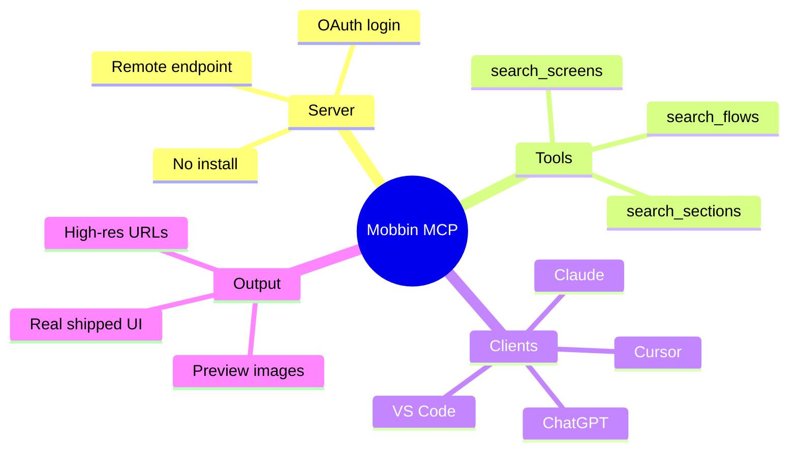

AI coding agents write solid code. They still guess at UI.

Ask Cursor or Claude to design a paywall, onboarding flow, or empty state and you often get the same generic layout everyone else ships. The model has never seen what actually works in production apps.

Mobbin fixed that. Its MCP server gives any compatible AI agent direct access to more than 600,000 real screens and flows from shipped products. Your agent searches the library with natural language, pulls annotated screenshots, and builds from proven patterns instead of vibes.

This guide shows exactly how to connect Mobbin to the tools developers already use: Claude, Cursor, ChatGPT, Claude Code, and other MCP clients. Setup takes under a minute once you have a paid Mobbin plan.

<!--more-->

## Key Takeaways

- Mobbin MCP is a remote Model Context Protocol server at `https://api.mobbin.com/mcp`.
- It requires a Pro, Team, or Enterprise Mobbin plan. Free accounts cannot connect.
- Authentication uses OAuth. No API keys to copy or store.
- Three tools are available: `search_screens`, `search_flows`, and `search_sections`.
- Supported clients include Claude Desktop, Claude Web, Claude Code, Cursor, ChatGPT, Codex, v0, VS Code, and any Streamable HTTP + OAuth MCP client.
- The rate limit sits at 60 requests per 60 seconds per user.
- Results include preview images plus high-resolution URLs that expire after 30 days.

## What Is Mobbin MCP?

Mobbin is the largest searchable library of real mobile and web UI. Designers and product teams have used it for years to research onboarding, checkout, paywalls, settings, and empty states from apps that actually shipped.

Mobbin MCP exposes that library to AI agents through the Model Context Protocol. The server runs remotely. You do not install or host anything. You point your agent at the endpoint, authorize once with your Mobbin account, and start searching.

The tools return:

- Individual screens (login, dialogs, navigation treatments, forms)
- Multi-step flows (onboarding, checkout, account setup)
- Website sections (heroes, pricing tables, footers)

Each result includes low-res previews sized for the model plus high-res image URLs for export into Figma, Notion, or your codebase.

This is read-only. The agent cannot create, edit, or delete anything in your Mobbin account.

If you are new to the protocol itself, our explainer on [why AI coding agents need tool access](/p/ai-coding-agents-explained/) covers the context behind MCP before you wire anything up.



## Prerequisites

Before you connect:

1. An active Mobbin Pro, Team, or Enterprise plan.
2. An MCP-compatible client (Claude Desktop, Cursor, ChatGPT, Claude Code CLI, and so on).
3. A browser for the one-time OAuth authorization.

No API keys. No local server process. No Docker.

## How to Connect Mobbin MCP Step by Step

The connection pattern is the same across clients: add the remote endpoint, authorize via browser, start searching.

### Connect to Claude Desktop or Claude Web

1. Open Claude and go to **Customize > Connectors**.
2. Click the **+** icon, then **Add custom connector**.
3. Name it `Mobbin`.
4. Paste the server URL: `https://api.mobbin.com/mcp`.
5. Click **Add**.
6. On first use the browser opens. Sign in with your Mobbin account and approve access.

Claude Code CLI users can either use the shared connector from Desktop or Web, or run:

```bash
claude mcp add mobbin --scope user --transport http https://api.mobbin.com/mcp
```

Then start a session, run `/mcp`, select mobbin, and authenticate. If you are still deciding between the CLI and an editor, our [OpenCode vs Cursor comparison](/p/opencode-vs-cursor/) breaks down the trade-offs.

### Connect to Cursor

1. Open the Mobbin plugin in the Cursor Marketplace and click **Add to Cursor**.
2. In the Cursor desktop app go to **Customize > Installed** and select Mobbin.
3. Click **Authenticate** and complete the browser OAuth flow.
4. Confirm the status badge shows the server is connected.

Alternatively add this to your `mcp.json` (project or global):

```json
{
  "mcpServers": {
    "mobbin": {
      "url": "https://api.mobbin.com/mcp"
    }
  }
}
```

Some Cursor versions expect `"type": "http"` or `"type": "streamableHttp"`. Check the current docs if the connection fails.

### Connect to ChatGPT

1. Open the official Mobbin plugin page on ChatGPT.
2. Click **Install plugin**.
3. Sign in with your Mobbin account when prompted.

If the official plugin is temporarily unavailable, add it as a custom MCP server:

1. Go to ChatGPT plugins.
2. Add a custom MCP server.
3. Name: `mobbin`.
4. URL: `https://api.mobbin.com/mcp`.
5. Authorize with your Mobbin account.

### Connect to Other Clients

Most other clients follow the same pattern:

1. Locate the MCP or Integrations settings.
2. Add a new HTTP or Streamable HTTP server.
3. Paste `https://api.mobbin.com/mcp`.
4. Authorize in the browser on first use.

Official per-client guides exist for Claude Design, Codex App and CLI, v0, Lovable, pen.dev, Replit, Figma agent, GitHub Copilot CLI, Grok Bot, and more. Check the [Mobbin clients overview](https://docs.mobbin.com/mcp/clients/overview) for the exact steps.

When we added the endpoint to our own VS Code and Cursor setups, the only real friction was remembering to finish the OAuth prompt before running a query. If the agent reports no tools, the authorization usually never completed.

### Building a Custom Integration

If you are shipping your own MCP client or agent platform, Mobbin supports Dynamic Client Registration (RFC 7591). Your users authorize with their own Mobbin accounts. Full details live in the [Build an integration](https://docs.mobbin.com/mcp/build-an-integration) guide.

## Available Tools and What They Do

| Tool | Purpose | Best for |
|------|---------|----------|
| `search_screens` | Find individual UI screens | Login, paywall, empty state, dialog, form, navigation |
| `search_flows` | Find ordered multi-step flows | Onboarding, checkout, account setup, subscription |
| `search_sections` | Find website page sections | Heroes, pricing, testimonials, footers, navigation |

Ask in natural language. Examples that work well:

- "Search Mobbin for onboarding screens from banking apps"
- "Find paywalls used by productivity apps with free trials"
- "Show empty states from collaborative tools"
- "Compare checkout flows from top e-commerce apps"
- "Pull bottom sheet examples from recent iOS apps"

Results include app name, context, links back to Mobbin, and images the agent can reason over or export.

## Practical Tips for Better Results

- Be specific about platform, industry, or pattern. "iOS fintech KYC screens" beats "login screens".
- Ask the agent to name the source apps so you can verify the references.
- Combine with your own design system. Tell the agent to adapt the pattern to your components rather than copy pixel for pixel.
- Watch the rate limit of 60 requests per minute. Batch related searches when possible.
- High-res image URLs expire after 30 days. Download or re-fetch them if you need them later.
- Interactive galleries appear in clients that support the MCP Apps extension, including ChatGPT, Claude Desktop and Web, and the Codex App.

If your project already has a design reference file, a tool like [getdesign.md](/p/what-is-getdesign-md-ai-agents-design-system/) pairs well with Mobbin: pull proven patterns, then constrain output to your tokens and components.

## Common Issues and Fixes

**Connection fails or no tools appear**  
Confirm you are on a paid Mobbin plan. Free accounts are blocked. Restart the client after adding the server.

**OAuth browser window never opens**  
Some clients require you to manually trigger authentication from the MCP menu. Look for an Authenticate or Connect button next to the Mobbin entry.

**Claude Team or Enterprise workspace**  
Your workspace admin may need to enable the Mobbin connector first.

**Transport errors**  
Make sure the client uses Streamable HTTP, not the older SSE transport. Explicitly set `"type": "streamableHttp"` if the client supports it.

**Rate limit hits**  
Wait 60 seconds or reduce the number of concurrent agent sessions calling Mobbin.

For a wider look at configuring servers like this, our [OpenCode MCP servers guide](/p/opencode-mcp-servers/) covers local servers, remote servers, and OAuth handling in more depth. If your agent stack spans multiple tools, the [Meta Muse connectors setup](/p/how-to-setup-meta-muse-connectors/) follows a similar authorization flow.

## Why Design References Matter for Agents

A model trained on public code has seen a lot of generic dashboards. It has not seen the specific decisions that separate a paid onboarding flow from a free one, or how a top banking app handles identity verification. Those patterns live in shipped products, not in tutorials.

Mobbin MCP closes that gap by handing the agent curated, real-world references at query time. In practice, the biggest quality jump comes from forcing the agent to cite what it found. When it has to name the source app and describe the pattern, it stops defaulting to the same centered card and three-feature grid.

This is the same principle behind other reference-style agents. Tools like [REA, which reverse-engineers an app](/p/what-is-rea-reverse-engineer-anything-setup-guide/), and workflow connectors such as [Grok Bot](/p/how-to-setup-grokbot/) all improve output by giving the model grounded context instead of relying on memory.

## FAQ

### What is Mobbin MCP?

Mobbin MCP is a remote Model Context Protocol server that lets AI agents search Mobbin's library of 600,000+ real product screens, flows, and website sections using natural language.

### Do I need a paid Mobbin plan?

Yes. Pro, Team, or Enterprise plans include MCP access. Free accounts cannot connect.

### Is there an API key?

No. Authentication is OAuth. Your MCP client opens a browser window the first time you connect. No keys to manage.

### Which AI tools work with Mobbin MCP?

Claude Desktop, Claude Web, Claude Code, Cursor, ChatGPT, Codex, v0, VS Code, Lovable, pen.dev, Replit, Figma agent, and any other client that supports Streamable HTTP plus OAuth.

### Can the agent change my Mobbin account?

No. All tools are read-only search operations.

### What is the difference between Mobbin MCP and Figma MCP?

Figma MCP works with your own design files. Mobbin MCP searches a curated library of real shipped products for inspiration and reference patterns.

## Conclusion

Your agents no longer have to invent UI from average training data. Point them at Mobbin, let them study what already works, and ship interfaces that feel like they belong in real products.

If you build something with this workflow, consider sharing it through the [contributor guide](/contribute/). Every tutorial on Dev9b is reviewed by the F9XR Review Board against our [editorial policy](/editorial-policy/), and reader corrections are welcome.

_Written with AI assistance and reviewed by the F9XR Team. Mobbin and the referenced tools are third-party products; pricing, tool names, and client support can change, so confirm details against the [official Mobbin MCP documentation](https://docs.mobbin.com/mcp/introduction)._
