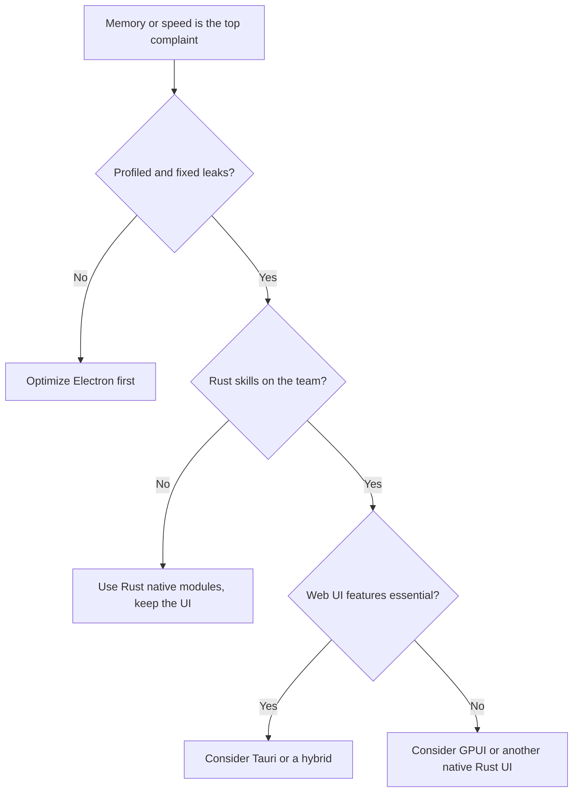

If you have ever alt-tabbed out of a game and watched Discord sit on a gigabyte of RAM, you already understand why this news landed so loudly. On November 4, 2026, Discord co-founder and CTO Stanislav Vishnevskiy confirmed on X that the company is rebuilding its desktop client in Rust. Electron is going away. React Native is going away too, at least on mobile.

For users, that is a story about a lighter chat app. For developers, it is a bigger signal. One of the most visible Electron apps in the world is walking away from the framework that made web-tech desktop apps normal. That raises a fair question for the rest of us: should you do the same?

<!--more-->

> [!TIP]
> Discord is rebuilding its desktop app in Rust with the GPUI toolkit and moving mobile off React Native while sharing code through Rust. An early Windows build shown by the CTO used about 290 MB of RAM. There is no public release date yet, and most teams should optimize their Electron apps before considering a rewrite.

## What Discord Actually Announced

The core facts are short. The details behind them matter more.

| Detail | What was reported |
|---|---|
| Who announced it | Stanislav Vishnevskiy, Discord co-founder and CTO, on X, November 4, 2026 |
| Desktop | Electron is being replaced by a native client written in Rust |
| UI toolkit | GPUI, the GPU-accelerated Rust UI framework from the team behind the Zed editor |
| Not chosen | Tauri, which still renders the interface in the system web view |
| Mobile | React Native is going away. Mobile keeps a native UI but shares app code with desktop through Rust |
| Codename | Discord Phoenix, seen in the Task Manager screenshot |
| Early metric | About 290.2 MB of RAM on Windows 11 in a screenshot |
| Timing | Discord hopes to start user testing soon. No release date has been given |

Rust is not new at Discord. The company has used it since 2018 in infrastructure, voice technology and parts of the current client. What changed is the scope. The goal now is to bring the entire client into Rust.

Vishnevskiy described the shared core as the main prize. Mobile keeps its native interface, while state, networking and business logic move into one Rust codebase that both platforms can use. He also said the new client looks and works like the current one, which is a useful promise to hold the team to when a beta ships.

The follow-up posts added two details that got lost in the RAM headlines. Discord maintains its own patches for GPUI and wants to push useful changes upstream. The browser version is also getting a UI wrapper that can render to HTML or GPUI depending on the platform, with accessibility called out as a requirement.

### What the 290MB Number Does and Does Not Prove

It is tempting to read "290 MB versus 4 GB" as a clean before and after. It is not, and the difference matters.

- It is one screenshot from an early build. Nobody outside Discord has measured it.
- The comparison is loose. The current app was reported at 1 to 2 GB when idle in Windows Latest testing, with spikes up to 4 GB. Those are different workloads from a freshly started test build.
- The screenshot had two accounts signed in, according to later reporting. That makes the figure more impressive, not less.
- Discord has not listed which features are in the build. We cannot compare like for like.
- The same screenshot showed Chrome at about 1.57 GB across 19 processes. A single native process is a different shape of memory use, not just a smaller number.

There is also the history behind the 4 GB figure. A Discord employee said in December 2025 that the team was testing an automatic restart when memory passed 4 GB, compared with under 1 GB in normal use. A restart failsafe treats the symptom. It also admits that the problem was real.

The fair reading: the early result is promising, and the full story is not in yet.

## Why Electron Became Discord's Bottleneck

Electron lets you build a desktop app with HTML, CSS and JavaScript. It does that by bundling two large pieces with every app: the Chromium browser engine and a Node.js runtime. You get one codebase for Windows, macOS and Linux, plus the web ecosystem. You also get a browser's worth of memory overhead for every app.

For a chat app that stays open all day, runs voice, video, screen sharing, overlays and thousands of messages, that overhead adds up. Discord's desktop client has been criticized for memory use for years. The criticism got louder as RAM prices rose and vendors brought back 8 GB Windows 11 configurations, which makes heavy background apps harder to defend.

| Cost | Why it hurts |
|---|---|
| Memory | Each app carries its own Chromium and Node.js |
| Startup time | Loading a browser engine and a large JavaScript bundle takes time |
| Battery | Constant JavaScript and rendering work drains laptops |
| Disk size | Installers are large because the runtime ships inside |
| Security surface | You track Chromium and Node updates for every release |

Electron also has real strengths, which is why so many products still choose it. VS Code, Slack and the ChatGPT desktop app use it, and the developer experience is excellent. The framework still works. It is simply heavy at Discord's scale.

Discord did try to trim it. An Electron 42 upgrade reportedly cut median CPU use by about 17%, but median memory use rose by around 4% at the same time. That trade-off is the reason a deeper rewrite started to look attractive.

## GPUI, Tauri and Electron Compared

This is the part developers asked about first. All three options can produce a desktop app, but they draw the interface in different ways.

Tauri is written in Rust, yet it renders the UI in the operating system web view: WebView2 on Windows, WKWebView on macOS and WebKitGTK on Linux. You skip bundling Chromium, so apps are far smaller. You still write the interface with web tech, and you still depend on a web engine.

GPUI is different. It is a GPU-accelerated UI framework written in Rust and developed by the team behind the Zed editor. It draws the interface itself, without a web view or Chromium. That is closer to how a game engine renders, and it can give fast, consistent drawing. The trade-off is that you give up the web ecosystem and rebuild many things that browsers provide for free.

| | Electron | Tauri | GPUI |
|---|---|---|---|
| Language for UI | JavaScript or TypeScript | JavaScript or TypeScript, with a Rust backend | Rust |
| Rendering | Bundled Chromium | System web view | GPU drawn by the toolkit |
| App size | Large | Small | Small to medium |
| Memory use | Highest of the three | Lower | Lowest in principle |
| Web ecosystem access | Full | Full | None |
| Maturity | Very mature | Mature | Younger, smaller ecosystem |
| Best for | Fast shipping with a web team | Lean apps that still use web UI | Performance critical, long running apps |

Discord's choice fits its profile. It is a huge app with a big team, very long session length and a performance reputation to repair. Few projects share that profile.

### The GPUI trade-off nobody mentions

GPUI renders through the GPU. At the time of writing, it did not support CPU-only rendering, according to reporting from Roboin. That is fine on a laptop with integrated graphics. On a desktop with a single dedicated GPU, the chat client now competes with the game for graphics resources.

None of that makes the choice wrong. The memory win may simply bring a different cost on some hardware, and independent testing during the beta will show whether it matters.

## What This Means for Your App

### 1. A flagship Electron app is moving off Electron

Electron has been the default answer for cross-platform desktop apps for about a decade. A move like this leaves the framework in place, yet it changes the conversation, especially for apps that stay open all day.

### 2. Rust keeps moving up the stack

Rust began as a systems language for servers, tooling and infrastructure. Using it for the full client, UI included, is a statement about how far the ecosystem has come. Readers building with agents and terminal tools will recognize the pattern. If you want to see how lighter tools compare with heavier ones, read our comparison of [OpenCode vs Cursor](/p/opencode-vs-cursor/), and our guide to the [OpenCode terminal UI](/p/how-to-setup-opencode-tui/). For the wider category, our explainer on [AI coding agents](/p/ai-coding-agents-explained/) covers what these tools actually do.

### 3. Shared code across desktop and mobile is the prize

Vishnevskiy described the goal as one core for state, networking and business logic, with platform specific UI on top. Many teams chase that and few reach it. React Native promised something similar in JavaScript. Rust gives Discord a core that also runs on servers and in the browser through WebAssembly.

### 4. Memory is now a product feature

With high RAM prices and cheap laptops still shipping with 8 GB, users notice apps that hog memory. Resource use has become part of how people judge quality. The same shift shows up in browser experiments, like the time [GTA 5 ran in a browser tab](/p/how-gta-5-ran-in-browser-tab/), where engineering teams pushed hard to fit a large workload into a small footprint.

### 5. It resets expectations for chat and community apps

If Phoenix ships and delivers, other big Electron apps will face comparisons. WhatsApp and Teams were already named in memory tests by Windows Latest. Expect users to ask why a chat app needs a browser inside it.

## Should You Rewrite Your Electron App?

For most teams, the answer is not yet, and probably not by rewriting. Discord has a dedicated engineering organization, years of runway on this project, and a product where memory use directly affects the user experience. A rewrite is expensive, risky and slow. Joel Spolsky's classic warning about full rewrites still applies: you throw away years of bug fixes while the old product stands still.

Use this decision guide.

| Your situation | Suggested path |
|---|---|
| Small team, web skills, need to ship now | Stay on Electron and optimize it |
| Mostly CRUD or a dashboard, want a lean installer | Evaluate Tauri |
| Heavy backend logic or performance critical modules | Keep the Electron UI, move hot paths to Rust |
| App stays open all day, memory is the top complaint | Profile first, then consider a staged migration |
| Rich text, accessibility and plugins matter out of the box | Stay with a web based UI |
| New, performance obsessed product with Rust expertise | Consider a native Rust UI such as GPUI |
| No Rust experience on the team | Do not start a rewrite. Build skills on a small project first |



### Questions to Ask Before You Rewrite

1. Is memory actually your users' top complaint? Check support tickets and reviews, not just your own opinion.
2. Have you profiled? Most Electron memory problems come from leaks and heavy renderers, not only from the framework.
3. Can you migrate in stages? A hybrid approach lowers risk.
4. Does your team know Rust? The learning curve is real, and hiring is harder.
5. What will you lose? Rich text editing, accessibility, spellcheck, input methods and extensions are all easier on the web.
6. Do you need all three platforms at the same quality? Custom drawn UIs must handle each platform's quirks.

## How to Cut Electron Memory Without a Rewrite

You can often get useful gains without replacing the framework. Start with measurement, then fix the usual suspects.

### 1. Measure before you change anything

Electron can report per-process usage from the main process:

```javascript
const { app } = require("electron");

setInterval(() => {
  const metrics = app.getAppMetrics().map((m) => ({
    type: m.type,
    pid: m.pid,
    workingSetMB: Math.round(m.memory.workingSetSize / 1024),
  }));
  console.table(metrics);
}, 10000);
```

Pair this with Chrome DevTools heap snapshots in the renderer to find what is actually growing.

### 2. Use fewer windows and renderers

Every `BrowserWindow` is another renderer process. Reuse windows where you can, close hidden ones, and avoid keeping unused views alive.

### 3. Virtualize long lists

Rendering thousands of DOM nodes is a classic memory sink. Use virtual scrolling for message lists, logs and tables so only visible items exist in the DOM.

### 4. Hunt leaks

Remove event listeners, clear timers, cancel subscriptions on unmount, and watch for detached DOM nodes in heap snapshots.

### 5. Manage images and media

Resize images before display, avoid holding large decoded images in memory, and release video and audio resources when views close.

### 6. Move hot paths to Rust

You can keep your UI and still use Rust where it matters, through native Node modules. A small example with napi-rs:

```rust
use napi_derive::napi;

#[napi]
pub fn count_words(text: String) -> u32 {
    text.split_whitespace().count() as u32
}
```

```javascript
const { countWords } = require("./native");
console.log(countWords("hello rust inside electron"));
```

This is the lowest risk way to get Rust performance without a full rewrite.

### 7. Lazy load everything you can

Load heavy modules, settings panels and rarely used features on demand, not at startup.

### 8. Test on low end hardware

Test on a machine with 8 GB of RAM, not just your fast laptop. If it feels heavy there, your users already know.

### 9. Track memory in CI

Add a smoke test that opens the app, performs common actions and fails the build if memory passes a threshold. Regressions are cheaper to catch early.

If your product is web first and you want to skip installs entirely, our guide to [building a SaaS app with Puter.js](/p/puter-js-build-saas-app-guide/) shows a different route. The point is to choose the delivery model before you choose the runtime.

## What to Watch Next

- Public testing of Discord Phoenix. Independent measurements will matter more than screenshots.
- Feature parity. Voice, video, overlays, plugins and accessibility are the hard parts.
- Linux support. Discord has not detailed platform coverage in the announcements covered here.
- GPU behavior during games on single-GPU systems.
- GPUI's ecosystem. If a large product ships on it, expect more libraries, docs and contributors.
- Third party clients and mods. A new rendering stack could change how customization works. Nothing has been announced yet.

## Key Takeaways

- Discord's CTO confirmed on November 4, 2026 that the desktop client is being rebuilt in Rust, replacing Electron.
- The new UI uses GPUI, a GPU-accelerated Rust framework from the Zed team, not Tauri.
- React Native is also leaving. Mobile keeps a native UI and shares app code with desktop through Rust.
- An early Windows build showed about 290 MB of RAM. That is promising, but it is one early screenshot, not a benchmark.
- The current Electron app is reported at 1 to 2 GB when idle, with spikes up to 4 GB.
- There is no release date. Discord says user testing is coming soon.
- Most teams should profile and optimize before rewriting. Rewrites are expensive and risky.
- You can get Rust performance inside Electron with native modules, which is often the best first step.

## Frequently Asked Questions

### Is Discord leaving Electron?

Discord has confirmed that its desktop app is being rebuilt in Rust and will no longer use Electron. Co-founder and CTO Stanislav Vishnevskiy announced the change on X on November 4, 2026. The company has not announced a release date.

### Why is Discord moving to Rust?

Discord wants a faster app that uses less memory and power. The current Electron client bundles a full browser engine, and reports show it can use 1 to 2 GB of RAM when idle and as much as 4 GB in extreme cases. A native Rust client aims to remove that overhead.

### What is Discord Phoenix?

Discord Phoenix is the name shown in a screenshot of the early Rust based desktop client posted by Discord's CTO. The Task Manager entry showed about 290 MB of RAM on Windows 11. Discord has not confirmed that Phoenix will be the final product name.

### What is GPUI?

GPUI is a GPU-accelerated user interface framework for Rust developed by the team behind the Zed code editor. It draws the interface directly without a web view or Chromium, which can improve speed and reduce memory use.

### Why did Discord not choose Tauri?

Tauri is written in Rust but displays the interface in the operating system web view, so it still depends on a web engine. Discord chose GPUI, which draws the interface natively. Discord has not published a full technical explanation of the decision.

### How much RAM will the new Discord use?

An early Windows 11 build showed about 290 MB in a screenshot, while signed in to two accounts. That figure comes from an early test build and is not a verified benchmark, so final memory use may differ.

### Will Discord mobile apps change too?

Discord plans to drop React Native on mobile. The apps will keep a native interface and share application code with the desktop client through Rust.

### Should I rewrite my Electron app in Rust?

Usually not as a first step. Profile the app, fix memory leaks, reduce renderer processes and move performance critical code to Rust modules. Consider a full rewrite only if memory or performance is the main product problem and the team has Rust expertise and time.

## Conclusion

Discord's move is the clearest sign yet that the Electron default is no longer automatic. The framework still makes sense for many products, especially small teams that need to ship fast with web skills. It just has to earn its place now, and memory use is part of the argument.

If you build a desktop app, start with a profile, not a rewrite. Fix leaks, cut renderer count, lazy load the heavy parts and move the hot spots to Rust. Reach for Tauri when a smaller installer matters. Reach for GPUI only when the product, the team and the timeline all support a native UI bet.

Primary sources for this article include [The Verge's report](https://www.theverge.com/news/1027379/discord-ditching-electron-web-app), [Windows Latest on the RAM testing](https://www.windowslatest.com/2026/11/05/discord-is-killing-its-electron-app-that-can-eat-4gb-of-ram-on-windows-11-and-the-rust-rebuild-uses-just-290mb/), [Roboin's technical summary](https://roboin.io/article/en/2026/11/05/discord-cto-announces-move-away-from-electron-to-gpui/) and the official [GPUI site](https://gpui.rs/). Our [contributor guide](/contribute/) explains how to pitch a follow-up, and the [editorial policy](/editorial-policy/) covers how we review claims like these.

*This article was drafted with AI assistance and reviewed by the F9XR Team before publication. The 290 MB figure comes from a screenshot and press coverage, not an independent benchmark. We will update it as Discord shares more.*
