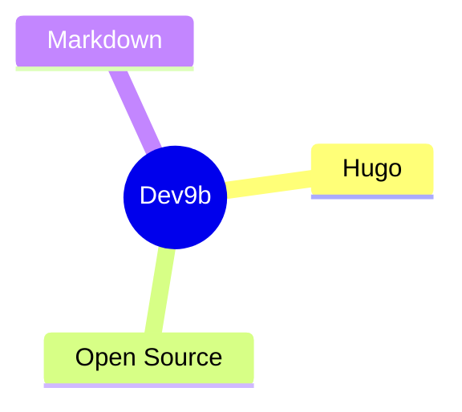
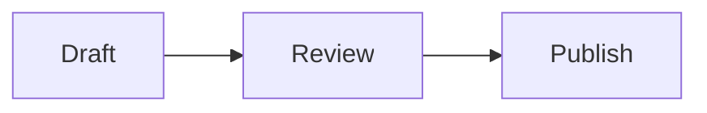

This page is a permanent internal fixture. It exists to confirm that the reader-facing components of Dev9b render correctly after a theme or configuration change. It is intentionally kept as a draft and is never included in the published site.

Use it before a release to check callouts, Mermaid diagrams, and inline links in one place. For the real writing references, see the [Markdown syntax guide for Dev9b](/p/markdown-syntax-guide-for-dev9b/) and the [useful shortcodes for Dev9b articles](/p/useful-shortcodes-for-dev9b-articles/).

<!--more-->

## GitHub-style Alerts

Each alert type should render with its own icon and accent color.

> [!NOTE]
> This is a note callout.

> [!TIP]
> This is a tip callout.

> [!IMPORTANT]
> This is an important callout.

> [!WARNING]
> This is a warning callout.

> [!CAUTION] Custom title
> This is a caution callout with a custom title.

## Mermaid Diagrams

A Mermaid code fence should render as a live diagram, not as raw text.





## Links and Toolbar

Internal links should resolve through a root-relative path, for example [Welcome to Dev9b](/p/hello-world/). Code blocks should expose a copy button in the reader toolbar:

```bash
hugo --gc --minify
```

## Key Takeaways

- This fixture verifies alerts, Mermaid diagrams, internal links, and the code copy button after a theme or config change.
- It stays `draft: true` and is excluded from every published build and feed.
- For real writing guidance, use the [Markdown syntax guide for Dev9b](/p/markdown-syntax-guide-for-dev9b/).

## Conclusion

If every component above renders as described, the reader feature set is healthy. Report regressions to the team through the [Contributor Guide](/contribute/), and review the standards in our [Editorial Policy](/editorial-policy/).
