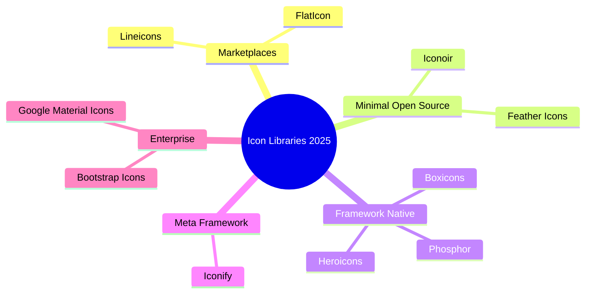

In the ever-evolving landscape of web design, the resources developers reach for keep changing. For over a decade, Font Awesome was the default icon library for countless websites and applications. As design trends shift and build tooling matures, though, a new wave of solutions has emerged. In 2025, the most interesting **Font Awesome alternatives** are lighter, more customizable, and far better suited to modern frameworks than the classic icon font ever was.

This guide walks through the leading icon libraries of the year, from the giant marketplaces to the framework-native component sets, and then explains how to pick one that actually fits your stack. We will cover Lineicons, FlatIcon, Feather, Heroicons, Boxicons, Iconify, and the enterprise mainstays, along with the performance, accessibility, and licensing questions that usually decide the matter for real teams.

> [!NOTE] Originally published
> This article was first published on [Tontuf TWL](https://tontufweblearners.blogspot.com/2025/05/top-font-awesome-alternatives-in-2025.html) and is republished here with attribution. The cover image is provided via [UIdeck](https://uideck.com/).

<!--more-->

## The Changing Face of Web Icons

"Icon libraries have become central to the modern web experience," explains Sasha Rodriguez, UX Director at DesignForward. "What we're seeing in 2025 is a move toward more customizable, lightweight options that integrate seamlessly with today's development frameworks."

This shift comes as designers increasingly prioritize loading speeds and unique brand expressions. Teams are moving away from the ubiquitous look that once dominated the web, and the same instinct that drives us to [de-AI-slop our website design](/p/how-to-de-ai-slop-website-design/) applies directly to icons: the default set is competent, but it is also everywhere.

## Leading Contenders in the Icon Space

### [Lineicons](https://lineicons.com/): The New Heavyweight

Emerging as perhaps the most comprehensive alternative, Lineicons has established itself as a powerhouse in the icon market. With an impressive collection exceeding 30,000 icons, including 4,000+ free options, it offers unrivaled variety for designers.

"What sets Lineicons apart is not just the quantity but the versatility," notes web developer Marco Chen. "Having multiple styles from regular to duo-tone within a single ecosystem means I can maintain visual consistency while adding subtle variations where needed."

The library supports modern development workflows with formats spanning SVG, JSX, TSX, VUE, Svelte, and HTML, making it particularly attractive for teams working across multiple frameworks.

### [FlatIcon](https://www.flaticon.com/): The Vast Repository

With a staggering 13.9 million vector icons, FlatIcon has positioned itself as the largest icon database available to designers in 2025. Beyond sheer volume, FlatIcon's competitive edge lies in its robust editing capabilities.

"The built-in editor transforms how we work with icons," says independent designer Priya Malhotra. "Being able to make quick adjustments to color, size, or even combine elements from different icons without leaving the platform has cut my design time dramatically."

Available in SVG, PNG, PSD, EPS, and BASE64 formats, FlatIcon caters to various design workflows while offering both free and premium options. The trade-off is that the catalog is contributed by many different authors, so visual consistency and licensing terms vary from one icon pack to the next.

### [Feather Icons](https://feathericons.com/): Simplicity Redefined

For projects where minimalism is paramount, Feather Icons continues to be the preferred choice among designers seeking clean, lightweight solutions.

"There's something refreshingly straightforward about Feather," remarks front-end developer Alex Washington. "Every icon communicates clearly without unnecessary flourishes, which perfectly supports the current trend toward functional minimalism."

As an open-source collection with MIT licensing, Feather has fostered a strong community of contributors who maintain its signature aesthetic while expanding its offerings. At roughly 280 icons it is deliberately small, so it suits focused interfaces rather than sprawling dashboards.

## Framework-Specific Solutions Gaining Traction

### Tailwind-Optimized Options

With Tailwind CSS maintaining its position as a leading CSS framework in 2025, icons designed specifically for its ecosystem have seen remarkable adoption. [Heroicons](https://heroicons.com/) leads this category, created by the same team behind Tailwind.

"The seamless integration between Tailwind and Heroicons eliminates friction in the development process," explains Tailwind enthusiast and developer Emma Kowalski. "The icons follow the same design principles as the framework itself, creating a cohesive visual language."

[Heroicons](https://heroicons.com/) ships as React and Vue components, as raw SVG, and even as copy-paste JSX, so you can drop an icon into a template without pulling in a font file. [Boxicons](https://boxicons.com/) has also become increasingly popular among Tailwind users, offering a modern aesthetic that complements the framework's utility-first approach.

### Component-Based Libraries

As component-based architecture continues to dominate front-end development, libraries like Phosphor Icons and [Iconoir](https://iconoir.com/) have gained significant followings for their flexibility within these systems.

"Component-based icon libraries let us treat icons as true elements of our design system rather than mere decorations," notes senior React developer James Liu. "Phosphor's multiple weights give us precise control over visual hierarchy without switching between different icon sets."

This matters because an icon is now a first-class component with props, not a CSS class on a `<i>` tag. Weight, color, and size become part of your type system instead of scattered hacks.

## The Integration Revolution: Iconify's Approach

Perhaps the most innovative development in the icon space comes from [Iconify](https://iconify.design/), which has pioneered a meta-approach to icon management. Rather than offering a single collection, Iconify aggregates dozens of icon sets under a unified API and component system.

"Iconify represents the future of icon implementation," says systems architect Sofia Bergman. "It solves the fragmentation problem by creating a consistent interface across virtually any icon library you can imagine. This means teams can mix and match icon styles while maintaining a standardized implementation pattern."

In practice, that means you can pull a Feather arrow, a Material menu, and a Tabler chart into the same interface and call them through one `Icon` component. The trade-off is a small runtime for on-demand loading, or a build step if you prefer to bundle only the icons you reference.

## How We Evaluate an Icon Library

After shipping icon sets into Hugo sites, React dashboards, and static marketing pages, the same handful of questions keep deciding which library wins. If you are choosing a Font Awesome replacement, run each candidate through this checklist:

| Question | Why it matters |
|---|---|
| Delivery format | Tree-shakeable SVG and components beat a webfont that blocks render. |
| Tree-shaking | Does the bundler drop unused icons, or does the whole set load? |
| Framework fit | Is there a first-class component for React, Vue, or Svelte? |
| Accessibility | Can each icon take `aria-hidden`, a `title`, or a text label? |
| Licensing | Does the license allow self-hosting and commercial use? |
| Consistency | Does the set cover the styles and weights your design system needs? |

In our own Hugo build, the biggest gain came from swapping a font-based set for inline SVG. Once you get the delivery format right, everything else, from caching to Core Web Vitals, gets easier. That is the same discipline behind the [Hugo SEO checklist](/p/hugo-seo-guide/), where a handful of technical decisions carry most of the outcome.

If you publish icons inside article content, our guide to [useful shortcodes for Dev9b articles](/p/useful-shortcodes-for-dev9b-articles/) shows how to embed and manage media cleanly without bloating the page.

## Icon Ecosystem at a Glance

The map below summarizes how the 2025 icon landscape splits between marketplaces, minimal open-source sets, framework-native kits, and meta-frameworks.

## Enterprise Adoption and Considerations

For enterprise applications, the transition away from Font Awesome requires careful consideration of licensing, implementation costs, and design consistency.

"Large organizations need to weigh several factors when considering an icon system switch," advises enterprise UX consultant David Morales. "Beyond aesthetics, questions about self-hosting capabilities, performance optimization, and accessibility compliance become crucial decision points."

[Google Material Icons](https://fonts.google.com/icons) continues to dominate in enterprise environments due to its comprehensive documentation, accessibility focus, and established design guidelines. However, Bootstrap Icons has made significant inroads in this space, particularly among organizations already utilizing the Bootstrap framework.

## Performance Implications

With Core Web Vitals metrics remaining critical to SEO and user experience, the performance characteristics of icon libraries have become a determining factor for many development teams.

"We've seen dramatic improvements in page performance after switching from font-based icon systems to optimized SVGs," reports performance engineer Naomi Park. "Libraries like Line Awesome and [Boxicons](https://boxicons.com/) offer the visual appeal designers want while satisfying the load time requirements that affect our bottom line."

The reason is straightforward. A webfont loads a single file containing every glyph, then paints only the ones you use, and until it arrives the browser either hides the text or flashes it. An inline SVG is just markup: it renders with the page, caches with the document, and only includes the icons you imported. When a font is unavoidable, `font-display: swap` and subsetting limit the damage, but SVG-first is the better default.

## The Future Outlook

As we move through 2025, the trend toward greater customization and framework-specific optimization appears set to continue. Industry experts anticipate further specialization of icon libraries for particular use cases, such as e-commerce, dashboards, and immersive experiences.

"The one-size-fits-all approach is firmly behind us," concludes digital strategist Omar Patel. "What we're witnessing is the natural maturation of the icon ecosystem, with specialized tools emerging for specific contexts while unified systems like Iconify help manage the resulting complexity."

For designers and developers evaluating alternatives to [Font Awesome](https://fontawesome.com/), the wealth of options represents not just different aesthetic choices but fundamentally different approaches to implementing visual elements in modern web projects. As these alternatives continue to evolve, they promise to further enhance both the development experience and the resulting user interfaces that shape our digital world.

## Frequently Asked Questions

### What is the best Font Awesome alternative in 2025?

There is no single winner. Lineicons leads on breadth with 30,000+ icons across multiple styles, Heroicons is the natural pick for Tailwind CSS projects, Feather and Iconoir win for minimalism, and Iconify is best when you want to mix many icon sets behind one API and component.

### Why are developers moving away from Font Awesome?

Font-based icon delivery can block rendering and load icons you never use, which hurts Core Web Vitals. Modern alternatives ship as tree-shakeable SVG or framework components, so you only pay for the icons you actually import.

### Are there free icon libraries that rival Font Awesome?

Yes. Feather Icons and Iconoir are MIT-licensed and fully open source, Lineicons and FlatIcon both offer large free tiers, and Heroicons and Boxicons are free for most use cases. Check each license before shipping a commercial product.

### What is Iconify?

Iconify is a meta icon framework that aggregates dozens of separate icon sets behind a unified API and component system. It lets you mix and match icon styles uniformly, and it can load icons on demand instead of bundling entire libraries.

### Do icon libraries affect page performance?

They can. Font-based icon systems often load a full webfont and can cause a flash of unstyled or invisible text, while optimized inline SVG icons are small, cache well, and render immediately. Choosing a tree-shakeable SVG library is one of the easiest performance wins on a modern site.

## Key Takeaways

- Font Awesome is no longer the default. In 2025 the ecosystem has split into marketplaces, minimal open-source sets, framework-native components, and meta-frameworks like Iconify.
- Delivery format matters more than icon count. Tree-shakeable SVG and components replace the render-blocking webfont.
- Match the library to your stack: Heroicons for Tailwind, Phosphor or Iconoir for component systems, Lineicons for breadth, Iconify for mixing sets.
- Always check licensing and accessibility before you ship, especially for enterprise and commercial products.
- Migrate font-based icons to inline SVG and you usually win on performance and Core Web Vitals at the same time.

## Conclusion

Choosing among the top Font Awesome alternatives in 2025 is less about finding one universal library and more about matching the right tool to your framework, performance budget, and design system. Start with delivery format, then narrow by licensing and coverage, and you will rarely go wrong. Before you make the switch on a production site, decide whether you need brand-specific icons, an on-demand runtime, or a fully self-hosted set, because that single answer eliminates most of the list.

This article is part of the educational, open-source content the [F9XR Team](/p/hello-world/) maintains for developers. If you want to help improve it, read the [Contributor Guide](/contribute/) and check the [Editorial Policy](/editorial-policy/) that governs everything we publish.

---

*This guide was drafted with the assistance of an AI coding assistant, then reviewed by the F9XR Review Board before publishing. It was first published on Tontuf TWL.*
