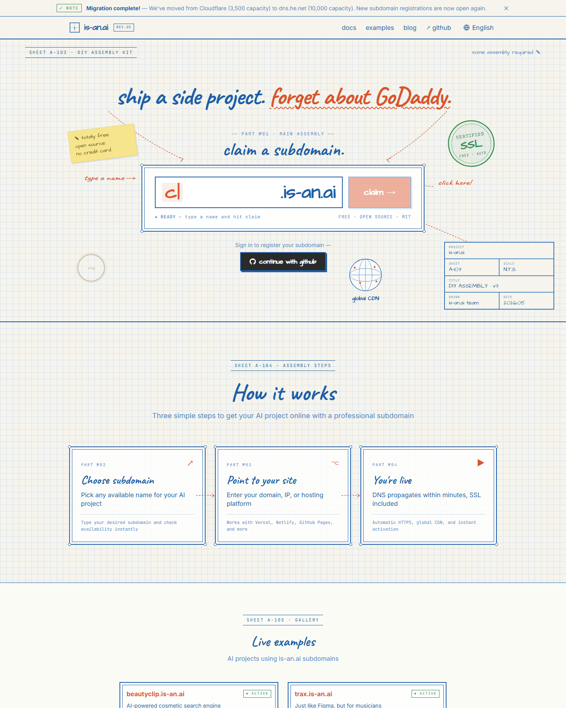

You have the idea. The repo is already named. Maybe the OpenAI or Anthropic key is sitting in your `.env` file, and the landing page is half built. Then you hit the small, annoying wall every side project hits: where is this thing going to live?

Buying a domain for every experiment adds up fast, and most AI prototypes never make it past week two. That is exactly the gap [is-an.ai](https://is-an.ai) was built to fill. It hands out free `your-project.is-an.ai` subdomains to people building AI products, and it recently shipped two upgrades that change the workflow: a proper command line tool, and plugin support so your AI coding agent can handle registration for you.

Better still, the service moved its DNS from Cloudflare to dns.he.net, which lifts capacity from 3,500 to 10,000 subdomains. New registrations are open again. When we loaded the homepage while writing this guide, the green migration banner was still pinned above the header, which is a good sign for anyone who found the door closed earlier.

This guide walks through the whole thing: what the service is, three ways to claim a name, the new CLI, how to let Claude Code or OpenClaw do it, and the mistakes that bite you later.

<!--more-->

## Quick Answer: How Do You Get a Free is-an.ai Domain?

You can get a free is-an.ai subdomain in three steps:

1. Pick a name and check availability at is-an.ai, or run `npx is-an-ai check my-project`.
2. Sign in with GitHub and register it, either on the website or with `npx is-an-ai register my-project -t CNAME -v my-project.vercel.app`.
3. Point the record at your host (Vercel, a static bundle, GitHub Pages, or your own server) and wait a few minutes for DNS.

That is the whole flow. The rest of this article covers the details, the edge cases, and the tips we wish someone had told us earlier. If you are still comparing free naming options, our roundup of [free subdomains for developers](/p/free-subdomains-for-developers-list/) puts is-an.ai next to is-a.dev, JS.ORG and a dozen others.

## What Is is-an.ai?

is-an.ai is a free subdomain service for AI researchers, developers, and hobbyists. If you have used is-a.dev before, the idea will feel familiar: you get a name like `your-project.is-an.ai` that you can point at a website, an API, a demo, or a portfolio.



*The is-an.ai homepage in November 2026. The claim box checks availability as you type, and the banner confirms the move to dns.he.net with 10,000 slots.*

A few things make it different from the older pattern of forking a repo and waiting for a maintainer:

- **GitHub sign-in.** No separate account to create.
- **No DNS knowledge required** for the basic path. You choose a name and a target.
- **Open source records.** DNS records live in a public GitHub repository, so everything is transparent and auditable.
- **Scriptable.** The CLI and plugins mean registration can sit inside your deploy pipeline or your agent workflow.

One naming note, because it trips people up: `is-an.ai` and `is-an-ai.dev` are two separate services run by different people. This article is about `is-an.ai`. Double check the domain before you paste a record somewhere.

## Big News: The Move From Cloudflare to dns.he.net

The most important update for anyone who tried to register earlier and found the door closed is this: the project has changed its DNS backend.

| | Before | Now |
|---|---|---|
| DNS provider | Cloudflare | dns.he.net (Hurricane Electric) |
| Subdomain capacity | 3,500 | 10,000 |
| New registrations | Closed (capacity reached) | Open again |

Why does this matter to you as a builder?

- **More room.** Capacity nearly tripled, so you are far less likely to hit a wall when you try to claim a name.
- **Names are available again.** If your favorite name was blocked because registrations were paused, try again now.
- **Nothing changes in how you use it.** You still register through the website, the CLI, or a pull request. The DNS provider is a backend detail.

A small practical tip: if you already hold a subdomain, check that it still resolves after the migration. A quick `dig your-project.is-an.ai` from your terminal will tell you in seconds. If something looks off, open an issue on the project repository rather than guessing. If you want to understand what changed under the hood, our [Hurricane Electric Free DNS setup guide](/p/hurricane-electric-free-dns-setup-guide/) walks through the portal and the nameservers involved.

## Three Ways to Register Your Subdomain

You can choose the method that fits how you work.

| Method | Best for | Speed | Skill needed |
|---|---|---|---|
| Website | Beginners, one-off projects | Fastest | None |
| CLI (`is-an-ai`) | Developers, CI pipelines | Fast | Basic terminal |
| Pull request | Agents with GitHub access, auditability | Slower (review or automation) | Git and JSON |

### Method 1: The Website

Go to is-an.ai, type the name you want, and check availability. Sign in with GitHub, confirm the registration, and set your target URL in the dashboard. The project describes this path as active within minutes.

### Method 2: The is-an-ai CLI

This is the headline feature. You do not even need to install anything:

```bash
# Check if a name is free
npx is-an-ai check my-project

# Register it and point it at a Vercel app
npx is-an-ai register my-project -t CNAME -v my-project.vercel.app
```

Prefer a global install? Run `npm install -g is-an-ai` and drop the `npx`. The package is published on [npm](https://www.npmjs.com/package/is-an-ai).

### Method 3: A GitHub Pull Request

If you like everything in version control, fork the [records repository](https://github.com/is-an-ai-org/is-an.ai) and add a file named `your-subdomain.json` inside the `records/` folder. One gotcha: the `owner.email` field must match the public email on your GitHub profile. Set it at github.com/settings/profile before you open the PR, or validation will fail.

## The New CLI, Command by Command

The CLI covers the full lifecycle of a subdomain, not just the first registration.

| Command | What it does |
|---|---|
| `check <name>` | Checks whether a subdomain is available |
| `register <name>` | Registers a new subdomain |
| `update <name>` | Updates an existing subdomain |
| `delete <name>` | Deletes a subdomain |
| `deploy <name> <dir>` | Uploads a static site and registers the name if needed |

And the options you will use most with `register`:

| Option | Meaning |
|---|---|
| `-t, --type` | DNS record type: A, AAAA, CNAME, or TXT |
| `-v, --value` | The record value, such as a hostname or IP |
| `-d, --description` | A short description of the project |
| `-m, --mode` | Force an auth mode: `api` or `pr` |
| `-w, --wait` | Wait for the PR to merge (PR mode only) |

### The Underrated Command: deploy

If your AI project has a static front end, `deploy` is genuinely handy. It uploads a build folder and serves it on your subdomain, with single page app routing so every path falls back to `index.html`.

```bash
# Vite or React
npm run build && npx is-an-ai deploy my-app ./dist

# Next.js with static export
npm run build && npx is-an-ai deploy my-app ./out

# Plain HTML
npx is-an-ai deploy my-app ./
```

The first deploy registers the subdomain automatically. Later deploys update the files in place. The documented limits are 50 MB total and 1,000 files, so keep heavy model weights and large datasets out of the bundle. If your front end lives on Vercel instead, the connection is the same CNAME pattern described in our [Cloudflare subdomain guide for GitHub Pages](/p/how-to-create-cloudflare-subdomain-github-pages/).

## Let Your AI Agent Register It for You

This is where it gets fun for anyone who already codes with an agent. The CLI ships as a plugin for AI coding tools.

**Claude Code**

```
/plugin marketplace add is-an-ai/cli
/plugin install is-an-ai
```

**OpenClaw**

```bash
openclaw plugins install github:is-an-ai/cli
```

**Any other agent with GitHub access** can use the pull request mode by supplying a `GITHUB_TOKEN`.

Once installed, you can say something like "check if `invoice-bot` is free on is-an.ai, and if it is, register it and point it at my Vercel deployment." The agent runs the same commands you would. If you are new to working this way, our explainer on [AI coding agents](/p/ai-coding-agents-explained/) covers what they can and cannot do on their own.

### How to Do This Safely

Agents are fast, which is also the risk. A few habits keep you out of trouble:

- **Review before approving.** Read the exact command the agent wants to run, especially anything with `delete` or `update` in it.
- **Use a narrowly scoped token.** If you use PR mode, give `GITHUB_TOKEN` only the access it needs, not your full account.
- **Pin and inspect plugins.** Treat any plugin install like running third-party code. Pin versions where you can and read the source of what you install.
- **Keep production names manual.** Let the agent handle prototypes. Register the name your paying customers will use yourself.

## Pointing Your Subdomain at an AI SaaS

Registering is half the job. Here are the record types you can use and when each makes sense.

| Record | Use it when | Example value |
|---|---|---|
| CNAME | Your host gives you a hostname (Vercel, Netlify, GitHub Pages) | `my-project.vercel.app` |
| A | Your host gives you an IPv4 address (a VPS running your API) | `203.0.113.10` |
| AAAA | Your host gives you an IPv6 address | `2001:db8::1` |
| TXT | You need to verify ownership with a vendor | `vc-domain-verify=...` |

### Verifying With Vercel and Other Vendors

Many platforms ask you to prove you control a domain by adding a TXT record. On is-an.ai, vendor verification records use the `_{vendor}.{subdomain}` pattern, and they only support TXT records. You also need to own the base subdomain first. So register `my-project` first, then add the verification record the platform asks for.

### A Simple Stack That Works

For a typical AI SaaS prototype, this combination is hard to beat:

1. Front end on Vercel or a static `deploy` to is-an.ai
2. API on a small VPS or a serverless platform, on a second name such as `api-my-project`
3. Environment variable for the base URL, so changing it later is a one line edit

If you need trusted HTTPS on a private network or a staging box that is not public yet, a certificate service such as [LocalCert](/p/free-localcert-subdomain-api-setup-guide/) solves a different problem and pairs well with this setup.

## Be Honest About What a Free Subdomain Is

This section builds trust, so let us be direct. A subdomain is not a domain you own. With `my-project.is-an.ai`, the service owns `is-an.ai` and lends you a slice of it. That is perfectly fine for a prototype, a demo, a hackathon entry, or an early beta. It is a weaker foundation for a business with paying customers.

Before you commit, think about:

- **OAuth redirect URIs and webhooks.** Stripe, Google, and GitHub all store your URL. Moving later means updating each one.
- **Brand perception.** Some enterprise buyers will expect a standalone domain.
- **Dependency on a volunteer-style service.** Rules, capacity, and providers can change, as the DNS migration just showed.

A sensible plan: launch on is-an.ai, validate the idea, and buy a real domain the moment you take your first payment. If you keep your base URL in one config value, the switch takes minutes.

## Practical Tips Before You Register

- **Choose a clear, short name.** `contractlens` beats `my-cool-ai-project-final-v2`.
- **Check availability from the terminal first.** `npx is-an-ai check name` is quicker than clicking around.
- **Use HTTPS-ready targets.** Pointing at a platform that handles certificates for you saves a headache.
- **Do not squat.** Register names you will actually use. Free resources stay free when people are considerate.
- **Follow the acceptable use rules.** The service is for AI projects. Read the repository guidelines so your name is not removed later.
- **Keep your GitHub email public** if you plan to use pull request mode.
- **Verify DNS after changes.** Use `dig` or an online DNS checker and give propagation a few minutes.

## Key Takeaways

- is-an.ai gives developers free `your-project.is-an.ai` subdomains for AI projects.
- The service moved its DNS from Cloudflare to dns.he.net, raising capacity from 3,500 to 10,000 subdomains.
- New registrations are open again, so previously blocked names are worth retrying.
- You can register through the website, the `is-an-ai` CLI, or a GitHub pull request.
- The CLI supports `check`, `register`, `update`, `delete`, and `deploy`.
- Claude Code and OpenClaw have plugins, so an AI agent can register subdomains for you.
- A free subdomain is great for prototypes, but plan to move to a domain you own once revenue starts.

## Frequently Asked Questions

### Is the is-an.ai subdomain really free?

Yes. is-an.ai offers free subdomains such as `your-project.is-an.ai` for AI projects. You sign in with GitHub, choose a name, and register it at no cost. Always read the current rules on the official site, since terms for free services can change.

### How do I register an is-an.ai subdomain from the terminal?

Run `npx is-an-ai check my-project` to confirm the name is free. Then run `npx is-an-ai register my-project -t CNAME -v my-project.vercel.app`, replacing the value with your host. You can also install it globally with `npm install -g is-an-ai`.

### Can Claude Code register an is-an.ai subdomain?

Yes. In Claude Code, run `/plugin marketplace add is-an-ai/cli`, then `/plugin install is-an-ai`. After that, you can ask the agent to check and register subdomains. Review each command it proposes before you approve it.

### Does is-an.ai work with OpenClaw?

Yes. Install the plugin with `openclaw plugins install github:is-an-ai/cli`. Any other agent with GitHub access can use the pull request mode with a `GITHUB_TOKEN`.

### Which DNS records can I use, and can I host a static site there?

The CLI supports A, AAAA, CNAME, and TXT records. Use CNAME for hosted platforms like Vercel, A or AAAA for servers with a fixed IP, and TXT for ownership verification. You can also run `npx is-an-ai deploy my-app ./dist` to upload a static build, with limits of 50 MB and 1,000 files.

### Is a free subdomain good enough for a production SaaS?

It works well for prototypes, demos, and early betas. For a paid product, a domain you own is safer, because you control renewals, branding, and DNS. Keep your base URL in config so migrating later is easy.

## Conclusion

is-an.ai is one of the few free services aimed squarely at AI builders, and the dns.he.net migration means the supply problem that closed registrations is gone for now. The website path takes a minute. The CLI takes about the same and fits neatly into a deploy script. The plugins are the interesting part: if you already let an agent write code, letting it claim the subdomain is a small, natural next step.

Before you ship, read the project rules and keep the name you care about under your own domain. For everything else, a free `is-an.ai` address is a fast way to get a real URL in front of users this afternoon.

If you want to write up your own experience with free developer infrastructure, start with our [contributor guide](/contribute/). The [editorial policy](/editorial-policy/) explains how we verify claims, dates and product details. This article was drafted with AI assistance and reviewed by the F9XR Team against the is-an.ai homepage, the CLI package page and the project repository.
