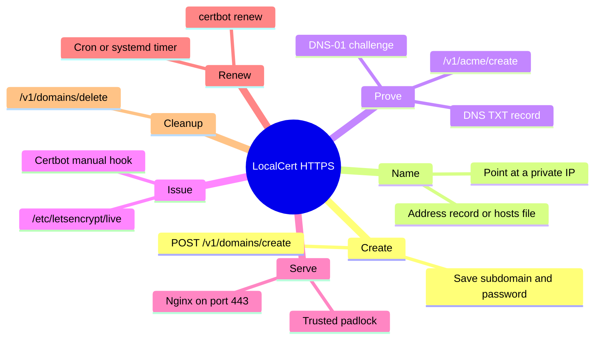

Most developers know the pain. You spin up a dashboard on your home server, a staging app on your office network, or a small internal tool, and the browser greets you with a red "Not secure" warning. You could run your own private certificate authority, but that means installing a root certificate on every device. You could buy a domain, but that is money and setup for something nobody outside your network will ever visit.

LocalCert offers a neat shortcut. It hands out a free `.localcert.net` subdomain through a tiny REST API, and it lets you publish ACME challenge records so a public certificate authority like Let's Encrypt can issue a real, browser-trusted certificate for it. No signup form. No input. One POST request.

This guide walks through the whole flow: creating the subdomain, saving your credentials, proving domain ownership with the ACME DNS-01 challenge, and installing the certificate on a web server. It also covers the rate limits that trip people up and one important expectation to set before you start.

<!--more-->

> [!NOTE] Before you start
> LocalCert is built for private networks, not public websites. If you need a name the wider internet can reach, use a registered domain or pick from our [list of free subdomains for developers](/p/free-subdomains-for-developers-list/).

## Quick Answer: What Is a LocalCert Subdomain?

A LocalCert subdomain is a free name under `.localcert.net` that you create by calling `POST https://api.localcert.net/v1/domains/create`. The call needs no input and returns access credentials. You then use those credentials with the ACME endpoint to add a DNS TXT record, which lets Let's Encrypt or another certificate authority issue a trusted HTTPS certificate for that name.

## Read This First: It Is Built for Private Networks

LocalCert comes from the getlocalcert project, which was designed to bring HTTPS to private networks. Its creator described the goal as increasing HTTPS adoption on internal networks using free subdomains, free DNS and certificates from certificate authorities that support the DNS-01 protocol. The project documentation also notes that these local-only domains are meant for private network use.

So set your expectations like this:

- **Great for:** home labs, NAS dashboards, Raspberry Pi projects, internal admin tools, staging servers on a LAN, local development with real HTTPS, and IoT gateways.
- **Not meant for:** a public website that strangers on the internet should reach. For that, you want a real domain.

If you build anything on this, check the current [LocalCert documentation](https://localcert.net/) for the latest usage terms, because free services can change their rules.

## What You Need Before You Start

- A terminal with `curl` (macOS, Linux, WSL, or Git Bash on Windows)
- A server or machine on your network where you can run a web server
- Certbot, or any ACME client that supports manual DNS hooks
- A password manager or a secure note, because you will receive credentials you must not lose

## The Three LocalCert Endpoints at a Glance

| Endpoint | Method | What it does | Body fields | Rate limit |
|---|---|---|---|---|
| `/v1/domains/create` | POST | Creates a new free subdomain and returns credentials | None | 1 request per 24 hours per IP |
| `/v1/acme/create` | POST | Creates a DNS TXT record for an ACME challenge | `subdomain`, `password`, `acme_token` | 3 requests per 10 minutes per IP |
| `/v1/domains/delete` | POST | Deletes a subdomain you created | `subdomain`, `password` | 25 requests per hour |

The base URL for everything is `https://api.localcert.net`. A plain GET to the root returns a small JSON list of routes, which is handy for a quick sanity check.

## Step 1: Create Your Free Subdomain

Run this in your terminal:

```bash
curl -sS -X POST https://api.localcert.net/v1/domains/create
```

That is the whole request. No headers, no body, no API key.

The response contains your new subdomain and the credentials that control it. The exact JSON field names are defined by the service, so read your own response carefully and copy the full output. The two values you will use again and again are the **subdomain** and the **password**.

**Save the response immediately.** Treat the password the way you would treat a database password, and paste the whole thing into a password manager before you do anything else.

### Why Saving It Matters

The create endpoint allows only one request per 24 hours per IP address. If you lose the password, you cannot simply call create again and get the same name back. You would be waiting a day for a new subdomain, and you would have started your certificate setup from zero.

### Pro Tip: Pipe It Straight to a File

```bash
curl -sS -X POST https://api.localcert.net/v1/domains/create -o localcert-credentials.json
chmod 600 localcert-credentials.json
```

The `chmod 600` line makes sure only your user can read the file. Never commit this file to Git, and add it to `.gitignore` right now.

## Step 2: Make the Name Reach Your Server

A certificate proves you control a name, but visitors still need that name to resolve to a machine. For a private network, that usually means pointing the name at a private IP such as `192.168.1.50`.

The three endpoints covered in this guide do not set address records. Record management on the public LocalCert service happens through its dashboard, and the project describes A, AAAA and CNAME records as handled differently depending on the domain. Check the current LocalCert documentation for how to set the address for your subdomain.

While you are testing, you can also add a line to your machine's hosts file so the name points at your server locally:

```text
192.168.1.50  your-subdomain.localcert.net
```

Replace the placeholder with your real subdomain from Step 1. This only affects the machine you edit, so it is a testing shortcut, not a team solution.

## Step 3: Understand How the ACME DNS-01 Challenge Works

Before touching any scripts, it helps to know what is actually happening. When you ask Let's Encrypt for a certificate, it must verify that you control the name. With the DNS-01 challenge, the certificate authority gives your ACME client a token and expects to find it in a TXT record at `_acme-challenge.your-subdomain`. The [Let's Encrypt challenge types documentation](https://letsencrypt.org/docs/challenge-types/) explains all three validation methods, and the protocol itself is defined in [RFC 8555](https://datatracker.ietf.org/doc/html/rfc8555).

This challenge type is the reason LocalCert exists. Unlike the HTTP-01 challenge, DNS-01 does not require your server to be reachable from the internet. Your machine can sit entirely behind a router. Only the DNS record has to be public.

LocalCert's `/v1/acme/create` endpoint does the publishing for you. You send it the subdomain, the password and the token (`acme_token`), and it creates the TXT record.

## Step 4: Issue a Certificate With Certbot and a Hook Script

Certbot can run a script of your own during a manual DNS challenge. Certbot passes the domain and the validation token to that script through the environment variables `CERTBOT_DOMAIN` and `CERTBOT_VALIDATION`.

Create a file called `localcert-auth.sh`:

```bash
#!/usr/bin/env bash
set -euo pipefail

# Use the subdomain value returned by LocalCert in Step 1
SUBDOMAIN="your-subdomain.localcert.net"

curl -sS -X POST https://api.localcert.net/v1/acme/create \
  -H "Content-Type: application/json" \
  -d "{\"subdomain\":\"${SUBDOMAIN}\",\"password\":\"${LOCALCERT_PASSWORD}\",\"acme_token\":\"${CERTBOT_VALIDATION}\"}"

# Give DNS a moment to publish the record
sleep 30
```

Make it executable:

```bash
chmod +x localcert-auth.sh
```

Now run Certbot. Start with a dry run so you do not burn through certificate authority rate limits while debugging:

```bash
export LOCALCERT_PASSWORD='paste-your-password-here'

sudo -E certbot certonly \
  --manual \
  --preferred-challenges dns \
  --manual-auth-hook ./localcert-auth.sh \
  -d your-subdomain.localcert.net \
  --dry-run
```

If the dry run succeeds, run the same command again without `--dry-run`. Certbot stores your certificate under `/etc/letsencrypt/live/your-subdomain.localcert.net/`. The [Certbot documentation](https://eff-certbot.readthedocs.io/) covers the manual hook and renewal flags in detail.

### Why the Sleep Matters

DNS changes are not always instant. If Let's Encrypt checks the TXT record before it has propagated, validation fails. A short wait in the hook is the simplest fix. If you still see failures, raise it to 60 seconds.

### Watch Your ACME Rate Limit

LocalCert allows 3 ACME record requests per 10 minutes per IP. A single-name certificate uses one. Do not loop the script or retry in a tight cycle. If something fails, read the error, fix it, then wait before trying again.

## Step 5: Install the Certificate on Your Web Server

Here is a minimal Nginx example:

```nginx
server {
    listen 443 ssl;
    server_name your-subdomain.localcert.net;

    ssl_certificate     /etc/letsencrypt/live/your-subdomain.localcert.net/fullchain.pem;
    ssl_certificate_key /etc/letsencrypt/live/your-subdomain.localcert.net/privkey.pem;

    location / {
        proxy_pass http://127.0.0.1:3000;
    }
}
```

Test and reload:

```bash
sudo nginx -t && sudo systemctl reload nginx
```

Open `https://your-subdomain.localcert.net` from a device on your network. You should see the padlock with no certificate warnings, because the certificate comes from a public certificate authority that browsers already trust.

## Step 6: Automate Renewals

Let's Encrypt certificates are short lived, so renewal is not optional. Since this setup uses a manual hook, renewal needs the hook and the password available to the renewal process.

A simple approach is to store the password in a root-owned environment file and run renewal from a cron job or systemd timer:

```bash
sudo certbot renew --manual-auth-hook /path/to/localcert-auth.sh
```

Test it with `sudo certbot renew --dry-run` well before your first real expiry date.

## Step 7: Delete the Subdomain When You Are Done

If you no longer need the name, clean up with the delete endpoint:

```bash
curl -sS -X POST https://api.localcert.net/v1/domains/delete \
  -H "Content-Type: application/json" \
  -d '{"subdomain":"your-subdomain.localcert.net","password":"your-password"}'
```

Deleting frees the name and removes your responsibility for it. Remember that the create limit is per IP and per 24 hours, so do not delete a working subdomain just to experiment.

## Common Errors and How to Fix Them

| Problem | Likely cause | Fix |
|---|---|---|
| Rate limit error on create | You already created one in the last 24 hours from this IP | Wait, or use the credentials you already saved |
| Rate limit error on ACME create | More than 3 calls in 10 minutes | Stop retrying, wait 10 minutes |
| Certbot says validation failed | TXT record not propagated yet | Increase the `sleep` in your hook |
| Authentication or password error | Wrong password or subdomain string | Compare against your saved credentials file |
| Browser still warns | Server is using an old or self-signed certificate | Check the certificate paths and reload the web server |
| Name does not resolve | No address record or hosts entry | Revisit Step 2 |

## Practical Tips From Real-World Setups

1. **Use the staging environment first.** Certbot's `--dry-run` or the Let's Encrypt staging endpoint avoids hitting production limits while you learn.
2. **Keep credentials out of scripts.** Read the password from an environment variable or a locked-down file, never hardcode it into a repo.
3. **One subdomain per environment.** Because you get only one new name per day, plan your naming. A good split is one for staging and one for your main internal tool, created on different days.
4. **Document it.** Write down which machine owns which name and where the renewal job lives. Future you will be grateful.
5. **Prefer a real domain for anything public or business critical.** A free service is great for labs and internal tools, but do not depend on one for customer-facing work.

## How This Compares to Other Approaches

| Approach | Cost | Browser trusted | Works on private network | Setup effort |
|---|---|---|---|---|
| Self-signed certificate | Free | No | Yes | Low, but warnings everywhere |
| Private certificate authority | Free | Only after installing your root cert | Yes | High |
| Your own domain plus DNS-01 | Domain fee | Yes | Yes | Medium |
| LocalCert free subdomain plus DNS-01 | Free | Yes | Yes | Medium |

If you already own a domain, you can do the same DNS-01 trick there. Our guides on [creating a Cloudflare subdomain for GitHub Pages](/p/how-to-create-cloudflare-subdomain-github-pages/) and [connecting a custom domain through Cloudflare](/p/github-pages-custom-domain-cloudflare/) cover that side of things.

## The LocalCert Setup at a Glance

The map below shows how the pieces fit together, from the first API call to a browser-trusted padlock.



## Frequently Asked Questions

### How do I get a free .localcert.net subdomain?

Send a POST request to `https://api.localcert.net/v1/domains/create` with no body. The API returns your new subdomain and the credentials that control it. Save the response straight away, because you can create only one subdomain per 24 hours per IP address.

### How many LocalCert subdomains can I create per day?

One. The create endpoint is limited to 1 request per 24 hours per IP address. The delete endpoint allows 25 requests per hour, and the ACME record endpoint allows 3 requests per 10 minutes per IP.

### Do I need an account or API key for LocalCert?

No account or API key is needed to create a subdomain, since the create endpoint requires no input. The credentials you receive in the response are what you use for later calls such as creating ACME records or deleting the subdomain.

### Can I get a Let's Encrypt certificate for a LocalCert subdomain?

Yes. LocalCert's ACME endpoint publishes the DNS TXT record needed for the DNS-01 challenge, which lets Let's Encrypt and other certificate authorities issue a trusted certificate. You send the subdomain, password and ACME token to `/v1/acme/create`.

### Can I use a LocalCert subdomain for a public website?

It is not what the service is built for. LocalCert focuses on private networks that need publicly trusted HTTPS certificates. For a public site, use a registered domain or a hosting platform's free subdomain.

### What happens if I lose my LocalCert password?

You lose control of that subdomain, because the password is required for ACME and delete requests. Since you can only create one new subdomain per 24 hours per IP, store the credentials in a password manager the moment you receive them.

### Why does the DNS-01 challenge work on a private network?

DNS-01 only checks a public DNS TXT record, not your server. Your machine never has to be reachable from the internet, so internal servers can still earn browser-trusted certificates.

## Key Takeaways

- A free `.localcert.net` subdomain takes one POST request to `/v1/domains/create`, with no input and no signup.
- The create endpoint is limited to 1 request per 24 hours per IP, so save the returned credentials immediately.
- The `/v1/acme/create` endpoint publishes the DNS TXT record needed for the ACME DNS-01 challenge.
- Certbot with a small manual auth hook script is the simplest way to connect the two, and `--dry-run` should always come first.
- LocalCert is built for private networks, so use it for home labs and internal tools while public projects move to a domain you own.

## Conclusion

A trusted padlock on a private service used to mean either a pile of root certificate installs or a paid domain. With LocalCert, a single `curl` command gives you a name, and a short hook script gives you a real Let's Encrypt certificate for it. The workflow is simple once you understand the DNS-01 challenge, and the rate limits are easy to live with if you save your credentials and avoid retry loops.

Start small. Create the subdomain, test with a dry run, and get one internal tool running over HTTPS. If you are still building out the lab itself, our guide to [running n8n locally on your PC](/p/how-to-install-n8n-locally-on-pc/) is a good companion, and when a project grows beyond the lab and needs a polished public home, the same static setup we use for this site is covered in our [Hugo and GitHub Pages walkthrough](/p/hugo-github-pages-setup/). Teams like F9XR Team handle that kind of public-facing build work as well.

If you want to write your own developer guide for the community, read the [Contributor Guide](/contribute/) and the [Editorial Policy](/editorial-policy/) that governs everything we publish.

---

*LocalCert is an independent project by William Harrison and the getlocalcert team, and is not affiliated with F9XR Team. The endpoint names, body fields and rate limits in this guide come from the public API and dashboard as checked on October 19, 2026. This guide was drafted with the assistance of an AI coding assistant, then reviewed by the F9XR Review Board before publishing. Free services change their rules, so confirm the current behaviour against the official documentation before you rely on it.*
