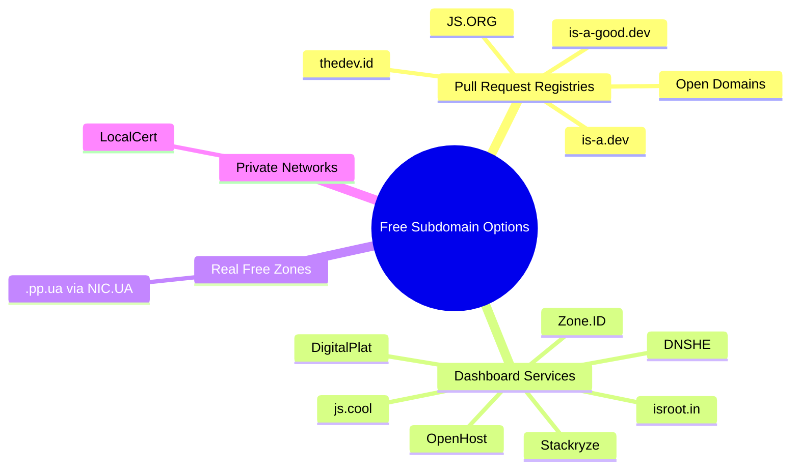

Every developer has been there. You finish a side project on a Friday night, push it to GitHub Pages, and then stare at a URL like `username.github.io/my-cool-project-v2`. It works, but it does not feel finished. A custom domain would fix that, yet paying for one before you know if the project will survive the month feels wrong.

This is exactly why free subdomain programs exist. Volunteers and small teams buy a domain, split it into subdomains, and hand them out to anyone with a project to host. You get a clean URL like `yourname.is-a.dev` at no cost, and you point it at your own hosting with a DNS record.

I went through fourteen of the best known options, checked each official page, and compared how they work, what they give you, and where they can bite you. Whether you are building a portfolio, an open source library, a weekend API, or a homelab that needs trusted HTTPS, one of these will likely fit.

> **Quick answer:** The most popular free subdomain providers for developers are is-a.dev, JS.ORG, is-a-good.dev, Open Domains, thedev.id, js.cool, DigitalPlat, DNSHE, isroot.in and the free .pp.ua zone, plus Stackryze, OpenHost, Zone.ID and LocalCert. Most let you claim a name through a GitHub pull request or a web dashboard, then point it to your host with a CNAME or A record.

<!--more-->

## How Free Subdomain Services Work

A free subdomain is a name under someone else's domain. The provider owns `example.dev`, and you get `yourname.example.dev`. You never own the root domain, but you control where your subdomain points.

There are two common models:

1. **Pull request registries.** You fork a GitHub repository, add a small file or JSON entry describing your subdomain and DNS target, and open a pull request. A maintainer or an automated check reviews it. JS.ORG, is-a.dev, is-a-good.dev, Open Domains and thedev.id work this way.
2. **Dashboard services.** You sign up on a website, search for a name, and manage DNS records in a control panel, sometimes through an API. DigitalPlat, DNSHE, isroot.in, Stackryze, OpenHost and Zone.ID follow this model.

Two services break the pattern. `.pp.ua` is a real second level zone where you register a full domain name for free through the NIC.UA registrar. LocalCert hands out `.localcert.net` names for a different purpose: getting publicly trusted certificates for hosts on a private network, not for publishing a website to the public internet.

## Quick Comparison Table

| Service | Example result | How you claim it | Best for |
|---|---|---|---|
| JS.ORG | `foo.js.org` | GitHub pull request | JavaScript projects on GitHub Pages |
| is-a.dev | `foo.is-a.dev` | GitHub pull request | Developer portfolios and projects |
| is-a-good.dev | `foo.is-a-good.dev` | GitHub repository | Personal sites and demos |
| Open Domains | `foo.is-not-a.dev` and others | Website form or pull request | Open source projects with several suffix choices |
| thedev.id | `foo.thedev.id` | Pull request editing `subdomains.json` | Static sites on Pages, Netlify or Vercel |
| js.cool | `foo.js.cool` | Apply and manage on the site | Open source projects, Chinese developer community |
| DigitalPlat | `foo.dpdns.org`, `foo.qzz.io` | Web dashboard | Developers who want to bring their own DNS |
| DNSHE | `foo.de5.net`, `foo.cc.cd` | Web dashboard and API | API driven and CI/CD workflows |
| isroot.in | `foo.isroot.in` | Web dashboard | Students and indie hackers |
| .pp.ua | `foo.pp.ua` | NIC.UA with phone activation | A full domain with your own nameservers |
| Stackryze | `foo.indevs.in`, `foo.sryze.cc` | GitHub login and dashboard | Free names with bring-your-own DNS |
| OpenHost | `foo.pride.moe`, `foo.prvcy.page` | Web dashboard | Privacy and community focused names |
| Zone.ID | `foo.zone.id`, `foo.nett.to` | Web dashboard | Short names for general projects |
| LocalCert | `foo.localcert.net` | Web dashboard | Trusted HTTPS for private networks |

## The 14 Free Subdomain Providers, Reviewed

### 1. JS.ORG

[JS.ORG](https://js.org/) has been serving the JavaScript community since 2015, which makes it one of the oldest programs on this list. You get a name like `foo.js.org`, and it is designed to sit in front of a GitHub Pages site.

The process is simple. Set up your GitHub Page, add a `CNAME` file to your repo with your chosen subdomain, then open a pull request on the JS.ORG repository. According to the project, a new URL should go live within 24 hours unless there is a naming conflict.

**Watch out for:** your page needs reasonable content with a clear connection to JavaScript. A blank page or an unrelated site is likely to be rejected.

### 2. is-a.dev

[is-a.dev](https://is-a.dev/) gives developers free `.is-a.dev` subdomains. Registration happens through the `is-a-dev/register` repository on GitHub, and there is a documentation site plus an availability checker on the homepage. The project has also launched `.is-a.bot` subdomains, and it runs a Discord server for support.

It describes itself as a free service for developers that will stay that way, supported by donations.

**Watch out for:** popular short names are often taken or reserved, so have two or three backup names ready.

### 3. is-a-good.dev

[is-a-good.dev](https://is-a-good.dev/) is a community run subdomain provider. Its site says the project has been running for over two years, and registration goes through a GitHub repository with a separate documentation site.

**Watch out for:** it is run by volunteers and funded by sponsors and contributors, so read the policies and keep a backup plan if you depend on the URL.

### 4. Open Domains

The Open Domains program offers free subdomains for personal sites, open source projects and more. Its GitHub repository lists several suffixes, including `is-cool.dev`, `is-local.org`, `is-not-a.dev`, `localplayer.dev`, `is-a-fullstack.dev` and `open-comm.org`. You register by adding a `.json` file to the `/domains` folder with a repo link and contact email, and the DNS record you want, such as a CNAME or MX.

Note that NS records are available to donors only, and the team can approve or reject any registration. I could not load the main website during research because of bot protection, so the details above come from the official GitHub repository.

**Watch out for:** the terms say the program can be changed or ended at any time, and abuse leads to removal.

### 5. thedev.id by upset.dev

[thedev.id](https://upset.dev/thedev.id) is a free identity for developers on the web. You claim `yourname.thedev.id`, which points to your static site through a CNAME record. The steps are clear: star and fork the repo, deploy your site, add your entry to `subdomains.json`, and open a pull request.

The entry looks like this:

```json
{
  "yourname": "yourname.github.io"
}
```

It works with GitHub Pages, Netlify, Vercel and other static hosts that support custom domains.

**Watch out for:** it is built for static sites pointing through a CNAME, so it is less flexible if you need complex DNS records.

### 6. js.cool

[js.cool](https://js.cool/en/) is run by Willin Wang and offers several suffixes, including `js.cool`, `v0.chat` and a Chinese language domain. The site shows a few hundred registered records and has both Chinese and English interfaces. Community directories describe it as a service for open source projects, with support for Vercel.

**Watch out for:** the site gives limited public detail on the application steps, so check the project repository and the Apply / Manage area before you plan around it.

### 7. DigitalPlat Domains

[DigitalPlat Domains](https://domain.digitalplat.org/) is operated by EdgeAlphix LLC and offers free public namespaces. The current options listed include `*.qzz.io`, `*.dpdns.org`, `*.us.kg`, `*.xx.kg` and `*.qd.je`. You register through a dashboard, then connect your own nameservers, so you can use any DNS provider or CDN.

**Watch out for:** the platform says it combines automated signals with human review to catch abuse. Keep your site legitimate and active.

### 8. DNSHE

[DNSHE](https://www.dnshe.com/) offers free domain registration with support for A, AAAA, CNAME, MX, TXT, NS, SRV and CAA records, DNSSEC support, and a REST API with webhooks. Suffixes shown on the site include `.de5.net`, `.us.ci`, `.cc.cd` and `.bot.cd`. That API makes it attractive if you want to manage DNS from scripts or a CI pipeline.

Registrations are valid for one year by default, with free renewal in the 180 days before expiry, according to its FAQ. The site says it needs no credit card and does not force ads onto your domain.

**Watch out for:** a missed renewal can lead to deletion, so enable the reminder emails.

### 9. isroot.in

[isroot.in](https://isroot.in/) gives you `yourname.isroot.in`, with simple management for A, CNAME and MX records. It says changes apply quickly and the project is open source on GitHub. A subdomain is valid for one year, with a reminder email before renewal.

**Watch out for:** custom nameservers are not supported yet, because the domain is not listed in the Public Suffix List. If you need your own NS records, pick a different provider.

### 10. .pp.ua via NIC.UA

The `.pp.ua` zone is different from the rest. According to [NIC.UA](https://nic.ua/en/domains/.pp.ua), it has offered free registration since 2008 and lets you use your own nameservers and glue records. Registration and renewal cost nothing.

You need a valid phone number to activate the domain, either through an SMS code on pp.ua or a Telegram bot. You can register up to three domains in 30 days, the delegation period is one year, and the account owner's contact details are always public because privacy hiding is not available in this zone.

**Watch out for:** public contact details, phone activation, and yearly renewals. The restoration fee after the grace period is steep, so do not let it lapse.

### 11. Stackryze Domains

[Stackryze Domains](https://domain.stackryze.com/) gives free subdomains under a handful of namespaces, including `indevs.in`, `sryze.cc`, `ryzedns.org`, `nx.kg` and `ryzn.pro`. You sign in with GitHub, pick a name, and register instantly. Each registration lasts one year and can be renewed for free from 60 days before expiry, and accounts get five domains by default.

The interesting part is DNS control. You can keep the default Stackryze nameservers or point the domain at Cloudflare, Route 53, DigitalOcean or another provider, so it behaves more like a small registrar than a fixed CNAME service. The project is open source and maintained by a small team in India.

**Watch out for:** names cannot be renamed after registration, and the provider's docs are still marked beta. If you pick the wrong name, you have to delete the domain and register a new one.

### 12. OpenHost Registry

[OpenHost Registry](https://registry.openhost.uk/) has offered free names since 2023. Its available suffixes are `.pride.moe`, `.prvcy.page`, `.16-b.it`, `.32-b.it` and `.64-b.it`. The `.pride.moe` space is intended for personal sites, projects and organizations that support the LGBTQIA+ community, while the other namespaces focus on privacy and community projects.

You register through the website. The registry says its names work as full domains, with A and CNAME records and NS records when the registry approves them, and WHOIS privacy is enabled by default.

**Watch out for:** some namespaces have a clear purpose, so claim a name that fits. Custom nameservers are subject to approval rather than automatic.

### 13. Zone.ID

[Zone.ID](https://www.zone.id/) offers free `.zone.id` and `.nett.to` subdomains through a dashboard at `my.zone.id`. It is run by PT. Geksa, an Indonesian company, and the site says more than 37,000 free domains have been created. It markets its names as short, indexable by Google, and eligible for Google AdSense, which is unusual for a free namespace.

Availability checks and sign-in happen on the homepage, and records are managed from the panel.

**Watch out for:** much of the audience and documentation is Indonesian, and the usual free-name reputation rules still apply. Keep the site legitimate and active.

### 14. LocalCert

[LocalCert](https://localcert.net/) is not a website namespace. It provides free `.localcert.net` subdomains so you can get certificates from public CAs like Let's Encrypt for machines on a private network. Instead of running your own certificate authority, you create a subdomain in the dashboard and publish the ACME DNS challenge TXT record LocalCert gives you. The CA can see that record even though the host itself is only reachable on your LAN, so the certificate validates.

That makes it useful for homelabs, internal dashboards and test devices that need a browser-trusted certificate without a public IP. Our [LocalCert API setup guide](/p/free-localcert-subdomain-api-setup-guide/) walks through the create call and the Certbot hook end to end.

**Watch out for:** these names are for internal services, not public websites. The dashboard allows one new subdomain per 24 hours, and you need to keep the generated password safe because it is what lets you manage the subdomain and its records.

## The Free Subdomain Landscape at a Glance

The map below groups the fourteen options by the way you actually claim them.



## How to Choose the Right One

| If you need... | Consider |
|---|---|
| A JavaScript project URL | JS.ORG |
| A clean developer portfolio name | is-a.dev, thedev.id |
| Lots of DNS record types | DNSHE, Open Domains |
| API or CI/CD automation | DNSHE, Stackryze |
| Your own nameservers | DigitalPlat, .pp.ua, Stackryze |
| A privacy or community namespace | OpenHost |
| A short name for a general project | Zone.ID |
| Trusted HTTPS on a private network | LocalCert |
| The fastest signup without Git | isroot.in, DNSHE, DigitalPlat, Stackryze, Zone.ID |

## How to Claim a Free Subdomain: A Practical Walkthrough

Here is a general workflow that works for most pull request based programs.

### Step 1: Deploy your site first

Most maintainers want to see a live project. Deploy to GitHub Pages, Netlify, Vercel or Cloudflare Pages. If you need help, our guide to [Hugo on GitHub Pages](/p/hugo-github-pages-setup/) walks through a clean static setup.

### Step 2: Pick two or three backup names

Short names go fast. Choose something that matches your project, not a generic word.

### Step 3: Read the provider's rules

Check the acceptable use policy and the registration docs. Some programs require a certain type of project, like JS.ORG, and others reject empty or misconfigured sites.

### Step 4: Add your DNS entry

For a static site on GitHub Pages, the target is usually `yourusername.github.io`. Follow the exact file format the repository asks for, including lowercase file names where required.

### Step 5: Add the matching custom domain on your host

The DNS entry is only half the job. Add the new domain in your host settings, or commit a `CNAME` file if your host uses one. Then enable HTTPS once the certificate is issued.

### Step 6: Test and monitor

Check the page over HTTPS, test with and without a trailing path, and use a DNS lookup tool to confirm the record. If you later move to a paid domain, our guide on [connecting a custom domain to GitHub Pages with Cloudflare](/p/github-pages-custom-domain-cloudflare/) shows the next step, and our post on [creating a Cloudflare subdomain for GitHub Pages](/p/how-to-create-cloudflare-subdomain-github-pages/) covers subdomain setups you control yourself.

## Risks and Limits You Should Know About

Free comes with trade-offs. Keep these in mind before you print the URL on a business card.

- **You do not own the root domain.** The provider can change rules, suspend your subdomain, or shut the program down. Open Domains states in its terms that it can modify or end the program at any time.
- **Expiry and renewals.** Several services use one year terms. Set a calendar reminder.
- **Reputation varies.** Some free suffixes get abused by spammers, which can affect email deliverability and how browsers or filters treat the domain.
- **Some namespaces have a purpose.** OpenHost's `.pride.moe` is meant for LGBTQIA+ community sites, and LocalCert names are for private networks. Claim a name that fits the program instead of treating every suffix as generic.
- **Public Suffix List status matters.** Domains listed there get isolated cookies and better browser security. Domains that are not listed can have limits, like isroot.in's missing custom nameserver support.
- **Email is risky.** Do not rely on a free subdomain for important email. If you want custom addresses, a paid domain with something like [Cloudflare Email Routing](/p/cloudflare-email-routing-custom-addresses/) is safer.
- **SEO and trust.** A free subdomain can rank, but visitors and search engines often trust a domain you own more. For a serious product or brand, plan to move to your own domain, and set up redirects when you do. Our [Hugo SEO guide](/p/hugo-seo-guide/) covers the basics of doing that cleanly.

## Practical Tips From Real Use

- **Use free subdomains for demos, portfolios and open source docs.** Use a paid domain for anything that earns money.
- **Keep your content real.** Maintainers remove empty or abandoned sites.
- **Document your DNS records.** Keep a note of every record in your repo so you can rebuild quickly.
- **Do not put all projects on one provider.** Spread risk across two services if the URLs matter.
- **Never use a free subdomain for phishing, spam or illegal content.** Providers ban those quickly, and it ruins the service for everyone.
- **Consider donating.** Most of these programs run on volunteer time and donations.

## Frequently Asked Questions

### What is a free subdomain?

A free subdomain is a name under a domain owned by someone else, such as `yourname.is-a.dev`. The provider hosts the DNS, and you point the name to your own website or server using a record like CNAME or A.

### Which free subdomain service is best for developers?

For most developers, is-a.dev and JS.ORG are the best known options. JS.ORG suits JavaScript projects on GitHub Pages, while is-a.dev is aimed at developer portfolios and projects. For API based DNS management, DNSHE is a strong choice, and LocalCert is the pick when you need trusted HTTPS for hosts on a private network.

### Are free subdomains safe to use?

They are safe for demos, portfolios and open source projects, but they carry risks. You do not own the root domain, the provider can suspend or end the program, and some free suffixes have a spam reputation. Avoid them for business critical sites or email.

### Can I use a free subdomain with GitHub Pages?

Yes. Most providers support GitHub Pages. Point your subdomain to `yourusername.github.io` with a CNAME record, then add the custom domain in your repository settings and enable HTTPS.

### How long does a free subdomain last?

It depends on the provider. DNSHE, isroot.in and Stackryze use one year terms with reminders, and `.pp.ua` has a one year delegation that you can renew for free. Pull request registries usually keep your name as long as the site stays active and follows the rules.

### Can I get a free domain with my own nameservers?

Yes, with some providers. DigitalPlat lets you connect external nameservers, DNSHE supports changing NS, and `.pp.ua` supports your own nameservers and glue records. isroot.in does not support custom nameservers yet.

## Key Takeaways

- Free subdomain services let you get a clean URL for a personal site, portfolio or open source project without paying for a domain.
- Most use either a GitHub pull request workflow (JS.ORG, is-a.dev, is-a-good.dev, Open Domains, thedev.id) or a dashboard (DigitalPlat, DNSHE, isroot.in, js.cool, Stackryze, OpenHost, Zone.ID).
- `.pp.ua` is a real free zone through NIC.UA that supports your own nameservers, and LocalCert is the specialist for trusted HTTPS on hosts that live only on your private network.
- Check the rules before you apply, since some namespaces have a purpose, and remember you do not own the root domain, so plan for renewals, policy changes and possible suspension.
- Use free subdomains for side projects and demos, and move serious products to a domain you own.

## Conclusion

A free subdomain is one of the cheapest ways to make a weekend project look finished, as long as you go in knowing the trade-offs. Pick a provider that matches how you want to manage DNS, claim two or three backup names, deploy your site before you apply, and remember that you are borrowing a name, not owning one. For anything you intend to grow, treat the free subdomain as a launchpad and plan the move to a domain you control.

If you want to write your own developer guide for the community, read the [Contributor Guide](/contribute/) and the [Editorial Policy](/editorial-policy/) that governs everything we publish.

---

*Last checked against each provider's official pages on October 19, 2026. Policies, suffixes and availability change often, so confirm details before you register.*

*This guide was drafted with the assistance of an AI coding assistant, then reviewed by the F9XR Review Board before publishing.*
