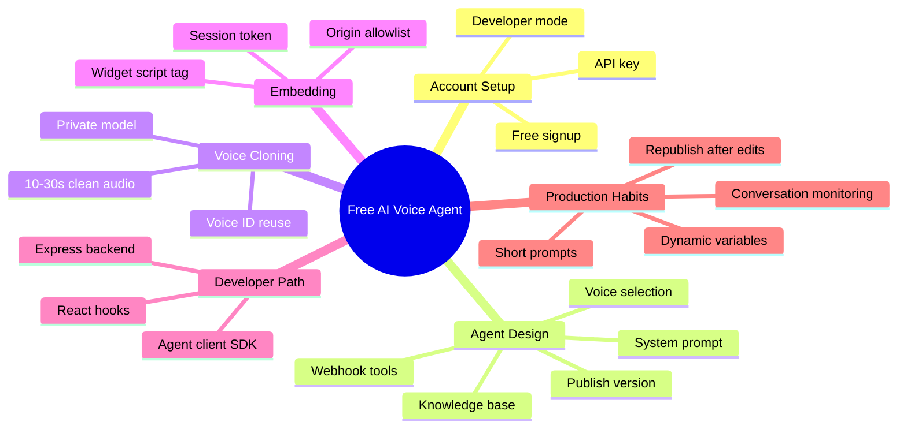

If you have ever wanted a real-time AI voice agent on your site that can talk back, answer questions, and sound human without burning through your budget, Fish.audio makes it possible right now. The platform gives you a free tier, a solid voice library, instant voice cloning, and a ready-to-use agent system that handles speech recognition, turn-taking, and synthesis for you.

This guide walks you through creating a free AI voice agent on Fish.audio and getting it live on your website. We cover the no-code path with the embeddable widget and the developer path with the Web SDK and a simple backend. Everything is aimed at developers who want practical steps and working code they can paste today.

> [!NOTE] Disclosure
> Sign-up links to Fish.audio in this article are [affiliate links](https://fish.audio/?aff=DWSVEGZ5E5OPQ). If you create an account through them we may earn a commission at no extra cost to you. It never affects what we choose to cover; our process is documented in the [Editorial Policy](/editorial-policy/).

<!--more-->

## Key Takeaways

- Fish Agents is in public beta and available to every account. New accounts receive a trial balance that covers roughly 60 minutes of agent conversation.
- You can design the agent in the visual Builder (prompt, voice, knowledge, tools), test it live, publish a version, then embed it with two lines of HTML.
- For production sites with authenticated users, create short-lived session tokens on your backend so the API key never reaches the browser.
- Public agents work with an origin allowlist and rate limits. Private agents require a session token from your server.
- Voices come from the Fish Audio library or your own clones (as little as 10 to 15 seconds of clean audio). Drama 3 and S2.1 Pro power the speech.
- The free plan and trial credits let you prototype and ship a working voice agent without an immediate paid upgrade.

## What Is a Fish.audio Voice Agent?

Fish Agents is a hosted real-time voice agent platform. You define the agent's system prompt, voice, knowledge base, and tools in a console. The platform takes care of ASR (speech recognition), turn-taking, and TTS (speech synthesis). Once published, the same agent can talk through a browser widget, a custom Web SDK UI, or a phone number.

That division of labor is the important part: you are not wiring a speech model to a transcript loop yourself. If you have read our [AI coding agents explained](/p/ai-coding-agents-explained/) guide, you know the observe-decide-act loop an agent runs. Fish.audio runs that loop on hosted infrastructure and hands you the configuration surface.

Three main surfaces work on the same agent:

| Surface       | What it does                                      | Best for                          |
|---------------|---------------------------------------------------|-----------------------------------|
| Console       | Visual design, testing, publishing                | Rapid iteration, no code          |
| REST API      | Create agents, sessions, tools programmatically   | Automation, backends              |
| Client SDKs   | Live voice conversations in the browser           | Custom UIs and React apps         |

Agents start with a $5 trial balance (about 60 minutes of conversation). After that, usage is billed against your API credits. The free plan still gives you monthly TTS credits for non-agent text-to-speech work.

## Guide at a Glance

The whole path from signup to a live embed, mapped out:



## Step 1: Create Your Free Fish.audio Account

1. Go to the [Fish.audio sign-up page](https://fish.audio/?aff=DWSVEGZ5E5OPQ) and register. Google sign-in works and no credit card is required for the free tier.
2. Once inside the app, switch to Developer mode if you plan to use the API (look for the mode toggle in the top-left menu).
3. Create an API key under API Keys. Name it something clear, set expiration to Never if you want, and copy the key immediately. Store it in an environment variable:

```bash
export FISH_API_KEY="your_api_key_here"
```

Never commit the key to version control.

## Step 2: Create and Configure Your Voice Agent (No-Code Path)

1. Open the [Agents console](https://fish.audio/app/agents) and click **New agent**. Give it a clear name (for example "Support Agent" or "Docs Helper").
2. On the Configuration page write the system prompt. Keep it focused. Example:

```
You are a friendly product support agent for Acme. Keep answers short and conversational. If you do not know something, say so and offer to escalate.
```

You can also set a first message so the agent opens the conversation. Prompt craft matters more here than in a chatbot, because the user is speaking and latency is visible. Our [system prompt writing guide](/p/what-is-system-prompt-how-to-write-effective/) covers structure, constraints, and tone in depth.

3. Pick a voice. Use a library voice or one of your own clones. Speaking language is independent of the voice model. Drama 3 is the default expressive TTS model; S2.1 Pro is also available.
4. Optionally attach knowledge documents or webhook tools if the agent needs to look up data or call your backend. Teams already wiring AI into other platforms, like the connectors covered in [how to set up Meta Muse connectors](/p/how-to-setup-meta-muse-connectors/), will recognize the same pattern: the agent fills arguments from the conversation and your endpoint answers.
5. Click **Test call** and talk to the draft. Preview calls always run against the current draft so you can iterate quickly.
6. When you are happy, click **Publish**. Live sessions only use published versions. You can keep editing the draft without affecting production traffic.

## Step 3: Clone a Custom Voice (Optional but Powerful)

If you want the agent to sound like your brand or a specific persona:

1. Go to Voice Cloning and upload 10 to 30 seconds of clean, single-speaker audio (or record directly).
2. Name the model and set visibility (Private is safest for personal voices).
3. Once training finishes you get a voice model ID. Use that ID as the agent's `voice_id`.

Cloned voices work across the supported languages and can be reused in both TTS and agents. Clean audio is the whole game here: one speaker, no background music, no room echo.

## Step 4: Embed the AI Voice Agent on Your Website (Easiest Method)

The fastest way to put a working voice agent on any page is the official widget, as described in the [widget deploy guide](https://docs.fish.audio/agents/deploy/widget).

### Public agent (no backend required)

1. Publish the agent.
2. On the agent's Deploy page turn on **Public access** and add your site origin to the allowlist (exact scheme + host + port). Note that `localhost` and `127.0.0.1` are treated as different origins.
3. Drop these two lines into your HTML:

```html
<fish-agent agent-id="your-agent-id"></fish-agent>
<script
  src="https://unpkg.com/@fishaudio/agent-widget-embed"
  async
  type="text/javascript"
></script>
```

That is it. A floating launcher appears. Users click it, grant microphone access, and start talking. The widget shows a live transcript and handles the full conversation.

Useful attributes:

- `agent-name` – header title
- `greeting` – home screen headline
- `position` – bottom-right (default), bottom-left, top-right, top-left
- `proactive-message` – attention bubble next to the launcher
- `consent` – show a first-run terms card

You can theme it with CSS custom properties on the element (`--fish-accent`, `--fish-orb-color-1`, and friends).

### Private agent (recommended for production)

Keep Public access off. Instead of `agent-id`, supply a session token from your backend:

```html
<fish-agent agent-name="Support"></fish-agent>
<script>
  document.querySelector("fish-agent").sessionTokenProvider = async () => {
    const response = await fetch("/api/voice-session", { method: "POST" });
    return response.json();
  };
</script>
<script
  src="https://unpkg.com/@fishaudio/agent-widget-embed"
  async
  type="text/javascript"
></script>
```

Your backend creates the session with your API key and returns the token. The key never leaves the server.

## Step 5: Developer Path: Web SDK and Simple Backend

For a custom UI or React app, use the official client. If you have already shipped something like our [Facebook marketing AI agent tutorial](/p/build-facebook-marketing-ai-agent/), the backend route below will feel familiar: a thin server-side endpoint holds the secret and the browser only ever sees a short-lived token.

Install:

```bash
npm install @fishaudio/agent-client
# or for React
npm install @fishaudio/agent-react
```

### Backend route (Node/Express example)

```js
// server.mjs
import express from "express";

const app = express();

app.post("/api/voice-session", async (req, res) => {
  const upstream = await fetch("https://api.fish.audio/v1/agent/sessions", {
    method: "POST",
    headers: {
      Authorization: `Bearer ${process.env.FISH_API_KEY}`,
      "Content-Type": "application/json",
    },
    body: JSON.stringify({
      agent_id: process.env.AGENT_ID,
      timezone: "Asia/Kolkata", // use the visitor's IANA timezone when possible
    }),
  });

  if (!upstream.ok) {
    console.error("session creation failed:", upstream.status);
    return res.status(502).json({ error: "session_unavailable" });
  }

  res.json(await upstream.json());
});

app.listen(3001, () => console.log("backend on http://localhost:3001"));
```

### Frontend

```js
import { AgentSession } from "@fishaudio/agent-client";

const startButton = document.getElementById("start");
let session;

startButton.onclick = async () => {
  const sessionToken = await fetch("/api/voice-session", { method: "POST" })
    .then((r) => r.json());

  session = await AgentSession.start({
    sessionToken,
    callbacks: {
      onUserTranscript: ({ text, final }) => {
        if (final) console.log("You:", text);
      },
      onAgentResponse: ({ text }) => console.log("Agent:", text),
      onDisconnect: ({ reason }) => console.log("Call ended:", reason),
    },
  });
};
```

For React, use `useConversation` from `@fishaudio/agent-react` or the ready-made `<FishAgentWidget>` component. The [official quickstart](https://docs.fish.audio/agents/quickstart) walks through the same flow with copy-paste snippets.

## Hands-On Notes From Running the Flow

A few practical details stood out while putting this guide together, and all of them are cheap to avoid:

- **Origin allowlists are exact.** `http://localhost:5173` and `http://localhost:3001` are different origins, and so is `http://127.0.0.1:5173`. The widget silently refuses to start when the origin does not match, which looks like a broken button rather than a config error.
- **Preview and production are different versions.** Test call always talks to the draft. If a change seems to have no effect in production, the odds are you edited the draft but never clicked Publish.
- **Session tokens belong on the server.** The widget's `sessionTokenProvider` pattern keeps `FISH_API_KEY` out of the bundle entirely, which matters the moment your repo is public or your frontend is audited.

## Practical Tips for Developers

- Keep the system prompt under ~2,000 tokens for lower latency and cost. The hard limit is 32,000 tokens.
- Always publish after configuration changes. Sessions only run published versions.
- Use dynamic variables at session creation time to personalize the agent (user name, plan tier, and so on).
- Attach webhook tools when the agent needs to look up orders, create tickets, or call your APIs mid-conversation.
- Monitor conversation history and post-call analysis in the console. You can also push events to your own systems with webhooks.
- Prefer the free trial balance and free plan for prototyping. Move to a paid plan only when you need commercial rights or higher volume.
- If you want the agent triggered by more than a browser, tools like the ones in [installing n8n locally](/p/how-to-install-n8n-locally-on-pc/) give you a place to run scheduled jobs, post-call summaries, and webhook fan-out next to it.

## FAQ

### Is Fish.audio free for voice agents?

Yes for getting started. New accounts receive a trial balance that covers roughly 60 minutes of agent conversation. The free plan also supplies monthly TTS credits. Commercial use and higher volume require a paid plan.

### Do I need a backend to embed the agent?

No. Public agents work with just the widget and an origin allowlist. For private agents or authenticated users you should create session tokens on your backend so the API key stays secret.

### Can I use my own cloned voice with the agent?

Yes. Clone a voice once (10 to 15 seconds of clean audio is enough), then set that model's ID as the agent's voice. The same voice works for both regular TTS and agent sessions.

### Which TTS model should I choose for the agent?

Drama 3 is the current default and is highly expressive. S2.1 Pro is also available. You can switch models in the Builder or via the API and then publish.

### How do I add knowledge or tools to the agent?

Upload documents to a knowledge base and attach it to the agent. For tools, create webhook tools that call your HTTP endpoints; the agent fills arguments from the conversation and uses the response in its next reply.

### Can the agent answer phone calls?

Yes. You can bind a phone number so inbound callers reach the same published agent. The telephony path does not require a browser session.

## Conclusion

You now have a complete path from zero to a live voice agent on your site. Start with the free account and the two-line widget, then graduate to the SDK and authenticated sessions when you need tighter control. The combination of natural voices, low-latency conversation, and a simple embed makes Fish.audio one of the most practical options available to developers in 2026. Agencies building client demos, including teams like F9XR, benefit most from the part that costs nothing: an agent you can put in front of real users this afternoon.

Ready to try it? [Create your free Fish.audio account](https://fish.audio/?aff=DWSVEGZ5E5OPQ) and build your first agent today.

This article was drafted with AI assistance and reviewed by the F9XR Team before publication. Corrections and additions are welcome through the [Contributor Guide](/contribute/), and our standards live in the [Editorial Policy](/editorial-policy/).
