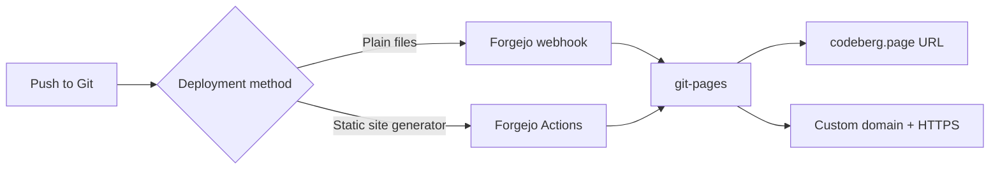

If you want free static hosting without corporate lock-in, Codeberg Pages deserves a serious look. Codeberg is a nonprofit, community-run Git forge based in Europe, and its Pages service publishes HTML, CSS, JavaScript, and assets straight from a public repository. No credit card, no surprise overage bill, and the hosting software itself is open source.

The current service runs on git-pages, a faster and more predictable replacement for the legacy Pages v2 server. You get automatic HTTPS, custom domains, and two clean deployment paths: a Forgejo webhook for plain files, or Forgejo Actions for static site generators.

This guide covers both paths, then walks through custom domain authorization and the v2 migration deadline. By the end you will know exactly which branch to push, which webhook to create, and which DNS records git-pages actually checks.

<!--more-->

## What Is Codeberg Pages?

Codeberg Pages is a free static site hosting service that serves content from public repositories on Codeberg.org. Sites appear under `{username}.codeberg.page` or on a domain you own. Under the hood it uses [git-pages](https://codeberg.org/git-pages/git-pages), an open-source static site server designed for Git forges.

You can host three common shapes of site:

- A personal or organization homepage at `https://yourname.codeberg.page`
- A project site at `https://yourname.codeberg.page/your-repo`
- Either of the above on a custom domain with an automatic Let's Encrypt certificate

Everything must be static. There is no server-side code execution, no database, and no background worker. That limitation is also why the service stays simple and free.

The deployment flow is short enough to draw on a napkin:



## Codeberg Pages vs Other Free Options

| Feature | Codeberg Pages | GitHub Pages | Cloudflare Pages |
|---|---|---|---|
| Cost | Free | Free for public repos | Free tier |
| Organization | Nonprofit / community | Commercial (Microsoft) | Commercial |
| Custom domain + HTTPS | Yes, automatic | Yes | Yes |
| CI system | Forgejo Actions or Woodpecker | GitHub Actions | Built-in |
| Open-source server | Yes (git-pages) | No | Partial |
| Commercial use | Allowed within ToS | Allowed within ToS | Allowed |
| Best fit | Nonprofit, EU-hosted, open source | Largest ecosystem | Global edge performance |

Codeberg wins when nonprofit ownership, European hosting, and open-source infrastructure matter to you. GitHub Pages still has the largest tutorial surface and the smoothest Actions integration. Cloudflare Pages is the performance pick when you need edge caching in many regions.

If you are comparing static hosts more broadly, our guide to the [best blogging sites for developers](/p/best-blogging-sites-for-developers/) covers the tradeoffs between managed platforms and self-hosted generators.

## Prerequisites

- A free Codeberg account
- A **public** repository, because private repositories cannot be served
- Basic Git familiarity
- Optional: a domain you control for a custom hostname
- Optional: a static site generator such as Hugo, Astro, or Eleventy

## Method 1: Plain Static Files with a Webhook

This is the fastest path when you already have finished HTML, CSS, and assets.

### Create the repository and the pages branch

For a personal site at `https://yourname.codeberg.page`, create a public repository named exactly `pages`. The site is published from a branch that is also called `pages`.

```bash
git switch --orphan pages
git rm --cached -r .
# add index.html, css, images, and other static files
git add .
git commit -m "Initial pages content"
git push -u origin pages
```

For a project site at `https://yourname.codeberg.page/my-project`, create a public repository with any name and put the content on a branch named `pages`.

> [!IMPORTANT]
> The repository name and branch name do different jobs. The repository named `pages` controls the root URL. The branch named `pages` controls which commit gets deployed.

### Add the deployment webhook

1. Open the repository and go to **Settings**.
2. Click **Webhooks** in the sidebar.
3. Click **Add webhook** and choose **Forgejo**.
4. Set the **Target URL** to the final site URL:
   - Personal site: `https://yourname.codeberg.page/`
   - Project site: `https://yourname.codeberg.page/my-project/`
5. Set the **Branch filter** to `pages`.
6. Save the webhook.

Every push to `pages` now triggers a deployment. The first push after adding the webhook should make the site live within a minute or two.

Do not use the **Test delivery** button to check the setup. According to the official documentation it fails by design. Push content to the branch and inspect the real delivery log instead.

### Verify the deployment

Open the target URL in a browser. If the page is blank, check three things in order: the branch is exactly `pages`, the branch filter matches, and the target URL has no typo. The webhook delivery history in repository settings is the fastest place to see an HTTP error.

## Method 2: Static Site Generators with Forgejo Actions

When you use Hugo, Astro, Eleventy, or another generator, let CI build the site and upload the output. The official action is [`git-pages/action`](https://codeberg.org/git-pages/action), and the current major version is `v2`.

1. Keep your source on the default branch, usually `main`.
2. Enable Actions under **Settings → Units** in the repository.
3. Add a workflow under `.forgejo/workflows/`.
4. Point the action at your generator's output directory.

Here is a working shape for a Node-based generator:

```yaml
name: Deploy to Codeberg Pages
on:
  push:
    branches: [main]

jobs:
  build-and-deploy:
    runs-on: codeberg-small
    steps:
      - uses: actions/checkout@v4
      - uses: actions/setup-node@v4
        with:
          node-version: 20
      - run: npm ci
      - run: npm run build
      - name: Deploy
        uses: https://codeberg.org/git-pages/action@v2
        with:
          site: https://yourname.codeberg.page/my-project/
          token: ${{ forge.token }}
          source: dist/
```

For a repository named `pages` that serves the root URL, drop the repository suffix:

```yaml
        with:
          site: https://yourname.codeberg.page/
          token: ${{ forge.token }}
          source: dist/
```

The `source` value must match your generator: `dist/` for Astro and Vite, `public/` for Hugo, `_site/` for Eleventy and Jekyll. If the path is wrong the action deploys an empty directory and the site 404s even though the job is green.

> [!NOTE]
> Codeberg's hosted Forgejo Actions are intentionally limited. The `codeberg-small` runner allows 2 CPU, 4 GB RAM, and about 5 minutes per job. A Hugo or Eleventy build usually fits. A heavy Next.js export may not. For bigger builds, attach a self-hosted runner or use Codeberg's Woodpecker CI.

If you already deploy an Astro site elsewhere, the build steps are nearly identical to our [Astro on GitHub Pages walkthrough](/p/how-to-deploy-astro-github-pages/). Only the deploy step changes.

## Adding a Custom Domain

Custom domains work with both methods, but the authorization record differs depending on how you deploy. This is the part most guides get wrong.

### Step 1: Point DNS at Codeberg

The recommended option is a CNAME:

| Host | Type | Value |
|---|---|---|
| `www` | CNAME | `codeberg.page.` |
| `docs` (any subdomain) | CNAME | `codeberg.page.` |

If you need the apex domain and your provider supports ALIAS or CNAME flattening, use that:

| Host | Type | Value |
|---|---|---|
| `@` | ALIAS | `codeberg.page` |
| `www` | ALIAS | `codeberg.page` |

If neither is available, or if DNSSEC forces your hand, use the documented A and AAAA records:

| Host | Type | Value |
|---|---|---|
| `@` | A | `217.197.84.141` |
| `@` | AAAA | `2a0a:4580:103f:c0de::2` |

Those IPs can change. A CNAME or ALIAS avoids that maintenance. If you use Cloudflare, the DNS concepts in our [GitHub Pages custom domain guide](/p/github-pages-custom-domain-cloudflare/) apply here too, but do not copy the GitHub IP addresses.

### Step 2: Authorize the repository with a TXT record

git-pages must know which repository owns the domain. The record name depends on the deployment method.

For a **webhook** deployment:

| Host | Type | Value |
|---|---|---|
| `_git-pages-repository` | TXT | `https://codeberg.org/username/repo-name.git` |
| `_git-pages-repository.www` | TXT | `https://codeberg.org/username/repo-name.git` |

For a **Forgejo Actions** deployment:

| Host | Type | Value |
|---|---|---|
| `_git-pages-forge-allowlist` | TXT | `https://codeberg.org/username/repo-name.git` |
| `_git-pages-forge-allowlist.www` | TXT | `https://codeberg.org/username/repo-name.git` |

The word `repository` and the word `forge-allowlist` are literal. They are not placeholders.

### Step 3: Set the deploy target

For a webhook, change the **Target URL** to your custom domain. For Actions, set `site` to the custom domain and add `server: codeberg.page`:

```yaml
        with:
          site: https://www.example.org/
          server: codeberg.page
          token: ${{ forge.token }}
          source: dist/
```

The `server` parameter is required for the first custom-domain deployment. It breaks a circular dependency: git-pages will not issue a certificate until the site exists, and the action cannot reach the site over HTTPS until a certificate exists. Passing `server` connects to Codeberg directly and sends your domain in the `Host` header.

> [!WARNING]
> The first deployment to a new custom domain must use the `http://` scheme, either in the webhook target URL or in the action's `site` parameter. After that deployment succeeds and the certificate is issued, switch back to `https://`.

### Step 4: Handle www and the apex

If you want both `example.org` and `www.example.org`, treat them as two sites. Add a webhook or deploy action for each, plus the matching TXT record. Then add a `_redirects` file to choose a canonical host:

```text
//www.example.org/* https://example.org/:splat 302!
```

The trailing `!` matters. Without it, the redirect only applies to paths that would otherwise 404.

You no longer need a `.domains` file on git-pages. If you migrated from v2, remove it.

## Lessons from a Git-Published Workflow

This blog is built with Hugo and deployed from a Git repository through CI, so the shape of the Codeberg setup is familiar. We have not moved Dev9b to Codeberg Pages, but we have debugged the same class of problems on GitHub Pages, and the failure modes map one-to-one.

The same pattern shows up on other small Git hosts. If you want a GitLab-style workflow instead of Forgejo, our [GitGud.io setup guide](/p/what-is-gitgud-io-setup-guide-for-developers/) walks through repos, CI, and Pages on that service.

The build step is rarely the problem. Authorization is. On GitHub the usual culprit is a missing CNAME file or a proxy that terminates TLS twice. On Codeberg the equivalent traps are a branch filter that does not match, a TXT record on the wrong subdomain, and a first deploy that uses HTTPS before a certificate exists. All three produce a green pipeline and an empty or broken site, which is why the delivery log and the migration check tool matter more than the build output.

The other lesson is to keep the deploy target in one place. If you hardcode `https://yourname.codeberg.page` in a webhook, in a workflow, and in a README, a domain change becomes a three-file hunt. Put the URL in a repository variable and reference it from the workflow.

## Migrating from Pages v2

Codeberg introduced the git-pages server in December 2025. The old v2 server still serves sites for accounts that existed before the change, but it will stop on **2026-12-31**.

To check where you stand, open the [migration check tool](https://codeberg.page/migration-check/) and enter your site URL. If it reports v2, you have two options:

- Add a Forgejo webhook and push to the `pages` branch.
- Replace your old build-and-push step with `git-pages/action@v2`.

The next successful deployment moves the site to the new server. There is no separate cutover step and no DNS change unless you also want a custom domain.

A few v2 behaviors did not survive the migration. `raw.codeberg.page` is gone. Direct `/repository/@branch` access is gone. Files stored in Git LFS are not served through the webhook deployment method. Automatic `path` to `path.html` redirects are gone unless you enable pretty URLs with the action's `pretty-urls: true` option. Check the [migration notes](https://docs.codeberg.org/codeberg-pages/migrating-from-pages-v2/) before you flip the switch if your site depends on any of those.

## Common Problems and Fixes

**The site stays empty after a push.** Confirm the branch is exactly `pages`, the webhook branch filter matches, and the target URL is correct. Check the delivery history for a non-2xx response.

**The custom domain shows a certificate error.** Make sure the TXT authorization record exists on the correct subdomain and that any CAA record allows Let's Encrypt. Wait a few minutes after the first successful deployment.

**The Actions job succeeds but the site is empty.** The `source` path is wrong. Point it at the directory that actually contains `index.html` after the build.

**The first custom-domain deploy fails with a TLS error.** You used `https://` before a certificate existed. Switch the first deploy to `http://` and set `server: codeberg.page`.

**The old v2 site is still serving.** Run the migration check. Once a webhook or Actions deployment succeeds, git-pages takes over on the next push.

## Key Takeaways

- Codeberg Pages gives you free, nonprofit-hosted static sites with automatic HTTPS.
- Create a public `pages` repository or a `pages` branch, then add a Forgejo webhook pointing at your site URL.
- For static site generators, build in Forgejo Actions and deploy with `https://codeberg.org/git-pages/action@v2`.
- Custom domains need DNS pointing at `codeberg.page`, a TXT authorization record, and an `http://` first deployment.
- The old Pages v2 server stops on 2026-12-31, so migrate early by adding a webhook or an Actions workflow.

## Frequently Asked Questions

### Is Codeberg Pages completely free?

Yes. There are no paid plans or bandwidth overage charges for normal use. The service is funded by the Codeberg nonprofit and community donations.

### Can I publish a private repository to Codeberg Pages?

No. Only public repositories can be served. Git-pages needs to read the content, and the deployment must be authorized for that repository.

### Do I need a pages branch on Codeberg Pages?

Yes for the webhook method. The branch filter must be set to `pages`. With Forgejo Actions you can build from `main` and deploy the generated output directory.

### How do I migrate from the old Codeberg Pages v2 server?

Check your site with the official migration check tool. If it reports v2, add a Forgejo webhook or a git-pages Action deployment before 2026-12-31. The next push then serves the site from the new server.

### Can Codeberg Pages host dynamic applications?

No. It serves static files only. Server-side code, databases, and background jobs need a VPS, PaaS, or another host.

### Are custom domains and HTTPS certificates free?

Yes. You configure DNS records for authorization, and git-pages obtains a Let's Encrypt certificate automatically after the first successful deployment.

## Conclusion

Codeberg Pages is one of the cleanest free options for anyone who already keeps a site in Git. The workflow is short: push to `pages`, add one webhook, or let a Forgejo Action upload the build output. Custom domains take a little more DNS work, but the authorization model is explicit and predictable once you see it.

Start with a plain HTML test site if you are unsure. It removes the build step from the equation and proves the deployment path before you add a generator. Then move your real site over and retire the v2 setup before the end of 2026.

If you want to share your own migration notes, read our [contributor guide](/contribute/) and check the [editorial policy](/editorial-policy/) before submitting a post. For more free hostname options, see our list of [free subdomains for developers](/p/free-subdomains-for-developers-list/), and if you are setting up DNS for a subdomain, the [Cloudflare subdomain walkthrough](/p/how-to-create-cloudflare-subdomain-github-pages/) covers the same record types.

*Disclosure: This article was drafted with AI assistance and reviewed and edited by the F9XR Team. Technical details were verified against the official Codeberg documentation linked above.*
