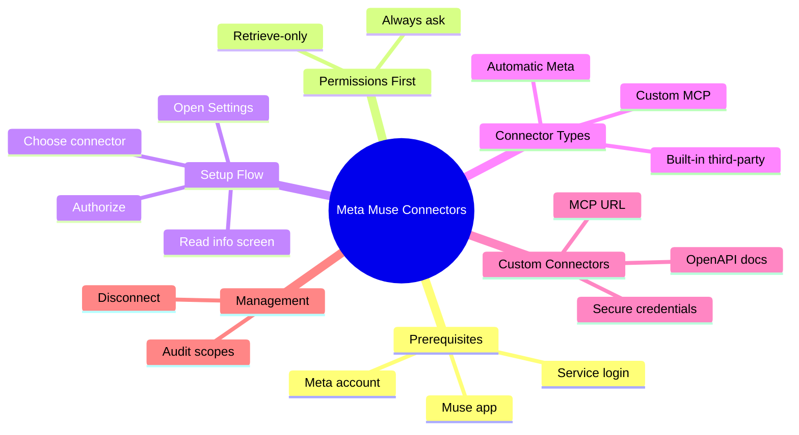

Meta Muse is Meta's personal AI agent, and out of the box it can chat, plan, and reason. What turns it into something that actually gets work done is connectors. A connector is an authorized link between Muse and an external app, so the agent can read data from it and, with your approval, take actions inside it. Knowing how to setup Meta Muse connectors is the difference between a clever chatbot and an agent that clears your inbox while you sleep.

If you are new to the whole category, our guide on [how AI coding agents work](/p/ai-coding-agents-explained/) explains why tool access matters more than raw model quality. In late 2026 the in-app connector list sits north of 50 services: the full Google Workspace suite, Outlook, Meta's own apps, Slack, Notion, Shopify, Stripe, QuickBooks, health trackers, and more. When an app is missing, you can ask Muse to build a custom connector from a public API or an MCP endpoint.

<!--more-->

This guide walks through the exact setup process, the permission choices that keep you in control, practical usage patterns for developers and builders, and how to create or submit custom connectors. Everything here reflects Meta's documented flows and current in-app behavior, so you can follow along without guessing.

## What Meta Muse Connectors Actually Are

A connector is an authorized link between Muse and another service. Once connected, Muse can:

- Search and summarize data from that service (emails, calendar events, Notion pages, Shopify orders)
- Take multi-step actions when you approve them (send an email, create a calendar invite, update a task)
- In some cases receive proactive updates, if you allow them

Meta's help center states that Muse exchanges only the data needed for the task you give it. Connecting Gmail does not mean Muse downloads your entire inbox on every request. The [official Meta Muse help page](https://www.meta.com/help/artificial-intelligence/1687253048996149/) is the source of truth for how this exchange works.

There are three practical kinds of connectors:

1. **Automatic Meta connectors** – Facebook, Instagram and Threads link automatically when the accounts share the same Accounts Center.
2. **Built-in third-party connectors** – Gmail, Slack, Notion, Shopify and the rest of the directory list. You authorize them once.
3. **Custom connectors** – Muse builds these on the fly from an MCP server URL, OpenAPI spec, or API docs you provide. Meta does not review them.

## Meta Muse Connectors Setup at a Glance

Here is the whole workflow as one map, so you can see where each step fits before we go into detail:



For readers who prefer plain text, the same tree in list form:

```
Meta Muse Connectors
  - Prerequisites
    - Meta account
    - Muse app
    - Service login
  - Permissions First
    - Always ask
    - Retrieve-only
  - Setup Flow
    - Open Settings
    - Choose connector
    - Read info screen
    - Authorize
  - Connector Types
    - Automatic Meta
    - Built-in third-party
    - Custom MCP
  - Custom Connectors
    - MCP URL
    - OpenAPI docs
    - Secure credentials
  - Management
    - Disconnect
    - Audit scopes
```

## Prerequisites Before You Connect Anything

- A Meta account that can sign into Muse (availability is region-dependent; Meta has listed the US and Canada for people 18+)
- Muse open on iOS, Android, the web at [muse.ai](https://muse.ai), or the Mac app
- Login credentials for the target service ready
- Two minutes to actually read the permission screens instead of clicking through

Do not skip the permissions step. It is the difference between a helpful agent and one that surprises you.

## How to Setup a Meta Muse Connector Step by Step

### 1. Lock Down Permissions First

Open Muse → Settings → Permissions (or the Connectors permissions section).

Set the default for connectors to **Always ask**. This forces Muse to check with you before any write action and before many important reads. You can loosen it later once you trust the setup. Starting strict is the safer developer habit, and it mirrors the approval-first pattern in terminal agents like the [Grok Bot desktop agent](/p/how-to-setup-grokbot/).

### 2. Open the Connectors Screen

Go to Settings → Connectors. You will see the full list with a search box. Connected apps appear at the top.

Alternatively you can simply tell Muse in chat: "Connect my Gmail" or "Connect my Shopify." The Settings route is better the first time because you see status and the information screen for every connector.

### 3. Choose the Connector and Read the Info Screen

Tap **Connect** next to the service you want. Meta explicitly tells users to read the information screen. It describes:

- What data Muse can exchange
- Whether the connector can share information proactively
- Whether retrieve-only (read) versus act (write) options exist

Do not skip this. It is the only place the exact scope is explained before authorization.

### 4. Authorize and Complete the Provider Login

Tap **Continue**. You will be taken through the service's normal sign-in or OAuth flow (Google consent screen, Slack workspace selection, Shopify store login, etc.).

After success the connector moves into the Connected section.

### 5. Tune Per-Connector Permissions

Back in Settings → Permissions → Connectors you can often set individual connectors to retrieve-only. Use this for email, banking (Plaid), or anything that can send money or messages until you are comfortable.

## Common Connectors and What They Unlock

The directory is large and changes often. This table groups the categories developers and builders reach for most.

| Category              | Example Connectors                          | Typical Developer / Builder Uses                     |
|-----------------------|---------------------------------------------|-----------------------------------------------------|
| Google Workspace      | Gmail, Calendar, Docs, Drive, Sheets        | Inbox triage, meeting prep, doc drafting            |
| Microsoft             | Outlook Mail, Calendar, Contacts            | Same as Google for Microsoft shops                  |
| Meta apps             | Facebook, Instagram, Threads, Messenger     | Content context, DMs, business page insights        |
| Work & productivity   | Slack, Notion, Asana, Linear, Zoom, Zapier  | Task updates, meeting notes, status digests         |
| Business & commerce   | Shopify, Stripe, QuickBooks, Klaviyo        | Order lookup, revenue checks, invoice drafting      |
| Developer             | GitHub, Replit, Tailscale, Vercel           | Repo context, deployment status                     |
| Health & lifestyle    | Withings, Peloton, Spotify, Apple Health    | Personal data summaries                             |

Numbers and exact availability change; always check the in-app list. The shift toward small-business tooling is recent and deliberate, as Meta's Alexandr Wang announced when the business connectors shipped:

<blockquote class="twitter-tweet"><p lang="en" dir="ltr">1/ muse for small businesses 📊 

we found lots of people using muse to run their small business. plumbing businesses, grocery stores, farms, restaurants, and shops.

today we're launching a bunch of connectors to make that easier! https://t.co/zqCGJljCW9</p>&mdash; Alexandr Wang (@alexandr_wang) <a href="https://x.com/alexandr_wang/status/2104925780547399986?ref_src=twsrc%5Etfw">September 29, 2026</a></blockquote>
<script async src="https://platform.x.com/widgets.js" charset="utf-8"></script>

For a running count and an independent catalog, the [community connector tracker at metamuseai.site](https://metamuseai.site/connectors/) is worth bookmarking.

## Automatic Meta Connectors

Facebook, Instagram and Threads connect automatically when those accounts live in the same Accounts Center as your Muse login. No separate Connect button is required. Confirm the accounts appear together in Accounts Center if anything looks missing.

Instagram Messages and Threads Messages are separate connectors in some accounts and may need explicit connection.

## How to Build a Custom Meta Muse Connector

When the directory does not have what you need, ask Muse itself. A reliable prompt pattern looks like this:

```
Build a custom connector to [SERVICE NAME].
Its MCP server URL / OpenAPI docs / API docs are here: [LINK].
I want you to be able to [specific capabilities] from any future conversation.
Connect to it, test every tool end to end, show me the results, and save it as a reusable skill.
If it needs credentials, use the secure credential flow (do not ask me to paste keys in chat).
```

Muse writes the client inside its own environment, tests it, and stores credentials in its secure store. Meta does not review custom connectors, so the responsibility for the service's behavior sits with you. Directory connectors, by contrast, go through submission at the [Muse Connector Platform](https://muse.ai/platform).

Technical requirements for a solid custom connector:

- Public HTTPS endpoint (localhost will not work)
- Streamable HTTP or a clear OpenAPI surface
- Clear auth method (bearer token, API key, or OAuth)

Developers who already run MCP servers can point Muse at the hosted URL and finish the handshake in one conversation. If you are new to that model, our walkthrough on [adding MCP servers to OpenCode](/p/opencode-mcp-servers/) covers the same tool-wiring pattern that custom Muse connectors rely on. And if you want to bundle a connector with reusable instructions, the guide on [installing and updating the F9XR CodeBase Auditor skill](/p/how-to-install-update-f9xr-codebase-auditor-skill/) shows how skills package tooling for an agent.

## Practical Uses That Matter for Developers

### Daily workflow glue

- "Summarize every unread email from the last 24 hours that looks like a support ticket and draft replies."
- "Pull my Google Calendar for the next three days and flag any meetings that still lack an agenda."

### Business operations

- Shopify + Stripe: "Show yesterday's orders and any refunds still pending."
- Notion + Slack: "Create a page from this thread and post the link in #product."

### Code and shipping

- GitHub connector (when available) or a custom MCP: "List open PRs that mention the payment service and summarize the review comments."

### Health and personal context

- Withings or Apple Health: "How did my sleep and resting heart rate look this week compared with last month?"

Always keep the approval prompts on while you learn the agent's habits. Muse's Sentinel layer watches for sensitive actions, but your permission settings are the first line of control. The same Meta ecosystem thinking applies when you [build a Facebook marketing AI agent](/p/build-facebook-marketing-ai-agent/) around page data and campaigns.

## Managing, Auditing and Disconnecting Connectors

- Disconnect any connector from the same Settings → Connectors screen.
- Review permissions periodically. Services change their scopes; what you approved three months ago may no longer match what you want.
- Treat custom connectors with extra caution. Because Meta does not review them, only connect services you trust and whose privacy policy you have read.
- Remember that disconnecting stops future access; it does not erase data Muse already used in previous conversations.

## FAQ

### How do I connect an app to Meta Muse?

Open Settings → Connectors, tap Connect next to the app, read the information screen, tap Continue, and complete the provider's sign-in. You can also say "Connect my Gmail" in chat. Set permissions to Always ask first.

### Can Muse only read data without taking actions?

Yes. Many connectors support a retrieve-only mode so Muse can look but cannot send, book, or purchase. Use this default for sensitive services.

### How do I create a custom Muse connector?

Tell Muse the service name, give it the MCP server URL or API documentation link, describe the capabilities you want, and ask it to build, test, and save the connector as a skill. Provide credentials only through the secure credential flow.

### Are custom connectors reviewed by Meta?

No. Meta reviews directory connectors submitted through muse.ai/platform. Custom connectors built in chat are private to your account and are not reviewed.

### How do I disconnect a connector?

Go to Settings → Connectors and disconnect the service. Future access stops immediately.

### Can I use Muse connectors for business tools like Shopify or Slack?

Yes. Meta added a large set of business connectors (including Shopify, Slack, Notion, Stripe, QuickBooks, Asana and others) under the Muse for Small Business expansion. Check the in-app list for the latest.

## Key Takeaways

- Set connector permissions to "Always ask" before you connect the first app.
- Use Settings → Connectors for the first setup so you can read every information screen; chat commands work fine after that.
- Facebook, Instagram and Threads usually connect automatically through Accounts Center.
- Prefer retrieve-only mode for email, payments and messaging until you are comfortable with write actions.
- Custom connectors are built by asking Muse and providing an MCP URL or API docs; credentials go through the secure prompt, not chat.
- Disconnect and re-check permissions any time a service changes or you no longer need the integration.

## Conclusion

Connectors are what turn Muse from a capable chat interface into an agent that can actually operate inside the tools you already use. Set the permissions carefully, start with the services you trust most, and keep the approval prompts on until the behavior is predictable. Once that foundation is solid, the daily time savings compound quickly.

Every article on Dev9b follows a [transparent editorial policy](/editorial-policy/), and if you have a connector workflow worth sharing, the [contributor guide](/contribute/) explains how to submit your own post.
