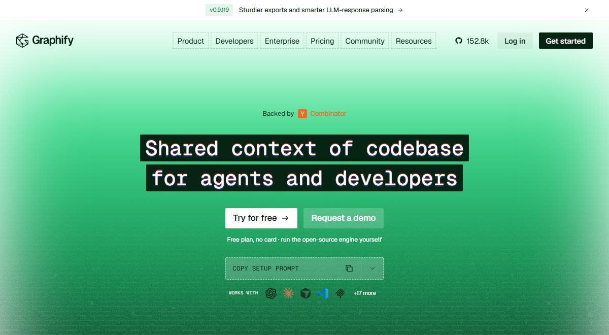
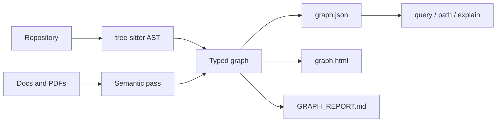

You open a large repo. Your AI coding assistant starts grepping files, reading the same modules again and again, burning tokens, and still missing the bigger picture. If that sounds familiar, the problem is not the model. It is that your assistant has no map.

Graphify fixes that. It turns your code, docs, SQL schemas, configs, and even PDFs into a real knowledge graph you can query. No vector database. No fuzzy embeddings. Just deterministic AST parsing with tree-sitter, clear edges that tell you exactly why two things connect, and a graph that lives on your machine.

This guide walks you through installing Graphify, building your first code knowledge graph, querying it from Claude Code, Cursor, Codex, or Gemini CLI, and keeping it useful as the codebase changes. Everything here was checked against the open-source tool from Graphify Labs and its documentation in November 2026.

<!--more-->

## What Graphify actually does

Graphify is a local-first skill and CLI that maps a project into nodes and edges. Code gets parsed with tree-sitter, which covers about 40 languages. Functions, classes, imports, calls, inheritance, and references become nodes and typed edges. Docs, PDFs, images, and other files get a lighter semantic pass so design notes and rationale also land in the same graph.

Every edge is tagged `EXTRACTED` (it came straight from the source), `INFERRED` (Graphify resolved it), or `AMBIGUOUS` (more than one target was possible). You always know what was read versus what was guessed.

The output is three files in `graphify-out/`:

- `graph.html` is an interactive visualization you open in a browser.
- `GRAPH_REPORT.md` holds highlights, communities, surprising connections, and suggested questions.
- `graph.json` is the full graph you can query later without re-reading files.

It is not RAG. It is not another vector index. It is a traversable graph with file and line citations. The project site below documents both the open-source CLI and the hosted Cloud option.



## Prerequisites

You need Python 3.11.5 or newer (below 3.15), plus `uv` (recommended) or `pipx`. A coding assistant is optional for the CLI path, but required for the slash-command workflow.

On macOS with Homebrew:

```bash
brew install uv
```

On Windows PowerShell:

```powershell
powershell -ExecutionPolicy ByPass -c "irm https://astral.sh/uv/install.ps1 | iex"
```

## Install Graphify in two commands

The package name on PyPI is `graphifyy` (two y's) while the shorter `graphify` name is being reclaimed. The command you run is still `graphify`.

```bash
uv tool install --python 3.12 graphifyy
graphify install
```

`graphify install` detects your assistant and registers the skill. By default it targets Claude Code. For other tools use the platform flag:

| Assistant | Install command |
|---|---|
| Claude Code | `graphify install` |
| Cursor | `graphify install --platform cursor` |
| Codex | `graphify install --platform codex` |
| Gemini CLI | `graphify install --platform gemini` |
| OpenCode | `graphify install --platform opencode` |
| VS Code / Copilot | `graphify install --platform vscode` |

You can also scope the install to the current project with `--project`. That writes skill files under the repo so the team can share them.

> [!TIP] Check the command name
> The official package is `graphifyy`. Other similarly named packages on PyPI are not from Graphify Labs. If `graphify` is missing after install, run `uv tool update-shell` and open a new terminal.

## Build your first graph

Open your coding assistant in the project root and type:

```
/graphify .
```

That one command scans the directory, runs the AST pass on code, does the semantic pass on docs and media, clusters the graph with Leiden community detection, and writes the three output files.

Useful flags:

- `/graphify . --update` re-processes only changed files
- `/graphify . --mode deep` adds richer inferred edges, at the cost of speed
- `/graphify . --code-only` skips docs and media entirely, so it stays fully offline with zero model calls

You can run the same pipeline from the shell without an assistant. The documented CLI path is two steps, because extraction and reporting are separate commands:

```bash
graphify extract . --code-only
graphify cluster-only . --no-label
```

The first command parses code with no API key. The second writes `graph.html` and `GRAPH_REPORT.md`. Drop `--no-label` if you want the model to name communities.



## Query the graph instead of grepping

Once the graph exists you stop asking the model to re-read files. You ask the graph.

Plain-language questions work from the shell or inside the assistant:

```bash
graphify query "how does authentication reach the database"
```

```
/graphify query "how does authentication reach the database"
```

Find the shortest path between two concepts:

```bash
graphify path "UserService" "DatabasePool"
```

Explain one node and its neighborhood:

```bash
graphify explain "APIRouter"
```

Every answer comes with file and line citations plus the `EXTRACTED` or `INFERRED` tag, so you can judge confidence before you trust a claim. When you are exploring an unfamiliar codebase, `graphify god-nodes --top 5` lists the most connected symbols, which are usually the modules a change will touch first.

## Keep the graph fresh

Code changes. The graph should too.

```bash
graphify update .
graphify hook install
```

`graphify update .` re-parses only files whose hashes changed, and it is always AST only. `graphify hook install` adds post-commit, post-checkout, post-merge, and post-rebase hooks that rebuild what changed. For assistant-side "always use the graph" behavior, the install step already writes rules into `CLAUDE.md`, `.cursor/rules/`, or `AGENTS.md` depending on the platform.

## Practical tips for daily use

- Start with `--code-only` on big monorepos to get a clean structural graph fast, then add docs later.
- After the first build, open `graph.html`. Click a few hubs and communities. You will usually find connections the team had forgotten.
- Feed the agent `GRAPH_REPORT.md` early in a session when you are exploring architecture.
- Use `path` before you change a shared module. Seeing the blast radius before you edit is cheaper than discovering it in review.
- For multi-repo work, the hosted Graphify option or the local merge tools can combine graphs so answers cross service boundaries.

If you are still choosing an assistant to pair with the graph, our guides to [OpenCode MCP servers](/p/opencode-mcp-servers/) and [setting up the OpenCode TUI](/p/how-to-setup-opencode-tui/) cover the client side. For model choices, [the best coding models on OpenRouter](/p/best-coding-models-openrouter/) and [using Cline with free OpenRouter models](/p/use-cline-free-openrouter-models/) are a good next read.

## Graphify vs typical RAG approaches

| Aspect | Graphify | Typical RAG / vector search |
|---|---|---|
| Core data structure | Typed graph with nodes and edges | Chunks plus embeddings |
| Code parsing | Deterministic tree-sitter AST | Text chunks |
| Edge provenance | `EXTRACTED` / `INFERRED` / `AMBIGUOUS` tags | Similarity scores |
| Local / offline | Full code path stays on your machine | Often needs a remote index |
| Token cost | Query the graph instead of re-reading files | Often re-embeds or re-reads |
| Explainability | Path, file and line, confidence | "These chunks looked similar" |

The trade-off is honest. A graph tells you how symbols connect. It does not answer open-ended prose questions about intent unless your docs and notes are in the graph too. For architecture questions on a real repo, that is exactly the part you want.

## Frequently asked questions

### Does Graphify send my code anywhere?

No. The open-source CLI parses code entirely on your machine with tree-sitter. Only the optional semantic pass over docs and media uses a model, and only if you configure one. There is no telemetry.

### Which languages does Graphify support?

Roughly 40 languages through tree-sitter grammars, including Python, JavaScript, TypeScript, Go, Rust, Java, C, C++, Ruby, PHP, Swift, Kotlin, SQL schemas, and Terraform. Check the [current docs](https://docs.graphify.com/) for the full list.

### Can I use Graphify without Claude Code?

Yes. The same CLI and skill work with Cursor, Codex, Gemini CLI, OpenCode, VS Code Copilot, and many other assistants. Install with the matching platform flag.

### Is the graph updated automatically?

With `graphify hook install` it rebuilds on commit, checkout, merge, and rebase. You can also run `graphify update .` or `/graphify . --update` any time to re-process only changed files.

### What is the difference between the Graphify CLI and Graphify Cloud?

The CLI is free, open-source under Apache 2.0, and fully local for code. Cloud adds persistent multi-repo graphs, shared Memory, a Wiki, and PR reviews that see beyond the diff. See [graphify.com](https://graphify.com/) for the hosted product.

### Do I need a vector database for Graphify?

No. Graphify builds and queries a real graph with deterministic AST parsing. There are no embeddings and no vector store for the structural code graph.

## Key takeaways

- Graphify turns code, docs, SQL, configs, and PDFs into a real knowledge graph with deterministic AST parsing.
- Install takes two commands: `uv tool install --python 3.12 graphifyy`, then `graphify install`.
- Build with `/graphify .` in an assistant, or `graphify extract . --code-only` and `graphify cluster-only .` in a shell.
- Query with `query`, `path`, `explain`, and `god-nodes`. Every edge carries a confidence tag.
- The code path stays local and needs no vector store, no API key, and no telemetry.
- Git hooks and agent rules keep the graph useful as the code changes.

## Conclusion

Graphify is worth the ten minutes it takes to install if you work in a repo that no single person fully understands. The first time you run `graphify path` between a request handler and the database pool, you get an answer with file and line citations instead of a plausible guess. That alone changes how you review AI-generated code.

Start with a code-only build on your main repository, open the HTML view, and ask one real architecture question. If the graph earns its place, wire up the hooks and let it stay current.

This guide was written by the F9XR Team with AI assistance, then checked against the official Graphify documentation and the project's public repository. If you spot an error, [suggest a change through our contributor guide](/contribute/) or read how we handle corrections in our [editorial policy](/editorial-policy/). You can also follow the [Graphify repository](https://github.com/Graphify-Labs/graphify) and the [quickstart docs](https://docs.graphify.com/open-source/quickstart) to track changes.
