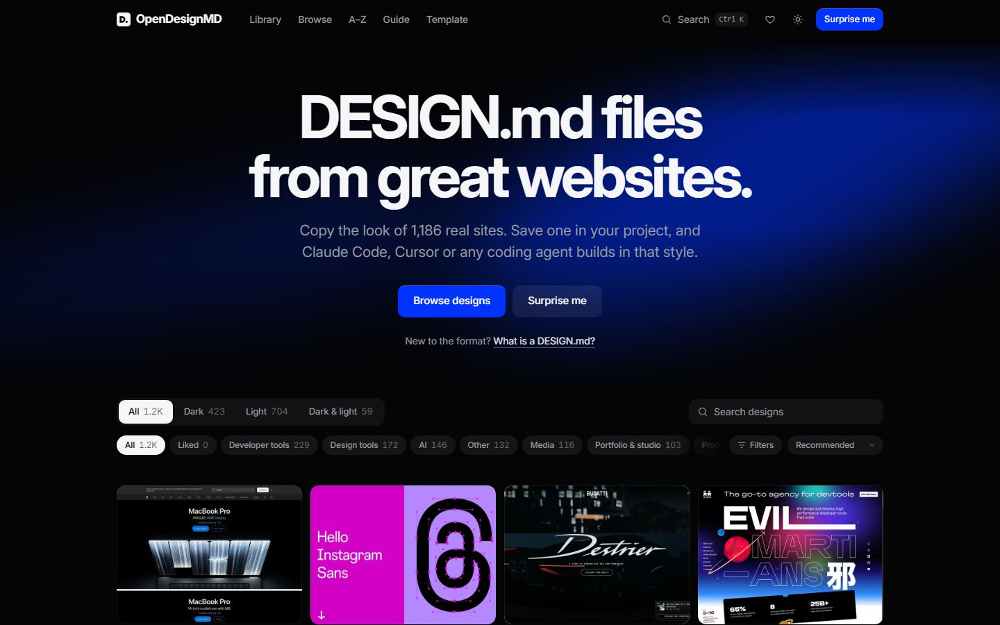

You ask your AI coding agent for a landing page. It hands back something clean, fast, and strangely familiar. Purple gradient. Rounded cards. A hero headline that could belong to ten thousand startups. Nothing is broken, and nothing is yours.

OpenDesignMD breaks that loop. The name covers two things people use together: a free library of 1,186 DESIGN.md files pulled from real websites, and the plain-text format those files follow. Grab a file, point your agent at it, and the output stops drifting toward the average of the web.

This guide shows how to use OpenDesignMD end to end. Find a file, wire it into the agent you already run, write your own when the library isn't close enough, then critique the result and ship it. I checked the details against the OpenDesignMD site, the official DESIGN.md spec, and the Open Design repository in November 2026. Counts move fast, so confirm anything load-bearing before you copy it into production.

<!--more-->

## Quick answer: how do you use OpenDesignMD?

Go to [opendesignmd.com](https://opendesignmd.com/), find a DESIGN.md that matches the direction you want, and download it. Save it as `DESIGN.md` in the root of your project. Then tell your agent to follow it, either with one line in `CLAUDE.md` or `AGENTS.md`, or in the prompt itself.

That's the whole loop. Here it is as three commands:

```bash
# 1. Copy a design file from the library
curl -o DESIGN.md https://opendesignmd.com/designs/linear-app/DESIGN.md

# 2. Tell your agent about it
printf '\nFollow DESIGN.md for all UI work.\n' >> AGENTS.md

# 3. Build something
# "Build the pricing page. Follow DESIGN.md."
```

Every design page on the site prints its own `curl` line under **Install**, so you never have to guess a URL. Swap `linear-app` for `stripe`, `vercel`, `apple`, or any other slug.

## What OpenDesignMD actually is

Two projects share this space, and mixing them up wastes an afternoon. Here's the split.

| Piece | What it is | Where it lives |
|---|---|---|
| **OpenDesignMD library** | 1,186 DESIGN.md files written from real sites, plus a guide and a blank template. Free, MIT licensed. | [opendesignmd.com](https://opendesignmd.com/) |
| **DESIGN.md format** | YAML design tokens plus Markdown rationale. Draft spec, alpha status, Apache-2.0. | [google-labs-code/design.md](https://github.com/google-labs-code/design.md) |
| **Open Design workspace** | Optional local-first desktop app that reads DESIGN.md and generates prototypes, decks, dashboards and video. Apache-2.0. | [nexu-io/open-design](https://github.com/nexu-io/open-design) |

> [!IMPORTANT] They are not the same product
> OpenDesignMD is the library. Open Design is the workspace. You do not need the workspace to get value from OpenDesignMD, because a DESIGN.md is just a file any agent can read. The workspace is a bonus if you want a GUI, templates and a built-in critique step.

That distinction matters for cost and setup. The library needs no install at all. Open Design needs a desktop app, Docker, or a source build before it does anything.

## Why AI generated websites look so generic

Language models learned from the average of the web. Ask for "a modern SaaS landing page" and you get the average of every modern SaaS landing page. Same colors, same card shapes, same hero layout. We covered the color side in [the most and least used colors by AI](/p/most-least-used-colors-by-ai/), and the wider habit in [how to de-AI-slop your website design](/p/how-to-de-ai-slop-website-design/).

The root cause is simple. An agent has a prompt, not a memory of your brand. Every new session starts blank. Re-explaining your palette and spacing in each chat is slow, and the agent still drifts.

DESIGN.md fixes this by giving the agent one versioned file to read before it generates anything. The Google Labs spec describes two layers: tokens as the normative values, and prose that explains how and why to apply them. Tokens keep values consistent. The prose keeps taste consistent. You need both.

Adoption is not a vibe. A DesignSpecs dataset posted to arXiv in November 2026 collected 613,207 files named DESIGN.md from GitHub in October 2026, then cleaned them to 36,906 files from 15,794 public, non-fork repositories. Plenty of those are unrelated design documents, which is why the filtering mattered. Even so, developers are clearly writing these files by the thousand. See the [DesignSpecs paper](https://arxiv.org/abs/2611.17713) for the method.

## What you need before you start

- A project with UI code, or a fresh folder where you want to start one
- A coding agent CLI you already use, such as Claude Code, Codex, Cursor, Copilot or OpenCode
- Git, so DESIGN.md gets reviewed like code
- Optional: Node.js if you want to run the official `@google/design.md` linter
- Optional: the Open Design desktop app if you want a visual workspace

That's it. There's no account to create for the library, and no key to paste.

## Step 1: pick a DESIGN.md from the library

The library is organized for browsing, not reading. You can filter by category, accent color, theme, font and tag. At the time of writing the counts are 1,186 files total, split into 423 dark, 704 light and 59 that cover both. Developer tools is the biggest category at 229 files, followed by design tools at 172 and AI at 146.



*Screenshot: opendesignmd.com, captured November 2026.*

A few ways to narrow it down:

- **Start with your category.** A developer tool should not borrow a fashion brand's layout. The developer tools and productivity shelves are the closest match for most SaaS and docs work.
- **Filter by theme first.** Picking dark or light early removes half the library.
- **Read the one-line description.** Each card explains what the design does, not just who owns it. "Near-black canvas with one lavender accent" tells you more than a logo.
- **Open two or three finalists.** The detail page shows screenshots, the full guide, the token block and the update date. Compare before you commit.

The detail pages are thorough. The Linear entry, for example, documents a four-step surface ladder, a single chromatic accent, and a typography scale that runs from 80px display down to 12px captions. That level of detail is why a downloaded file works better than a paragraph of adjectives.

Then copy the file:

```bash
curl -o DESIGN.md https://opendesignmd.com/designs/linear-app/DESIGN.md
```

If you want something neutral to start from, the [blank DESIGN.md template](https://opendesignmd.com/design-md-template/) has every section an agent needs, filled with example values you replace.

## Step 2: point your agent at the file

A DESIGN.md sitting in a folder does nothing until the agent is told to read it. Put that instruction in the file your agent already loads, so you don't repeat yourself every session.

| Agent | Where to reference DESIGN.md |
|---|---|
| Claude Code | Add `@DESIGN.md` to `CLAUDE.md`, or mention the file in your prompt |
| OpenAI Codex | Add "Follow DESIGN.md for all UI work." to `AGENTS.md` |
| Cursor | Add it to a project rule, or type `@DESIGN.md` in chat |
| GitHub Copilot | Mention it in `.github/copilot-instructions.md`, or attach it in chat |
| OpenCode | Add the same line to `AGENTS.md` |
| Windsurf and others | Add a line to the project rules or `AGENTS.md` |
| v0, Lovable, Bolt | Paste the file into project instructions or your first prompt |

The prompt itself can carry the instruction too:

```
Build the pricing page. Follow DESIGN.md: use its colors, type scale,
spacing and button styles, and respect its don'ts.
```

If terminal agents are new to you, [AI coding agents explained](/p/ai-coding-agents-explained/) covers the basics, and [setting up the OpenCode TUI](/p/how-to-setup-opencode-tui/) walks through one setup end to end. If you already keep custom instructions, the [OpenCode skills guide](/p/opencode-skills-guide/) shows where design rules can live next to your other agent config.

## Step 3: write your own when the library isn't close

The library is a starting point. For a real product you want your own file, because borrowed taste still looks borrowed.

A DESIGN.md has an optional YAML front matter for tokens and a Markdown body for the reasoning. Here's a compact example for a fictional developer tool. Treat the key names as a starting point and confirm the exact schema in the [official spec](https://github.com/google-labs-code/design.md/blob/main/docs/spec.md).

```markdown
---
version: alpha
name: Northwind Console
colors:
  primary: "#2457F5"
  primary-hover: "#1C45C9"
  canvas: "#FFFFFF"
  surface-1: "#F5F6F8"
  ink: "#14171F"
  ink-muted: "#5B6475"
  danger: "#C62828"
typography:
  h1:
    fontFamily: Inter
    fontSize: 44px
    fontWeight: 650
    lineHeight: 1.1
    letterSpacing: -0.02em
  body:
    fontFamily: Inter
    fontSize: 16px
    fontWeight: 400
    lineHeight: 1.6
  mono:
    fontFamily: JetBrains Mono
    fontSize: 14px
    fontWeight: 400
    lineHeight: 1.5
rounded:
  sm: 4px
  md: 8px
  full: 9999px
spacing:
  sm: 8px
  md: 16px
  lg: 32px
  section: 96px
---

# How Northwind Console is designed

## Overview
A calm, technical interface for people who read logs for a living.
Closer to a well edited terminal than a marketing site.

## Colors
Primary blue is reserved for the single most important action on a screen.
Never use primary for decoration. Surfaces stay white or very light gray.

## Typography
Headlines are tight and confident. Body text is generous.
Code always uses the mono family, never the body family.

## Layout
Use an 8px grid. Content max width is 1120px. 96px between sections.

## Components
Buttons use the md radius. Cards have a 1px border and no shadow.
Tables are dense, with sticky headers.

## Do's and don'ts
Do: show real data, real code, real numbers.
Don't: use gradients, glassmorphism, emoji as icons, or stock photos
of people at laptops.
```

If you want the linter to check it, run:

```bash
npx @google/design.md lint DESIGN.md
```

The CLI validates token references, checks component contrast against WCAG, and flags orphaned tokens. It is still alpha, so expect the rules and export formats to change between releases.

## Step 4: what makes a DESIGN.md work

The Google Labs notes make a point worth remembering: specific references carry far more information than adjectives. "Modern and clean" tells an agent almost nothing. "Dense like a bank statement, quiet like a Dieter Rams radio" gives it a direction.

- **Name the job of each color.** Roles beat swatches. Say where the accent may appear, not just what hex it is.
- **Write the don'ts.** Telling an agent what to avoid kills the generic look faster than telling it what to do.
- **Describe voice, not just visuals.** Button labels and error messages are part of the design.
- **Keep it short enough to read.** A focused 150-line file beats a 900-line essay.
- **Commit it to your repo.** Version it next to the code and review changes in pull requests.
- **Name font fallbacks.** If a typeface isn't free, say which licensed alternative to use.

The library files follow a similar shape: overview, colors, typography, layout, elevation, shapes, components, responsive behavior, and a do's and don'ts list. That structure is a good default even when you write from scratch.

## Step 5: generate a page, then critique it

Open the library file you chose, or start from your own, and write a brief. A good brief reads like a ticket:

> A pricing page for Northwind Console. Three tiers, monthly and yearly toggle, one highlighted plan, an FAQ section, and a short comparison table. Audience: platform engineers. Tone: direct, no hype.

Then do the part most people skip. Ask the agent to audit its own output against the file:

```
Audit this page against DESIGN.md. List every place it breaks a rule.
Check color roles, type scale, spacing grid, and the do's and don'ts.
Then fix the violations without changing the content.
```

Review the result yourself with four questions:

1. Is there exactly one primary action per screen?
2. Can you read every line of text at normal zoom, on a phone?
3. Does the spacing follow a system, or does it look eyeballed?
4. Would you recognize this as your brand with the logo hidden?

If you want outside reference while you refine, our roundup of [UI and UX design inspiration resources](/p/best-ui-ux-design-inspiration-resources/) and the guide to [connecting Mobbin to an AI agent through MCP](/p/connect-mobbin-ai-agent-mcp/) both help here.

## Step 6: optional, add the Open Design workspace

Everything above works with plain files. Open Design adds a GUI, templates, plugins and a preview sandbox if you want them. It does not ship its own model. Your existing CLI becomes the design engine.

| Method | Best for | What to do |
|---|---|---|
| Desktop app | Fastest start | Download for macOS (Apple Silicon or Intel) or Windows x64 from the project site or GitHub Releases |
| Docker | Self-hosting | Copy `.env.example` to `.env`, set `OD_API_TOKEN`, run `docker compose up -d` from the `deploy` folder |
| From source | Linux and contributors | Clone the repo, then `corepack enable && pnpm install && pnpm tools-dev run web` |
| MCP only | Terminal-first work | Run `od mcp install <agent>` against an existing install |

The agent connection is the useful part:

```bash
od mcp install claude      # Claude Code
od mcp install codex       # Codex CLI
od mcp install cursor      # Cursor
od mcp install opencode    # OpenCode

od mcp install claude --print       # preview the change
od mcp install claude --uninstall   # undo it
```

Inside the agent, the prompt stays plain:

```
Use open-design to generate a landing page with the Linear design system
```

> [!WARNING] The `od` command collides on macOS and WSL2
> macOS ships `/usr/bin/od`, a system octal-dump tool, and it can shadow Open Design's `od`. If you installed the desktop app, open **Settings, then MCP server** and copy the snippet from there. It uses absolute paths and avoids the clash. WSL2 users should follow the project's WSL setup notes first.

Linux still has no prebuilt desktop build. Running from source with Node 24 and pnpm is the current route, and the project says so on its own download page.

## Step 7: hand the design to your real codebase

A prototype is only useful if it ships. You have three routes.

**Route 1: rebuild components yourself.** Take the HTML and CSS, then recreate it in React, Vue or Svelte using your normal patterns. Slowest, and you control everything.

**Route 2: let your agent port it.** Open the prototype in Cursor, Codex or Claude Code and ask it to convert the page into your framework while keeping DESIGN.md as the style source.

**Route 3: use migration plugins.** Open Design lists plugin scenarios for React, Next.js and Vue export, plus a code migration path that points at a git repo and a DESIGN.md. These are newer parts of the project and some workflows are still marked in progress. Run them on a branch, review every diff, and never merge a bulk visual change you have not looked at.

Exports also cover HTML, PDF, PPTX and Markdown, so the same design system can feed a deck or a launch email.

## Step 8: keep the file alive

The honest risk with any design contract is neglect. A stale DESIGN.md is worse than none, because the agent follows it faithfully and ships yesterday's brand.

Habits that help:

- Treat DESIGN.md changes like API changes: small pull requests, a named reviewer.
- Add a checklist item to your PR template: "Does this change need a DESIGN.md update?"
- Review the file every quarter, and after any rebrand.
- Keep tokens in sync with your real CSS variables or Tailwind config, so the file never describes a site that no longer exists.

The `@google/design.md diff` command compares two versions token by token, which makes review easier than reading a wall of YAML.

## Before and after: what actually changes

| Common problem | Without DESIGN.md | With DESIGN.md |
|---|---|---|
| Inconsistent colors | Each page picks a slightly different blue | One primary token, one defined job |
| Random spacing | Padding values drift page to page | A single spacing scale |
| Template look | Gradients and generic cards everywhere | A don'ts list blocks them |
| Weak typography | System fonts and a flat hierarchy | Defined scale, weights and line heights |
| Off brand copy | Buzzword headlines | Voice rules shape labels and messages |
| Slow reviews | "This feels off" with no reason | Reviewers point to a written rule |
| Onboarding | Tribal knowledge | One file to read |

## Practical tips for better results

- **Start with one page.** Prove the workflow on your pricing page before touching the whole site.
- **Write briefs like tickets.** Audience, goal, content blocks and tone beat a one-line wish.
- **Use real content.** Paste your actual copy and real screenshots. Lorem ipsum hides layout problems.
- **Pick fewer fonts.** Two families is plenty, and check licensing before you ship.
- **Test accessibility yourself.** Contrast, focus states and keyboard navigation need a human check. Do not assume the agent handled them.
- **Measure afterward.** Run Lighthouse, watch Core Web Vitals, and compare conversion or bounce rate before and after.
- **Keep icons consistent.** Our [Lucide vs Font Awesome comparison](/p/lucide-vs-font-awesome/) can help you pick one set and stick to it.

## Limits and things to know

- **Counts and versions move.** The library says 1,186 files today. The DESIGN.md spec is alpha, and CLI flags have already been renamed between releases.
- **No Linux desktop build for Open Design yet.** Run from source.
- **Some plugin workflows are unfinished.** Check the roadmap before you plan around them.
- **Privacy depends on your setup.** The library is static files. Open Design runs a local daemon, and when it needs a model it calls the provider you configured. The project says its BYOK proxy is SSRF-guarded.
- **Tokens do not equal taste.** A DESIGN.md makes output consistent. It will not make a weak idea good. You still need a designer's eye, even if that eye is yours.
- **Brand ownership still applies.** The MIT license covers the file text. It does not give you another company's logo, name or typeface.

## OpenDesignMD vs other ways to design with AI

| Approach | Output | Best for | Trade-off |
|---|---|---|---|
| OpenDesignMD plus your agent | Real HTML and CSS shaped by a written contract | Developers who want consistent code and local control | You maintain the file |
| Open Design workspace | Prototypes, decks, images and video in a local app | Teams who want a GUI and a critique loop | Extra install and setup |
| Figma | Design files with tokens and themes | Designer-led exploration | Output is not production code |
| Prompting an agent with no file | Whatever the model guesses | One-off experiments | Style drifts every session |
| Hosted AI design tools | Polished first drafts | Quick concepting | Less control over files and data |

Because DESIGN.md is a plain file, it is portable. You can start in the library, move into Open Design, and finish in Cursor without rewriting your brand rules.

## Troubleshooting

| Problem | Likely cause | Fix |
|---|---|---|
| `od` does something strange | macOS or WSL2 resolves the system `/usr/bin/od` | Use the Settings, MCP server snippet with absolute paths |
| No Linux download | No prebuilt Linux build yet | Run from source with Node 24 and pnpm |
| Agent ignores your style | DESIGN.md is missing, vague, or not referenced | Confirm the file is at the project root and named in `AGENTS.md` or your prompt |
| Output looks like a different brand | A built-in system is still selected | Switch to your own design system before generating |
| Docker asks for credentials | Auth is on by default | Use username `open-design` and your `OD_API_TOKEN` as the password |
| Linter rejects the file | Token reference or key name is wrong | Run `npx @google/design.md lint DESIGN.md` and read the rule name |

## Frequently asked questions

### What is OpenDesignMD?

OpenDesignMD is a free library of 1,186 DESIGN.md files made from real websites, plus a guide and a blank template. You copy a file into your project and your AI coding agent reads it before writing UI, so new pages follow that visual style instead of a generic default.

### Is OpenDesignMD the same as Open Design?

No. OpenDesignMD is the DESIGN.md library at opendesignmd.com. Open Design is a separate open-source, local-first design workspace from the nexu-io/open-design project that also reads DESIGN.md. You can use either one alone, or both together.

### What is a DESIGN.md file?

A DESIGN.md file is a plain-text description of a design system for AI agents. It combines optional YAML design tokens, such as colors and type sizes, with Markdown prose explaining how to apply them. The format started in Google Stitch and the draft specification was open-sourced by Google Labs in April 2026.

### Are the DESIGN.md files on OpenDesignMD free?

Yes. All 1,186 files are free to copy, download and use, including in commercial projects, under the MIT License. The sites and trademarks they describe belong to their owners, so use a file as a visual direction rather than copying another company's identity.

### Which coding agents work with OpenDesignMD?

Any agent that can read files in your project works: Claude Code, OpenAI Codex, Cursor, GitHub Copilot, OpenCode, Windsurf, and others. You reference DESIGN.md from `CLAUDE.md`, `AGENTS.md`, a Cursor rule, or the prompt itself. App builders like v0, Lovable and Bolt accept it in project instructions.

### Can I use a DESIGN.md made from a famous website?

Use it as a direction for layout, type, spacing and color, then replace the name, logo and brand values with your own. Do not ship another company's identity, and check the license of any font the file names before you use it in production.

## Key takeaways

- OpenDesignMD is a library of 1,186 free DESIGN.md files from real sites. The format is the design contract your agent reads.
- Copy a file with the `curl` line on its design page, save it as `DESIGN.md`, and reference it from `AGENTS.md` or `CLAUDE.md`.
- Write your own file for a real product. Use library files for direction, not for someone else's identity.
- Exact values and a strong do's-and-don'ts list do more than adjectives like "modern" or "clean".
- Critique every render against the file, then hand it to your codebase on a branch and review the diff.
- Keep the file versioned and current, or the agent will faithfully ship a brand you no longer use.

## Conclusion

Good design is mostly consistency plus a few decisions nobody else would have made. AI agents handle the first part well when you give them rules, and struggle with the second when you don't. A DESIGN.md is how you hand over those decisions in a form a machine can follow.

Start small. Pull one file from OpenDesignMD, write a one-page version for your own site, generate a single page, and compare it to what your agent produced last month. If the difference is obvious, expand. If it isn't, sharpen the file. The work lives in the writing, which is where a developer with taste has the edge.

If you want to write for Dev9b or improve one of our guides, read the [contributor guide](/contribute/) and our [editorial policy](/editorial-policy/). We review every tutorial against primary sources before it ships.

*This article was drafted with AI assistance and reviewed by the F9XR Team. Cover image and screenshot from opendesignmd.com, used for editorial reference.*
