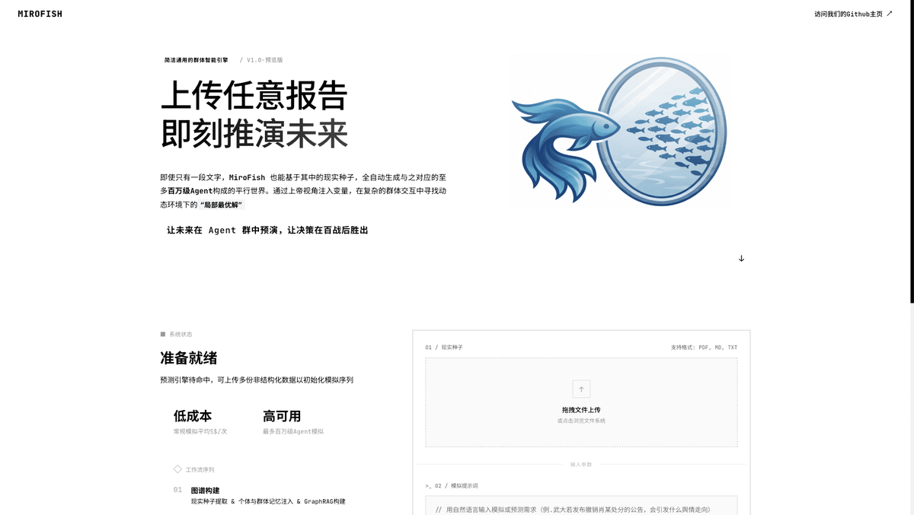
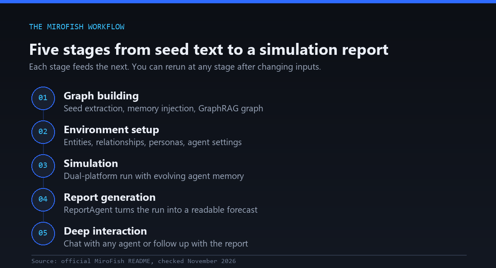
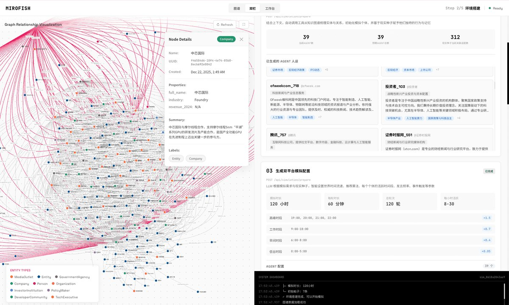
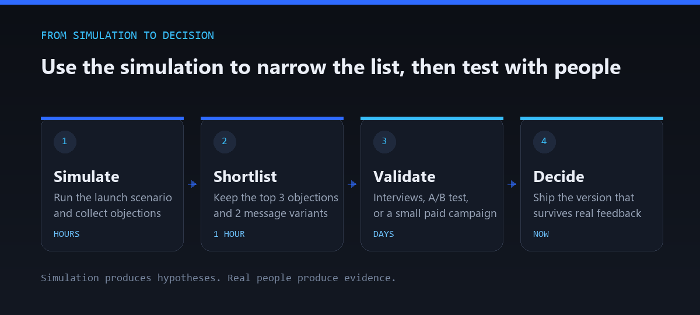
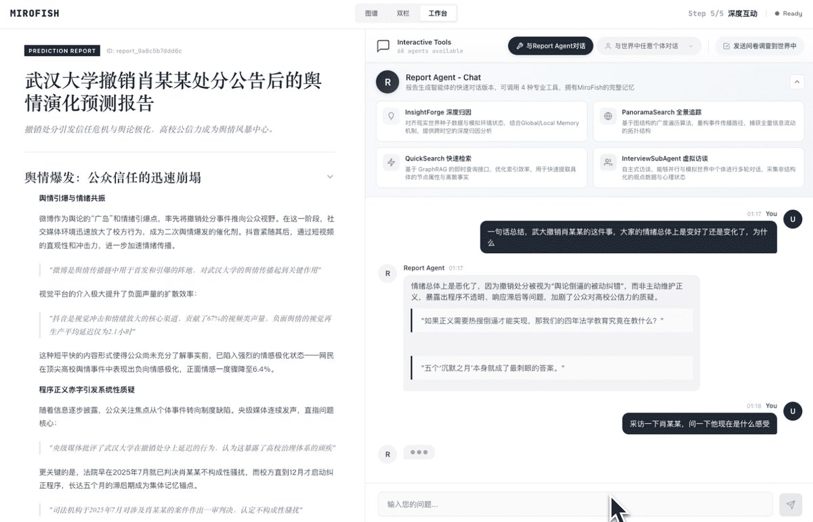

---
title: "MiroFish Repo: Test Your SaaS Launch Before You Ship It"
description: "The MiroFish repo is an open source AI swarm simulator. Learn what it is, how to set it up, and how to test your next SaaS launch before you ship."
slug: mirofish-repo-setup-test-saas-launch
date: 2026-11-03
image: cover.jpg
author: F9XR Team
keywords:
    - MiroFish repo
    - MiroFish setup
    - MiroFish AI prediction engine
    - multi-agent simulation
    - swarm intelligence engine
    - test SaaS launch
    - SaaS launch validation
categories:
    - Tutorials
tags:
    - ai-tools
    - ai-agents
    - saas-tools
    - open-source
draft: false
math: false
faq:
    - question: "What is MiroFish?"
      answer: "MiroFish is an open source AI prediction engine that uses multi-agent technology. It takes real world seed information such as news, reports, or policy drafts, builds a parallel digital world filled with AI agents that have their own personalities and memories, and simulates how events may unfold so you can study likely outcomes."
    - question: "Is MiroFish free and open source?"
      answer: "The code is free to download and is released under the AGPL-3.0 license. Running it still costs money in practice, because you need an LLM API key, and usage can add up. The README says Zep Cloud's free monthly quota is enough for simple use."
    - question: "How do I set up the MiroFish repo?"
      answer: "Clone the GitHub repository, copy .env.example to .env, add your LLM and Zep API keys, run npm run setup:all, then start everything with npm run dev. Open http://localhost:3000 in your browser. You can also run docker compose up -d if you prefer Docker."
    - question: "What do I need to run MiroFish?"
      answer: "You need Node.js 18 or newer, Python 3.11 to 3.12, and the uv package manager. You also need an API key for an LLM provider that follows the OpenAI SDK format, plus a Zep Cloud API key for agent memory."
    - question: "Can MiroFish predict whether my SaaS launch will succeed?"
      answer: "No tool can guarantee that. MiroFish can help you explore likely reactions to your pricing, messaging, and competitor moves, and surface objections early. Use it to form hypotheses, then validate them with customer interviews, landing page tests, or a waitlist."
    - question: "How much does it cost to run MiroFish?"
      answer: "Cost depends mostly on your LLM provider, the number of agents, and the number of simulation rounds. The README warns that consumption is high and recommends trying fewer than 40 rounds first. Start small and watch your API usage."
---

You spend three months building. You schedule the launch post, hit publish, and wait. Then the dashboard stays flat. No signups, no replies, and no angry comments either. Just silence.

That silence usually starts long before launch, in the guesses we make about price, messaging, and timing. The **MiroFish repo** is an attempt to turn some of those guesses into a rehearsal.

MiroFish is an open source multi-agent prediction engine. It builds a simulated world from real text, fills it with AI agents, and lets you watch what happens when you change the price, the headline, or the competitive field. The project has been climbing GitHub fast: about 83,700 stars and 12,700 forks when we checked on November 3, 2026.

This guide covers what the MiroFish repo is, how to set it up on your own machine, and how to use it to pressure test a SaaS launch. It also covers the limits, because a simulation can sharpen your questions but it cannot answer them for real buyers.

<!--more-->

## What is the MiroFish repo?

MiroFish is a swarm intelligence engine built around a simple loop. You give it seed material, such as a news story, a policy draft, a financial report, or your own launch copy. It then builds a parallel digital world filled with thousands of AI agents. Each agent has its own personality, long-term memory, and behavior logic. They interact, react to events, and evolve socially over many rounds.



*The MiroFish interface starts with seed documents and a plain-language prediction request. Screenshot: [MiroFish project repository](https://github.com/666ghj/MiroFish), AGPL-3.0.*

The part that matters for decision makers is control. You can inject new variables into a running world from what the project calls a "God's-eye view." Want to know what happens if a rival slashes prices on day five? Drop that event in and watch how the simulated crowd responds.

The official tagline calls MiroFish a simple and universal swarm intelligence engine that predicts anything. The creators frame the idea in two ways:

- **At the macro level**, it is a rehearsal lab for decision makers who want to test policies and public relations moves with zero real world risk.
- **At the micro level**, it is a creative sandbox for individuals, such as readers who want to explore alternate endings to a novel.

### MiroFish at a glance

| Item | Detail |
|---|---|
| Repository | [github.com/666ghj/MiroFish](https://github.com/666ghj/MiroFish) |
| Creator | 666ghj, with strategic support and incubation from [Shanda Group](https://www.shanda.com/) |
| License | AGPL-3.0 |
| Stars and forks | About 83.7k stars and 12.7k forks (November 3, 2026) |
| Repository activity | 322 commits, 87 open issues, 137 open pull requests |
| Simulation engine | [OASIS (Open Agent Social Interaction Simulations)](https://github.com/camel-ai/oasis) from the CAMEL-AI team |
| Agent memory | [Zep Cloud](https://app.getzep.com) |
| Backend | Python 3.11 to 3.12 |
| Frontend | Node.js 18 or newer |
| Default ports | 3000 for the frontend, 5001 for the backend API |
| Official site and demo | [mirofish.ai](https://mirofish.ai) and the [hosted demo](https://666ghj.github.io/mirofish-demo/) |

The repo is young enough that the instructions still move. Treat the README as the source of truth, not this article. If you want a deeper look at how autonomous agents are changing software work in general, our explainer on [AI coding agents](/p/ai-coding-agents-explained/) is a good companion read.

## How the MiroFish engine works

The README breaks the process into five stages. Here is the same flow in plain language.



| Stage | What happens | Why it matters to you |
|---|---|---|
| 1. Graph building | Seed material is extracted, memory is injected, and a GraphRAG knowledge graph is built | Your launch docs become the "facts" of the simulated world |
| 2. Environment setup | Entities and relationships are pulled out, personas are generated, and agent settings are configured | You get a believable crowd of buyers, critics, and bystanders |
| 3. Simulation | Two platforms run in parallel, prediction requirements are parsed automatically, and agent memory updates over time | Reactions build on each other instead of appearing in isolation |
| 4. Report generation | A ReportAgent with a rich toolset analyzes the finished simulation | You receive a readable prediction report instead of raw logs |
| 5. Deep interaction | You can chat with any agent in the simulated world or ask the ReportAgent follow up questions | You can ask a simulated customer why they said no |



*The graph view and generated personas for a financial news scenario. Screenshot: [MiroFish project repository](https://github.com/666ghj/MiroFish), AGPL-3.0.*

The creators showed the engine at work with a public opinion simulation built around a Wuhan University event. They also used it to predict the lost ending of a classic Chinese novel from its first 80 chapters. Neither example is a SaaS case, but both show the same mechanic: feed it a large body of text, ask a question in plain language, and get a structured forecast. Both demos are hosted on Bilibili, not YouTube.



*Wuhan University public opinion simulation and project introduction.*



*Dream of the Red Chamber lost-ending simulation, built from the first 80 chapters.*

## Why test a SaaS launch with MiroFish?

CB Insights analyzed 431 VC-backed startups that shut down since 2023. Poor product-market fit appeared in 43 percent of the cases where a failure reason could be identified. Building something people do not want is expensive, and founders usually discover it after launch.

Traditional validation still matters. Customer interviews, landing page tests, and waitlists are proven methods. They are also slow, and they only test the scenarios you thought to run.

A simulation gives you a different starting point:

- **Speed.** You can run dozens of "what if" versions in an afternoon.
- **Range.** You can test scenarios that are hard to stage, like a competitor price drop or a negative review going viral.
- **A new angle.** Agents surface objections you may not have considered.
- **Low social risk.** A bad launch message that flops in a simulation costs a few API credits, not your reputation.

This is not only for software companies. A local business owner announcing a price increase, a new booking system, or a changed return policy faces the same question: how will people react? We cover that further down.

## What you need before you clone the MiroFish repo

MiroFish is a developer tool, so expect some command line work. Here is the checklist from the official README.

| Requirement | Version | How to check |
|---|---|---|
| Node.js | 18 or newer | `node -v` |
| Python | 3.11 or higher, up to 3.12 | `python --version` |
| uv (Python package manager) | Latest | `uv --version` |
| An LLM API key | Any provider that supports the OpenAI SDK format | From your provider dashboard |
| A Zep Cloud API key | Free tier available | From [app.getzep.com](https://app.getzep.com) |

The README recommends Alibaba's Qwen-plus model through the [Bailian platform](https://bailian.console.aliyun.com), but any LLM API that follows the OpenAI SDK format should work.

> [!WARNING] Watch the Python version
> The project supports Python 3.11 and 3.12 only. If your machine defaults to 3.13 or newer, install a compatible version first or the backend setup will likely fail.

## How to set up the MiroFish repo (step by step)

There are two paths: source code deployment, which the README recommends, and Docker. The commands below follow the official README as of November 3, 2026. Double check the repo in case anything changed.

### Step 1: Clone the repository

```bash
git clone https://github.com/666ghj/MiroFish.git
cd MiroFish
```

### Step 2: Configure your environment variables

```bash
cp .env.example .env
```

Open the new `.env` file and fill in the required values:

```bash
# LLM API configuration (any provider using the OpenAI SDK format)
LLM_API_KEY=your_api_key
LLM_BASE_URL=https://dashscope.aliyuncs.com/compatible-mode/v1
LLM_MODEL_NAME=qwen-plus

# Zep Cloud configuration
ZEP_API_KEY=your_zep_api_key
```

Two practical notes from the README are worth repeating. First, the project warns that consumption is high and suggests trying simulations with fewer than 40 rounds. Second, the free monthly quota on Zep Cloud is described as enough for simple usage.

### Step 3: Install dependencies

The one command route:

```bash
npm run setup:all
```

Or step by step:

```bash
npm run setup           # Node dependencies (root and frontend)
npm run setup:backend   # Python dependencies, creates a virtual environment
```

### Step 4: Start the services

```bash
npm run dev
```

Then open the frontend at `http://localhost:3000`. The backend API runs at `http://localhost:5001`. If you only need one side:

```bash
npm run backend
npm run frontend
```

### Option 2: Run MiroFish with Docker

If you would rather not manage Node and Python versions, use Docker:

```bash
cp .env.example .env
docker compose up -d
```

The container reads your `.env` file from the project root and maps ports 3000 and 5001. The compose file also includes a commented mirror address for faster image pulls if your network needs it.

### Quick troubleshooting checklist

| Problem | Likely fix |
|---|---|
| Backend install fails | Check that Python is 3.11 or 3.12 and that uv is installed |
| Page will not load | Confirm nothing else is using ports 3000 or 5001 |
| Simulation stops immediately | Re-check `LLM_API_KEY`, `LLM_BASE_URL`, and `ZEP_API_KEY` in `.env` |
| API bill climbing fast | Cut the number of rounds and agents, then scale up gradually |

If you prefer to run AI tooling locally without touching a cloud setup first, our walkthrough on [installing n8n locally on your PC](/p/how-to-install-n8n-locally-on-pc/) follows a similar self-hosted mindset.

## How to test your next SaaS launch with MiroFish

Here is a practical rehearsal workflow. Treat the simulation as a hypothesis generator, not a crystal ball.



### 1. Decide on one clear question

Vague questions give vague forecasts. Pick one decision to test, for example:

- Will our $19 per month price feel fair to freelance designers?
- Which of our three launch headlines will people share most?
- What objections will come up in the first two weeks?
- How will the market react if a competitor cuts prices by 30 percent?

### 2. Build a seed pack

MiroFish works from real world text. The richer and more honest your seed material, the more grounded the simulated world will be. Good ingredients include:

- Your landing page copy and pricing page text
- The draft launch announcement or Product Hunt post
- A short description of your ideal customer
- Real quotes from customer interviews, support tickets, or reviews
- Public text from competitor pricing and feature pages
- Recent news or Reddit style discussion about your category

Do not include secrets. The text you upload goes through your chosen LLM provider and Zep Cloud, so leave out private customer data, unreleased financials, and anything covered by an NDA.

### 3. Write your prediction request in plain language

The README says you only need to upload seed materials and describe what you want predicted in natural language. Here is a sample you can adapt:

> Simulate the first 14 days after we launch Acme Invoice, a $19 per month invoicing tool for freelance designers in India and the US. Predict which messages get shared, the most common objections, which customer segment is most likely to convert, and how reactions change if a competitor cuts its price by 30 percent on day five.

### 4. Run a small simulation first

Start with a low round count, under 40 as the README suggests. Check that the world looks sensible. If the agents sound nothing like your market, fix your seed pack before spending more credits.

### 5. Read the ReportAgent output

The report is where you look for patterns, not verdicts. Pay attention to:

- Objections that repeat across many agents
- Segments that react very differently from each other
- Claims in your copy that confuse or provoke people
- Moments where the simulated mood shifts

### 6. Interview the agents

This is the underrated feature. Because you can chat with any agent in the simulated world, you can ask follow up questions such as "What would make you cancel after the first month?" Treat the answers as prompts for real interview questions, not as facts.



*The ReportAgent and a simulated agent answer follow-up questions inside the finished world. Screenshot: [MiroFish project repository](https://github.com/666ghj/MiroFish), AGPL-3.0.*

### 7. Inject variables and compare runs

Change one thing at a time and rerun. Keep a simple log so you can compare outcomes.

| Variable to inject | Example change | What to watch |
|---|---|---|
| Pricing | $19 to $29 per month | Drop in interest, shift in who objects |
| Positioning | "Invoicing tool" to "Get paid faster" | Which message spreads more |
| Competitor move | 30 percent price cut on day five | Churn style reactions, switching talk |
| Bad press | One harsh public review | How fast the criticism spreads, whether supporters respond |
| Promotion | 50 percent launch discount | Short term buzz versus long term sentiment |

### 8. Validate with real people

This step is not optional. Take the top three objections and the winning headline from your simulation and test them with real humans: a landing page A/B test, five customer calls, or a small paid campaign. If real feedback agrees with the simulation, your confidence goes up. If it disagrees, you just learned something useful cheaply.

### Simulation versus traditional validation

| Method | Speed | Cost | Realism | Best use |
|---|---|---|---|---|
| MiroFish simulation | Hours | LLM credits | Synthetic, can be biased by the model | Exploring scenarios and objections |
| Customer interviews | Days to weeks | Time | High | Understanding real needs |
| Landing page A/B test | Days | Ad spend | High | Choosing between messages |
| Waitlist or pre-sales | Weeks | Time and some budget | Very high | Proving demand |

Use them together. Simulate first to narrow the options, then validate the shortlist with real people.

## A local business example

You do not need to run a SaaS company to benefit from this thinking. Imagine a neighborhood dental clinic that plans to introduce an online booking system and a small cancellation fee.

The owner could feed MiroFish the clinic's draft announcement, a few anonymized patient comments about waiting times, and public reviews of competing clinics. The prediction request might ask how patients, local community groups, and review sites would react in the first month. It could also ask which wording of the cancellation policy causes the least backlash.

The result will not be a guarantee. It will be a set of wording options and likely complaints to prepare for before the announcement goes out. Most local businesses will want a developer or agency to handle the technical setup.

## Limits and honest caveats

A simulation is a model. It can be wrong, and it can be confidently wrong.

- **Agents are generated by language models.** They reflect patterns in training data, which can be biased, outdated, or too polite.
- **Garbage in, garbage out.** Weak seed material produces weak forecasts.
- **Costs can grow quickly.** The README itself warns about high consumption.
- **Data privacy.** Your seed text is processed by third party services, so treat it like anything else you send to an API.
- **Licensing.** MiroFish uses the AGPL-3.0 license. If you plan to modify it and offer it to others as a network service, read the license carefully and talk to a lawyer. This article is not legal advice.
- **Young project.** The repo shows a steady stream of commits and a long list of open issues and pull requests. Expect rough edges and changing instructions.

## Practical tips for your first week

1. Run the hosted demo first so you know what good output looks like.
2. Keep your first simulation tiny, with few rounds, and check the cost before scaling.
3. Use real customer language in your seed pack. Quotes beat summaries.
4. Test one variable per run, then write down the result.
5. Turn every surprising objection into a question for your next customer call.
6. Save your best prompts and seed packs so the next launch starts faster. Our guide to [writing effective system prompts](/p/what-is-system-prompt-how-to-write-effective/) covers the wording habits that help here.
7. Never ship a decision based on the simulation alone.

## How we checked this guide

We read the official README, the `.env.example` file, and the repository statistics on November 3, 2026. The review covered the setup commands, service ports, required API keys, and the five-stage workflow.

We did not run a full 40-round simulation for this article, because that needs paid LLM and Zep Cloud keys. Where this guide describes output, it summarizes what the project documents. That distinction matters: the setup steps are verified, while the launch workflow is a practical method built on top of documented features.

## Where the F9XR Team fits in

Running a simulation is half of a launch. The other half is what real visitors see when they land on your site. The F9XR Team works on website development, website redesign, local SEO, and the analytics that make launch results measurable. If simulated objections point to confusing copy or weak trust signals, those are fixable before the traffic arrives.

Our [Hugo SEO guide](/p/hugo-seo-guide/) covers the page-level details that help search engines and AI tools read your launch pages. You can learn more about the people behind the work on the [F9XR team page](/team/).

## Frequently asked questions

### What is MiroFish?

MiroFish is an open source AI prediction engine that uses multi-agent technology. It takes real world seed information such as news, reports, or policy drafts, builds a parallel digital world filled with AI agents that have their own personalities and memories, and simulates how events may unfold so you can study likely outcomes.

### Is MiroFish free and open source?

The code is free to download and is released under the AGPL-3.0 license. Running it still costs money in practice, because you need an LLM API key, and usage can add up. The README says Zep Cloud's free monthly quota is enough for simple use.

### How do I set up the MiroFish repo?

Clone the GitHub repository, copy `.env.example` to `.env`, add your LLM and Zep API keys, run `npm run setup:all`, then start everything with `npm run dev`. Open `http://localhost:3000` in your browser. You can also run `docker compose up -d` if you prefer Docker.

### What do I need to run MiroFish?

You need Node.js 18 or newer, Python 3.11 to 3.12, and the uv package manager. You also need an API key for an LLM provider that follows the OpenAI SDK format, plus a Zep Cloud API key for agent memory.

### Can MiroFish predict whether my SaaS launch will succeed?

No tool can guarantee that. MiroFish can help you explore likely reactions to your pricing, messaging, and competitor moves, and surface objections early. Use it to form hypotheses, then validate them with customer interviews, landing page tests, or a waitlist.

### How much does it cost to run MiroFish?

Cost depends mostly on your LLM provider, the number of agents, and the number of simulation rounds. The README warns that consumption is high and recommends trying fewer than 40 rounds first. Start small and watch your API usage.

## Key Takeaways

- The MiroFish repo is an open source multi-agent prediction engine that builds a simulated world from real seed material and lets you inject variables to test how events may play out.
- The project has about 83.7k stars and 12.7k forks, and it is released under AGPL-3.0.
- Setup needs Node.js 18 or newer, Python 3.11 to 3.12, uv, an OpenAI-compatible LLM API key, and a Zep Cloud API key. Docker is also supported.
- For a SaaS launch, use it to explore pricing, messaging, objections, and competitor reactions before you go live.
- Start with fewer than 40 rounds, because usage and cost can climb quickly.
- Simulated results are hypotheses. Confirm them with real customers, A/B tests, or a waitlist.

## Conclusion

MiroFish will not tell you the future. What it offers is a cheap, fast way to rehearse. You can see how a crowd of synthetic personalities might react to your price, your headline, or your competitor's surprise move, then walk into real customer conversations with sharper questions.

For startups, that can mean a tighter launch. For local businesses, it can mean a smoother announcement. In both cases the real win comes from combining simulation with real world testing and a website that turns attention into customers.

If you try the MiroFish repo, consider sharing what you learn through our [contributor guide](/contribute/). Every guide on this site is reviewed against the standards in our [editorial policy](/editorial-policy/), and this one was drafted with AI assistance and checked against the official repository on November 3, 2026.
