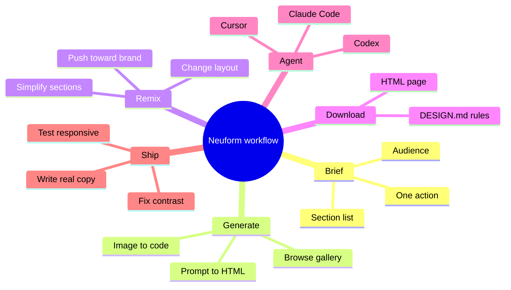

You know the feeling. You open a fresh project, the cursor blinks, and the design decisions start piling up before you have written a single useful line of code. Fonts, spacing, hero layout, motion, colors. Then you ask an AI to "build a landing page" and get something that looks like every other AI landing page on the internet.

That is the gap Neuform tries to close. It is a new platform from designer and founder Meng To that turns prompts into HTML landing pages and app screens, and, more importantly for developers, ships a reusable `DESIGN.md` file with every template so your coding agent can keep building in the same visual language.

In this guide you will learn what Neuform is, who is behind it, what it actually gives you, and a practical workflow for using it on your next site. I will also point out where you should stay skeptical, because no tool removes the need for a developer's judgment.

> [!NOTE] Disclosure
> Links to [Neuform](https://neuform.ai?via=f9xr) in this article are affiliate links. If you sign up through one, F9XR Team may earn a commission at no extra cost to you. We use it because the tool is genuinely useful, and we would rather tell you than hide it.

> **Quick answer:** Neuform is an AI HTML landing page builder and template marketplace by Meng To. You prompt or browse, remix a design, download the HTML, and hand the `DESIGN.md` to a coding agent such as Claude Code, Codex, or Cursor to generate more pages in the same style.

<!--more-->

## What Is Neuform AI?

Neuform is a design platform that generates landing pages and app screens as plain HTML, then packages each result as a remix-ready template. Every template comes with a `DESIGN.md` source file that describes the design system in an open, text-based format.

Think of it as two things in one:

1. **A generator.** You describe what you want in natural language, or drop in a screenshot to recreate a layout, and Neuform produces HTML.
2. **A template library.** The [community gallery](https://neuform.ai/community/featured) holds hundreds of curated designs you can browse, download, and remix instead of starting from nothing.

The official site describes it as a tool that turns prompts into AI HTML landing pages, remix templates, and reusable `DESIGN.md` files for agent-ready design systems. You can try it here: [Neuform](https://neuform.ai?via=f9xr).

## Who Is Meng To?

Meng To is a designer and developer known for founding DesignCode, a well-known resource for learning design and front-end development, and [Aura](https://aura.build), an AI design tool. His public profile on Neuform lists him as the founder of all three. The visual taste he built over the years shows up in Neuform's templates: soft depth, tasteful motion, generous whitespace.

That background matters for trust. This is not a random wrapper around a language model. It comes from someone who has spent years shipping real design work and teaching it.

## Key Features at a Glance

| Feature | What it does | Why developers care |
|---|---|---|
| Prompt to HTML | Generates landing pages and app screens as HTML | You get real markup you can read, edit, and deploy |
| DESIGN.md source files | Each template ships its design system in an open markdown format | Coding agents can read it and stay consistent |
| Remix templates | Adapt existing layouts into new directions | Faster than starting from a blank file |
| Image to code | Drag a screenshot into the canvas to recreate a layout in HTML | Useful for matching a reference or an old design |
| Format variety | Remix designs into mobile, slides, motion design and more | One visual identity across several outputs |
| WebGL and Three.js sections | Many templates include motion and 3D style variations | Eye-catching sections without writing shaders from scratch |

## Why DESIGN.md Is the Real Story

Most AI design tools hand you a finished page and stop there. The next time you need a pricing page or a blog template, the model has forgotten the design, and the result drifts.

`DESIGN.md` fixes that by turning the design into text an agent can read: colors, typography, spacing rules, component patterns. Neuform publishes these in the open TypeUI `DESIGN.md` format, which means the file is not locked to one product.

The practical loop looks like this:

1. Download a Neuform template and its `DESIGN.md`.
2. Give the file to Claude Code, Codex, or Cursor.
3. Ask the agent to build new pages in the same visual language.

If you want the background on why design instructions in markdown work so well with agents, read our explainer on [what DESIGN.md is and how it guides AI agents](/p/what-is-getdesign-md-ai-agents-design-system/).

There is also a [Chrome extension from the TypeUI community](https://github.com/bergside/design-md-chrome) that extracts styles from any website and generates `DESIGN.md` files, which pairs nicely with Neuform for an extract, modify, regenerate loop.

## Watch It in Action



## The Neuform Workflow at a Glance

If you prefer the shape of the process before the detail, this map shows how a prompt becomes a shipped page. You prompt or browse, remix, download both the HTML and the `DESIGN.md`, hand the design rules to an agent, then test and ship.



The rest of this guide walks each branch in order.

## How to Use Neuform for Your Next Site

Here is a workflow that works well for developers. Button labels in the interface may change over time, so treat the steps as the logic, not a click-by-click script.

### Step 1: Define the site before you open the tool

Write down three things: the audience, the single action you want visitors to take, and the sections you need (hero, features, pricing, FAQ, footer). Vague input gives you generic output. A short brief saves you several rounds of regeneration.

### Step 2: Start from a template or a prompt

Open [Neuform](https://neuform.ai?via=f9xr) and either browse the community gallery or write a prompt. Browsing first is a smart habit. Seeing a few finished directions helps you describe what you want in your own words.

### Step 3: Remix, do not accept the first result

Use the remix option to push a design toward your brand. Change the direction, simplify a section, or ask for a different layout for the hero. Treat the first output as a draft.

### Step 4: Download the HTML and the DESIGN.md

Grab both. The HTML gives you a working page. The `DESIGN.md` gives your agent the rules behind it. Keep them in your repo, for example in a `/design` folder, so they travel with the project.

### Step 5: Hand the design system to your coding agent

Point your agent at the file and ask for the next page. If you are new to agent workflows, our guide to [AI coding agents explained](/p/ai-coding-agents-explained/) covers the basics.

### Step 6: Polish, test, and ship

Run the page through a real review. Check responsive behavior, color contrast, keyboard navigation, and performance. If your site is static, you can publish it with a setup like [Hugo on GitHub Pages](/p/hugo-github-pages-setup/) and connect a domain through [Cloudflare](/p/github-pages-custom-domain-cloudflare/).

## A Sample Prompt You Can Adapt

Use specific nouns and constraints. Here is a starting point:

```text
Design a landing page for a developer tool that audits website performance.
Audience: frontend developers and technical founders.
Tone: calm, precise, confident.
Sections: hero with one primary call to action, three feature blocks,
a code snippet section, pricing with two tiers, FAQ, footer.
Style: dark theme, one accent color, subtle motion, generous spacing.
Avoid: stock gradients, generic icon grids, filler copy.
```

Then ask your coding agent to extend it:

```text
Read DESIGN.md and build a /changelog page that matches the existing
typography, spacing, and component patterns. Do not introduce new colors.
```

## Pricing and Free Access

Neuform has a free tier, with paid tiers named Pro, Max, and Ultra that raise generation limits. In an [April 2026 post on X](https://x.com/MengTo/status/2046276968749089222), Meng To said the 400+ design systems on the site are free to download, either as HTML or as `DESIGN.md` files. Quotas and plans change, so check the live pricing page before you commit to anything.

| Tier | Positioning |
|---|---|
| Free | Try the platform and browse templates |
| Pro | Individual creators |
| Max | Higher generation limits |
| Ultra | Heaviest users and teams |

## What Using It Actually Looked Like

When our team needed a landing page draft for a small tool, we started from a finished template instead of a blank prompt. Browsing first paid off: seeing two or three directions made the brief easier to write, and the first remix was closer to usable than the generic output we had gotten from a bare "build a landing page" prompt elsewhere.

The part that changed our workflow was the `DESIGN.md`. Handing that file to a coding agent and asking for a second page in the same style kept the type scale and spacing steady, which is exactly where our earlier AI-built pages had drifted. We still rewrote the copy and cut two of the heavier motion sections before shipping, and the honest lesson is that the template handled the layout while the taste and the tradeoffs were still ours.

## Honest Pros and Cons

**What works well**

- Output is real HTML you can inspect, not a locked canvas.
- `DESIGN.md` gives AI agents consistent design rules.
- Curated templates look more considered than typical AI defaults.
- Strong fit for landing pages, marketing sites, and hero sections.

**What to watch**

- Motion, WebGL, and Three.js sections can hurt performance on low-end devices if you ship them untouched.
- Generated copy is a placeholder. Write your own, or the page will read generic.
- It is a design and front-end accelerator, not a backend. You still own accessibility, SEO, and data handling.
- Check the license terms on any template before using it commercially.

## Practical Tips From Real Use

- **Audit before launch.** Run Lighthouse and fix any heavy animation. Respect `prefers-reduced-motion` for users who need it.
- **Keep one source of truth.** Store `DESIGN.md` in your repo and update it when the design changes.
- **Replace every placeholder.** Titles, meta descriptions, alt text, and structured data are your job, not the template's.
- **Limit 3D sections.** One strong visual moment beats five competing ones. If you want to add 3D to a page, see how to [set up Three.js models on a landing page](/p/setup-threejs-models-landing-page/).
- **Avoid the sameness trap.** Even good templates can look repetitive when everyone uses them. Change the typography, spacing, or imagery so your site feels like yours. Our piece on [how to de-AI-slop your website design](/p/how-to-de-ai-slop-website-design/) goes deeper.
- **Test with a real device.** A page that looks perfect on a fast laptop can stutter on a mid-range phone.

## Who Should Use Neuform?

It suits frontend developers who want a strong visual starting point, indie hackers shipping a product page quickly, and agencies that need consistent design systems across projects. It is less suited to teams that need complex app logic generated end to end, since its strength is the design and HTML layer.

## Frequently Asked Questions

### What is Neuform AI?

Neuform is an AI platform by Meng To that turns prompts into HTML landing pages and app screens and packages them as remix-ready templates. Each template includes a reusable `DESIGN.md` file that describes its design system for AI coding agents.

### Who created Neuform?

Meng To created Neuform. He is also the founder of DesignCode and Aura, and is widely known in the design and front-end community.

### Is Neuform free?

Neuform has a free tier, and Meng To has said the 400+ design systems on the site are free to download. Paid tiers named Pro, Max, and Ultra offer higher generation limits. Plans change, so check the official pricing page.

### What is a DESIGN.md file?

A `DESIGN.md` file is a markdown document that records a design system in plain text, including colors, typography, spacing, and component rules. AI coding agents read it so new pages match the original design. Neuform uses the open TypeUI format.

### Can I use Neuform with Claude Code, Cursor, or Codex?

Yes. The recommended workflow is to download a template, then give its `DESIGN.md` to Claude Code, Codex, or Cursor and ask the agent to build new pages in the same style.

### Does Neuform export real HTML?

Yes. Neuform outputs HTML templates you can download, read, edit, and deploy. That makes it easier to review and customize than tools that lock designs inside a proprietary editor.

## Key Takeaways

- Neuform is an AI HTML landing page builder and remix template platform created by Meng To, founder of DesignCode and Aura.
- Every template ships with a reusable `DESIGN.md` file in an open format that agents like Claude Code, Codex, and Cursor can read.
- You can prompt, remix, or drop in a screenshot to recreate a layout in HTML.
- The 400+ design systems were announced as free by Meng To, but always confirm current plans on the pricing page.
- The best workflow is: brief, remix, download HTML and `DESIGN.md`, hand to your agent, then test and polish.
- Treat output as a strong draft. Performance, accessibility, SEO, and original copy remain your responsibility.

## Conclusion

Neuform is a genuinely useful starting line for anyone who ships landing pages, because it treats the design system as a first-class artifact instead of a one-off render. The `DESIGN.md` export is what makes it more than a template store, and that idea is the same one behind our explainer on [giving AI agents a real design system](/p/what-is-getdesign-md-ai-agents-design-system/).

It fits the wider shift we describe in [vibe coder vs vibe engineer](/p/vibe-coder-vs-vibe-engineer/): the tool produces a draft, and the engineer owns the judgment. For teams like F9XR, the practical pattern is to remix a template, keep the `DESIGN.md` in the repo, and review the result the same way we would review any code.

If you would rather understand the agent half first, [AI coding agents explained](/p/ai-coding-agents-explained/) is the right place to start. When your page is ready, [Hugo on GitHub Pages](/p/hugo-github-pages-setup/) gets it live, and our [Hugo SEO guide](/p/hugo-seo-guide/) helps it get found.

Ready to contribute? The [Contributor Guide](/contribute/) explains how to submit an article to Dev9b, and everything we publish is reviewed against the standards in our [Editorial Policy](/editorial-policy/).

---

*Disclosure: this article contains an affiliate link to [Neuform](https://neuform.ai?via=f9xr). If you sign up through it, F9XR Team may earn a commission at no extra cost to you. Our opinions are based on the public information and tools described above. This guide was researched and drafted with the assistance of an AI coding assistant, then reviewed by the F9XR Review Board before publishing. Have feedback or want to contribute your own article? See our [Contributor Guide](/contribute/) and [Editorial Policy](/editorial-policy/).*
