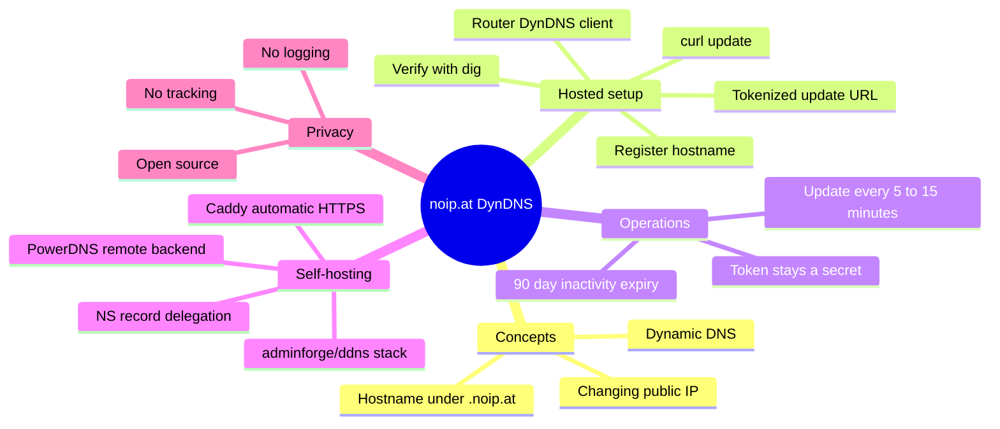

If you run a home lab, self-host a service, or need reliable remote access without paying your ISP for a static IP, Dynamic DNS is one of those tools you eventually reach for. Most big providers push confirmations, ads, or paid upgrades. noip.at takes a different route.

noip.at DynDNS is a free, no-nonsense Dynamic DNS service focused on privacy and simplicity. It gives you a hostname under `.noip.at` that always points to your current public IP. No accounts with endless confirmations, no tracking, no logging, and no advertising. The code is open source, and the hosted service is run by adminForge.de.

This guide explains exactly what noip.at DynDNS is, why developers and coders reach for it, and how to set it up in minutes on a router, with curl, or even self-host the whole stack.

<!--more-->

## What Is noip.at DynDNS?

Dynamic DNS (often called DynDNS or DDNS) solves a basic problem: most residential and many business internet connections get a changing public IP address. When the IP changes, any hostname or remote access you set up stops working until you update it manually.

noip.at handles that update for you. You register a short hostname such as `myhomelab.noip.at`. A simple HTTP call — from your router, a cron job, or a one-line script — tells the service your current IP. The DNS record is updated, and the hostname keeps resolving correctly.

Key characteristics of the service:

- Completely free, with no paid tiers currently listed
- No tracking, no logging, no advertising
- Hostnames live under the `.noip.at` domain
- Inactive hosts are automatically deleted after 90 days of no updates
- Open-source backend based on the [adminforge/ddns project](https://github.com/adminforge/ddns) (itself a fork of an earlier PowerDNS Remote Backend implementation)
- Update mechanism is a single unique URL containing a token

It is deliberately minimal. There is no full account dashboard with dozens of features, no email confirmations every 30 days, and no pressure to upgrade. You register a name, get a token, and start updating.

For developers this is attractive because the update surface is just an HTTP GET. You can wire it into a cron job, a systemd timer, a router, a container, or any scripting language in a few lines.

## Why Developers Choose noip.at Over Bigger Providers

Many people start with the well-known commercial options. Those services work, but they often come with friction:

- Forced periodic confirmation of free hostnames
- Account creation and email verification steps
- Logging or analytics you did not opt into
- Upgrade paths that push you toward paid plans once you need more than one or two names

noip.at removes most of that. The privacy stance (no tracking, no logging) and the open-source nature make it a solid fit for self-hosters, privacy-conscious developers, and anyone who just wants a stable name for a changing IP.

It also pairs well with other free tooling. If you already pick names from our [free subdomains for developers list](/p/free-subdomains-for-developers-list/), adding a privacy-focused DDNS hostname is a natural next step — the difference being this one follows your IP automatically instead of sitting still.

Here is the whole picture at a glance:



## How to Set Up noip.at DynDNS (Step by Step)

The hosted service is intentionally simple. Here is the complete flow.

### 1. Register Your Hostname

1. Open the [noip.at registration page](https://noip.at) in your browser.
2. Enter the desired subdomain name (the part before `.noip.at`).
3. The interface shows green if the name is free and red if it is taken.
4. Click **Register Host**.

You immediately receive an update URL that looks like this:

```
https://noip.at/update/yourname/1fc582a9b3c4d5e6f7...token
```

Your full hostname will be `yourname.noip.at`. Save the full update URL somewhere safe. The token is the authentication mechanism. Anyone who has the complete URL can update the record, so treat it like a secret.

### 2. Update Your IP Address

The simplest way to push an update is a single curl command:

```bash
curl "https://noip.at/update/yourname/YOUR_TOKEN_HERE"
```

When the call succeeds, the service records the public IP that made the request and updates the A record for your hostname.

You can schedule the update in several ways:

- **Cron** (Linux/macOS): run every 5–15 minutes
- **systemd timer**: same interval, cleaner logging
- Router built-in DynDNS client with a custom URL
- A small container or script that checks your current public IP and only calls the URL when it changes

There is currently no classic DynDNS-style username/password API. The tokenized URL is the intended update method.

### 3. Configure a Router (Fritz!Box Example)

Many home routers support custom DynDNS update URLs. On a Fritz!Box the steps are:

1. Log in to `http://fritz.box`
2. Go to **Internet → Freigaben → DynDNS** (or the equivalent English path: Internet → Permit Access → DynDNS)
3. Paste the full noip.at update URL into the **Update-URL** field
4. Fill Domain name, Username, and Password with any non-empty values — the router requires them, but noip.at ignores them

Save the settings. The router will call the URL whenever it detects an IP change. The operator's [adminForge.de DynDNS service page](https://adminforge.de/service-dyndns) documents the same Fritz!Box flow from the other side.

Other routers that support "custom" or "user-defined" DynDNS providers work the same way: paste the complete update URL.

### 4. Verify the Record

After the first successful update, check resolution:

```bash
dig +short yourname.noip.at
# or
nslookup yourname.noip.at
```

You should see your current public IPv4 address. Compare it against what a public echo service such as [icanhazip.com](https://icanhazip.com) reports for your connection.

Remember the 90-day inactivity rule. If you stop updating for three months the hostname is removed. Keep the update job running, or re-register if needed.

## Self-Hosting a noip.at-Style DynDNS Stack

Because the software is open source, you can run your own instance on your own domain. The [adminforge/ddns repository](https://github.com/adminforge/ddns) provides a Docker Compose based deployment.

High-level requirements:

- A domain where you can set NS records for a subdomain
- A server with Docker and docker-compose
- Ports 53/udp, 80/tcp, and 443/tcp open

You create two DNS records at your registrar:

- An A/AAAA or CNAME for the frontend (for example `ddns.example.net`)
- An NS record for the zone that will hold the dynamic names (for example `d.example.net` pointing to the frontend host)

Then clone the repository, adjust the override file with your domain and Let's Encrypt email, and bring the stack up. The project uses [PowerDNS with its Remote Backend](https://doc.powerdns.com/authoritative/backends/remote.html) for the dynamic zone, Caddy for automatic HTTPS, and Redis for storage. Inactive hosts expire after a configurable number of days (default 90).

If your DNS lives on Cloudflare, the delegation step works the same way — our [guide to creating a Cloudflare subdomain](/p/how-to-create-cloudflare-subdomain-github-pages/) shows how to structure records on that side of the fence.

Self-hosting gives you full control over the domain, TTL, and retention policy, at the cost of running and securing the infrastructure yourself. For most people the hosted service is the better trade until they outgrow `.noip.at`.

## Practical Tips for Reliable Operation

- Prefer updating only when the IP actually changes. A short script can compare the last known IP (from [icanhazip.com](https://icanhazip.com) or a similar echo service) before calling the update URL.
- Keep the update interval reasonable — every 5–15 minutes is usually enough. Aggressive polling gains nothing.
- Store the full update URL in a secrets manager or an environment variable, never in a public repository. The token is the only credential.
- Combine the hostname with a reverse proxy (Caddy, Traefik, Nginx) and automatic certificates for clean HTTPS access to your services. If you need certificates without exposing ports publicly, the [free LocalCert subdomain API guide](/p/free-localcert-subdomain-api-setup-guide/) covers ACME DNS-01 issuance for private networks.
- Test failover: temporarily change your public IP (mobile hotspot, a different network) and confirm the hostname follows.
- Monitor the 90-day window. A simple health check that fails when the hostname stops resolving can alert you before the record is deleted.

## Frequently Asked Questions

### Is noip.at completely free?

Yes. The hosted service at noip.at is free. There are no paid plans listed, no usage caps that force an upgrade, and no advertising. The only notable limit is that hostnames inactive for 90 days are deleted.

### Do I need to create an account or confirm the hostname regularly?

No. You register a hostname once and receive a token. There are no periodic email confirmations required to keep the name alive, unlike some other free DDNS providers.

### How do I update the IP address?

Call the unique update URL you received at registration, for example with curl:

```bash
curl "https://noip.at/update/yourname/your-token"
```

Your router can also call the same URL if it supports custom DynDNS update URLs.

### What happens if I stop updating for a long time?

After 90 days without an update the hostname is automatically removed. You can simply register the same (or a new) name again if needed.

### Can I use my own domain instead of .noip.at?

Not on the public noip.at service. For a custom domain you need to self-host the open-source ddns software and point the necessary NS records to your server.

### Is the service suitable for production or only for testing?

Many people use it for production home-lab and small self-hosted services. Because it is privacy-focused and minimal, it is a good fit for personal projects. For mission-critical commercial use you may still prefer a provider that offers SLAs and support contracts.

## Key Takeaways

- noip.at is a free, privacy-first Dynamic DNS service that gives you a stable `.noip.at` hostname for a changing public IP.
- Registration is instant: choose a free name, receive a tokenized update URL, and start updating — no confirmations, no ads.
- Updates are a single HTTP GET. Use curl, cron, systemd, or your router's custom DynDNS field.
- Inactive hostnames are removed after 90 days of no updates, so keep the update job alive.
- The entire stack is open source and can be self-hosted on your own domain with NS delegation, PowerDNS, and Caddy.

## Conclusion

noip.at DynDNS does one job — keeping a hostname pointed at your changing public IP — and does it without accounts, ads, or telemetry. A tokenized update URL, one curl command, and a 15-minute cron are genuinely all it takes; the same URL drops into any router that accepts a custom DynDNS provider. When you outgrow the shared `.noip.at` zone, the same open-source stack scales up to a fully self-hosted instance on your own domain. If you later need global resolution and automatic failover instead of a single home IP, our [Anycast DNS setup guide](/p/anycast-dns-what-is-it-setup-guide/) covers the layer above Dynamic DNS.

Teams like F9XR lean on similarly boring, dependable plumbing so the interesting work gets the attention. If something in this guide is wrong or outdated, see the [Contributor Guide](/contribute/) to send a fix, and read our [Editorial Policy](/editorial-policy/) to understand how Dev9b reviews and updates articles. This post was drafted with AI assistance and fact-checked against the noip.at interface, the adminforge/ddns repository, and the PowerDNS documentation.
