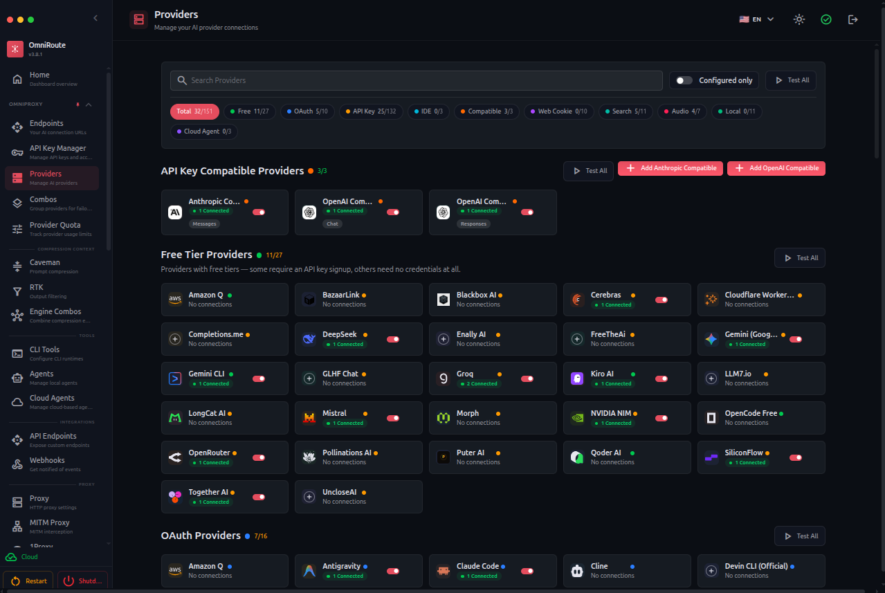

If you spend any time coding with AI tools, you already know the frustration. One minute Claude Code or Cursor is flying, the next you hit a rate limit or burn through your monthly quota. Switching providers mid-flow kills momentum. Managing a dozen API keys and dashboards feels like a second job.

OmniRoute fixes that. It is a free, open-source local AI gateway that sits on your machine and gives every coding tool one clean OpenAI-compatible endpoint. Behind the scenes it routes across hundreds of providers, falls back automatically when quotas run dry, and even compresses tokens so you stretch free tiers further. If you have ever wondered how the agents in our [AI coding agents guide](/p/ai-coding-agents-explained/) actually talk to models, this is the switchboard layer that answers that question.

In this guide I will walk you through exactly what OmniRoute is, how to get it running on your PC in a few minutes, and how to build a completely free vibecoding setup that keeps working when paid quotas expire.

<!--more-->

## What Is OmniRoute?

OmniRoute is a local proxy and AI gateway written in TypeScript. You install it once, start it, and point tools like Claude Code, Cursor, Cline, Continue, OpenCode, Aider, or any OpenAI-compatible client at `http://localhost:20128/v1`.

It does three things extremely well:

- Aggregates many providers (subscription accounts, API keys, and free tiers) behind a single endpoint.
- Applies intelligent routing and auto-fallback so requests keep flowing when one provider hits limits.
- Offers stacked token compression (RTK + Caveman and others) that can cut eligible token usage significantly. The maintainers report savings anywhere from roughly 15% to 95% depending on how much of the request is code, JSON, or plain prose.

Because everything runs on your machine, your API keys and request logs stay local. There is no cloud middleman charging per request. The project is MIT licensed, actively maintained, and has grown quickly with community contributions. The [OmniRoute repository on GitHub](https://github.com/diegosouzapw/OmniRoute) is the source of truth for releases and the provider catalog.

Think of it as a smart switchboard for AI models. Your coding tools talk to one address. OmniRoute decides which upstream model answers, translates formats when needed, and keeps the conversation going.



### Key Features That Matter for Developers

| Feature | Why It Helps |
|---------|--------------|
| OpenAI-compatible endpoint | Drop-in replacement for most coding agents and IDEs |
| Auto-fallback (Subscription → API Key → Cheap → Free) | Zero downtime when quotas or rate limits hit |
| Token compression | Stretch free tiers and paid quotas further |
| Combos and routing strategies | Priority, weighted, round-robin, cost-optimized, auto scoring, and more |
| Dashboard | Easy provider management, usage tracking, health checks |
| MCP and A2A support | Works with agent workflows and tool calling |
| Multiple install options | npm, Docker, Electron desktop app, even Termux on Android |

## How to Set Up OmniRoute on Your PC

The fastest path for most developers is the global npm install. You need a recent [Node.js](https://docs.npmjs.com/downloading-and-installing-node-js-and-npm) — version 22 or 24 is recommended by the project. This is the same local-first pattern you see in tools like our [local n8n installation walkthrough](/p/how-to-install-n8n-locally-on-pc/): install once, keep everything on your machine, no account required to start.

### 1. Install OmniRoute

```bash
npm install -g omniroute
```

If you prefer Docker:

```bash
docker run -d --name omniroute -p 20128:20128 diegosouzapw/omniroute:latest
```

Or clone and run from source if you want to dig into the code. The [official quick start guide](https://github.com/diegosouzapw/OmniRoute/blob/main/docs/getting-started/QUICK-START.md) covers all three paths in detail.

### 2. Start It

```bash
omniroute
```

The dashboard opens at `http://localhost:20128`. The API lives at `http://localhost:20128/v1`.

On first run you will see a simple setup flow. Change the default password under Configuration → Security if you plan to leave it running, especially on a shared machine. This is what the main dashboard looks like once it is up:



### 3. Connect Providers

Open the dashboard → Providers → Add Provider.

For a free start, add a few of these (many work without a credit card):

- Kiro AI (often gives free Claude-class models)
- OpenCode Free
- Pollinations
- LongCat
- Cloudflare Workers AI
- Other keyless or free-tier providers listed in the catalog

The project's [free tiers guide](https://github.com/diegosouzapw/OmniRoute/wiki/Free-Tiers-Guide) keeps the current list honest, since free tiers come and go. The [providers guide](https://github.com/diegosouzapw/OmniRoute/wiki/Providers-Guide) walks through connection details for each one.

You can also add paid API keys (OpenAI, Anthropic, Google, DeepSeek, Groq, and others) or link subscription accounts. OmniRoute will prefer higher-tier options first and fall back when needed.

### 4. Grab Your Local Key

In the dashboard go to Endpoints and copy the API key OmniRoute generated for you. This key authenticates requests to your local gateway only. It never leaves your machine.

### 5. Point Your Tools at OmniRoute

In Claude Code, Cursor, Continue, Cline, or similar tools set:

- Base URL: `http://localhost:20128/v1`
- API Key: the key you just copied
- Model: `auto` (recommended) or a specific combo you create

Many tools also support a one-command launcher:

```bash
omniroute launch
```

That command wires the environment variables and starts the tool pointed at your local gateway. If you are coming from a terminal agent setup such as our [OpenCode TUI guide](/p/how-to-setup-opencode-tui/), this replaces the provider configuration step entirely.

Test quickly:

```bash
curl http://localhost:20128/v1/models -H "Authorization: Bearer YOUR_KEY"
```

You should see the models from the providers you connected.

### Optional but Useful Tweaks

- Enable token compression in the dashboard for tool-heavy sessions.
- Create a combo with priority or auto strategy so you control the fallback order.
- Use the health page to watch provider status and circuit breakers.
- On Windows you can enable tray mode and autostart so OmniRoute stays available.

## How to Set Up a Completely Free Vibecoding Project

Vibecoding is about staying in flow: describe what you want, let the agent write and iterate, and keep shipping without stopping for quota messages. Our [vibe coder vs vibe engineer comparison](/p/vibe-coder-vs-vibe-engineer/) covers the mindset side; this section is about the mechanics of keeping that loop free. Here is a practical free stack.

### Step 1: Run OmniRoute Locally

Follow the install steps above. Keep the process running while you work.

### Step 2: Connect Multiple Free Providers

Add at least three free or free-tier providers. A solid starter set:

1. Kiro AI (quality Claude-style models)
2. OpenCode Free or Pollinations (broad model access, often keyless)
3. LongCat or Cloudflare AI (extra volume)

OmniRoute's auto routing will score them on latency, remaining quota, success rate, and other factors. If you want to know what free actually adds up to, the project publishes a pool-deduplicated budget breakdown of its catalog, counting each shared free pool once instead of double-counting providers that draw from the same upstream:



### Step 3: Configure Your Coding Agent

Use Claude Code, Cursor, Continue.dev, OpenCode, Cline, or Aider. Point them all at the same local endpoint and set the model to `auto` or a free combo you defined.

Example for Continue.dev in `~/.continue/config.yaml`:

```yaml
models:
  - name: OmniRoute Auto
    provider: openai
    model: auto
    apiBase: http://localhost:20128/v1
    apiKey: YOUR_OMNIROUTE_KEY
```

### Step 4: Turn On Compression and Smart Routing

In the OmniRoute dashboard enable the RTK + Caveman (or stacked) compression pipeline. For tool-heavy agent sessions this can reduce tokens dramatically while protecting code blocks, JSON, and URLs.

Create a simple priority combo if you want explicit control: preferred free model first, then backups.

### Step 5: Start Building

Open a project folder and start a conversation. Ask the agent to scaffold features, write tests, refactor, or explain unfamiliar code. When one free provider slows down or hits a soft limit, OmniRoute switches automatically. You stay in the same chat.

The first session is where the setup proves itself. You hit a soft limit, glance at the dashboard, watch it flip to the next provider, and the conversation simply continues. After a week of that, quota anxiety stops being part of the workflow.

### Practical Tips for Reliable Free Vibecoding

- Keep several free providers connected. Diversity beats relying on a single free tier.
- Prefer models that support tool calling if your agent needs to edit files or run commands.
- Watch the dashboard usage page so you know when a provider is near its limit.
- For heavier work, add one low-cost paid API key as a safety net. OmniRoute will only use it after free options are exhausted.
- Restart OmniRoute after major provider changes so the model list refreshes cleanly.
- On shared machines or if you expose the port, change the default password and consider binding only to localhost.

This setup costs nothing beyond the electricity your machine already uses. You get continuous AI assistance without juggling multiple accounts or watching the clock for quota resets.

## FAQ

### What is OmniRoute used for?

OmniRoute acts as a local AI gateway and router. Developers use it to connect coding agents and IDEs to many AI providers through a single endpoint, with automatic fallback and optional token compression.

### Is OmniRoute completely free?

Yes. The software itself is free and open-source under the MIT license. You only pay if you choose to use paid API keys or paid subscriptions that you connect yourself.

### Do I need an API key to start?

No. Several free providers work with no key or with a simple account connection. You can begin with keyless options and add paid keys later.

### Which tools work with OmniRoute?

Any tool that accepts a custom OpenAI-compatible base URL, including Claude Code, Cursor, Cline, Continue, OpenCode, Aider, and many others.

### Does OmniRoute send my data to a third party?

No. It runs entirely on your machine. Credentials and requests stay local unless you deliberately configure a remote or proxy setup.

### How does the free vibecoding setup stay reliable?

By connecting multiple free providers and letting OmniRoute's auto-routing and fallback logic switch between them when one hits limits. Compression further reduces token pressure.

## Key Takeaways

- OmniRoute is a free, open-source local AI gateway that gives coding tools one OpenAI-compatible endpoint.
- Installation is usually just `npm install -g omniroute` followed by `omniroute`.
- Free providers such as Kiro, OpenCode Free, Pollinations, and others let you run a fully free vibecoding workflow.
- Auto-fallback and token compression keep sessions alive longer and stretch every free token.
- Your keys and data stay on your machine. No per-request cloud fees.

## Conclusion

OmniRoute turns the usual quota anxiety into background noise. Install it, connect a few free providers, point your favorite coding agent at the local endpoint, and keep shipping. The flow stays unbroken, the cost stays zero if you want it that way, and you stay in control of your keys and data.

Every article on Dev9b is published under the standards in our [Editorial Policy](/editorial-policy/). If you have a developer workflow worth sharing, the [Contributor Guide](/contribute/) explains how to get it in front of the community. This article was drafted and edited with AI assistance, then reviewed by the F9XR Team. The cover image, dashboard screenshot, and diagrams come from the OmniRoute project documentation, and all version-specific details were checked against the project documentation linked above.
