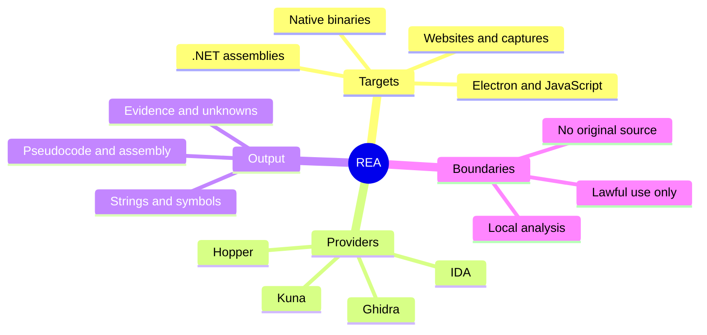

Software used to be something you bought. You paid once, installed it, and it kept working. Subscriptions changed that. Features now arrive through a server, and the copy on your machine often stops working the moment the billing stops.

REA, short for Reverse Engineer Anything, gives AI coding agents a way to look inside that software. It connects Claude Code, Codex, and other agents to tools such as Ghidra, Hopper, and IDA, then returns pseudocode and evidence the agent can reason about. The project has crossed 400,000 GitHub stars, and its showcases show agents reconstructing real functions from compiled code.

<!--more-->

## What REA is and why developers care

REA is an MIT-licensed MCP server and CLI from the GitHub user morluto. MCP stands for [Model Context Protocol](https://modelcontextprotocol.io), the interface that lets an AI agent call external tools. REA sits between your agent and the analysis engines already used by reverse engineers.

The agent asks for something specific. REA opens the target, routes the request to the right provider, and returns findings with addresses, strings, pseudocode, and a list of what it could not prove. The agent can then explain the behavior, write a new implementation, or ask another question.

That loop is the useful part. A traditional session in Ghidra involves jumping between the decompiler, the symbol tree, cross-references, and a notes file. An agent can keep that context together and follow a thread without losing the earlier evidence.

> [!TIP] Start with the official sources
> REA's README warns that similarly named repositories may not be official. Use [morluto/rea on GitHub](https://github.com/morluto/rea), [rea.tools](https://rea.tools/), or the [rea-agents npm package](https://www.npmjs.com/package/rea-agents).

We covered the basic install in the [REA setup guide for Claude Code and Codex](/p/what-is-rea-reverse-engineer-anything-setup-guide/). This article focuses on what the agent can do once it has the tools, and where the legal lines sit.



## How REA works under the hood

REA is not a new decompiler. It is a bridge with session management, target handling, and a consistent tool interface. Native work goes to Ghidra, Hopper, IDA, or Kuna. Static JavaScript and .NET inspection can run without a native engine.

The official documentation lists a wide range of targets, from desktop app bundles and Go binaries to Android APKs, firmware images, and saved network captures. Most readers will start with one of the common cases below.

| Target | What REA returns | What you need |
|---|---|---|
| Native binaries | Pseudocode, assembly, strings, symbols, calls, and references | Hopper, Ghidra, IDA, or Kuna |
| JavaScript and Electron | Modules, imports, source maps, routes, and IPC boundaries | Node.js and npm |
| .NET assemblies | Metadata, CIL instructions, native dependencies, and build comparisons | Nothing extra, static only |
| Websites | Page structure, scripts, network observations, and screenshots | A Chrome-family browser |
| Android APKs | Manifest declarations, classes, decompiled methods, and references | JADX and a full JDK |

The workflow looks like this:

1. You point the agent at a binary, an app bundle, or a website.
2. You ask a narrow question about one behavior.
3. The agent calls REA tools to find functions, strings, and cross-references.
4. REA returns evidence and known gaps.
5. The agent explains the finding, writes code, or asks a better follow-up question.

Analysis runs on your machine. That does not mean the findings stay there. Your agent receives the tool results, and its model provider has its own data policy. If the target is confidential, treat the model side of the loop as part of your threat model.

Node.js is the other practical requirement. The current README asks for Node.js 22.x at 22.23.4 or newer, 24.x at 24.22.1 or newer, or 26.12.1 or newer. Older 22.x builds will not pass the check.

## A real workflow: from binary to feature

The project's published showcases are a better guide than a broad "clone any app" claim. Three cases show what the work looks like:

The [DX-Ball reconstruction](https://rea.tools/showcase/dx-ball/) follows a sound call into a position-to-pan helper, inspects the instructions, and turns incomplete pseudocode into C. The result passes 3,205 original x86 test cases and reproduces all 63 compiled function bytes. That is a narrow, testable result. It also shows where an agent helps most: keeping the evidence attached while turning disassembly into code.

The [Notion clipboard case](https://rea.tools/showcase/notion/) starts in the Electron renderer, follows the clipboard API through preload and IPC, and ends in the main process with the rich clipboard format. Anyone who has traced an Electron app knows how much of the work is just finding the boundary. REA gives the agent a way to walk it.

The [Touhou 4 case](https://rea.tools/showcase/th04/) inspects 16-bit PC-98 instructions to recover fixed and aimed angle calculations, then compares the reconstructed C++ with the historical compiler output. This is old code on an unfamiliar architecture, which makes the evidence trail more important than the final source file.

A prompt for a task like that should be specific:

```text
Inspect the DX-Ball binary with REA. Find the function that maps
ball position to stereo pan, show the evidence, and write a C
implementation with tests for the original cases.
```

The setup and CLI entry points are simple:

```bash
npx rea-agents setup
npx -y rea-agents@latest analyze-javascript-application /path/to/app --json
```

For regular use, the README suggests a global install so the `rea` command is available:

```bash
npm install --global rea-agents
rea --help
```

I have not reproduced the showcase numbers myself. They come from the project's published case studies and reconstruction repositories, which is the right way to read them. Treat a demo as a claim with a test harness, not as proof that the same result will hold for your target.

When you try it, ask for the evidence and the unknowns in the same answer. A confident explanation without addresses or code references is a warning sign. So is a reconstruction that passes one example but has no tests. The agent can move fast, and speed makes it easier to accept a plausible answer that was never checked.

## Legal and ethical boundaries you cannot ignore

REA's own [disclaimer](https://github.com/morluto/rea/blob/main/DISCLAIMER.md) limits the tool to lawful research, education, interoperability, software preservation, and analysis of software you own or are authorized to examine. That is the project's position, not a legal opinion for your situation.

The commercial analysis engines have their own rules. Hopper, IDA, and JEB are licensed products. A demo or trial may restrict automation, output sharing, or commercial use. The REA README is explicit that the project grants no license, key, or activation entitlement for those tools.

Copyright and contract law still apply to the target. So do the terms of service that come with many apps. Reverse engineering for interoperability or security research has protections in some jurisdictions, under specific conditions. Copying a product's code, assets, and interface and shipping it as your own is a separate act with a different risk profile.

A practical checklist:

- Work on software you own, software under a license that permits analysis, or a target you have written permission to examine.
- Keep the goal narrow. Understanding one algorithm is easier to defend than rebuilding an entire product.
- Use clean-room habits. Study the behavior, document what you learned, then implement from that understanding without copying the original code or assets.
- Do not copy icons, artwork, exact layouts, or other protected expression.
- Keep a log of each target, the question you asked, and the legal basis for looking at it.
- Check the model provider's data policy before you send proprietary findings through an agent.
- Talk to a lawyer before you distribute anything based on a commercial target.

> [!WARNING] Permission beats a clever prompt
> A tool that can inspect any app does not give you the right to inspect any app. Get permission or a clear legal basis first.

## What this means for closed-source and subscription software

Reverse engineering used to be a moat built on difficulty. A small number of specialists could open a binary, follow the logic, and explain how a feature worked. Most developers could not justify the time.

REA lowers that barrier. A developer who can write a clear prompt can now ask an agent to trace a feature and produce evidence. That is useful for security research, for learning from well-built software, and for building interoperable tools. It also makes functional alternatives cheaper to study.

Subscription companies should pay attention, but not because their code is suddenly public. The code was always inspectable by someone with the right skills. The change is the number of people who can do the work and the speed at which they can do it. A feature that took a week of manual analysis may now take an afternoon of guided investigation.

That does not remove the need for a good product. Understanding how a feature works is easier than building a version that people want to use, support, and pay for. Network effects, trust, integrations, and execution still matter. The moat moves from "nobody can see inside" to "nobody can match the whole system."

## Key takeaways

- REA is an MIT-licensed MCP server and CLI that lets AI agents drive Ghidra, Hopper, IDA, and Kuna.
- It returns pseudocode, assembly, strings, symbols, and call graphs with evidence and stated limits.
- The published showcases reconstruct specific functions, including a DX-Ball sound-pan routine and a Notion clipboard bridge.
- Analysis runs locally, but tool results still reach your agent's model provider, so check its data policy.
- The legal risk sits with the target and the distribution, not with the prompt. Permission and clean-room habits matter more than the tool.

## Conclusion

REA makes the inside of compiled software visible to a much larger group of developers. That is good for research, learning, and interoperability when it is used with permission. It is dangerous when it is treated as a shortcut around copyright or a license.

The barrier has dropped. The responsibility has not.

The F9XR Team publishes these tool breakdowns so developers can judge the tradeoffs before adding another agent to their workflow. If you want to contribute a tested walkthrough or correct something here, read the [Contributor Guide](/contribute/) and our [Editorial Policy](/editorial-policy/). For more agent setup context, see our guides to [AI coding agents](/p/ai-coding-agents-explained/), [OpenCode MCP servers](/p/opencode-mcp-servers/), and [Mobbin's agent integration](/p/connect-mobbin-ai-agent-mcp/).

AI assistance: this article was drafted with an AI assistant and checked against REA's official documentation, disclaimer, and published showcases by the F9XR Team.

## FAQ

### What is REA (Reverse Engineer Anything)?

REA is an open-source MCP server and CLI that connects AI coding agents such as Claude Code and Codex to reverse-engineering tools including Ghidra, Hopper, IDA, and Kuna. It lets the agent inspect binaries, Electron apps, .NET assemblies, websites, and other targets without source code, then returns findings with evidence and stated limits.

### How do I install REA?

Install a supported Node.js release, then run `npx rea-agents setup`. Choose your agents, review the proposed configuration, and approve the changes. Restart the agent afterward. Native binary work also needs Ghidra, Hopper, IDA, or Kuna. Static JavaScript and .NET analysis does not.

### Does REA recover original source code?

No. REA produces pseudocode, assembly, strings, symbols, call graphs, and other evidence. It does not claim to recover the exact original source. The agent can use those findings to write a new implementation.

### Is it legal to use REA on commercial software?

Laws vary by country and use case. REA's own guidance limits the tool to lawful research, education, interoperability, software preservation, and software you own or are authorized to examine. Distributing a substantial copy of proprietary code, assets, or design is a different matter. Get legal advice before you go beyond private research.

### Which AI agents work with REA?

Claude Code, Codex, Cursor, Gemini CLI, Grok Build, and any other agent that supports local MCP servers. The setup command configures supported agents and writes the matching workflow instructions.

### Can REA rebuild an entire application?

The published showcases reconstruct specific functions, such as the DX-Ball sound-pan calculation and a Touhou 4 bullet-ring routine. Full commercial applications with server components, large codebases, and anti-tamper measures are much harder. Expect useful feature-level work more often than a drop-in replacement.
