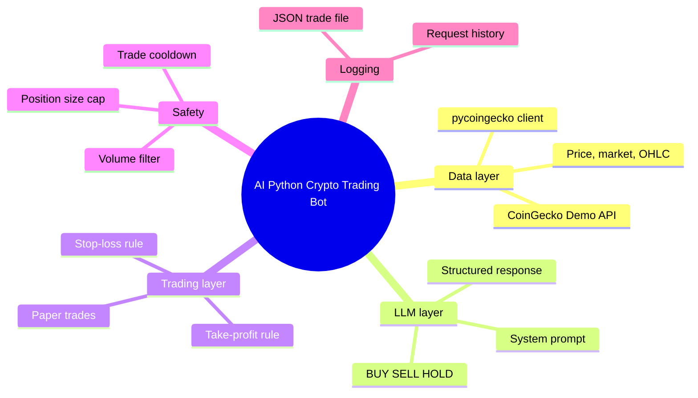

Building your own crypto trading bot sounds complex until you break it down. Most developers start with price alerts or simple scripts. The next step is connecting real market data, adding decision logic, and letting an AI model help decide when to buy or sell.

This guide walks you through setting up a practical AI-powered Python crypto trading bot that pulls live data from the CoinGecko API. You will fetch prices and market metrics, feed them into a large language model for analysis, apply basic safety rules, and run everything in paper trading mode first. No real money moves until you are ready.

<!--more-->

The approach stays simple enough for intermediate Python developers while giving you a solid foundation you can expand later. It is the same observe, decide, act loop we broke down in [AI coding agents explained](/p/ai-coding-agents-explained/), applied to market data instead of a codebase.

## What This AI Python Crypto Trading Bot Does

You end up with a bot that:

- Pulls real-time and historical crypto data from the CoinGecko API
- Sends the data plus a clear prompt to an LLM (OpenAI example)
- Receives a BUY, SELL, or HOLD recommendation
- Applies hard-coded stop-loss and take-profit rules
- Logs trades in a local JSON file for review
- Runs safely in paper trading mode

CoinGecko's free Demo API covers everything needed for this tutorial. Rate limits exist, so treat this as a learning and testing setup rather than a high-frequency production system. CoinGecko also published [their own take on an AI crypto trading bot tutorial](https://www.coingecko.com/learn/build-ai-crypto-trading-bot) if you want a second perspective after this one.

Here is the whole build at a glance:



And as plain text, the same map:

```
AI Python Crypto Trading Bot
  - Data layer
    - CoinGecko Demo API
    - pycoingecko client
    - Price, market, OHLC
  - LLM layer
    - System prompt
    - Structured response
    - BUY SELL HOLD
  - Trading layer
    - Paper trades
    - Stop-loss rule
    - Take-profit rule
  - Safety
    - Volume filter
    - Position size cap
    - Trade cooldown
  - Logging
    - JSON trade file
    - Request history
```

## Prerequisites

Before writing code, gather these:

- Python 3.11 or newer
- A free CoinGecko Demo API key
- An OpenAI API key (or any LLM provider you prefer)
- Basic familiarity with virtual environments and environment variables
- A code editor (VS Code works well)

### Get Your CoinGecko Demo API Key

1. Go to the [CoinGecko API pricing page](https://www.coingecko.com/en/api) and create a free account.
2. Open the Developer Dashboard.
3. Create a new API key under the Demo plan.
4. Copy the key. You will use the header `x-cg-demo-api-key`.

The Demo plan gives you 30 calls per minute and a monthly credit limit. It is enough for development and light testing. The [official CoinGecko API reference](https://docs.coingecko.com) documents every endpoint and header if you need to go beyond this guide.

### Project Setup

Create a new folder and virtual environment:

```bash
mkdir ai-crypto-bot
cd ai-crypto-bot
python -m venv venv
source venv/bin/activate   # Windows: venv\Scripts\activate
```

Install the required packages:

```bash
pip install pycoingecko openai python-dotenv requests pandas
```

Create a `.env` file in the project root:

```
COINGECKO_DEMO_API_KEY=your_demo_key_here
OPENAI_API_KEY=your_openai_key_here
TAKE_PROFIT=0.15
STOP_LOSS=0.08
ORDER_AMOUNT=50
```

Never commit the `.env` file. Add it to `.gitignore`.

## Core Architecture Overview

A clean structure keeps the bot maintainable:

```
ai-crypto-bot/
├── .env
├── main.py
├── services/
│   ├── coingecko_service.py
│   ├── openai_service.py
│   └── trading_service.py
├── data/
│   └── trades.json
└── prompt_template.txt
```

The flow is straightforward:

1. CoinGecko service fetches market data.
2. OpenAI service receives the data and a system prompt.
3. Trading service evaluates the AI response against stop-loss and take-profit rules.
4. Everything is logged locally.

Keeping the services in separate modules means you can swap the data source or the LLM provider without touching the trading logic. That same thin-service separation shows up in our [Facebook marketing AI agent build](/p/build-facebook-marketing-ai-agent/).

## Step 1: Fetch Market Data with the CoinGecko API

The popular [pycoingecko library](https://github.com/man-c/pyCoinGecko) makes the API easy to use. If you eventually want stricter typing and method names maintained by CoinGecko themselves, they ship an [official Python SDK](https://docs.coingecko.com/docs/sdk-python) as well — but pycoingecko is perfect for this tutorial.

Create `services/coingecko_service.py`:

```python
from pycoingecko import CoinGeckoAPI
from dotenv import load_dotenv
import os

load_dotenv()

class CoinGeckoService:
    def __init__(self):
        self.cg = CoinGeckoAPI(demo_api_key=os.getenv("COINGECKO_DEMO_API_KEY"))

    def get_price(self, coin_id="bitcoin", vs_currency="usd"):
        return self.cg.get_price(ids=coin_id, vs_currencies=vs_currency, include_24hr_change=True)

    def get_market_data(self, coin_id="bitcoin"):
        return self.cg.get_coin_by_id(
            id=coin_id,
            localization=False,
            tickers=False,
            market_data=True,
            community_data=False,
            developer_data=False
        )

    def get_ohlc(self, coin_id="bitcoin", vs_currency="usd", days=7):
        return self.cg.get_coin_ohlc_by_id(id=coin_id, vs_currency=vs_currency, days=days)
```

Test it quickly:

```python
from services.coingecko_service import CoinGeckoService

cg = CoinGeckoService()
print(cg.get_price("bitcoin"))
```

You should see the current Bitcoin price and 24-hour change.

## Step 2: Craft a Clear Prompt for the LLM

Prompt quality determines how useful the AI recommendations become. Keep the instructions specific and force a structured response. If you want to go deeper on prompt structure, our guide on [what a system prompt is and how to write effective ones](/p/what-is-system-prompt-how-to-write-effective/) covers the patterns that transfer directly to trading prompts.

Create `prompt_template.txt`:

```
You are a crypto trading assistant. Analyze the provided market data carefully.

Rules:
- Only recommend BUY, SELL, or HOLD.
- Consider price action, 24h volume, and recent volatility.
- Prefer HOLD when data is unclear or mixed.
- Never invent numbers. Use only the data given.

Respond in this exact format:
RECOMMENDATION: BUY | SELL | HOLD
REASON: one short paragraph
CONFIDENCE: low | medium | high
```

Forcing an exact response format is what makes the output parseable in code later. A free-form paragraph would force you into fuzzy string matching.

## Step 3: Connect the LLM

Create `services/openai_service.py`:

```python
from openai import OpenAI
from dotenv import load_dotenv
import os

load_dotenv()

class OpenAIService:
    def __init__(self):
        self.client = OpenAI(api_key=os.getenv("OPENAI_API_KEY"))

    def get_recommendation(self, market_data: dict, prompt_template: str):
        user_content = f"Market data:\n{market_data}\n\nAnalyze and respond according to the rules."

        response = self.client.chat.completions.create(
            model="gpt-4o-mini",
            messages=[
                {"role": "system", "content": prompt_template},
                {"role": "user", "content": user_content}
            ],
            temperature=0.2
        )
        return response.choices[0].message.content
```

Lower temperature keeps the output more consistent and less creative, which is better for trading decisions. The request shape follows the standard [OpenAI API documentation](https://platform.openai.com/docs); any provider with a compatible chat-completions endpoint can slot in here, and local models via Ollama work too if you prefer keeping market data on your own machine.

## Step 4: Paper Trading Logic

Create `services/trading_service.py`:

```python
import json
from pathlib import Path
from datetime import datetime

class TradingService:
    def __init__(self, data_file="data/trades.json"):
        self.data_file = Path(data_file)
        self.data_file.parent.mkdir(exist_ok=True)
        if not self.data_file.exists():
            self.data_file.write_text("[]")

    def load_trades(self):
        return json.loads(self.data_file.read_text())

    def save_trade(self, trade: dict):
        trades = self.load_trades()
        trades.append(trade)
        self.data_file.write_text(json.dumps(trades, indent=2))

    def paper_buy(self, coin_id, price, amount_usd):
        trade = {
            "type": "BUY",
            "coin": coin_id,
            "price": price,
            "amount_usd": amount_usd,
            "timestamp": datetime.utcnow().isoformat()
        }
        self.save_trade(trade)
        return trade

    def paper_sell(self, coin_id, price, reason):
        trade = {
            "type": "SELL",
            "coin": coin_id,
            "price": price,
            "reason": reason,
            "timestamp": datetime.utcnow().isoformat()
        }
        self.save_trade(trade)
        return trade
```

This keeps everything local and risk-free while you refine the strategy.

## Step 5: Put It All Together

Here is a minimal `main.py` that ties the pieces:

```python
from services.coingecko_service import CoinGeckoService
from services.openai_service import OpenAIService
from services.trading_service import TradingService
from dotenv import load_dotenv
import os

load_dotenv()

def load_prompt():
    with open("prompt_template.txt") as f:
        return f.read()

def run_bot(coin_id="bitcoin"):
    cg = CoinGeckoService()
    ai = OpenAIService()
    trader = TradingService()

    price_data = cg.get_price(coin_id)
    market_data = cg.get_market_data(coin_id)

    # Simplify data for the prompt
    summary = {
        "price": price_data.get(coin_id, {}),
        "market_cap": market_data["market_data"]["market_cap"]["usd"],
        "volume_24h": market_data["market_data"]["total_volume"]["usd"],
        "price_change_24h": market_data["market_data"]["price_change_percentage_24h"]
    }

    prompt = load_prompt()
    recommendation = ai.get_recommendation(summary, prompt)
    print(recommendation)

    # Basic parsing example
    if "RECOMMENDATION: BUY" in recommendation:
        current_price = price_data[coin_id]["usd"]
        trader.paper_buy(coin_id, current_price, float(os.getenv("ORDER_AMOUNT")))
        print("Paper buy executed")
    elif "RECOMMENDATION: SELL" in recommendation:
        current_price = price_data[coin_id]["usd"]
        trader.paper_sell(coin_id, current_price, "AI recommendation")
        print("Paper sell executed")

if __name__ == "__main__":
    run_bot("bitcoin")
```

Run it:

```bash
python main.py
```

You will see the AI response and a paper trade recorded in `data/trades.json`.

## Adding Safety Rules

Never trust the AI output alone. Always wrap it with hard-coded guards:

- Check stop-loss and take-profit against your average entry price.
- Skip trades when 24h volume is extremely low.
- Limit position size.
- Add a cooldown between trades.

These rules protect you when the model hallucinates or when market conditions change rapidly. Treat them the same way we treat spend caps in agent design: the constraint lives in code, not in the prompt, so the model cannot argue its way past it.

## Practical Tips for Developers

When we wired this stack up in test runs, the failure mode that surprised us most was not the API — it was response parsing. Models occasionally wrap the required format in code fences or add a preamble sentence. Write the parser defensively and default everything unclear to HOLD.

A few more lessons worth knowing before you invest hours:

- Start with one coin (Bitcoin or Ethereum) until the flow is solid.
- Log every request and response. Debugging AI decisions is easier with full history.
- Monitor your CoinGecko credit usage in the dashboard. Switch to a paid plan only when you need higher limits or on-chain endpoints.
- Test the prompt aggressively. Small wording changes can shift the model from aggressive to conservative.
- Consider switching to the official `coingecko-sdk` later if you want cleaner method names and better typing support.
- For production, move from paper trading to a real exchange API (Binance, Coinbase, etc.) only after weeks of paper results you trust.

If you want to schedule the bot on a timer instead of running it manually, [installing n8n locally](/p/how-to-install-n8n-locally-on-pc/) gives you a visual cron alternative that can trigger `python main.py` and alert you on each recommendation. And if a plain Python loop is not agentic enough for your plans, [how to setup Grokbot](/p/how-to-setup-grokbot/) walks through wiring the same idea into a full AI agent.

## Watch the Quick Overview

<iframe width="100%" height="400" src="https://www.youtube.com/embed/ULAXRWyih24?si=8TtRgu-QopRQ3Hml" title="YouTube video player" frameborder="0" allow="accelerometer; autoplay; clipboard-write; encrypted-media; gyroscope; picture-in-picture; web-share" referrerpolicy="strict-origin-when-cross-origin" allowfullscreen></iframe>

## Frequently Asked Questions

### Do I need a paid CoinGecko plan to build this bot?

No. The free Demo API covers price, market data, and OHLC endpoints used in this guide. You will hit rate limits faster with frequent polling, so keep polling intervals reasonable during testing.

### Can I use a different LLM instead of OpenAI?

Yes. Any model that accepts a system prompt and returns text works. Adjust the service class accordingly. Local models via Ollama are also an option for privacy.

### Is this bot ready for live trading?

Not yet. This version is designed for paper trading and learning. Add proper risk management, exchange connectivity, error handling, and extensive backtesting before risking real funds.

### How often should the bot check the market?

Start with every 5 to 15 minutes. Tighter intervals burn through API credits quickly on the Demo plan and are rarely necessary for swing-style strategies.

### What happens if the AI returns an unclear response?

Parse the output carefully and default to HOLD. Add validation so the bot only acts on clean, expected formats.

### Want the same FAQ schema on your site?

Hugo sites like Dev9b emit FAQ structured data straight from front matter. The JSON-LD below is what this page publishes:

```json
{
  "@context": "https://schema.org",
  "@type": "FAQPage",
  "mainEntity": [
    {
      "@type": "Question",
      "name": "Do I need a paid CoinGecko plan to build this bot?",
      "acceptedAnswer": {
        "@type": "Answer",
        "text": "No. The free Demo API covers price, market data, and OHLC endpoints used in this guide. You will hit rate limits faster with frequent polling, so keep polling intervals reasonable during testing."
      }
    },
    {
      "@type": "Question",
      "name": "Can I use a different LLM instead of OpenAI?",
      "acceptedAnswer": {
        "@type": "Answer",
        "text": "Yes. Any model that accepts a system prompt and returns text works. Adjust the service class accordingly. Local models via Ollama are also an option for privacy."
      }
    },
    {
      "@type": "Question",
      "name": "Is this bot ready for live trading?",
      "acceptedAnswer": {
        "@type": "Answer",
        "text": "Not yet. This version is designed for paper trading and learning. Add proper risk management, exchange connectivity, error handling, and extensive backtesting before risking real funds."
      }
    },
    {
      "@type": "Question",
      "name": "How often should the bot check the market?",
      "acceptedAnswer": {
        "@type": "Answer",
        "text": "Start with every 5 to 15 minutes. Tighter intervals burn through API credits quickly on the Demo plan and are rarely necessary for swing-style strategies."
      }
    },
    {
      "@type": "Question",
      "name": "What happens if the AI returns an unclear response?",
      "acceptedAnswer": {
        "@type": "Answer",
        "text": "Parse the output carefully and default to HOLD. Add validation so the bot only acts on clean, expected formats."
      }
    }
  ]
}
```

## Key Takeaways

- CoinGecko Demo API gives free access to the market data you need for learning and testing.
- Combining structured market data with a well-written LLM prompt produces usable trading signals.
- Paper trading and hard-coded safety rules are non-negotiable.
- Keep the architecture modular so you can swap the LLM provider or data source later.
- Focus on reliability and logging before chasing higher frequency or more coins.

## Conclusion

You now have a working foundation. Expand the data sources, refine the prompt, add portfolio tracking, and keep iterating in paper mode. The combination of reliable market data from CoinGecko and structured LLM decisions gives developers a practical path into AI-assisted crypto trading without unnecessary complexity.

Every article on Dev9b is published under the standards in our [Editorial Policy](/editorial-policy/). If you have a developer workflow worth sharing, the [Contributor Guide](/contribute/) explains how to get it in front of the community. This article was drafted and edited with AI assistance, then reviewed by the F9XR Team.
