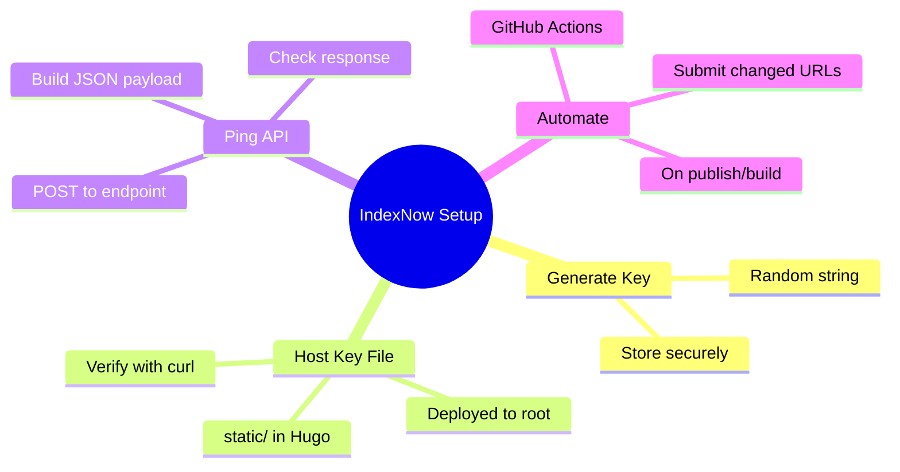

## Why IndexNow and When to Use It

If you publish content frequently, waiting for crawlers to discover new pages can be slow. IndexNow gives you a way to proactively notify participating search engines when pages are created, updated, or removed. It's lightweight, easy to automate, and fits well into a static site workflow like Hugo.

Before setting it up, it's worth reading our take on the protocol: [IndexNow in 2026: Does It Still Work? The Honest Answer](/p/indexnow-api-2026-does-it-still-work/). That covers adoption, realistic expectations, and where it fits in a modern SEO stack.

This guide walks through generating a key, hosting it, verifying it, and pinging the IndexNow API from your terminal or CI.

<!--more-->

## Prerequisites

- A live website with a public domain (we'll use `f9xr.org` as the example)
- Ability to deploy static files to the web root (for Hugo, use `static/`)
- A way to make HTTP POST requests (`curl`, PowerShell, or your CI runner)

## Step 1: Generate an IndexNow Key

An IndexNow key is a unique string (usually 8-128 hex or alphanumeric characters). You can generate one however you like. A quick way from PowerShell:

```powershell
$bytes = New-Object byte[] 16
[Security.Cryptography.RandomNumberGenerator]::Create().GetBytes($bytes)
($bytes | ForEach-Object { $_.ToString("x2") }) -join ''
```

Or use any random string generator. Save that value, e.g. `d6628032fa1e4b2ea31ba81441024687`.

## Step 2: Host the Key File on Your Site

The key file must be accessible at the location you declare. The simplest and most common pattern is to put a plain-text file named after your key in the site root.

For Hugo, create it in `static/` so it's copied as-is:

```powershell
$token = "d6628032fa1e4b2ea31ba81441024687"
Set-Content -Path "static/$token.txt" -Value $token -Encoding ASCII
```

After building and deploying, confirm it's reachable:

```bash
curl -I https://f9xr.org/d6628032fa1e4b2ea31ba81441024687.txt
```

You should get `HTTP/2 200` and the body should be exactly the key string (no extra whitespace or newlines).



## Step 3: Ping the IndexNow API

IndexNow accepts a JSON POST. You can use the shared endpoint `https://api.indexnow.org/indexnow` or engine-specific ones like `https://www.bing.com/indexnow`. In practice, both work; using the shared endpoint is fine.

### Payload structure

```json
{
  "host": "f9xr.org",
  "key": "d6628032fa1e4b2ea31ba81441024687",
  "urlList": [
    "https://f9xr.org/p/your-new-post/",
    "https://f9xr.org/p/another-updated-post/"
  ]
}
```

Notes:
- `keyLocation` is optional in many implementations, but some validators expect it. If you host at `https://<host>/<key>.txt`, you can omit it or set it explicitly. We had better luck omitting it when hitting Bing's endpoint during testing.
- Only submit URLs on the same host as declared.
- Keep the list reasonably sized (you can submit up to thousands, but batching changed URLs is cleaner).

### PowerShell example

```powershell
$token = "d6628032fa1e4b2ea31ba81441024687"
$urls = @("https://f9xr.org/p/connect-mobbin-ai-agent-mcp/")
$body = @{
  host = "f9xr.org"
  key  = $token
  urlList = $urls
} | ConvertTo-Json -Compress

curl.exe -X POST "https://www.bing.com/indexnow" `
  -H "Content-Type: application/json" `
  -d $body
```

### Bash/curl example

```bash
TOKEN="d6628032fa1e4b2ea31ba81441024687"
curl -X POST "https://www.bing.com/indexnow" \
  -H "Content-Type: application/json" \
  -d '{"host":"f9xr.org","key":"'"$TOKEN"'","urlList":["https://f9xr.org/p/connect-mobbin-ai-agent-mcp/"]}'
```

### Expected responses

- `200 OK` - Request accepted. The key was found and URLs were queued.
- `202 Accepted` - Also common; accepted for processing.
- `400 Bad Request` - Malformed JSON or bad parameters.
- `403 Forbidden` - Key not found/verified at the expected location. Double-check the file is live and matches exactly.
- `422 Unprocessable Entity` - URLs not on the declared host or other validation issue.

## Step 4: Automate in CI (GitHub Actions)

For a Hugo site on GitHub Pages, you can submit changed URLs after build/deploy. A simple approach: generate `public/articles-urls.txt` during build (Hugo can do this), diff against the previous run, or just submit the newly published post URL.

A minimal step in your workflow:

```yaml
- name: Submit to IndexNow
  if: github.ref == 'refs/heads/main'
  run: |
    TOKEN="YOUR_INDEXNOW_KEY"
    URL="https://f9xr.org/p/${{ steps.slug.outputs.slug }}/"
    BODY="{\"host\":\"f9xr.org\",\"key\":\"$TOKEN\",\"urlList\":[\"$URL\"]}"
    curl -X POST "https://www.bing.com/indexnow" -H "Content-Type: application/json" -d "$BODY"
```

Store the token as a GitHub Secret (`INDEXNOW_KEY`). Only submit when you actually publish (e.g., on push to main after a successful build).

## Tips and Gotchas

- **Host once.** Put the key file in `static/` and commit it. Don't generate it dynamically in a way that breaks verification.
- **Exact match.** The file contents must equal the key string exactly (no BOM, no extra newlines).
- **Same host.** All URLs in `urlList` must belong to the declared `host`.
- **Don't spam.** Submit only changed/new/removed URLs. Submitting your entire sitemap every run isn't necessary and can look noisy.
- **It won't fix crawl budget alone.** IndexNow is a notification, not a ranking boost. Internal links, sitemaps, and good content still matter.
- **Check real results.** Use Bing Webmaster Tools to see if pages get picked up over time.

We also recommend checking [IndexNow in 2026: Does It Still Work? The Honest Answer](/p/indexnow-api-2026-does-it-still-work/) for context on adoption. For SEO foundations, see our [Hugo SEO Guide](/p/hugo-seo-guide/), and if you're hardening DNS, the [GitHub Pages custom domain with Cloudflare](/p/github-pages-custom-domain-cloudflare/) guide is worth a read.

## Key Takeaways

- Generate a unique key, host `<key>.txt` at the site root via `static/` in Hugo.
- Verify the file is publicly accessible with the exact key content.
- Ping `https://www.bing.com/indexnow` (or `api.indexnow.org`) with a JSON POST containing `host`, `key`, and `urlList`.
- Automate submissions for changed URLs in CI, not your entire site.
- Treat IndexNow as a notification mechanism, not a guarantee of indexing.

## Conclusion

Setting up IndexNow takes five minutes and is easy to automate. Host the key file, ping on publish, and let participating engines know about changes faster. It's a small addition that pairs well with a solid sitemap and internal linking strategy.

_Written with AI assistance and reviewed by the F9XR Team. IndexNow is an open protocol; endpoints and behavior may evolve over time. Always verify against the [official IndexNow documentation](https://www.indexnow.org/documentation). For standards and contribution details, see our [Editorial Policy](/editorial-policy/) and [Contributor Guide](/contribute/)._
