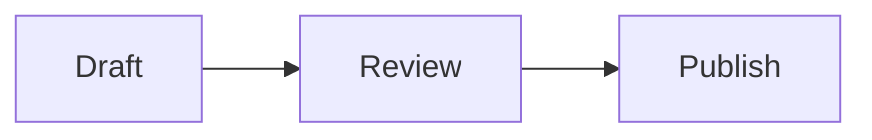

Most of a Dev9b article is plain Markdown, and that is by design. But some content genuinely cannot be expressed with punctuation alone: a YouTube walkthrough, a hosted video file, a book quotation with an attribution card, or a GitLab snippet are all richer than Markdown allows. Hugo solves this with **shortcodes**, small template calls that render predefined HTML.

Dev9b inherits the shortcodes that ship with the Stack theme plus Hugo's own built-ins. This guide lists the ones you will actually use, with copy-ready syntax and the escape trick that keeps your examples from executing. It builds on the basics in our [Markdown syntax guide for Dev9b](/p/markdown-syntax-guide-for-dev9b/).

<!--more-->

## How Shortcodes Work

A shortcode is written with double curly braces. There are two forms:

- `` for self-contained embeds, such as a video.
- `` ... `` for shortcodes that wrap content, such as a quote.

Because Hugo runs shortcodes even inside a code fence, this article writes every example with comment markers around it, ``, so you see the literal syntax instead of a live embed. When you use a shortcode for real, drop the markers.

The full catalog lives in the [Hugo Theme Stack shortcode documentation](https://stack.jimmycai.com/writing/shortcodes) and the [Hugo built-in shortcodes reference](https://gohugo.io/content-management/shortcodes/).

## YouTube Video

The `youtube` shortcode embeds a responsive, lazy-loaded player. It is the highest-value shortcode for tutorial posts, where a two-minute demo often replaces a wall of steps.

```markdown

```

The video ID is the `v` parameter in a watch URL, so `https://www.youtube.com/watch?v=VIDEO_ID` becomes `id="VIDEO_ID"`. A positional form, ``, works too, but the named `id` form is clearer in a document.

Privacy note: the theme respects Hugo's privacy configuration for YouTube. When enhanced privacy is enabled, the player is served from `youtube-nocookie.com` and does not set tracking cookies until playback starts.

## Bilibili and Tencent Video

For audiences on Chinese platforms, Dev9b supports the same pattern for [Bilibili](https://www.bilibili.com/) and Tencent Video.

```markdown


```

The Bilibili ID is the `av` or `bv` code from the URL, and the optional part number selects a specific segment, so `?p=2` becomes the second positional argument. The Tencent ID is the code at the end of a `v.qq.com` URL. Both render as responsive iframes.

## Generic Video File

When the clip is an MP4 you host yourself, or any direct video URL, use the `video` shortcode. It accepts a positional URL or the named `src` form with optional `autoplay` and `poster`:

```markdown

```

A path that starts with `/` is resolved relative to the site's `static` directory, so `src="/video/my-demo.mp4"` points at `static/video/my-demo.mp4`. Add a `poster` image so the player shows a frame before it loads, and use `autoplay="true"` sparingly, since unexpected motion is an accessibility problem.

## GitLab Snippets

To embed a code snippet from GitLab without pasting the source, use the `gitlab` shortcode with the snippet ID from the URL:

```markdown

```

For most code, though, a fenced code block is the better choice. It keeps the code in the article, gets syntax highlighting and a copy button from the reader toolbar, and does not depend on an external service staying online.

## Styled Quotes

The `quote` shortcode turns a quotation into a styled card with an optional author, source, and link:

```markdown

Your quote content here.

```

Use it for a genuine quotation you want to set apart, not as a substitute for a blockquote. For a simple indented quote, plain Markdown is enough.

## Hugo Built-in Shortcodes You Also Get

Because Dev9b runs on Hugo, the framework's built-in shortcodes are available alongside the theme's:

| Shortcode | What it does |
| --- | --- |
| `figure` | Image with an optional caption and attribution |
| `gist` | Embed a GitHub Gist by user and ID |
| `highlight` | Render a highlighted code block with options |
| `ref` / `relref` | Link to another page by path, validated at build time |

The `ref` and `relref` shortcodes are worth knowing because they fail the build when a link target disappears, which catches dead internal links before they reach readers. For everyday links, though, a root-relative Markdown link such as `/p/hello-world/` is simpler and reads better in the source.

## Diagrams and Alerts

Two of the most useful rich features need no shortcode at all. Mermaid diagrams render from a `mermaid` code fence:



GitHub-style alerts render from a special blockquote:

```text
> [!WARNING]
> Back up your configuration before you continue.
```

Mermaid turns text into flowcharts, sequence diagrams, and mind maps, which is often clearer than a screenshot. Alerts give you note, tip, important, warning, and caution callouts with automatic icons and colors. Both are covered in more depth alongside the [math typesetting guide](/p/math-typesetting-on-dev9b/) and the [image gallery guide](/p/image-gallery-in-dev9b-articles/), which together round out the embedded content you can add to an article.

## When to Use a Shortcode, and When Not To

A shortcode is the right tool when Markdown truly cannot do the job: embedding a third-party video, pulling in a hosted snippet, or formatting a quotation with attribution. For everything else, plain Markdown wins. It is faster to render, easier to review in a diff, and portable if the site ever changes themes.

A useful test: if the content lives on another platform and must stay in sync there, embed it. If you own the content, write it inline.

## Frequently Asked Questions

### What is a shortcode in Hugo?

A shortcode is a small template call you write inside Markdown, surrounded by double curly braces, that renders predefined HTML. It lets you embed media or styled components without pasting raw HTML into your article.

### How do I escape a shortcode so it shows as example code?

Wrap the opening and closing in comment markers, ``. The markers tell Hugo to display the shortcode as text instead of running it.

### Which shortcodes does Dev9b support?

Stack provides `youtube`, `video`, `bilibili`, `tencent`, `gitlab`, and `quote`. Hugo's built-in shortcodes such as `figure`, `gist`, `highlight`, `ref`, and `relref` are also available. Markdown alerts and Mermaid diagrams work without any shortcode.

### Should I use a shortcode or plain Markdown?

Use a shortcode only when Markdown cannot express the content, for example embedding a video. For images, links, tables, and code blocks, plain Markdown is simpler, faster, and easier to maintain.

### Why is my embedded video showing as raw text?

You probably added comment markers while writing the example and forgot to remove them, or the shortcode name is misspelled. Remove the comment markers so Hugo runs the shortcode and builds the embed.

## Key Takeaways

- Shortcodes are template calls in double curly braces; use them only where Markdown cannot express the content.
- Dev9b ships `youtube`, `video`, `bilibili`, `tencent`, `gitlab`, and `quote`, plus Hugo's built-ins such as `figure` and `gist`.
- Escape an example with comment markers so Hugo shows the syntax instead of running the embed.
- Mermaid diagrams and GitHub alerts are core Markdown features with no shortcode required.
- Prefer a fenced code block over an embedded snippet whenever the code belongs in the article.

## Conclusion

Shortcodes are a sharp tool, not a default. Reach for one when you need a YouTube walkthrough, a self-hosted video, or an attributed quotation, and leave the rest to Markdown. Keeping embeds rare also keeps pages fast and reviews simple, which is exactly the balance Dev9b aims for.

To go deeper, pair this page with the [Markdown syntax guide for Dev9b](/p/markdown-syntax-guide-for-dev9b/) for day-to-day formatting and the [image gallery guide](/p/image-gallery-in-dev9b-articles/) for figures and screenshots.

Ready to contribute? The [Contributor Guide](/contribute/) explains how to submit an article, and our [Editorial Policy](/editorial-policy/) describes the review every post goes through.

---

*This guide was drafted with the assistance of an AI coding assistant, then reviewed by the F9XR Review Board before publishing.*
