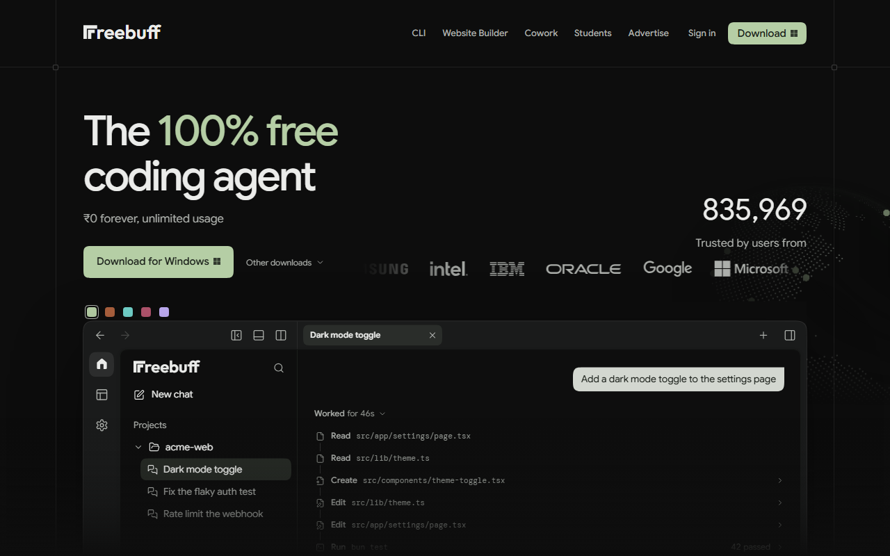

Coding agents got expensive at the wrong moment. A solo founder can spend more on model subscriptions than on hosting, and the bill grows faster as the product does. Claude Code, Cursor and Codex are good tools. They are also recurring line items that punish you for iterating.

Freebuff makes a different trade. The agent costs nothing, the models are paid for by text ads, and it installs with one npm command. It is not unlimited in every sense, and the free tier has real country-based limits. It is, however, a usable coding agent with a business model that does not start with your credit card.

This guide covers what Freebuff is, how the hour-based free tier works in November 2026, which models you actually get, and where it fits on a real SaaS build. We reviewed the public docs, the GitHub README and the trust page for this piece. We did not run confidential code through it.

<!--more-->

> [!NOTE] Disclosure
> Some links in this article are affiliate links or referral links. If you sign up through them, F9XR may receive a referral credit at no extra cost to you. That does not change what we recommend or how we test.

## What Freebuff Actually Is

Freebuff is a coding agent from Freebuff, Inc., the team behind the open-source Codebuff framework. The company went through Y Combinator's Fall 2024 batch and launched the product in February 2026. CEO James Grugett previously founded Manifold Markets, and Dawson Chen and Brandon Chen are co-founders. The [Y Combinator company profile](https://www.ycombinator.com/companies/freebuff) lists the team and the original pitch.

The product is free because advertisers pay for inference. Ads appear inside the app and are labeled "Sponsored." Some agent suggestions are sponsored too, but they name the sponsor and only run if you click Accept. The [Freebuff trust page](https://freebuff.com/trust) explains the model without burying it in a terms document.



*The Freebuff homepage in November 2026, including the Windows download and a sample agent session.*

One agent framework ships across five surfaces:

| Surface | What it does |
|---------|--------------|
| **Freebuff CLI** | Terminal agent, installed with `npm install -g freebuff` |
| **Freebuff Desktop** | Native app for macOS, Windows and Linux, with parallel agents in isolated workspaces |
| **Freebuff Web** | Browser workspace and a full-stack app builder with publishing |
| **Freebuff Cloud** | Agents that run against a connected GitHub repository |
| **Freebuff Chat** | Research and reasoning chat without a code project |

Under the hood, the orchestration, tools and SDK come from Codebuff. The [Codebuff documentation](https://codebuff.com/docs) is where you go if you want to build custom agents on top of the same framework.

## How the Free Hours Work, and Where They Stop

Most free tiers meter tokens. Freebuff meters time. A session lasts one hour, and messages inside that hour are not counted. Your daily allowance refills at midnight in your timezone and does not roll over.

The size of that allowance depends on where you live, because ad rates differ by country:

| Region | Daily free hours |
|--------|------------------|
| United States | Up to 30 |
| Canada, UK, Germany, Switzerland, Australia, New Zealand, Ireland, Nordic countries, Netherlands, Austria, Luxembourg | 21 |
| France, Spain, Italy, Portugal, Belgium, Liechtenstein, Malta, South Korea | 12 |
| Everywhere else (limited mode) | 5, or 4 over a VPN |

Models also carry a multiplier. An hour on a 3x model spends three hours of balance, while an hour on a 1x model spends one. The model picker shows the multiplier before you start a session. Freebuff moved to this hours model in October 2026, and its [explanation of the free tier](https://freebuff.com/blog/how-is-freebuff-free) is worth reading before you compare it with older reviews.

> [!IMPORTANT] "Unlimited" has a ceiling
> Messages are unlimited inside a session. Daily hours are not unlimited. If you see a claim of infinite free usage, read the country table first.

Paid plans are optional and start at $8 a month. Starter raises the daily allowance to 50 hours, Plus ($25) to 80, and Pro ($60) to 130, with monthly bonus hours and access to models the free tier does not include. The [Freebuff plans page](https://freebuff.com/plans) has the current details. You never need a paid plan to start coding.

## The Models You Can Pick in November 2026

The regular picker is a mix of open models and a few frontier options. Access depends on your country and your plan, so treat this table as a starting point and check the picker before you rely on a specific model.

| Model | Access | Best for |
|-------|--------|----------|
| DeepSeek V4.1 Flash 10/17 | Free and limited | The default; fast coding and tool use |
| MiMo v2.6 Flash Fast | Free and limited | Balanced work with image support |
| GLM 5.3 Flash | Free and limited | Deep reasoning |
| Solar Mini 4 | Free and limited | Fast, compact, 524K context |
| Solar Pro 4 | Free and limited | Stronger 524K-context text work |
| DeepSeek V4.1 Flash Fast | Full access, paid at limited | Splits work across parallel subagents |
| GPT-6 Luna | Full access | Strong all-around model with native images |
| MiMo 2.6 Pro | Full access | Heavier reasoning with image support |
| Gemini 3.8 Flash | Paid plans | 1M context and audio, video or PDF input |
| Muse Spark 1.3 | Paid plans | Meta's agentic coding model with 1M context |
| Gemini 4 Argon | US or paid plans | Flagship reasoning, one session a day |
| GPT-6.1 Sol | US or paid plans | OpenAI flagship, one session a day |

DeepSeek V4.1 Flash is the default for a reason: it is quick and handles tool calls well. GLM 5.3 Flash is the pick when a task needs more thinking. The Solar models are useful when you need to feed a large chunk of a codebase through a 524K context window. If you already pay for Claude Code or Codex, Desktop can also run those local agents with your existing account, separate from the included catalog.

## How the Multi-Agent System Works

Freebuff does not push every request through one model with one prompt. It coordinates specialized subagents, and the public launch notes list nine of them. The useful ones to understand are:

- **file-picker** maps the relevant parts of your repo before edits begin
- **code-reviewer** critiques changes before you see the final diff
- **browser-use** drives a real browser to test what it just built
- **thinker-with-files** handles deep reasoning over files with Gemini 3.1 Flash Lite
- Planner and editor agents that turn a plan into patches


The slash commands follow the same flow. `/interview` pulls requirements out of you, `/plan` turns them into steps, the editor implements, and `/review` runs a critique pass. That structure is why the agent feels more capable than a chat window with a file-read tool bolted on. It is the same idea we broke down in [how AI coding agents actually work](/p/ai-coding-agents-explained/), applied to a free tier.

## Set Up Freebuff in About Two Minutes

You need a current Node.js LTS release and a project you want to change.

```bash
npm install -g freebuff
cd ~/my-saas
freebuff
```

Then sign in when prompted. Your daily hours appear in the app. From there, describe the task in plain language and let the file-picker do its first pass.

For a desktop workflow, download the macOS, Windows or Linux build from the [Freebuff desktop download page](https://freebuff.com/desktop). The installers are code-signed and notarized, which matters if your team has endpoint policies. The [Freebuff web builder](https://freebuff.com/web) is the fastest route if you want to generate a full-stack app without touching a terminal, and [Freebuff Cloud](https://freebuff.com/cloud) connects an agent to a GitHub repository.

Two habits improve results immediately. Keep an `AGENTS.md` at the repo root with your build commands, conventions and forbidden paths. If you already run MCP servers, Freebuff reads them from `.agents/mcp.json`, so the same tools your other agents use are available without a second configuration file.

If you want to start through the official site, the [Freebuff sign-up page](https://freebuff.com/?ref=ref-08f46570-2fc0-4b16-82ed-b3f7ece1723c&via=welcome_link) is the referral link for this guide. The CLI install above is the same product and does not require it.

## Workflows That Hold Up on a Real SaaS Codebase

The difference between a good agent session and a bad one is usually context, not model choice. These workflows give the agent enough to work with.

### Scaffold a feature before you write code

Describe the feature, the data model and the acceptance criteria in one message. Let the file-picker locate the routes, schema and components, then read the plan before you approve edits. If you are starting from a kit, the [Supastarter Next.js SaaS starter guide](/p/supastarter-nextjs-saas-starter-kit-guide/) covers the structure an agent needs to understand first.

### Debug from a stack trace

Paste the error and the command that produced it. Ask for the smallest reproduction, then a fix, then a regression test. Agents are good at this loop because it has a clear pass or fail signal.

### Build or restyle a marketing site

Freebuff Web can generate a landing page with authentication, a database and one-click publishing. For a lighter path, the [Puter.js SaaS app guide](/p/puter-js-build-saas-app-guide/) shows how far a free client-side stack can go before you need a backend.

### Run parallel workstreams on Desktop

Open two agent tabs and give each one an isolated workspace. One can work on API endpoints while the other handles frontend components. Keep the tasks disjoint. Two agents editing the same file is still a merge conflict with extra steps.

### Review a branch before merge

Run the code-reviewer subagent on a branch and treat its notes like a human reviewer's comments. It will not catch every design problem, but it catches the obvious ones before a teammate spends time on them.

If you also run Cline, [the free OpenRouter setup for Cline](/p/use-cline-free-openrouter-models/) is a useful comparison point, and [OmniRoute's local gateway](/p/omniroute-setup-free-vibecoding/) is the better fit when you want to route several free providers yourself. For a direct comparison of terminal-first agents, see [OpenCode vs Cursor](/p/opencode-vs-cursor/).

## Freebuff vs Paid Coding Agents

| Aspect | Freebuff | Claude Code, Cursor, Codex |
|--------|----------|----------------------------|
| Price to start | $0, no card | $20 to $200+ per month |
| Models | Curated open models plus some frontier picks | Mostly proprietary models |
| Metering | Hours per day | Tokens, requests or plan quotas |
| Subagents | Nine specialized agents | Varies, often generic |
| Surfaces | CLI, desktop, web, cloud and chat | Mostly IDE or CLI |
| Open source | CLI, agents and SDK under Apache-2.0 | Usually closed |
| Ads | Labeled text ads | None |

Freebuff will not win every hard reasoning benchmark against the strongest paid models. On day-to-day feature work, refactoring, test writing and scaffolding, it is capable enough that the price difference becomes hard to justify for early-stage teams. The honest comparison is not "free versus best." It is "free and good enough versus paid and slightly better on the hardest 5% of tasks."

## Privacy and Trust Before You Connect a Repo

Freebuff is run by a real company with Y Combinator backing, and its CLI, agents and SDK are open source under Apache-2.0 on [GitHub](https://github.com/CodebuffAI/freebuff). Desktop installers carry Apple notarization and a Windows Authenticode signature. Those are verifiable trust signals, not marketing copy.

The tradeoff is data. Ads are chosen partly from what you are working on, including recent messages, and Freebuff may use that data to train ad models. Individual models also carry data-use notices, and the picker shows them before you start. Separately uploaded files and connected repositories are not given to advertising providers according to the README, but restricted partners may evaluate repositories you connect to Cloud.

A few practical rules keep this sane:

- Keep secrets in environment files that are gitignored, and never paste credentials into a prompt.
- Connect GitHub with the narrowest repository scope you can.
- Start with a side project or an open-source repo before you point an agent at a client codebase.
- Read the per-model data notice when a task touches anything confidential.

The [Freebuff privacy policy](https://freebuff.com/privacy-policy) is the primary source for all of it. If your team already treats cloud agents as a data-processing decision, apply the same review here.

## Key Takeaways

- Freebuff is a free, ad-supported coding agent from the Codebuff team, available as CLI, desktop, web, cloud and chat.
- Usage is measured in hours, not tokens: one-hour sessions with unlimited messages, refilled daily at midnight.
- Free hours are country-based: up to 30 a day in the US, 21 in several other full-access countries, 12 in a few, and 5 elsewhere.
- Nine specialized subagents handle file finding, planning, editing, review and browser testing.
- No card or API key is required. Paid plans start at $8 a month if you need more hours or paid-only models.
- Ads and per-model data notices are the real cost. Read them before you connect a confidential repository.

## Conclusion

Freebuff is one of the few free coding agents that looks like a product rather than a demo. The hour-based tier is honest about its limits, the model roster is good enough for real SaaS work, and the ad model keeps the invoice at zero. The catch is attention and data visibility, which is a trade each team has to make.

If you want to help document tools like this, read the [contributor guide](/contribute/) and send a pull request. Our [editorial policy](/editorial-policy/) explains how we source, review and correct articles like this one. The F9XR Team publishes these deep dives so developers can evaluate new tools without a sales call.

This article was researched and drafted with AI assistance, then reviewed and edited by the F9XR Team.

## FAQ

### Is Freebuff really free?

Yes. Advertisers pay for it, and ads inside the app are labeled Sponsored. You never need a card to start, though daily hour limits depend on your country.

### How many free hours do I get with Freebuff?

Up to 30 hours a day in the US, 21 in Canada, the UK, Germany and several other countries, 12 in France, Spain, Italy and a few others, and 5 elsewhere (4 over a VPN). Sessions last one hour with unlimited messages, and hours refill at midnight.

### Do I need an API key for Freebuff?

No. Freebuff provides the models. Install the CLI, sign in, and pick a model.

### Is Freebuff safe to use on my code?

The CLI, agents and SDK are open source under Apache-2.0, and desktop installers are code-signed. Like any agent it can read files and run commands in the projects you open, and prompts may be used to personalize ads. Review the privacy policy and start with non-sensitive repositories.

### Can I use Freebuff for commercial SaaS projects?

Yes. Many developers use it for side projects and early product work. For confidential codebases, check the per-model data notices and your own policy first.

### What happens if I need more than the free hours?

Paid plans start at $8 a month and raise the daily allowance to 50 hours, with higher tiers adding more hours and models. Referrals and bounties can also earn extra hours.
