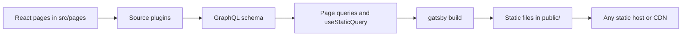
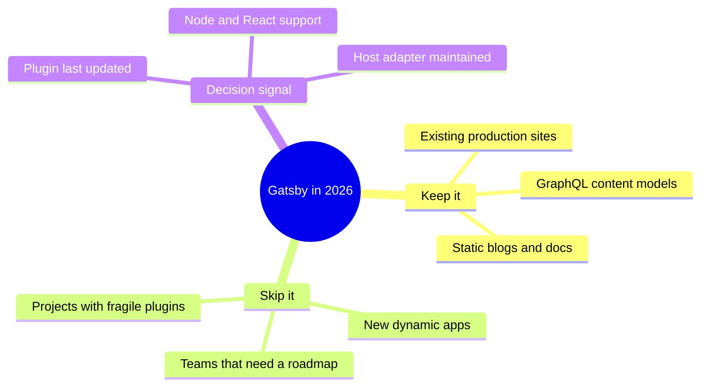

You typed "gabsy js" into Google and landed on a Gatsby site anyway. It is one of the most common misspellings of Gatsby.js, the React framework that made static sites interesting again.

The harder question in 2026 is whether Gatsby still earns a place in a new project. It ships releases and runs in production, but it is also in maintenance mode after Netlify bought the company in 2023 and retired Gatsby Cloud.

This guide covers what Gatsby JS is, how the build pipeline works, and how to get a site running. It also gives a straight answer on where Gatsby fits next to Next.js and Astro.

<!--more-->

## What Gatsby JS actually is

Gatsby is an open source React framework and static site generator. You write React components, describe data through GraphQL, and Gatsby compiles the result into static HTML, CSS, and JavaScript at build time.

Three parts do the work:

- React for the UI
- GraphQL for the data layer
- A build step that pre-renders each page

That pre-render is the reason people cared. A visitor gets HTML that can paint before any JavaScript arrives, not a blank div waiting on a bundle.

Kyle Mathews started the project in 2015. Gatsby 1.0 in 2017 added the GraphQL data layer and the plugin system that made it popular. Netlify acquired Gatsby, Inc. on 1 February 2023.

## How the build pipeline works

The mental model is a straight line from files to CDN.



Source plugins read data from Markdown, a CMS, an API, or a database. Gatsby turns what they return into a GraphQL schema. Your components query that schema, and the build writes one HTML file per route.

`gatsby develop` serves a hot reloading version at `http://localhost:8000`. `gatsby build` writes the production output to `public/`. The dev server and the build are not the same process, which is why a page that works locally can still fail at build time. Page queries run during the build, so a query that throws takes the whole build down.

## The Gatsby GraphQL data layer in practice

A small query in a layout component covers the common case:

```jsx
import * as React from "react"
import { useStaticQuery, graphql } from "gatsby"

export default function Layout({ children }) {
  const data = useStaticQuery(graphql`
    query SiteTitle {
      site {
        siteMetadata {
          title
        }
      }
    }
  `)

  return (
    <div>
      <header>{data.site.siteMetadata.title}</header>
      <main>{children}</main>
    </div>
  )
}
```

`useStaticQuery` works in any component and never takes variables. For pages that need input, export a `query` and Gatsby injects the result as `data`:

```jsx
import { graphql } from "gatsby"

export default function Post({ data }) {
  const post = data.markdownRemark
  return (
    <article>
      <h1>{post.frontmatter.title}</h1>
      <div dangerouslySetInnerHTML={{ __html: post.html }} />
    </article>
  )
}

export const query = graphql`
  query Post($slug: String!) {
    markdownRemark(frontmatter: { slug: { eq: $slug } }) {
      html
      frontmatter {
        title
      }
    }
  }
`
```

The hook and the `query` export are not interchangeable. Pick the hook for global data such as navigation or site metadata. Pick the export for data that depends on the page, because Gatsby builds the page context for you.

## Where Gatsby stands in 2026

The maintenance status is the first thing to understand.

| Fact | Detail |
|---|---|
| Latest release | 5.16.1, 10 February 2026 |
| Last feature release | 5.16.0, 26 January 2026 |
| What 5.16 added | React 19 and Node.js 24 support |
| Owner | Netlify, since February 2023 |
| Latest major | Gatsby 5, November 2022 |
| Status | Maintenance: security and dependency updates |
| License | MIT |

There is no Gatsby 6 and no published roadmap. Releases since 2024 have been limited to security fixes and dependency updates, and the pattern is visible in the release history. Gatsby Cloud retired in 2023, so the hosted build product is gone. The framework itself was not.

That leaves a gap between "dead" and "healthy". Gatsby still pulls roughly 287,000 downloads a week on npm as of mid 2026, and it has about 56,000 stars on GitHub. Plenty of teams run it without trouble. None of that changes the fact that the plugin you need may have last shipped in 2022.

> [!WARNING] Check plugins before you commit
> Open the plugin repository and look at the last publish date and the open issues. A plugin that has not moved since 2022 can still work, but you should know that going in.

## Gatsby vs Next.js vs Astro

| Feature | Gatsby | Next.js | Astro |
|---|---|---|---|
| Main model | SSG plus GraphQL | App Router and React Server Components | Content first islands |
| Data layer | Built in GraphQL | Your choice | Content collections |
| Learning curve | Medium: React plus GraphQL | Medium to high | Lower for content sites |
| Plugin library | Large, aging | Very large | Growing |
| Best for | Content sites, blogs, docs | Full apps and dynamic sites | Content with less JavaScript |

Gatsby's opening is narrower than it was in 2020. If you like GraphQL as the single door to every data source and you want mostly static output, it still fits. If you need server actions, streaming, or a large hiring pool, Next.js is the safer bet. If the site is mostly words and images, Astro usually ships less JavaScript.

## Build your first Gatsby site

The steps below match the official quick start. The only change is the Node version, because the older advice is now out of date.

### Prerequisites

Install Node.js 22 or 24. Node 18 reached end of life in April 2025, so do not start a new project on it even though the docs still list it. You also need npm and working knowledge of React components and props.

### 1. Scaffold the project

```bash
npm init gatsby
```

The CLI asks for a site name, a language, a CMS, and a styling option. Answer the prompts or pass flags to skip them:

```bash
npm init gatsby my-gatsby-site -- -y -ts
```

`-y` accepts the defaults. `-ts` starts from the TypeScript starter. If you would rather begin from a known site, clone a starter:

```bash
npx gatsby new my-blog https://github.com/gatsbyjs/gatsby-starter-blog
```

### 2. Start the dev server

```bash
cd my-gatsby-site
npm run develop
```

Open `http://localhost:8000`. Edit `src/pages/index.js` and the browser updates without a reload.

### 3. Learn the four folders that matter

- `src/pages/` creates a route from every file
- `src/components/` holds the components you reuse
- `gatsby-config.js` sets site metadata and plugins
- `gatsby-node.js` creates pages and changes the GraphQL schema

Files in `static/` are copied to `public/` as they are. That is the place for a `CNAME`, a `robots.txt`, or a verification file.

### 4. Add a page with the Head API

Create `src/pages/about.js`:

```jsx
import * as React from "react"

export default function AboutPage() {
  return (
    <main>
      <h1>About</h1>
      <p>This is my first Gatsby page.</p>
    </main>
  )
}

export const Head = () => <title>About</title>
```

The `Head` export sets the document head without react-helmet. Gatsby has supported this API since version 4.19, and it is the current approach.

### 5. Build and deploy

```bash
npm run build
```

The `public/` folder is the finished site. Upload it to any static host. Netlify still detects Gatsby projects and handles the build command and publish directory for you. GitHub Pages, Cloudflare Pages, S3 with CloudFront, and Codeberg Pages all work too.

If you are new to static hosting, our guide to [deploying Astro to GitHub Pages](/p/how-to-deploy-astro-github-pages/) explains the GitHub Actions pattern that transfers directly, and the [Hugo GitHub Pages setup](/p/hugo-github-pages-setup/) covers the same ground from a different generator.

For server-side rendering and deferred static generation, Gatsby uses adapters. Netlify maintains its own, and the feature works. Just know that the adapter is the part tied to a host, so moving hosts later means checking it.

## What still works, and what to avoid

Gatsby's defaults hold up. Link prefetching, code splitting, and `gatsby-plugin-image` with sharp produce fast pages without much tuning. If you already run a Gatsby site, there is no emergency. Security patches still land.

The risk sits in the edges. Third-party plugins age badly, and some CMS plugins have open issues that will not be fixed. Node and React upgrades now arrive months after upstream releases, not weeks.

Before adding a plugin to a production site, check its last publish date and whether the maintainer answers issues. Run `gatsby clean` before debugging a strange build failure, because the cache is usually the culprit.

A blog on Gatsby is still a reasonable project. A new greenfield app is harder to justify. The [blogging platforms comparison](/p/best-blogging-sites-for-developers/) puts Gatsby in context with Hugo and Astro, and the [supastarter Next.js guide](/p/supastarter-nextjs-saas-starter-kit-guide/) shows what an actively maintained React starter looks like today.

## Should you pick Gatsby in 2026?



Three questions decide it. Is the site mostly static? Do you want GraphQL as the data layer? Can you live with a framework that receives fixes but not features?

Three yes answers make Gatsby defensible. A no on any of them sends you to Next.js or Astro.

## Key Takeaways

- Gatsby JS is a React framework and static site generator with a built in GraphQL data layer.
- It pre-renders pages at build time, so visitors get HTML before JavaScript runs.
- Gatsby 5.16.1 is the current release, and 5.16 added React 19 and Node.js 24 support in January 2026.
- The project is in maintenance mode after Netlify acquired Gatsby, Inc. in 2023 and retired Gatsby Cloud.
- It still suits content sites. For new dynamic apps, Next.js or Astro is usually the better fit.

## Frequently asked questions

### What is Gatsby JS used for?

Gatsby is used to build fast static and hybrid websites such as blogs, documentation, marketing pages, and content-heavy applications that benefit from pre-rendering and GraphQL data fetching.

### Is Gatsby still maintained in 2026?

Yes, at a maintenance level. Netlify keeps the open source framework patched and has added support for new React and Node.js versions, but no new major version or roadmap has been announced.

### Do I need to know GraphQL to use Gatsby?

Basic GraphQL helps because the data layer is GraphQL first. You can start with one `useStaticQuery` call and add page queries as the site grows. Gatsby's docs and the GraphiQL explorer at `http://localhost:8000/___graphql` show the schema while you work.

### How do I create a new Gatsby site?

Run `npm init gatsby`, answer the prompts, then run `npm run develop` inside the project folder. The flags `-y` and `-ts` skip the questions and start from the TypeScript starter.

### Can I use Gatsby with TypeScript?

Yes. `npm init gatsby` offers a TypeScript option, and the minimal TypeScript starter is maintained in the Gatsby repository. Type definitions for the GraphQL result are still written by hand unless you add a codegen step.

### Is Gatsby better than Next.js?

It depends on the site. Gatsby is a good fit for mostly static content with a GraphQL data layer. Next.js is the stronger choice for dynamic applications, server rendering, and long term ecosystem support.

## Conclusion

Gatsby is not the default answer it was in 2020, and that is fine. It is still a working React framework with a data layer that many teams like and a build pipeline that produces fast static pages. If you run a Gatsby site, keep it patched and check your plugins. If you are starting fresh, go in with open eyes about the maintenance status.

To share your own notes or a fix, read the [Contributor Guide](/contribute/) and the [Editorial Policy](/editorial-policy/). Both explain how Dev9b reviews and updates articles.

## Sources

- [Gatsby quick start](https://www.gatsbyjs.com/docs/quick-start/), official documentation
- [gatsby@5.16.0 release notes](https://github.com/gatsbyjs/gatsby/releases/tag/gatsby@5.16.0), 26 January 2026
- [Netlify acquires Gatsby, Inc.](https://www.netlify.com/press/netlify-acquires-gatsby-inc-to-accelerate-adoption-of-composable-web-architectures/), 1 February 2023
- [Gatsby Cloud evolution announcement](https://www.netlify.com/blog/gatsby-cloud-evolution/), Netlify
- [gatsby on npm](https://www.npmjs.com/package/gatsby), version and download figures
- [Gatsby GitHub repository](https://github.com/gatsbyjs/gatsby), release history and stars

*This article was drafted with AI assistance and reviewed and edited by the F9XR Team. Version numbers, download counts, and maintenance status change over time. Check the official repository before you rely on them.*
