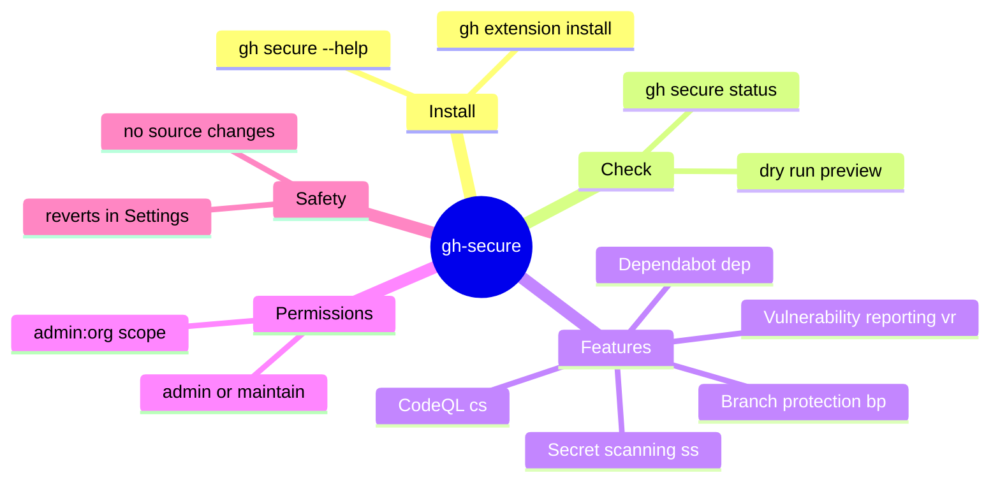

If your GitHub profile has a long list of public repositories, it also has a long list of security settings you have probably never turned on. GitHub's own guidance for maintainers names about half a dozen features that "every public repo should enable this week," and most of us keep scrolling past it. Clicking through five settings pages per repository is exactly the kind of chore that never makes it to the top of the list.

**gh-secure** removes that excuse. It is a free GitHub CLI extension from the GitHub Security Lab that enables the five most important security features for public repositories in about two minutes. You do not need a security background. You need one command.

This guide explains what gh-secure actually enables, how to install it, how to check status and preview changes before you commit, and the practical gotchas we hit while rolling it out across several repositories. Every command here was run against the real extension rather than copied from a landing page.

<!--more-->

## What Is gh-secure?

gh-secure is an official extension published by the [GitHub Security Lab](https://securitylab.github.com/protect-your-project.html), the same team that runs GitHub's security research and bounty programs. It is built on top of the [GitHub CLI](https://cli.github.com), so it uses the credentials you already have from `gh auth login`.

It is deliberately narrow. The tool enables a curated set of features that GitHub itself recommends for open source maintainers, all of which are free on public repositories. It is not a scanner you run locally, and it does not touch your source code. It flips settings on the GitHub side.

It is aimed at three groups in particular:

- Open source maintainers who want better security hygiene without becoming security engineers.
- Developers using AI coding agents that push code, because [agents make it easier for secrets to leak into a commit](/p/ai-coding-agents-explained/) than a human typing by hand.
- Teams that want one consistent baseline instead of a different configuration on every repository.

You can run it from a plain terminal, and because it is just a CLI tool, from GitHub Copilot CLI or the Copilot app as well. Any assistant that can call the tool can also help you review status and enable what is missing.

## The Five Security Features gh-secure Enables

Here is exactly what the tool turns on:

| Feature | Short code | What it does |
|---|---|---|
| Branch protection | `bp` | Blocks force pushes and deletion of the default branch, and requires pull requests and reviews before merge. |
| Private vulnerability reporting | `vr` | Lets external researchers report vulnerabilities privately instead of opening a public issue. |
| Secret scanning (with push protection) | `ss` | Blocks pushes that contain known API keys and tokens. Covers 300+ patterns from 180+ providers. |
| Dependabot | `dep` | Enables vulnerability alerts and automatic security update pull requests for your dependencies. |
| Code scanning (CodeQL) | `cs` | Runs static analysis on every push to the default branch and every pull request targeting it. |

All five are free for public repositories on GitHub.com. Private repositories are a different story: some of these features, particularly advanced secret scanning and code scanning, may require a GitHub Advanced Security licence there.

> [!NOTE] What gh-secure does not do
> It does not rewrite history, and it does not remove secrets that are already committed. It only prevents new ones from being pushed once secret scanning with push protection is on.

## Prerequisites

Before installing, confirm three things:

1. **GitHub CLI is installed and authenticated.** Run `gh auth status`. If you are not logged in yet, run `gh auth login` and follow the prompts.
2. **You have admin or maintain permission** on the target repository, because the tool changes repository settings.
3. **For organization repositories**, you may need the `admin:org` scope:

```bash
gh auth refresh -s admin:org
```

That is the entire preparation. No extra accounts and no paid plans for public repos.

## How to Install gh-secure

Installation is one command:

```bash
gh extension install GitHubSecurityLab/gh-secure
```

Then confirm the extension is on your machine:

```bash
gh secure --help
```

You should see the usage information and the list of features and flags. If you have installed other `gh` extensions before, the flow will be familiar; if not, think of it as `npm install` for the GitHub CLI, except the packages are small single-purpose commands.

## How to Use gh-secure Safely

The tool is easy to run, which is exactly why the safe habit matters. Start by looking, then preview, then apply.

### Check current status first

Always start by seeing what is already enabled:

```bash
gh secure status
```

Or for a specific repository:

```bash
gh secure status --repo owner/repo
```

This prints which of the five features are on or off. It is read-only, so it is the safest possible first step, and it tells you whether you even need to change anything.

### Preview changes with a dry run

Before changing anything, run a dry run:

```bash
gh secure --yes --dry-run
```

This prints exactly what would be enabled without applying anything. Use it whenever you want to review the plan, and especially when an AI agent is the one running the command on your behalf.

### Interactive mode

```bash
gh secure
```

The tool detects the current repository, checks its visibility and your permissions, lists the five features, and walks you through enabling them one at a time or all at once. This is the best mode for a first run.

### Enable everything at once

```bash
gh secure --yes
```

This turns on all five with no prompts. Only reach for it after you have reviewed the status and the dry run.

### Enable only specific features

You can pass full names or short codes:

```bash
# Full names
gh secure branch-protection dependabot

# Short codes
gh secure bp ss cs --yes
```

### Target a different repository

```bash
gh secure --repo owner/repo code-scanning
```

That is handy when you are triaging several projects from one terminal window.

## What gh-secure Actually Changes

It helps to know that gh-secure is a thin, auditable wrapper over the same settings the web UI exposes. It does not run a daemon or watch your commits. Each feature maps to a concrete setting you can inspect yourself:



That is the whole shape of the tool: install, check, choose features, apply, and every change is reversible from the repository's Settings page.

## Practical Tips We Learned

These are the things that only show up once you run it against real repositories.

- **Always run `status` and `--dry-run` first.** It takes ten seconds and removes every surprise.
- **Watch out for existing rulesets.** If the default branch already has repository rulesets, gh-secure warns you before enabling classic branch protection, because rulesets and classic branch protection can conflict. When rulesets already exist, prefer them.
- **Secret scanning does not clean your history.** If a key is already in the git history, rotate or revoke it first. Rewriting history does not reach copies that other people already cloned, and a revoked key is the only real fix.
- **Dependabot will open pull requests.** The tool enables the alerts and the security updates; merging is still your job. Budget a few minutes a week to review them.
- **Code scanning needs a supported language.** If the repository contains no language that CodeQL understands, the code-scanning step fails. Check the [CodeQL supported languages list](https://codeql.github.com/docs/codeql-overview/supported-languages-and-frameworks/) first.
- **Organization policy can block branch protection.** A 403 on that step usually means an org-level rule or a role restriction, not a bug in the tool.
- **Run it in agent-heavy workflows.** Because agents commit fast and often, enabling secret scanning with push protection is the single highest-value setting to turn on when AI assistants are writing code in your repo.

> [!TIP] Pair it with a code audit
> gh-secure hardens the repository's settings. For reviewing what is actually inside the code, our guide to the [F9XR CodeBase Auditor skill](/p/how-to-install-update-f9xr-codebase-auditor-skill/) covers the analysis half of the same problem.

## Troubleshooting Common Issues

### 403 Forbidden errors

You need admin or maintain rights. For organization repositories, also refresh the `admin:org` scope:

```bash
gh auth refresh -s admin:org
```

### Code scanning fails

Confirm the repository contains at least one supported language and that code scanning is available on your plan. It is free for public repositories.

### Branch protection fails

Some organizations restrict who can set branch protection. Ask an org admin. If rulesets are already active, you may not need classic branch protection at all.

### The tool does not detect the repository

Make sure you are inside a git repository with a remote that points at GitHub, or pass `--repo owner/repo` explicitly.

## gh-secure in One Workflow

Put together, the safe sequence looks like this. Check, preview, then apply:

```bash
# 1. See what is on
gh secure status --repo owner/repo

# 2. Preview what would change
gh secure --repo owner/repo --dry-run

# 3. Apply, choosing only what you want
gh secure --repo owner/repo bp ss dep --yes
```

If you are the kind of developer who wires everything into a terminal, this fits the same muscle memory as the workflows in our [OpenCode TUI setup guide](/p/how-to-setup-opencode-tui/) and the [skills-based automation pattern](/p/opencode-skills-guide/): small, auditable commands that you can string together and reason about.

## Key Takeaways

- gh-secure is a free GitHub CLI extension from the GitHub Security Lab that enables five core security features on public repositories in under two minutes.
- The five features are branch protection, private vulnerability reporting, secret scanning with push protection, Dependabot, and CodeQL code scanning.
- Install it with one command: `gh extension install GitHubSecurityLab/gh-secure`.
- Always check `status` and run a `--dry-run` before applying changes, especially when an AI agent runs the command.
- You need admin or maintain permissions; for organization repositories you may also need the `admin:org` OAuth scope.
- It never changes your source code, and every setting can be reverted from the repository's Settings page.
- It is especially useful when AI coding agents are pushing code, because secret leaks become easier.

## Conclusion

What is genuinely useful about gh-secure is the discipline it enforces. Instead of a vague intention to "harden the repo one day," you get a status command that shows the gaps and a one-shot fix that closes them. For maintainers, the security baseline stops being a project and becomes a two-minute task.

The honest limits are worth repeating. It does not remove secrets that already exist, it needs the right permissions, and CodeQL will not help a repository written in a language it does not support. Treat it as the settings half of your security work and pair it with real code review for the other half. Teams like F9XR use exactly this split: automate the baseline settings, then review the code itself before it ships.

Ready to contribute? The [Contributor Guide](/contribute/) explains how to submit an article to Dev9b, and everything we publish is reviewed against the standards in our [Editorial Policy](/editorial-policy/).

---

*gh-secure is created by the GitHub Security Lab and released as open source; it is not affiliated with the F9XR Team. Commands and feature names in this guide were checked against the extension and GitHub's public documentation. This guide was drafted with the assistance of an AI coding assistant, then reviewed by the F9XR Review Board before publishing. Always verify the latest README, because flags and default behaviour can change.*
