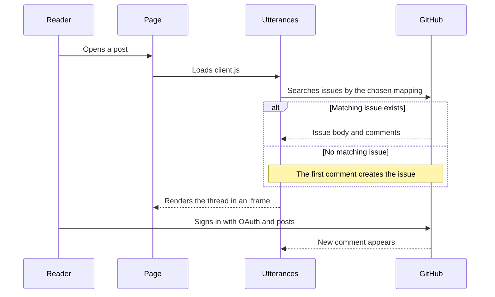

Static sites make publishing feel effortless. You write a file, commit it, and the page is live. Then someone asks where the comments are, and the simplicity disappears. Disqus adds a third-party script and a moderation dashboard. Self-hosted options add a server, a database, and backups. Skipping comments entirely is a valid choice, but it leaves readers with no way to reply.

Utterances offers a fourth path. It is a small open-source widget that turns GitHub Issues into a comment thread for any page. You install a GitHub App, paste one script tag, and the discussion lives in a repository you already control. There is no database to run and no monthly bill.

This guide explains what Utterances does, how the page-to-issue mapping works, and how to add it to Hugo, Astro, Next.js, Jekyll, or plain HTML. It also covers the failure modes that make the widget look broken when nothing is actually wrong.

<!--more-->

## What Is Utterances?

Utterances is a comments widget built on GitHub Issues. The project describes itself in one line: a lightweight comments widget built on GitHub issues. That description is accurate and worth taking literally. The widget does not host comments. GitHub does. Utterances is the bridge between a page URL and an issue thread.

The client is written in TypeScript, styled with GitHub's Primer design system, and loaded as a single script. It renders inside an iframe, which keeps the host page's CSS from leaking into the comment UI. The whole thing is [open source on GitHub](https://github.com/utterance/utterances) under the MIT license.

Cost is zero because the storage and authentication already exist. If you have a public repository, you have everything Utterances needs.

## How Utterances Works Under the Hood

The flow is short enough to draw on a napkin. A visitor opens a post. The Utterances script asks GitHub whether an issue exists for that page. If it does, the issue's comments render in the iframe. If it does not, the first comment creates the issue.



Two details matter for debugging. First, the search happens in the visitor's browser against GitHub's public API. If the repository is private, the search returns nothing. Second, the iframe has its own document and its own theme. Your site's dark mode does not automatically reach inside it.

## Where Utterances Fits, and Where It Does Not

Dev9b runs Disqus, so this guide comes from evaluating Utterances as a lighter alternative rather than from a migration. The appeal is easy to understand. Comments belong to the repository, not to a comment company. There is no tracking script, no ad slot, and no separate account for moderation.

The trade-offs are just as clear. Readers need a GitHub account. The comment body is not part of your HTML, so search engines do not index it as page content. You get GitHub's spam controls, which are strong for logged-in users but not a substitute for active moderation. And because issues are the database, deleting the repository deletes the conversation.

For a developer blog, documentation site, or open-source project, those trade-offs usually land on the right side. For a consumer site with non-technical readers, they often do not.

## Before You Install

You need three things:

- A public GitHub repository with Issues enabled.
- Permission to install a GitHub App on that repository.
- Access to the template or HTML where the comment section should appear.

You can use the repository that hosts your site or a dedicated comments repository. A separate repository keeps the issue list clean and makes it easier to grant moderation access without exposing the main project. If you are already hardening your repositories, the permissions are worth reviewing alongside the checklist in our [gh-secure setup guide](/p/what-is-gh-secure-setup-guide/).

## Step-by-Step Setup

### 1. Choose the repository

Create a public repository or pick an existing one. Open Settings and confirm that Issues are enabled. If you plan to use a label, create it now under the Issues tab. Utterances will only attach labels that already exist, so a typo in the script produces an issue with no label rather than an error.

### 2. Install the Utterances GitHub App

Go to the [Utterances GitHub App page](https://github.com/apps/utterances) and install it. Choose the account that owns the repository, then select either all repositories or only the comments repository. The app needs permission to create issues and post comments.

If you later move to a different repository, remember to update the app installation. This is the most common reason a correctly configured script creates no issues.

### 3. Generate the script tag

The [Utterances configuration page](https://utteranc.es) builds the tag for you. Fill in the repository, the issue mapping, and the theme, then copy the result. You can also write it by hand:

```html
<script src="https://utteranc.es/client.js"
        repo="OWNER/REPO"
        issue-term="pathname"
        label="comments"
        theme="preferred-color-scheme"
        crossorigin="anonymous"
        async>
</script>
```

Keep `crossorigin="anonymous"`. It is required for the script to load correctly across origins.

### 4. Add it to your site

Place the tag where the thread should appear, normally at the end of the article body.

For Hugo, create `layouts/partials/comments.html` and render it from the single-post layout:

```html
{{ if .Params.comments | default true }}
<script src="https://utteranc.es/client.js"
        repo="OWNER/REPO"
        issue-term="pathname"
        label="comments"
        theme="preferred-color-scheme"
        crossorigin="anonymous"
        async>
</script>
{{ end }}
```

The front-matter flag lets you turn comments off for a single post without touching the template. If you are still assembling the site itself, the [Hugo and GitHub Pages walkthrough](/p/hugo-github-pages-setup/) covers the deploy side.

For Astro or Next.js, inject the script after the component mounts. This avoids duplicate iframes during client-side navigation:

```jsx
import { useEffect, useRef } from 'react';

export default function Comments() {
  const container = useRef(null);

  useEffect(() => {
    if (!container.current) return;
    const script = document.createElement('script');
    script.src = 'https://utteranc.es/client.js';
    script.setAttribute('repo', 'OWNER/REPO');
    script.setAttribute('issue-term', 'pathname');
    script.setAttribute('theme', 'preferred-color-scheme');
    script.setAttribute('crossorigin', 'anonymous');
    script.async = true;
    container.current.appendChild(script);

    return () => {
      if (container.current) container.current.innerHTML = '';
    };
  }, []);

  return <div ref={container} />;
}
```

The cleanup matters. React strict mode mounts effects twice in development, and without it you can end up with two widgets stacked on top of each other. The same pattern works for an Astro island. If Astro is your framework, the [Astro GitHub Pages deployment guide](/p/how-to-deploy-astro-github-pages/) covers the hosting details.

For Jekyll, put the same tag in `_includes/comments.html` and include it from the post layout. For plain HTML, paste it directly into the page.

### 5. Test the thread

Open a page that contains the script. You should see the Utterances box. Sign in with GitHub, post a test comment, then open the repository's Issues tab. A new issue should exist with the page path in the title. If the widget loads but the issue is missing, the app installation is the first thing to check.

## Configuration Options That Matter

| Attribute | Required | What it does | Good starting value |
|-----------|----------|--------------|---------------------|
| `repo` | Yes | Repository in `owner/repo` form | `yourname/site-comments` |
| `issue-term` | Yes | Maps a page to an issue | `pathname` |
| `theme` | No | Sets the iframe theme | `preferred-color-scheme` |
| `label` | No | Adds an existing label to new issues | `comments` |
| `crossorigin` | Yes | Cross-origin loading | `anonymous` |

The mapping choice deserves more thought than the rest. `pathname` uses the URL path, so `/p/hello-world/` always maps to the same issue. `url` includes the full URL, which breaks every thread if you move to a custom domain. `title` follows the page title, which breaks when you edit a headline. `og:title` behaves the same way. A custom term gives you full control, but you have to keep it stable yourself.

Most blogs should use `pathname`. It survives title edits and theme changes, and it is easy to reason about when a thread goes missing.

## Theme Switching and Dark Mode

The available themes include `github-light`, `github-dark`, `preferred-color-scheme`, `github-dark-orange`, `icy-dark`, `dark-blue`, `photon-dark`, `boxy-light`, and `gruvbox-dark`. `preferred-color-scheme` follows the visitor's operating system setting, which is the simplest choice for most sites.

If your site has its own theme toggle, the iframe will not follow it automatically. Send a message after the toggle changes:

```js
const iframe = document.querySelector('.utterances-frame');
if (iframe) {
  iframe.contentWindow.postMessage(
    { type: 'set-theme', theme: 'github-dark' },
    'https://utteranc.es'
  );
}
```

Wait until the iframe has loaded before sending the message. If you call this on first paint, the frame may not exist yet and the message is silently dropped.

## Privacy, Ownership, and Moderation

Utterances does not add analytics, ads, or a tracking pixel. The trade-off is that GitHub still sees the request, and commenters are authenticated through GitHub OAuth. That is a different privacy model from a fully self-hosted system, and it is worth stating plainly in your own privacy page.

Ownership is the stronger argument. Every thread is an issue in your repository. You can export it with the GitHub API, migrate it to another repository, or move to a different widget later. There is no export request and no vendor lock-in beyond the issues themselves.

Moderation is familiar. Open the issue, reply, delete a comment, or lock the thread. You can close an issue to stop new replies. Add collaborators if someone else helps with community management. GitHub's notification settings let you watch the comments repository without watching every code change in your main project.

## Common Problems and Fixes

The widget is blank. Check that the repository is public, Issues are enabled, and the app is installed on that exact repository. Then open the browser console. A blocked script or a content security policy that disallows `utteranc.es` will show up there.

The widget loads but no issue is created. The app probably lacks write access. Reinstall it and grant the repository explicitly.

Every page shows the same thread. The mapping is set to a constant custom term instead of a per-page value. Switch to `pathname` or generate a unique term for each page.

The theme is wrong. `preferred-color-scheme` follows the operating system, not your site's toggle. Use `github-light` or `github-dark` if you want a fixed look, or send the `set-theme` message described above.

Comments duplicate after navigation. Your framework is mounting the script more than once. Clean up the container in the effect's teardown, or inject the script only on the article route.

Old threads disappear after a URL change. The mapping no longer matches. Either keep the old path as an alias, edit the issue title to the new path, or accept the break and link the old thread manually.

## Utterances vs Giscus vs Disqus

| Feature | Utterances | Giscus | Disqus |
|---------|------------|--------|--------|
| Storage | GitHub Issues | GitHub Discussions | Disqus servers |
| Cost | Free | Free | Free tier plus ads or paid plans |
| Account needed | GitHub | GitHub | Disqus or social login |
| Tracking | None | None | Yes on the free tier |
| Backend | None | None | None, but third-party hosted |
| Data ownership | Your repository | Your repository | Disqus |
| Best fit | Issue-based workflows | Discussion-based communities | Non-technical audiences |

Giscus is the closest alternative. It uses GitHub Discussions, which have categories, reactions, and a different moderation model. If your project already uses Discussions for questions and announcements, Giscus fits that structure. If your maintainers live in the Issues tab, Utterances will feel more natural.

Disqus still makes sense when your readers do not have GitHub accounts and you want a familiar comment box. The cost is a third-party script, ads on the free tier, and less control over the data.

## Key Takeaways

- Utterances turns GitHub Issues into a free comment system with no backend and no tracking.
- Setup takes three steps: install the GitHub App, add the script, and confirm the page mapping.
- Use `pathname` for stable threads, and keep the comments repository public.
- Only GitHub users can comment, and search engines do not index the thread as page content.
- Moderation is ordinary GitHub issue moderation, which is the main reason to choose it.

## Conclusion

Comments are a small feature with a long tail of maintenance. Utterances removes most of that tail by borrowing infrastructure you already pay for, in the sense that your repository is already there. The result is not the right choice for every audience, but for a developer blog it is hard to beat on effort and cost.

If you are deploying a static site, add the widget after the build pipeline is stable, not before. Our [Cloudflare custom domain guide](/p/github-pages-custom-domain-cloudflare/) is the natural next step once the site has a permanent URL, because changing domains after threads exist is the one migration you want to avoid. For the content side, the [SEO guide](/p/hugo-seo-guide/) explains what search engines can and cannot see in an iframe.

Teams like F9XR keep the stack small on purpose: static files, GitHub, and as few third-party services as possible. Utterances fits that pattern. If you want to write about your own setup, read the [Contributor Guide](/contribute/) and the [Editorial Policy](/editorial-policy/) before you pitch.

## FAQ

### Is Utterances completely free?

Yes. There is no paid plan and no usage limit. The client is open source under the MIT license, and the comments live in your own GitHub repository as issues.

### Do commenters need a GitHub account?

Yes. Visitors must sign in with GitHub before they can post. That requirement keeps spam low, but it also means readers without a GitHub account can only read the thread.

### Can I use a private repository with Utterances?

No. The repository must be public. The browser-side client reads issues through GitHub's API, and private issues are not visible to logged-out readers.

### What happens if I delete the repository later?

Every comment disappears from the site because the issues are the comment database. Export the issues first if you need to keep the discussion history.

### How do I change the Utterances theme after the page has loaded?

Send a postMessage to the Utterances iframe with type set-theme and the theme name, for example github-dark. The iframe must already be loaded before the message is sent.

### Is Utterances better than Giscus?

They solve the same problem with different GitHub primitives. Utterances stores threads as Issues; Giscus stores them as Discussions. Pick Utterances if your moderation workflow already lives in Issues, and Giscus if you want the Discussions interface.

### Can I moderate comments with Utterances?

Yes. Each thread is a normal GitHub issue, so you can edit, delete, lock, or close it with the same tools you use for code. You can also add repository collaborators to share moderation work.

---

*Utterances is an independent open-source project and is not affiliated with the F9XR Team. Configuration details in this guide were checked against the project's public documentation and the GitHub App listing. This guide was drafted with the assistance of an AI coding assistant, then reviewed by the F9XR Review Board before publishing. Verify the current options on utteranc.es before shipping, because supported themes and attributes can change.*
